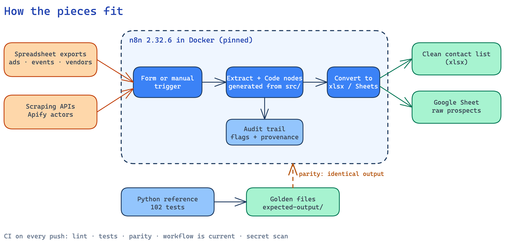
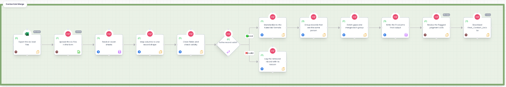

# GTM Engineering Learning Series

Learn go-to-market engineering by building it: sourcing, cleaning, enrichment, scoring, outreach, routing, retention and attribution. Each project states a business question, shows how it was answered, and says plainly **where it fails**. Several of the most useful results are negative: a model that does not beat a simple rule, or a score that looked excellent only because it used information from the future.

**Live site:** https://backend-bytes127.github.io/gtm-engineering-learning-series/

[](https://github.com/backend-bytes127/gtm-engineering-learning-series/actions/workflows/ci.yml)

[Learning path](#learning-path) · [Projects](#projects) · [What the data taught](#what-the-data-taught) · [Industry GTM guides](docs/industry-guides/README.md) · [Roadmap](docs/roadmap.md)

## Learning path

Before building anything, write down how the work happens today: the systems, who does each step, where the data lives and what breaks. Each newer project has a `docs/process.md` table you can use as a template.

| Stage | Question | Study | You should be able to explain |
|---|---|---|---|
| 1. Source | Who should we sell to? | [01](projects/01-linkedin-icp-scraper/) · [Industry guides](docs/industry-guides/README.md) | An ideal customer profile, buying committee and buying signals |
| 2. Clean | Can we trust the list? | [02](projects/02-contact-list-merge/) · [04](projects/04-contact-cleaning-app/) | Entity resolution, false merges, safe CRM updates |
| 3. Enrich | What does missing data cost? | [16](projects/16-enrichment-waterfall/) · [19, in Clay](projects/19-clay-playbook/) | Waterfalls, idempotency, spend caps, run conditions |
| 4. Prioritise | Who first? Does the score beat a rule? | [17](projects/17-signal-fit-scoring/) · [07](projects/07-pql-scorer/) | Point-in-time data, leakage, baselines, calibration |
| 5. Reach out | How do we contact people safely? | [03](projects/03-outreach-sequencer/) | Approval gates, send limits, stop requests, deliverability limits |
| 6. Automate | How does a signal reach a person? | [20](projects/20-gtm-automation-hub/) | Webhook signatures, replay protection, deduplication, dead letters |
| 7. Retain | Who is slipping away? | [11](projects/11-churn-alert-system/) | Gross and net revenue retention, churn definitions, weekly capacity |
| 8. Measure | What caused revenue? | [09](projects/09-attribution-engine/) | Why attribution is not causation, and how to test with a holdout |

Two exercises link the projects: check an ideal customer profile against **retention** as well as wins (17 with 11), and design one do-not-contact list shared by every channel (03 with 20). Each project uses a different dataset about a different business, so they are not one company's funnel.

**Not covered yet:** CRM data model and governance, Salesforce, e-mail deliverability infrastructure, and process costing.

## Projects

| # | Project | Data | What it shows |
|---|---|---|---|
| 01 | [LinkedIn ICP Scraper](projects/01-linkedin-icp-scraper/) | Live run, not reproducible from the repo | ICP to keyword matrix to a sheet. No automated tests; read its compliance note first |
| 02 | [Contact List Merge](projects/02-contact-list-merge/) | Synthetic sample | Cleaning and de-duplication in Python and n8n, with the same output on the tested data |
| 03 | [Outreach Sequencer](projects/03-outreach-sequencer/) | Synthetic sample | Sequencing with approval gates, send limits and stop rules; sending is simulated by default |
| 04 | [Contact Cleaning App](projects/04-contact-cleaning-app/) | Synthetic sample | Web app over 02 with a CRM change preview; the HubSpot push is untested against a live account |
| 07 | [Product-Qualified Lead Scoring](projects/07-pql-scorer/) | Real web-shop events (non-commercial licence), not a B2B trial | Scoring 30 minutes after first visit, leakage, routing, experiment design |
| 09 | [Multi-Touch Attribution](projects/09-attribution-engine/) | Synthetic world with known true effects | Eight ways of splitting credit, tested against what marketing really caused |
| 11 | [Revenue Retention and Churn Alerts](projects/11-churn-alert-system/) | Real wholesale-heavy retail transactions, not SaaS | SQL retention that reconciles, time backtest, weekly action queue |
| 16 | [Enrichment Waterfall](projects/16-enrichment-waterfall/) | Synthetic providers | Never paying twice or passing a spend cap |
| 17 | [Account Scoring with a Backtest](projects/17-signal-fit-scoring/) | Real bank marketing records, consumer not B2B | Whether a score beats simple rules on later data |
| 19 | [Clay Playbook](projects/19-clay-playbook/) | A live Clay table of 25 companies; no row data published | Free formulas first, paid lookups only on rows that qualify, measured credit cost |
| 20 | [Signal-to-Action Hub](projects/20-gtm-automation-hub/) | Synthetic payloads | Local n8n workflows with signed webhooks and approvals; Slack tested against a fake only |

Projects 02 to 04, 07, 09, 11, 16, 17 and 20 have automated tests that run in CI.

## What the data taught

Figures come from each project's own report; read its limits before quoting them.

- **A model did not clearly beat a rule.** In [17](projects/17-signal-fit-scoring/), on later data, the top 10% of the model's list won 1.58 times as often as average and a simple points rule 1.61 times. In [11](projects/11-churn-alert-system/), the model flagged churn with 56.6% precision and an "overdue" rule with 54.6%, a gap within the uncertainty.
- **Leakage makes bad models look brilliant.** Using information from after the decision point raised one score from 0.81 to 0.99 in [07](projects/07-pql-scorer/) and from 0.57 to 0.90 in [17](projects/17-signal-fit-scoring/).
- **Timing can matter more than the model.** In [07](projects/07-pql-scorer/), 59% of eventual buyers had already bought before the 30-minute score existed.
- **Attribution hands out credit it cannot justify.** In the synthetic world of [09](projects/09-attribution-engine/), marketing caused 3,430 conversions, while the methods credited channels with 7,923. Only a holdout showed that one channel had no effect.
- **Automation fails under repeats.** In one local test in [20](projects/20-gtm-automation-hub/), 20 identical parallel requests produced 20 alerts with n8n's default settings and 1 with a concurrency limit of 1.

### Next up

Specs only: no code yet.

| # | Project | What it will do |
|---|---|---|
| 05 | [Intent Webhook Router](projects/05-intent-webhook-router/) | Turn buying signals into routed alerts (20 covers the webhook part) |
| 06 | [AI Research Agent](projects/06-ai-sdr-research-agent/) | Account research with evaluation, tracing and cost per run |
| 18 | [GTM MCP Server](projects/18-gtm-mcp-server/) | Let an AI assistant run enrichment, scoring and cleaning safely |
| 08 · 10 · 12-15 | [See the roadmap](docs/roadmap.md) | Usage metering, call coaching, QBRs, dark social, competitor watch, teardown |

## How the pieces fit



*Editable source: [`platform-overview.excalidraw`](docs/diagrams/platform-overview.excalidraw) (open in excalidraw.com).*

Two ideas run through the whole repo:

1. **Workflows are generated, not hand-edited.** Logic lives in readable, testable source files. A build script assembles the n8n Code nodes from them, so the workflow JSON is a build artifact that CI can verify is up to date.
2. **Code is tested against a reference.** For project 02, a Python reference produces golden output; the n8n JavaScript gives the same output on the tested data, and an end-to-end test runs the workflow in a clean container. The golden file is the pipeline's own output, so it catches regressions; it does not measure matching accuracy. Project 01 has no tests, and live deployments are not covered by tests.

## Quick start

Prerequisites: Python 3.10+, Node 20+, Docker (only for the n8n steps).

```bash
git clone https://github.com/backend-bytes127/gtm-engineering-learning-series.git
cd gtm-engineering-learning-series

make install      # Python test dependencies
make check        # lint + tests + build workflows + JS/Python parity + secret scan (what CI runs)
make sequencer-demo  # project 03: the whole outreach pipeline on sample data (no n8n, no keys)
make contact-app     # project 04: the contact cleaning web app (CRM preview only)

make up           # start a local n8n (pinned image) on http://localhost:5678
make e2e          # import Contact List Merge, submit the real form, compare to golden output
make down
```

`make help` lists every target. To run the merge on your own exports, open the form at `http://localhost:5678/form/contact-merge-form-0001`, upload the six files, then download `Final_Contact_List.xlsx` from the latest execution (see [project 02](projects/02-contact-list-merge/README.md#run-it)).

## Workflow maps

Process maps of both workflows (who does what, with which tool, where the forks are) are in [`docs/workflows/`](docs/workflows/README.md).



## Repository map

```
.
├── projects/
│   ├── 01-linkedin-icp-scraper/     ICP design, keyword matrix, scraper workflow, docs
│   ├── 02-contact-list-merge/       reference build (Python), n8n source (JS), workflow, sample data, golden files, guide
│   ├── 03-outreach-sequencer/       import, validate, sequence, personalise, gate, simulated send, track, report
│   ├── 04-contact-cleaning-app/     web app over project 02: upload, clean, consolidate, CRM preview and push
│   ├── 07, 09, 11, 16, 17          scoring, attribution, retention and enrichment
│   ├── 19, 20                      Clay playbook and Slack/n8n automation hub
│   └── other numbers               specs for projects not built yet
├── docs/
│   ├── roadmap.md, research.md      what comes next and why
│   ├── architecture.md              platform design, build pipeline, testing strategy
│   ├── n8n-operations.md            import/export/publish, reading execution data, known gotchas
│   └── adr/                         architecture decision records
├── infra/docker-compose.yml         pinned local n8n
├── scripts/check_no_secrets.py      repo-wide secret / identifier scanner (pre-commit + CI)
├── .github/workflows/ci.yml
└── Makefile
```

## Engineering practices

| Practice | Where |
|---|---|
| Specification traced to code and tests | [Rules traceability matrix](projects/02-contact-list-merge/docs/rules-traceability.md) |
| Golden-file regression test | `pipeline/tests/test_golden.py` + `expected-output/` |
| Two implementations, one behavior | Python reference vs n8n JavaScript, `make parity` |
| End-to-end test in a clean container | `make e2e` (fresh volume, pinned n8n image) |
| Decisions recorded with context and trade-offs | [`docs/adr/`](docs/adr/README.md) |
| Generated artifacts verified in CI | CI rebuilds the workflow JSON and fails on a diff |
| Secret and identifier scanning | `scripts/check_no_secrets.py`, run on every commit and in CI |
| Sanitized workflow exports | [`sanitize_n8n_export.py`](projects/01-linkedin-icp-scraper/scripts/sanitize_n8n_export.py) strips instance metadata and service ids |
| Pinned infrastructure | `n8nio/n8n:2.32.6` |

## Data and privacy

- `sample-data/` is a small **synthetic** sample produced by a script; every person and company in it is invented. The instructor-provided dataset the project was first built on is **not included**, and a [README](projects/02-contact-list-merge/sample-data/README.md) describes how that kind of data looks in Excel.
- Screenshots in the docs have person-identifying regions pixelated.
- No credentials, tokens, OAuth client secrets or personal identifiers are committed. Workflow exports are sanitized and credentials are referenced by name only (re-create them in your own n8n). See [SECURITY.md](SECURITY.md).
- Commit authorship uses the GitHub noreply address.

## Credits

Project 02 was built against an instructor-provided exercise (six synthetic lead exports, an output template and a rules tab). That material is **not redistributed here**. The repository contains only original code, tests, workflows and documentation, plus a small synthetic sample generated by `make_sample_data.py` that mirrors the exports' structure.

## Roadmap

The full list, priorities and shared stack are in [docs/roadmap.md](docs/roadmap.md). [docs/research.md](docs/research.md) records the web and GitHub research behind projects 16 to 18 and links open-source work worth studying.

## License

Code and original text: [MIT](LICENSE). **Exception:** material derived from non-commercial datasets is not covered by MIT. See [NOTICE.md](NOTICE.md), which also credits the data sources.
