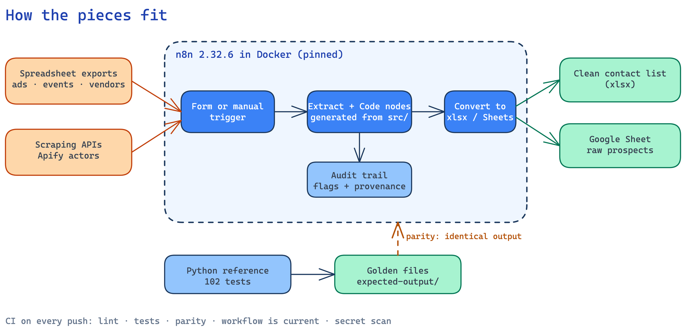
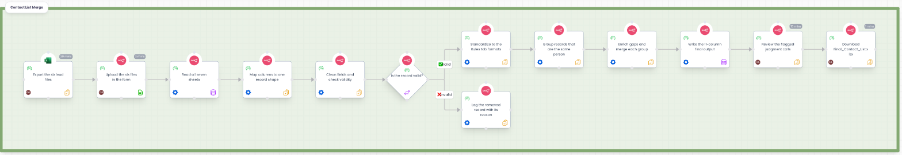

# GTM Engineering Learning Series

Hands-on go-to-market engineering projects, built as real, tested, reproducible systems rather than slide-deck demos. Each project takes a realistic GTM data problem (prospecting, lead hygiene, enrichment) and solves it with an automation stack (n8n, scraping APIs, spreadsheets) plus the software-engineering discipline you would apply to production code: specs traced to tests, golden files, parity checks, pinned infrastructure, architecture decision records and secret scanning.

**Live site:** https://backend-bytes127.github.io/gtm-engineering-learning-series/ (landing page and the Project 02 build guide)

[](https://github.com/backend-bytes127/gtm-engineering-learning-series/actions/workflows/ci.yml)

## Projects

| # | Project | Problem | Stack | Proof it works |
|---|---|---|---|---|
| 01 | [LinkedIn ICP Scraper](projects/01-linkedin-icp-scraper/) | Turn an Ideal Customer Profile into a keyword matrix and pull matching LinkedIn profiles into a sheet | n8n, Apify, Google Sheets API | 15 searches, 255 profiles, about $0.40 per full run |
| 02 | [Contact List Merge](projects/02-contact-list-merge/) | Merge 6 messy lead exports (ads, event, LinkedIn, scraper, Apollo, ZoomInfo) into one clean, de-duplicated contact list | n8n, JavaScript, Python reference build | built and verified on a 292-row instructor dataset (90 people out; dataset not included) and a bundled synthetic sample (37 rows, 12 people); 102 tests, 98% coverage, n8n output identical to the Python reference |
| 03 | [Outreach Sequencer](projects/03-outreach-sequencer/) | Take a clean contact list through a multi-step email and LinkedIn sequence, with validation, personalised and approved messages, send limits and stop rules, and a results report | Python, SQLite, openpyxl (sending is simulated) | 36 rows → 26 valid → 25 launched; rules proved over a 60-day simulated run; 475 tests, 98% coverage, report numbers recounted independently from SQL |
| 04 | [Contact Cleaning App](projects/04-contact-cleaning-app/) | A web app around Project 02: upload the lead exports, clean, standardize and consolidate them, then preview and (when switched on) push the result to HubSpot | Python, standard-library server, JavaScript, openpyxl | 37 rows → 12 people → 12 contacts and 5 companies planned for the CRM; 56 tests, 96% coverage; push off by default |

More projects will be added as the series continues; see the [roadmap](#roadmap).

## How the pieces fit



*Editable source: [`platform-overview.excalidraw`](docs/diagrams/platform-overview.excalidraw) (open in excalidraw.com).*

Two ideas run through the whole repo:

1. **Workflows are generated, not hand-edited.** Logic lives in readable, testable source files. A build script assembles the n8n Code nodes from them, so the workflow JSON is a build artifact that CI can verify is up to date.
2. **Every claim has a test.** A Python reference implementation produces golden output; the n8n JavaScript is proven identical to it, and an end-to-end test runs the real workflow in a clean container.

## Quick start

Prerequisites: Python 3.10+, Node 20+, Docker (only for the n8n steps).

```bash
git clone https://github.com/backend-bytes127/gtm-engineering-learning-series.git
cd gtm-engineering-learning-series

make install      # Python test dependencies
make check        # lint + tests + build workflows + JS/Python parity + secret scan (what CI runs)
make sequencer-demo  # project 03: the whole outreach pipeline on sample data (no n8n, no keys)
make contact-app     # project 04: the contact cleaning web app (CRM preview only)

make up           # start a local n8n (pinned image) on http://localhost:5678
make e2e          # import Contact List Merge, submit the real form, compare to golden output
make down
```

`make help` lists every target. To run the merge on your own exports, open the form at `http://localhost:5678/form/contact-merge-form-0001`, upload the six files, then download `Final_Contact_List.xlsx` from the latest execution (see [project 02](projects/02-contact-list-merge/README.md#run-it)).

## Workflow maps

Process maps of both workflows (who does what, with which tool, where the forks are) are in [`docs/workflows/`](docs/workflows/README.md).



## Repository map

```
.
├── projects/
│   ├── 01-linkedin-icp-scraper/     ICP design, keyword matrix, scraper workflow, docs
│   ├── 02-contact-list-merge/       reference build (Python), n8n source (JS), workflow, sample data, golden files, guide
│   ├── 03-outreach-sequencer/       import, validate, sequence, personalise, gate, simulated send, track, report
│   └── 04-contact-cleaning-app/     web app over project 02: upload, clean, consolidate, CRM preview and push
├── docs/
│   ├── architecture.md              platform design, build pipeline, testing strategy
│   ├── n8n-operations.md            import/export/publish, reading execution data, known gotchas
│   └── adr/                         architecture decision records
├── infra/docker-compose.yml         pinned local n8n
├── scripts/check_no_secrets.py      repo-wide secret / identifier scanner (pre-commit + CI)
├── .github/workflows/ci.yml
└── Makefile
```

## Engineering practices

| Practice | Where |
|---|---|
| Specification traced to code and tests | [Rules traceability matrix](projects/02-contact-list-merge/docs/rules-traceability.md) |
| Golden-file regression test | `pipeline/tests/test_golden.py` + `expected-output/` |
| Two implementations, one behavior | Python reference vs n8n JavaScript, `make parity` |
| End-to-end test in a clean container | `make e2e` (fresh volume, pinned n8n image) |
| Decisions recorded with context and trade-offs | [`docs/adr/`](docs/adr/README.md) |
| Generated artifacts verified in CI | CI rebuilds the workflow JSON and fails on a diff |
| Secret and identifier scanning | `scripts/check_no_secrets.py`, run on every commit and in CI |
| Sanitized workflow exports | [`sanitize_n8n_export.py`](projects/01-linkedin-icp-scraper/scripts/sanitize_n8n_export.py) strips instance metadata and service ids |
| Pinned infrastructure | `n8nio/n8n:2.32.6` |

## Data and privacy

- `sample-data/` is a small **synthetic** sample produced by a script; every person and company in it is invented. The instructor-provided dataset the project was first built on is **not included**, and a [README](projects/02-contact-list-merge/sample-data/README.md) describes how that kind of data looks in Excel.
- Screenshots in the docs have person-identifying regions pixelated.
- No credentials, tokens, OAuth client secrets or personal identifiers are committed. Workflow exports are sanitized and credentials are referenced by name only (re-create them in your own n8n). See [SECURITY.md](SECURITY.md).
- Commit authorship uses the GitHub noreply address.

## Credits

Project 02 was built against an instructor-provided exercise (six synthetic lead exports, an output template and a rules tab). That material is **not redistributed here**. The repository contains only original code, tests, workflows and documentation, plus a small synthetic sample generated by `make_sample_data.py` that mirrors the exports' structure.

## Roadmap

- Idempotent sheet writes for the scraper (upsert on profile id) and scheduled runs
- Email enrichment and verification waterfall
- Scoring and routing of the merged contact list
- Move the entity-resolution step to blocking + similarity scoring for larger lists

## License

[MIT](LICENSE)
