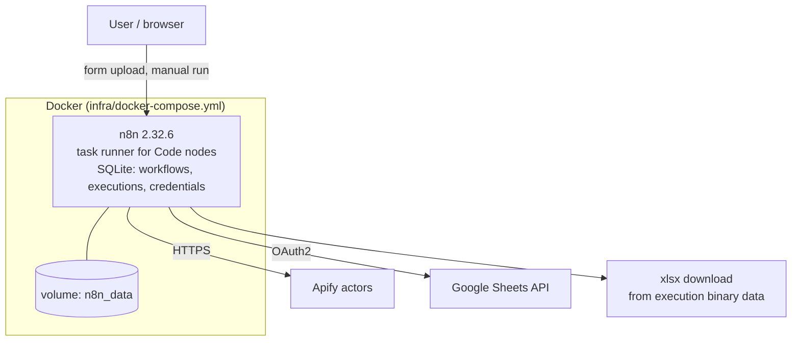
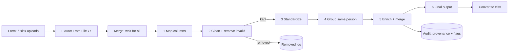
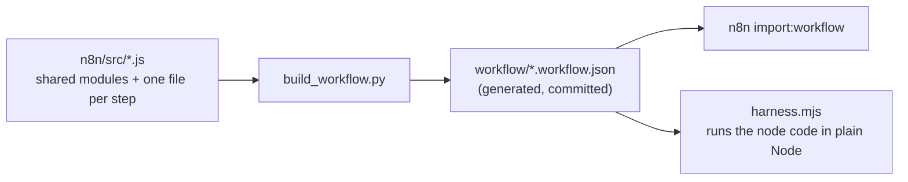

# Architecture

This document describes the platform every project in the series runs on, and the engineering approach shared across projects. Project-specific design lives in each project's own `README.md` and `docs/`.

## 1. Runtime

| Component | Choice | Reason |
|---|---|---|
| Orchestrator | n8n (self-hosted, pinned `2.32.6`) | Visual, inspectable data at every node; webhook/form triggers; credential store |
| Compute | n8n Code nodes (JavaScript, "run once for all items") | Whole-dataset operations such as de-duplication need all items at once |
| Persistence | n8n's SQLite in a named volume | Zero setup for a learning environment; executions retain per-node data for debugging |
| External data | Apify actors (scraping), Google Sheets (storage) | Pay-per-use scraping without a LinkedIn session cookie; a sheet is the lowest-friction sink for GTM teams |
| Reference build | Python 3 + openpyxl | Fast to test; independent of n8n |

### Code node constraints that shape the design

- A Code node is **one self-contained script**. It cannot `import` local files, and `require` is restricted to modules the instance allows (the compose file allows none beyond n8n's defaults). Consequence: shared helper code is *inlined* into each node at build time (section 3).
- There is **no filesystem access** from the sandbox and the container does not mount the host. Consequence: data enters through a **form upload** (binary properties), not "read file from disk" ([ADR-0002](adr/0002-input-via-form-upload.md)).
- Items are JSON. Anything passed between nodes must be serializable; classes and `Map`/`Set` do not survive a node boundary, so each stage emits plain objects.
- The reader behind **Extract From File** is SheetJS. It has quirks worth knowing: a string `range` such as `A5` is read as a single cell (use a numeric row offset), and 4-byte emoji are decoded into private-use characters.

## 2. Data flow (Project 02 as the reference example)

Design principles visible here:

- **One concern per node.** Each node maps to a step in the task specification, so a failure localizes immediately and an operator can open any node to see its input and output.
- **Provenance is data.** Merged rows carry `_merged_from` (the exact source rows) and `_flags` (review notes) through to the audit node. Nothing is merged without a trace.
- **Rejects are first-class.** Invalid rows are routed to a log branch with a reason instead of being silently dropped.

## 3. Build pipeline: source of truth is not the workflow JSON

`build_workflow.py` concatenates, for each Code node, the shared modules it needs followed by that step's file, and assembles nodes and connections. Node ids are derived from a stable hash of the node name so rebuilds are byte-for-byte reproducible (Python's built-in `hash()` is salted per process and would churn the diff). CI rebuilds the JSON and fails if it differs from what is committed.

Two build modes:

- `standalone` writes a workflow containing only the project's nodes (what the repo ships).
- `combined` appends the nodes to another workflow's canvas (how Project 02 was originally deployed inside Project 01's workflow in a live instance).

## 4. Testing strategy

| Layer | What it proves | Tool | Command |
|---|---|---|---|
| Unit | Each normalizer and merge rule behaves, including edge cases | pytest | `make test` |
| Property of the output | Every output cell satisfies the format rules (E.164, root domain, size bucket, no leaked noise); no duplicate identities | pytest on the real output | `make test` |
| Golden file | The whole pipeline output equals the committed expected output, cell for cell | pytest | `make test` |
| Parity | The JavaScript that runs in n8n equals the Python reference, on the real data | Node harness + diff | `make parity` |
| End to end | A real n8n container imports the workflow, accepts a real form upload, and produces the golden output | Docker + stdlib script | `make e2e` |
| Static | Lint, secret/identifier scan | ruff, `check_no_secrets.py` | `make lint secrets` |

The parity harness runs the *generated* `jsCode` strings (not the source modules) behind a small emulation of n8n's `$input` and `$()` globals. That makes it test what n8n will execute. It is not a substitute for `make e2e`: the first real n8n run of Project 02 exposed two defects the harness could not see because they live in n8n's own nodes (the Extract From File range semantics, and emoji decoding). Both are documented in [n8n-operations.md](n8n-operations.md#known-gotchas) and now covered by the e2e test.

## 5. Environments and configuration

| Concern | Mechanism |
|---|---|
| Image version | Pinned in `infra/docker-compose.yml` |
| Secrets | `.env` (git-ignored) for the n8n encryption key; service tokens only in the n8n credential store |
| Port | `N8N_HOST_PORT` (default 5678) |
| Timezone | `TZ` (default UTC). Date parsing in Project 02 does not depend on it |
| Workflow identity | Fixed ids (`contactListMerge01`, form path `contact-merge-form-0001`) so URLs and tests are stable |

## 6. Adding a project

1. Create `projects/NN-name/` with README, `workflow/`, data, and tests.
2. If it has non-trivial logic, write it as modules under `n8n/src/`, build with a script like `build_workflow.py`, and keep a reference implementation or golden file.
3. Sanitize any exported workflow (`scripts/sanitize_n8n_export.py` in Project 01 is reusable).
4. Add Make targets, a CI job, and an ADR for any significant decision.
5. Add the project to the root README table.
