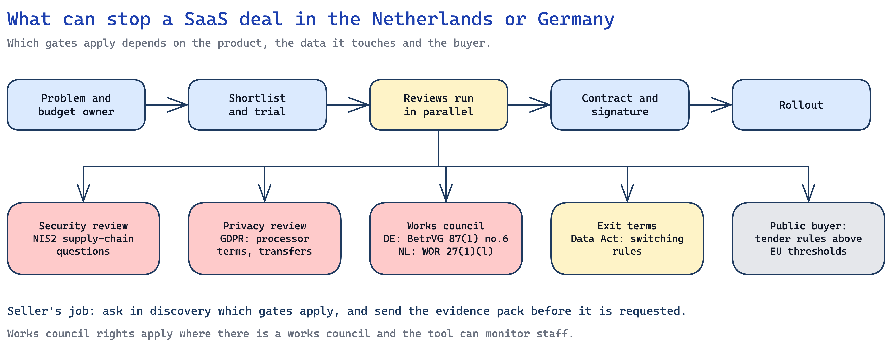
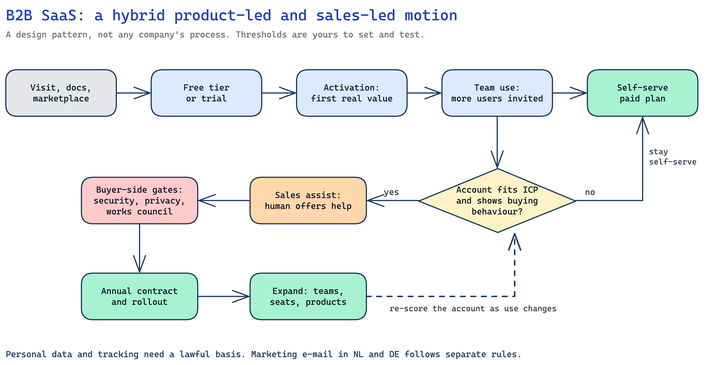
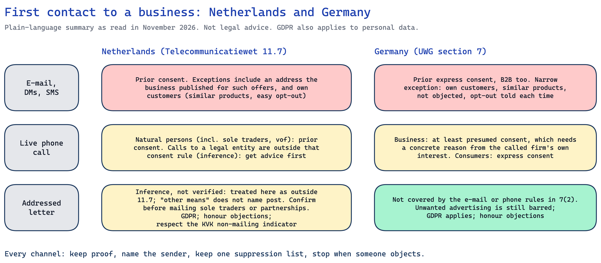

# Industry guide: horizontal B2B SaaS and product-led growth (EMEA, with the Netherlands and Germany in focus)

**For:** people learning GTM engineering, and candidates preparing for B2B SaaS roles in EMEA.
**Status:** facts checked on 26 November 2026. Rules and market figures change. Re-check before you use them.
**Not legal advice.** The sections on law are a learner's plain-language summary. Ask a qualified lawyer before you run a campaign or sell on the strength of a regulation.

## How to read this guide

- A number in brackets points to the [source list](#sources). Every source was opened for this guide.
- **Inference** means a conclusion drawn from the cited facts. No source states it.
- **Assumption** means a number or rule chosen so that an example can run. Replace it with your own evidence.
- Playbooks, tiers, plans, sample copy and metric trees are **proposed designs** that use common GTM methods. They do not describe how any company works inside.

## 1. Market definition and segments

**Working definition for this guide:** subscription software, hosted by the vendor, sold to organisations, and useful across many industries. Examples are collaboration, CRM, HR, finance operations, IT service management, analytics and developer tools. "Horizontal" separates it from software built for one industry.

This definition is narrower than most market reports. Many reports count consumer-like subscriptions, industry-specific software or related services. Always read the scope before you quote a size.

Segment by **how the product can be bought**, not only by company size:

| Segment (proposed) | Typical entry | Who decides | Motion that usually fits (inference) |
|---|---|---|---|
| Individual or small team | Free tier, trial, card payment | The user or team lead | Self-serve |
| Mid-market (about 50 to 249 staff) | Trial, referral, partner, inbound | Function head, IT, finance | Self-serve plus sales assist |
| Enterprise (250 staff or more) | Existing team use, partner, outbound, tender | A buying group | Sales-led, often fed by product use |
| Public sector | Tender or framework | Procurement and the user body | Tender-led, often with a reseller |

The 50 and 250 staff cut-offs match the size classes in the Eurostat data used in section 13 [25][26]. They are not a law of selling.

### Cloud adoption: how ready is the base?

Share of enterprises that bought paid cloud services in 2025 [25]:

| Enterprise size (persons employed) | Netherlands | Germany | EU-27 |
|---|---|---|---|
| 10 or more | 68.5% | 53.9% | 52.7% |
| 10 to 49 | 64.5% | 50.7% | 49.3% |
| 50 to 249 | 82.5% | 65.2% | 66.8% |
| 250 or more | 90.8% | 85.6% | 84.7% |

The survey covers enterprises with at least 10 persons in selected sectors (NACE C to J, L to N and group 95.1) [27]. Across the EU, the most common cloud purchases were e-mail (85.2% of cloud users), office software (71.7%) and file storage (71.5%). CRM was at 27.9% and ERP at 30.1% [27]. **Inference:** buying cloud e-mail does not show that a firm is ready to buy your category. Treat adoption as a weak first filter.

## 2. Market size: what the numbers say and why they disagree

| Figure | Source and year | What it measures | Caveat |
|---|---|---|---|
| Europe SaaS: USD 60.04 billion in 2025 (19% of a USD 315.68 billion world market) | Fortune Business Insights [28] | SaaS, as that firm defines it | The public page gives no formal definition |
| Europe SaaS: USD 97.98 billion in 2025; USD 109.84 billion projected for 2026 | Precedence Research [29] | SaaS split by deployment, enterprise size, software and services, application and industry | Includes a services component |
| Europe IT spending: USD 1.286 trillion in 2025, USD 1.428 trillion forecast for 2026; public cloud services forecast to grow 24% in 2026 | Gartner forecast, as reported by Petri, November 2025 [30] | All IT spending; public cloud is wider than SaaS | Secondary report of a forecast that Gartner may since have revised |
| Europe sovereign cloud IaaS: USD 6.9 billion in 2025, USD 12.6 billion forecast for 2026 | Gartner forecast, as reported by Computerworld, February 2026 [31] | Infrastructure only, not SaaS | Shows a demand theme, not your market |

The two SaaS estimates for the same year differ by about USD 38 billion; the higher one is about 63% above the lower one (calculated from [28] and [29]). Neither public page lets you reconcile them. **What to do with this:**

1. Never average them.
2. In an interview or a plan, give the range, name both sources, and say that scope differs or is unclear.
3. For any decision about your own product, use a bottom-up count (section 13). Top-down SaaS totals include thousands of categories that you do not sell.

## 3. How buyers buy

### Survey evidence

- A Gartner survey of 646 B2B buyers (August and September 2025) found that 67% preferred a buying experience without a sales representative, and 45% had used AI during a recent purchase [32]. This is read here through a trade-press report.
- 6sense surveyed 945 buyers in Belgium, France, Germany, the Netherlands and Sweden. Each had been directly involved in a purchase of at least USD 25,000 in the past two years [33].

| 6sense 2025 averages [33] | Netherlands | Germany | Five-country average |
|---|---|---|---|
| People in the buying group | 11 | 11 | 9.2 |
| Buying cycle | 13 months | 11 months | 9.8 months |
| Vendors evaluated | 5.1 | 5.3 | 4.6 |

Read these with care. They describe **larger purchases** (the page puts the average European purchase in the mid-to-high USD 200,000s), the vendor sells buying-signal software, and the page does not give per-country sample sizes. Do not apply a 13-month cycle to a EUR 5,000 team plan.

**Inference:** a preference for rep-free buying does not mean buyers need no help. It suggests you should let people evaluate without a meeting (pricing, documentation, trial, security answers) and make human help easy to get.

### The buying committee (proposed model)

| Role | What they need | Common objection | Evidence to prepare |
|---|---|---|---|
| End user or champion | The job gets easier | "Another tool" | Short trial path, templates, migration help |
| Function head (budget owner) | A business result | "Not this year" | Baseline, target, time to value |
| IT or platform owner | Fits identity and data stack | "We already have this in our suite" | SSO, SCIM, API, integration list |
| Security | Acceptable risk | "Send us your evidence" | Certifications you really hold, pen-test summary, incident process |
| Privacy or data protection officer | Lawful processing | "Where does the data go?" | Processing agreement, sub-processor list, transfer basis, retention |
| Finance | Predictable cost | "Seat sprawl" | Price model, caps, renewal terms |
| Procurement | Comparable terms | "Your standard terms are not acceptable" | Fallback clauses, exit terms |
| Works council | Staff are protected | "This can monitor people" | Data fields, reports, access roles, what is switched off |
| Executive sponsor | Fits strategy | "Why now?" | One-page case with risks |

### Works councils: the gate sellers often miss

- **Germany.** Unless a law or collective agreement already settles the matter, the works council has a right of co-determination on introducing and using technical equipment designed to monitor employees' behaviour or performance. If employer and council cannot agree, a conciliation committee decides [15].
- **Netherlands.** The employer needs the works council's consent to adopt, change or withdraw a rule on facilities that are aimed at, **or suitable for**, observing or checking staff presence, behaviour or performance (Works Councils Act, article 27(1)(l)). A separate item, 27(1)(k), covers rules on processing staff personal data [16].

This applies where a works council exists and the matter is in scope. **Inference:** activity logs, per-user analytics, productivity dashboards and call recording can all bring a SaaS tool into the discussion. Ask in the first discovery call, and plan the time.



### Procurement, including public buyers

For contracting authorities under the general EU directive, the thresholds for 2026 and 2027 for supplies and most services are **EUR 140,000 for central government** and **EUR 216,000 for sub-central authorities**. Utilities have a separate threshold of EUR 432,000 [23]. Above the threshold, EU tender rules apply. National rules can govern contracts below it. Do not split or shape a deal to avoid a tender.

Private buyers have no single rule. Ask for the process in discovery: who signs, which reviews run, which can run in parallel, and which dates are fixed.

## 4. Regulation that changes demand or deals

Status as read on 26 November 2026. "Why it matters" is **inference**.

| Rule | Dates and status | Why it matters for B2B SaaS |
|---|---|---|
| **GDPR** | In application. An EU "digital omnibus" proposal would amend it. A tracker checked on 28 October 2026 showed a Council negotiating mandate, no Parliament position and no talks between them: **not law** [7][8] | Sell on today's text |
| **Data Act** (Regulation (EU) 2023/2854) | Applies from 12 September 2025. For switching between data processing services, contracts must set a notice period of at most two months, a data retrieval period of at least 30 days, and a maximum transition period of 30 days (up to seven months where that is technically unfeasible). **From 12 January 2027 providers may not charge switching charges** [1]. The Commission has proposed some exemptions for small and mid-cap providers [7]; they were **not adopted** at the tracker's check date [8] | If you sell a data processing service, review contracts, export and exit. Multi-year pricing that relies on exit fees needs legal review |
| **AI Act**, as amended by Regulation (EU) 2026/1744 | The amendment was published on 24 July 2026 and enters into force on the third day after publication. High-risk duties in Chapter III, sections 1 to 3, now apply from **2 December 2027** (Annex III uses) and **2 August 2028** (AI covered through Annex I product law). The Act's general application date remains 2 August 2026, with specific later dates in the amendment [2] | Annex III includes AI for recruitment, and AI used to make decisions on work terms, to allocate tasks based on behaviour or traits, or to monitor and evaluate performance [3]. HR and workforce features need a classification check. Do not tell buyers that the whole Act was delayed |
| **NIS2, Netherlands** (Cyberbeveiligingswet) | In force since **15 August 2026**. Covers 18 sectors. Duties include registration, risk-management measures, incident reporting and board oversight and training [5] | Covered buyers ask suppliers more security questions |
| **NIS2, Germany** | Implementation law in force since **6 December 2025**. The federal cyber office (BSI) said it would supervise about 29,500 entities, up from about 4,500 [6] | Same. The directive's measures include supply-chain security for direct suppliers and service providers [4] |
| **Cyber Resilience Act** | Reporting duties since **11 September 2026**; main duties from **11 December 2027** [9]. It covers products with digital elements. Remote processing is in scope only where the product needs it to work and the manufacturer is responsible for it. The Act's recital says NIS2 applies to cloud services including SaaS, for medium-sized and larger providers [10] | A pure hosted SaaS product is not automatically a CRA product. A client app, agent or device with a required back end may bring parts into scope. Get advice |
| **German e-invoicing** (domestic B2B) | Businesses have had to be able to receive e-invoices since 1 January 2025. General transition for issuing runs to 31 December 2026; issuers with prior-year turnover up to EUR 800,000 have until the end of 2027 [11] | A dated trigger for finance, billing and ERP-adjacent tools. Check exceptions |
| **EU VAT in the Digital Age** | Digital reporting requirements, mainly for cross-border B2B, start 1 July 2030; domestic systems align by 1 January 2035 [12] | A longer roadmap theme for finance software |
| **Cookie and device access, Germany** (TDDDG section 25) | In application. Storing or reading information on a user's device needs consent, unless it only transmits a message or is strictly necessary for a service the user asked for [14] | Affects website tracking, product analytics and intent tools. EU guidance states the same ePrivacy consent principle for tracking [24] |

**Rule for outreach:** a regulation creates a reason to talk only if the account is in scope and has unfinished work. A message that implies a recipient is breaking the law, with no evidence, damages trust and may itself be misleading.

## 5. Publicly documented GTM motions

Only what each cited page says is stated as fact. The lessons are inference.

### 5.1 Atlassian: self-serve landing with sales and partners for expansion

Atlassian's fiscal 2026 annual report [34] says:

- It follows a product-led, land-and-expand model with low-touch service and transparent pricing for new customers and early expansion.
- Its self-serve "flywheel" relies mainly on word of mouth and low-touch demand generation. The website is the main route for landing and early expansion.
- A sales-led motion uses field sales, solution sales and channel partners to expand within enterprise customers. The direct sales force mainly works with the largest existing customers.
- Solution partners add deployment, customisation and local purchasing help, including currency, language and country compliance.
- Among its risks, it says that historically most users did **not** convert from free trials or limited free versions to paid products, and that its strategy also relies on those users influencing wider adoption.

**Lesson:** "product-led" and "sales-led" can sit in one company with different jobs. A free tier has a cost, and most free users may never pay.

### 5.2 TeamViewer: a German company reporting two segments

In its release on 2025 results (pro forma, constant currency) [35], TeamViewer reports:

- Enterprise annual recurring revenue (ARR) up 11% to EUR 241.0 million, and small-business ARR down 1% to EUR 518.7 million.
- About 631,000 small-business customers (down 5%) and about 5,300 enterprise customers (up 6%).
- From the third quarter of 2025, a suspension of short-term monetisation measures and price increases as a correction in the small-business segment.

**Lesson:** watch segments separately. A healthy total can hide a shrinking base. **Inference:** pressure on monetisation has a possible retention cost, so test paywall and price changes with guardrail metrics. The release alone does not prove cause.

### 5.3 Cloud marketplaces as a route to market

Microsoft's publisher FAQ says there is no listing fee and states a 3% standard service fee on purchases of transactable offers. Microsoft bills and collects under an agency model while the publisher sets price and terms and provides support. SaaS plans can be flat-rate, per-user or metered [36].

**Inference:** a marketplace can reduce new-supplier paperwork for a buyer already contracted with that cloud vendor. It does not create demand. The FAQ also says prepaid or sponsored Azure spend cannot be applied to partner solutions [36], so check each marketplace's current spend rules before you promise a buyer that commitments will count.

### 5.4 Choosing a motion

| Question | Points to self-serve | Points to sales-led |
|---|---|---|
| Can one person get value alone, quickly? | Yes | No, needs setup or data from others |
| Is the price within a team's own spending limit? | Yes | No |
| Does it touch sensitive or staff data? | Little | A lot |
| Does value spread through invites or shared output? | Yes | No |
| Does the buyer need integration or change work? | Little | A lot, often with a partner |

Most real cases are mixed. A common design:



**Product-qualified account (proposed definition):** an account that (a) fits the ICP, (b) has reached activation, and (c) shows one buying behaviour, such as several active users, repeated use of a paid-only feature, a visit to security or enterprise pricing pages, or a direct request. Define it in writing, test it against later paid conversion by time period, and compare it with a simple baseline such as "any account with three or more active users".

Using product data to prompt a sales contact is still processing of personal data. Tell users in your privacy notice, choose a lawful basis, offer objection, and do not use a customer's content for prospecting.

## 6. ICP and tiering

Define the ideal customer profile from **your own won, lost and churned accounts**. Before you have that data, write hypotheses and label them.

**Example product used in this guide:** a hypothetical workflow tool that routes internal requests (approvals, purchases, access) across teams.

| Dimension | Fit criterion (assumption) | Disqualifier |
|---|---|---|
| Size | 50 to 2,000 staff | Fewer than 20 |
| Work pattern | Several teams pass requests to each other | One-team workflow only |
| Stack | Uses a supported identity provider and chat tool | Requires on-premises only |
| Owner | A named operations or IT owner | Nobody owns the process |
| Language | Can adopt in a language you support | Needs a language you cannot support |
| Gates | You can pass the likely security and privacy review | Requires a certification you lack |

**Score (assumption, 0 to 100):** fit 50 (size 10, work pattern 20, stack 10, owner 10), behaviour 30, timing signal 20.

| Tier | Rule (assumption) | Treatment |
|---|---|---|
| 1 | Fit at least 40 of 50, and behaviour or timing present | Named owner, account plan, multi-contact, partner check |
| 2 | Fit at least 30 | Content, events, lighter human follow-up when behaviour appears |
| 3 | Fit below 30 | Self-serve only |
| Excluded | Any disqualifier, objection or suppression | Do not contact for marketing |

Backtest the score: take accounts as they looked on a past date, score them using only what was known then, and compare later conversion by tier. If tier 1 does not beat a size-only rule, simplify.

## 7. Buying signals and where to get them legally

A signal is a reason to **research**, not permission to **contact**.

| Signal | Why it may matter | Lawful source | Limits |
|---|---|---|---|
| Activation and team spread in your product | Real use | Your own product data | Privacy notice, lawful basis, consent for device tracking where required [14][24] |
| Requests for security or processing documents | Review has started | Your trust page and inbox | Use for the stated purpose |
| Pricing or enterprise page visits | Evaluation | Your own analytics | Consent rules for cookies; do not claim to identify a person if you cannot |
| Hiring for a relevant function or system | New owner or project | The employer's own careers page; a job-data provider with a licence | Read site terms; avoid collecting applicant or recruiter personal data you do not need |
| Public tender or contract award | Budget and timing | TED [46]; TenderNed [47] | TED notices can contain personal contact data [46] |
| New legal entity, merger, new site | Change event | Official registers, company announcements | Register terms, see section 8 |
| Regulatory scope (for example NIS2 sector) | Possible workload | Company activity compared with the law [5][6] | Scope is not proof of need |
| Marketplace or integration-directory activity | Stack fit | Your own listing analytics; partner-shared data under agreement | Partner contract |

Record for every signal: source, date seen, confidence, expiry date, and the lawful basis if personal data is involved. **Assumption:** expire hiring signals after 90 days and evaluation behaviour after 30 days; tune from your data.

## 8. Data sources and their terms

| Source | Useful for | Terms read (summary) |
|---|---|---|
| Eurostat [25][26] | Market sizing | Statistical data may be reused commercially with attribution; some non-Eurostat data and data on some non-European countries are non-commercial only [42] |
| CBS (Statistics Netherlands) | Dutch statistics | Website content is CC BY 4.0 unless stated otherwise; attribution required; logo and some photos excluded [43] |
| Destatis and GENESIS-Online | German statistics | GENESIS data under "dl-de/by-2-0"; attribution required [44]; the licence allows commercial use and requires changes to be marked [45] |
| KVK (Dutch Business Register) | Verifying companies | KVK says the register is not, as a rule, meant for direct marketing, and lists targeted acquisition tools as outside its purposes. Its two open datasets are CC BY 4.0. Respect the non-mailing indicator for post and door-to-door marketing [39] |
| German Handelsregister | Verifying companies | The law allows anyone to inspect it for information through individual retrievals [40]. The portal's usage rules, as reproduced by a third-party project, bar more than 60 retrievals per hour and warn about automated mass queries [41]. Read the live terms; do not bulk scrape |
| TED | Public tenders | Notices can generally be reused for commercial and non-commercial purposes; personal data still falls under data protection law [46] |
| TenderNed datasets | Dutch tenders | Listed as CC0. The XML API needs credentials [47] |
| LinkedIn | Manual research | The user agreement (effective 3 November 2025) bans scraping tools, bots and unauthorised automation, including automated messaging [37] |
| GitHub | Developer-ecosystem research | Information may not be used to send users unsolicited e-mail or sold as personal information [38] |
| Commercial contact databases | Enrichment | Not reviewed here. Check the contract, data origin, EU suppression handling, audit rights and permitted uses |

An open licence on a dataset does not make every use of personal data lawful, and it does not give consent to send a message.

## 9. Outreach law: Netherlands and Germany (not legal advice)

Two layers apply. **Channel law** says whether you may send or call. **GDPR** says whether you may process the personal data. You need to pass both.



### 9.1 GDPR basics for prospecting

- The GDPR says direct marketing **may** be a legitimate interest [17]. EU data protection board guidance, version 2.0 adopted on 10 November 2026, stresses that this is not automatic: you must pass all three tests (a legitimate interest, necessity, and a balance against the person's rights). It says legitimate interest cannot be used where the marketing is unlawful, and that national law may require consent, including for marketing to professionals [24].
- The same guidance says intrusive profiling and tracking, such as following people across sites and services, would be very unlikely to pass the balance. Reasonable expectations matter [24].
- If you got personal data from somewhere other than the person, give the required information within a reasonable period and at most one month; if you use it to contact them, at the latest in the first communication. Other timing limits and exceptions exist [17].
- A person may object to direct marketing at any time. After that, you must stop processing their data for that purpose [17].

### 9.2 Netherlands: Telecommunications Act, article 11.7 [13]

- **E-mail and other electronic messages, automated calling and fax:** unsolicited commercial, idealistic or charitable messages are banned unless the sender can **prove prior consent**. This is not limited to consumers.
- **Business exception:** no prior consent is needed to a legal entity, or a person acting in business, if you use contact details that the recipient **designated and published for receiving such unsolicited messages**, and follow any purpose they attached. Do not assume that a general info@ address qualifies. A second exception covers recipients outside the European Economic Area, subject to local rules.
- **Existing customers:** details obtained in selling a product or service may be used for your own similar products or services, if you offered an easy, free objection when you collected them and in each message.
- **Other means, such as live calls, to natural persons:** the consent rule also applies. The regulator confirms that natural persons include sole traders and partnerships, and that from **1 July 2026** calling existing or former customers who are natural persons also needs prior explicit consent, with limited exceptions for newspaper and magazine publishers, charities and certain lotteries [18][19].
- **Legal entities and live calls:** the text extends the consent rule for other means only to natural persons [13]. **Inference:** a live call to a legal entity such as a BV is outside that consent rule. It is unclear from the sources read here how to treat a call to a named employee's own line. GDPR, objections and rules on aggressive practices still matter. Get advice.
- **Addressed post:** Inference, not verified: this guide treats post as outside article 11.7. The statute's wording 'other means' does not name post either way. Confirm with ACM guidance or counsel before mailing sole traders or partnerships.
- **Every electronic message** must show the real identity of the party it is sent for and a valid address or number for stopping messages [13].
- A government business portal states that the regulator can fine up to EUR 900,000 per violation of the spam ban [20].

### 9.3 Germany: Unfair Competition Act (UWG), section 7 [21]

- Advertising that unreasonably harasses is unlawful, including advertising that the recipient recognisably does not want.
- **E-mail, fax and automated calling:** prior express consent is required. This includes B2B.
- **Existing-customer exception for e-mail**, only if all conditions hold: you got the address from the customer in a sale; you advertise your own similar goods or services; the customer has not objected; and you clearly say, at collection and in each use, that they can object at any time at no more than basic transmission cost.
- **Phone:** consumers need prior express consent. Other market participants need at least **presumed consent**.
- The conference of German data protection authorities says that mere topical relevance is not enough for presumed consent: there needs to be a concrete reason based on the **called business's own interests**, for example an earlier business contact. It cites a Federal Court of Justice decision. It also says that if competition law does not permit the channel, there is no legitimate interest under GDPR for it [22]. The guidance dates from February 2022; check later case law.
- Messages must not hide the sender, must meet digital-services identification rules and must give a valid opt-out address [21].

### 9.4 Direct messages, connection requests and AI

EU guidance lists SMS, messenger and similar applications among the electronic channels that need prior consent for unsolicited marketing, subject to the legal exceptions and national rules [24]. **Inference:** do not treat a promotional direct message on a social network as a way around the e-mail rules. Platform terms also ban automated messaging on LinkedIn [37]. Using AI to write a message changes nothing about whether you may send it.

### 9.5 Operating controls (proposed)

1. A consent and exception record per contact: channel, wording, time, source and proof.
2. One suppression list shared by every tool and checked at send time.
3. Country rules in code: block by default when country, legal form or basis is unknown.
4. Human review before any new channel or country.
5. A tested objection path that works within the same day (assumption for an internal service level).

## 10. Channels, messaging angles and sample copy

| Channel | Role | Lawful use, in short |
|---|---|---|
| Product (free tier, trial, templates) | Evaluation without a meeting | Product messages needed to run the service are different from marketing |
| Search, documentation, comparison pages | Capture existing demand | Cookie consent where needed |
| Marketplaces and integration directories | Stack-based discovery, purchasing route | Marketplace terms |
| Partners and resellers | Local trust, rollout, public frameworks | Agree who may contact whom and how consent was obtained |
| Events and webinars | Consent and conversation | Ask for marketing consent separately and clearly; do not assume attendance is consent |
| Paid ads | Reach | Check targeting and tracking consent |
| Calls | Conversation | Only within the rules in section 9 |
| Addressed post | Reach without electronic-message consent | GDPR, objections, KVK indicator [39]. That post is outside Dutch article 11.7 is an unverified inference (section 9.2): check before mailing sole traders or partnerships |
| E-mail | Nurture and follow-up | Consent or a listed exception only |

**Angles** (match one to evidence you have):

| Angle | Use when | Proof to attach |
|---|---|---|
| Time to value | The user can try alone | A task and the measured time in your product |
| Spread already happening | Several teams use it | Aggregated usage the customer is entitled to see |
| Review-ready | Security and works council gates | Evidence pack: processing terms, data map, role settings |
| Exit-friendly | Buyer fears lock-in | Export formats and your switching process [1] |
| Dated change | The account is in scope and not ready | Official source and your specific help |

### Sample copy

All examples are for a fictional product, "Product". Use them only through a permitted channel. Replace every bracket with facts you can prove, and have a native speaker check Dutch and German copy.

**A. In-product prompt to a workspace admin (service context)**
> Three teams in your workspace now use request routing. Admins can set one approval policy for all of them. [See settings] [Not now]

**B. E-mail to a contact who opted in at a webinar (English)**
> Subject: The approval checklist from [date]
> You asked us to send product information after the session on [topic]. Here is the checklist. If your next step is a security or works council review, we can send our data map first, so reviewers can read it before any demo.
> [Sender name, legal entity, postal address] · Reply "stop" or use [link] and we will stop.

**C. Letter to an operations lead (German)**
> Betreff: Freigaben über mehrere Teams: eine Seite zur Prüfung
> Guten Tag [Name],
> wenn Freigaben bei Ihnen über mehrere Teams laufen, kann eine gemeinsame Übersicht helfen. Beigefügt ist eine Seite mit den Daten, die [Produkt] verarbeitet, und mit den Auswertungen, die sich abschalten lassen, auch für die Abstimmung mit dem Betriebsrat. Informationen finden Sie unter [Adresse].
> Herkunft Ihrer Daten und Ihre Rechte: [Datenschutzhinweis]. Sie können der Nutzung Ihrer Daten für Werbung jederzeit widersprechen: [Weg].

**D. Dutch e-mail to an existing customer (only if the existing-customer conditions are met)**
> Onderwerp: Een functie die past bij wat u al gebruikt
> Beste [naam],
> u gebruikt [huidig product]. [Nieuwe functie] hoort bij dezelfde dienst en helpt bij [taak]. Meer weten? [link]
> Geen berichten meer ontvangen? Meld u gratis af via [link]. Afzender: [bedrijfsnaam, adres].

**E. Call opener for a German business, only where a concrete reason supports presumed consent**
> "You asked at [event] how to move approvals off e-mail, and you said to ring about it. Is now a reasonable time? If you would rather not get calls, I will record that."

Do not write "I saw you visited our pricing page" to a person unless they would reasonably expect it and your tracking and use are lawful.

## 11. 30-60-90 day plan (for a new GTM engineer; proposed)

| Window | Work | Evidence of done |
|---|---|---|
| Days 1 to 30: understand | Map the funnel and data sources. Define account, user, activation, PQA, pipeline. Audit consent, suppression and tracking. Review 20 won, lost and churned accounts. Interview sales, success, product, security and privacy owners | One metric dictionary; a data-flow map; a risk list; baselines with dates |
| Days 31 to 60: build one loop | Account identity resolution (domain, legal entity, workspace). Fit tier v1. One PQA rule with a holdout. Route to an owner with a reason string. Evidence pack v1 | Routed accounts with reason, owner and outcome field; tests for suppression and country rules |
| Days 61 to 90: measure and decide | Compare PQA routing with the simple baseline and the holdout. Review false positives with sales. Add one signal only if it adds lift. Document failure handling | A written keep, change or stop decision with counts and uncertainty |

With few accounts, 30 days of follow-up will not show revenue effects. Report leading indicators and say what is still unknown.

## 12. Metrics tree (proposed)

```
North star: net new recurring revenue retained (define period and currency)
├── New recurring revenue
│   ├── Self-serve
│   │   ├── Qualified signups
│   │   ├── Activation rate (activated accounts / qualified signups, same cohort)
│   │   ├── Paid conversion (paid accounts / activated accounts, fixed window)
│   │   └── Average starting recurring revenue
│   └── Sales-assisted
│       ├── PQAs and sales-sourced qualified accounts (kept separate)
│       ├── Accepted rate and time to first response
│       ├── Opportunity rate, win rate, cycle length (median, by tier)
│       └── Average contract value
├── Expansion: seats, products, plan upgrades
├── Loss
│   ├── Logo churn
│   ├── Revenue churn and contraction
│   └── Gross and net revenue retention, by segment
└── Guardrails
    ├── Objections, complaints, unsubscribe and bounce rates
    ├── Sends blocked by consent and country rules (and any that slipped through: target zero)
    ├── Support load and cost to serve free users
    ├── Customer acquisition cost payback
    └── Review-gate time: security, privacy, works council
```

Rules: use cohorts, not mixed-period ratios; report counts beside rates; split by country and size; and never credit the programme with revenue that the holdout would also have produced.

## 13. Worked bottom-up TAM: the example workflow tool, Netherlands and Germany

**This is a teaching example, not a market estimate.** Only the company counts and cloud shares come from data.

**Formula**

```
TAM  = sum over (country, size) of  N x c x f x ACV
SAM  = TAM x r
```

| Symbol | Meaning | Value | Status |
|---|---|---|---|
| N | Enterprises, 2024 | table below | **Data** [26] |
| c | Share buying paid cloud services, 2025 | table below | **Data** [25], used as a stand-in for "cloud-ready" (**assumption**: the survey's sector scope differs from N, and years differ) |
| f | Share of cloud-ready firms with the problem and no good-enough existing answer | 50-249: 30%; 250+: 35% (range 15-45% and 20-50%) | **Assumption** |
| ACV | Annual contract value | 50-249: EUR 12,000; 250+: EUR 45,000 (range EUR 8,000-18,000 and 30,000-70,000) | **Assumption** |
| r | Share you can serve today (language, integrations, hosting) | 60% (range 40-75%) | **Assumption** |

N is the sum of NACE sections B to J and L to N, so it excludes finance, public administration, education, health and several other areas [26].

| Country and size | N [26] | c [25] |
|---|---|---|
| Germany, 50-249 | 54,159 | 65.19% |
| Germany, 250+ | 11,278 | 85.58% |
| Netherlands, 50-249 | 9,587 | 82.46% |
| Netherlands, 250+ | 2,056 | 90.83% |

**Base case output**

| Segment | Fitting accounts | TAM |
|---|---|---|
| Germany, 50-249 | 10,592 | EUR 127.1m |
| Germany, 250+ | 3,378 | EUR 152.0m |
| Netherlands, 50-249 | 2,372 | EUR 28.5m |
| Netherlands, 250+ | 654 | EUR 29.4m |

| Scenario (all assumptions move together) | Accounts | TAM | SAM |
|---|---|---|---|
| Low | 8,786 | EUR 121m | EUR 48m |
| Base | 16,995 | EUR 337m | EUR 202m |
| High | 25,205 | EUR 753m | EUR 565m |

The high TAM is about six times the low one. **The spread is the finding:** fit share and price matter more than the company count. The next job is to measure f (interviews and a sampled account review) and ACV (pricing tests and real quotes).

**What you could actually win** is limited by capacity, not by TAM. **Assumption:** 6 sellers, 18 new deals per seller per year, EUR 18,000 average, 88% of recurring revenue kept each year, no ramp time and no self-serve. The result after three years is about EUR 5.16m of annual recurring revenue. Ignoring ramp makes this optimistic.

**Change it yourself** (plain Python, no packages):

```python
# companies: Eurostat sbs_sc_ovw 2024, NACE sections B-J and L-N summed
N = {("DE","50-249"):54159, ("DE","250+"):11278, ("NL","50-249"):9587, ("NL","250+"):2056}
# paid cloud use: Eurostat isoc_cicce_use 2025
cloud = {("DE","50-249"):0.6519, ("DE","250+"):0.8558, ("NL","50-249"):0.8246, ("NL","250+"):0.9083}
# ASSUMPTIONS (low, base, high) -- replace with your own evidence
fit = {"50-249":(0.15,0.30,0.45), "250+":(0.20,0.35,0.50)}
acv = {"50-249":(8_000,12_000,18_000), "250+":(30_000,45_000,70_000)}
reach = (0.40,0.60,0.75)   # share you can serve today
for i, name in enumerate(["low", "base", "high"]):
    tam = sam = accts = 0
    for (c, s), n in N.items():
        a = n * cloud[(c, s)] * fit[s][i]
        v = a * acv[s][i]
        accts += a; tam += v; sam += v * reach[i]
    print(f"{name}: accounts={accts:,.0f} TAM=EUR {tam/1e6:,.0f}m SAM=EUR {sam/1e6:,.0f}m")

reps, deals, years, avg, keep = 6, 18, 3, 18_000, 0.88   # ASSUMPTIONS
arr = 0
for _ in range(years):
    arr = arr * keep + reps * deals * avg
print(f"capacity-based ARR after {years} years: EUR {arr/1e6:,.2f}m")
```

## 14. Risks

| Risk | Early sign | Response |
|---|---|---|
| A free tier attracts users who never pay | Cost to serve rises; activation without paid intent | Cohort economics; limits tied to value |
| A suite vendor bundles your feature | "We already have it" in lost reasons | Narrow to a job the suite does poorly, or integrate |
| Sales contacts every signup | Complaints, trial drop-off | PQA rule, holdout, frequency cap |
| Unlawful or unexpected outreach | Objections, regulator or competitor complaint | Default-block rules, proof records, legal review |
| Works council or privacy review stalls a deal | "Waiting for review" ageing | Evidence pack, early mapping, settings that reduce monitoring |
| Treating a regulation date as demand | High reply-to-nothing rate | Confirm scope and gap first |
| Signal data is wrong or stale | Sellers ignore alerts | Expiry, confidence, feedback field |
| Marketplace dependence | One channel's rules or fees change | Keep a direct contracting route; monitor terms |

## 15. Verify before using

- [ ] Dutch article 11.7 current text, and how it treats your recipient's legal form and your exact channel [13]
- [ ] German UWG section 7 plus current case law on presumed consent for your scenario [21][22]
- [ ] Digital omnibus status for GDPR, cookie and Data Act changes [7][8]
- [ ] Whether the Data Act treats your service as a data processing service, and any exemption [1]
- [ ] AI Act classification of each AI feature [2][3]
- [ ] Whether your product has any part in Cyber Resilience Act scope [10]
- [ ] NIS2 scope for you and for each target segment [4][5][6]
- [ ] Market figures: open the original reports and read definitions; the two Gartner figures here come from press coverage [30][31]; the buyer survey figures come from [32] and [33]
- [ ] Latest company filings for the motions in section 5
- [ ] Live terms of every data source and tool, and each marketplace's fee and spend rules
- [ ] Your own f, ACV and capacity numbers before any plan uses section 13

## 16. Using this as a job candidate

Be ready to explain: why TAM is not a sales forecast; how you would define and test a PQA; why a signal is not consent; what changes between a German and a Dutch cold call to a company; where a works council can enter a SaaS deal; and one thing in this guide you would verify first, and how. A strong exercise is to rerun section 13 for a product you know, change one assumption at a time, and say which one you would research first.

## Sources

All accessed 26 November 2026.

**EU and national law and official guidance**
1. Regulation (EU) 2023/2854 (Data Act), official text: https://publications.europa.eu/resource/celex/32023R2854
2. Regulation (EU) 2026/1744 (Digital Omnibus on AI), official text: https://publications.europa.eu/resource/celex/32026R1744
3. Regulation (EU) 2024/1689 (AI Act), official text, Annex III: https://publications.europa.eu/resource/celex/32024R1689
4. Directive (EU) 2022/2555 (NIS2), official text, article 21: https://publications.europa.eu/resource/celex/32022L2555
5. Government of the Netherlands, Cyberbeveiligingswet in force: https://www.rijksoverheid.nl/actueel/nieuws/2026/08/15/cyberbeveiligingswet-en-wet-weerbaarheid-kritieke-entiteiten-vanaf-vandaag-van-kracht
6. BSI, NIS-2 implementation law press release: https://www.bsi.bund.de/DE/Service-Navi/Presse/Pressemitteilungen/Presse2025/251205_NIS-2-Umsetzungsgesetz_in_Kraft.html
7. European Commission, digital omnibus announcement (19 November 2025): https://commission.europa.eu/news-and-media/news/simpler-digital-rules-help-eu-businesses-grow-2025-11-19_en
8. EU Digital Policy tracker (unofficial), data omnibus status: https://eudigitalpolicy.eu/instruments/data-omnibus/
9. European Commission, Cyber Resilience Act: https://digital-strategy.ec.europa.eu/en/policies/cyber-resilience-act
10. Regulation (EU) 2024/2847 (Cyber Resilience Act), official text: https://publications.europa.eu/resource/celex/32024R2847
11. German Federal Ministry of Finance, e-invoice FAQ: https://www.bundesfinanzministerium.de/Content/DE/FAQ/e-rechnung.html
12. European Commission, VAT in the Digital Age: https://taxation-customs.ec.europa.eu/taxation/vat/vat-digital-age-vida_en
13. Netherlands, Telecommunicatiewet article 11.7, official consolidated XML (version of 15 August 2026): https://repository.officiele-overheidspublicaties.nl/bwb/BWBR0009950/2026-08-15_0/xml/BWBR0009950_2026-08-15_0.xml
14. Germany, TDDDG section 25: https://www.gesetze-im-internet.de/ttdsg/__25.html
15. Germany, BetrVG section 87: https://www.gesetze-im-internet.de/betrvg/__87.html
16. Netherlands, Wet op de ondernemingsraden article 27, official XML: https://repository.officiele-overheidspublicaties.nl/bwb/BWBR0002747/2023-02-18_0/xml/BWBR0002747_2023-02-18_0.xml (latest version listed in the official manifest)
17. Regulation (EU) 2016/679 (GDPR), official text, recital 47 and articles 14 and 21: https://publications.europa.eu/resource/celex/32016R0679
18. ACM, stricter telemarketing rules from 1 July: https://www.acm.nl/en/publications/stricter-telemarketing-rules-effect-starting-july-1-only-allowed-if-customers-have-given-consent
19. ACM, sales by telemarketing: https://www.acm.nl/nl/verkoop-aan-consumenten/reclame-en-verleiden/verkoop-telemarketing
20. Business.gov.nl, rules on advertising: https://business.gov.nl/regulations/advertising/
21. Germany, UWG section 7: https://www.gesetze-im-internet.de/uwg_2004/__7.html
22. Datenschutzkonferenz, guidance on direct marketing (February 2022): https://datenschutzkonferenz-online.de/media/oh/OH-Werbung_Februar%202022_final.pdf
23. European Commission, procurement thresholds: https://single-market-economy.ec.europa.eu/single-market/public-procurement/legal-rules-and-implementation/thresholds_en
24. EDPB Guidelines 1/2024 on legitimate interest, version 2.0, 10 November 2026: https://www.edpb.europa.eu/system/files/2026-11/edpb_guidelines_202401_legitimateinterest_v2_en.pdf

**Statistics, market and buying research**

25. Eurostat API, cloud use by size, 2025 (`isoc_cicce_use`): https://ec.europa.eu/eurostat/api/dissemination/statistics/1.0/data/isoc_cicce_use?geo=NL&geo=DE&geo=EU27_2020&time=2025&indic_is=E_CC&unit=PC_ENT
26. Eurostat API, structural business statistics (`sbs_sc_ovw`, indicator ENT_NR, 2024; query one NACE section at a time by changing `nace_r2`): https://ec.europa.eu/eurostat/api/dissemination/statistics/1.0/data/sbs_sc_ovw?geo=DE&nace_r2=J&time=2024&indic_sbs=ENT_NR
27. Eurostat news, paid cloud use in 2025: https://ec.europa.eu/eurostat/web/products-eurostat-news/w/ddn-20260203-1
28. Fortune Business Insights, SaaS market page: https://www.fortunebusinessinsights.com/software-as-a-service-saas-market-102222
29. Precedence Research, Europe SaaS databook: https://www.precedenceresearch.com/databook/europe-software-as-a-service-market
30. Petri, report of Gartner's Europe IT forecast: https://petri.com/europe-it-spending-2026-ai-sovereign-cloud-growth/
31. Computerworld, report of Gartner's sovereign cloud forecast: https://www.computerworld.com/article/4129552/gartner-european-spending-on-sovereign-cloud-iaas-to-nearly-double-in-2026.html
32. Digital Commerce 360, report of a Gartner buyer survey: https://www.digitalcommerce360.com/2026/03/17/gartner-b2b-buyers-rep-free-purchasing-ai-reshapes-sales/
33. 6sense, European buyer research: https://6sense.com/marketing-in-europe

**Company and platform pages**

34. Atlassian, fiscal 2026 annual report (business, sales, risk and results discussion): https://s206.q4cdn.com/270053503/files/doc_financials/2026/ar/Atlassian-FY26-Annual-Report.pdf
35. TeamViewer SE, release on 2025 results (the company's own release, distributed through EQS News; preliminary and unaudited): https://www.eqs-news.com/news/corporate/teamviewer-delivered-on-fy-2025-pro-forma-guidance-and-reported-strong-8-adj-ebitda-growth-and-44-3-adj-ebitda-margin/e2f8c1f9-341a-488f-b5fd-e80c863e42be_en
36. Microsoft Learn, Marketplace publisher FAQ: https://learn.microsoft.com/en-us/partner-center/marketplace-offers/marketplace-faq-publisher-guide
37. LinkedIn User Agreement: https://www.linkedin.com/legal/user-agreement
38. GitHub Acceptable Use Policies: https://docs.github.com/en/site-policy/acceptable-use-policies/github-acceptable-use-policies

**Data-source terms**

39. KVK, permitted and non-permitted uses of Business Register data: https://www.kvk.nl/kvk-data/waar-mag-je-gegevens-uit-het-handelsregister-wel-niet-voor-gebruiken/
40. Germany, HGB section 9: https://www.gesetze-im-internet.de/hgb/__9.html
41. bundesAPI/handelsregister project (third party), notes on portal usage rules: https://github.com/bundesAPI/handelsregister
42. Eurostat, copyright and reuse: https://ec.europa.eu/eurostat/help/copyright-notice
43. CBS, copyright: https://www.cbs.nl/en-gb/about-us/website/copyright
44. Destatis, legal notice: https://www.destatis.de/EN/Service/Legal-Notice/_node.html
45. GovData, Data licence Germany attribution 2.0: https://www.govdata.de/dl-de/by-2-0
46. TED, legal notice: https://ted.europa.eu/en/legal-notice
47. data.overheid.nl, TenderNed notices dataset: https://data.overheid.nl/dataset/aankondigingen-van-overheidsopdrachten---tenderned
