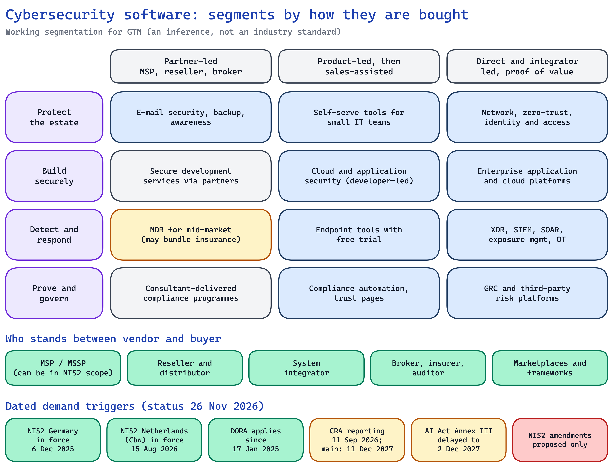
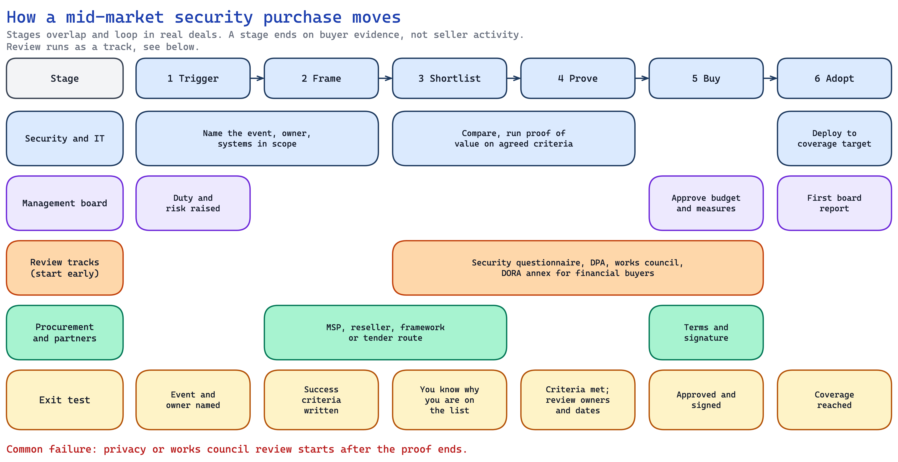
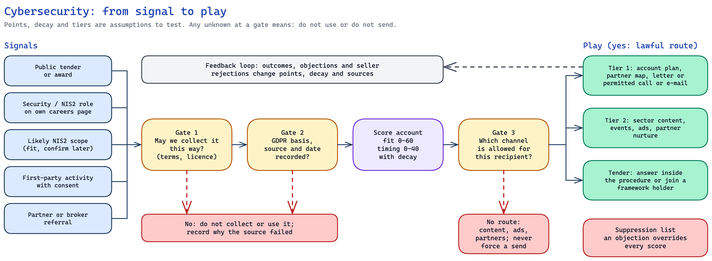

# Selling cybersecurity software in EMEA: a GTM guide (Netherlands and Germany focus)

**Status date: 26 November 2026. All sources accessed 26 November 2026.**

For learners and job candidates. It teaches how to reason about this market. It is not legal, compliance or investment advice.

## How to read this guide

- A number in brackets, such as [7], points to the source list at the end.
- **[Estimate]** = a number calculated here. **[Assumption]** = a value chosen here with no source; change it. **[Inference]** = a conclusion drawn here that the cited source does not state.
- Playbooks (ICP, tiers, plays, copy, plan, metrics) are proposals built with common GTM methods. They are not tested results and not a description of any company's internal practice.

## 1. Ten things to know first

1. NIS2 is national law in both focus countries, but on different clocks: Germany since 6 December 2025 [6], the Netherlands since 15 August 2026 [4][5].
2. NIS2 puts duties on management bodies: approve the risk measures, oversee them, take training [1]. Germany's text adds liability toward the company under company-law rules [9].
3. Supply-chain security is a required NIS2 measure [1]. Your product gets reviewed even when you are not a regulated entity yourself.
4. Germany had 20,141 registered NIS2 entities on 30 September 2026 [7]. In December 2025 BSI expected to supervise about 29,500 [6].
5. The Cyber Resilience Act (CRA) vulnerability and incident reporting duty has applied to manufacturers since 11 September 2026. Most other CRA duties apply from 11 December 2027 [12][13]. This can apply to your own software.
6. Published market sizes disagree widely. Even one trade body's forecast for Germany in 2026 moved from EUR 12.2bn to EUR 14.3bn within a year, with a change of data provider [25][26].
7. In Germany, advertising e-mail needs prior express consent, also in B2B [44]. In the Netherlands consent is also the default, with narrow exceptions [41]. A "scrape and sequence" outbound motion is the wrong starting design.
8. German data protection authorities say that harvesting contact data from a website's legal notice (Impressum) for advertising is regularly not permitted [46].
9. Tools that monitor employee behaviour can need works council co-determination in Germany [20] or consent in the Netherlands [21]. Plan for it in the deal timeline.
10. Do not scan or probe a prospect's systems without written permission. Unauthorised access is a criminal offence in both countries [48][49].

## 2. Market definition and segments

**Definition used here:** software and software-delivered services, sold to organisations, whose main purpose is to prevent, detect, respond to or recover from attacks on digital systems, or to prove that this is being done. Managed detection and response (MDR) is included because buyers often purchase the tool and the operator together. General consulting and hardware are outside the definition. Published market figures use other boundaries (section 7), so never compare them to this definition without checking.

The table is a working segmentation by **how the thing is bought**. [Inference]

| Segment | Typical economic buyer | Common motion | What starts a project | What blocks it |
|---|---|---|---|---|
| Endpoint, XDR and MDR | IT lead or CISO | Partner or sales-assisted | Incident, insurer questions, no 24/7 cover | Incumbent bundle, works council |
| Identity and access | CIO or CISO | Sales-led, system integrator | Audit finding, MFA gap, merger | Integration effort |
| Cloud and application security | Engineering leader plus security | Free tier, then sales-assisted | Customer security questionnaire, new product release, CRA readiness | Developer adoption |
| E-mail security, backup, awareness | IT lead | MSP and reseller channel | Phishing incident, renewal | MSP margin and tooling fit |
| Network, firewall, zero-trust access | Infrastructure lead | Distributor and reseller | Hardware refresh | Long refresh cycles |
| Security operations (SIEM, SOAR, exposure management) | CISO, SOC lead | Enterprise sales, proof of value | Logging and reporting duties, tool sprawl | Data cost, migration |
| OT and industrial security | Plant or operations lead plus CISO | Specialist integrator | NIS2 scope in manufacturing, energy, water | Safety and downtime risk |
| GRC, compliance automation, third-party risk | CISO, compliance lead | Direct, often with consultants | NIS2 or DORA programme, customer audits | "A spreadsheet is enough" |

NIS2 lists managed service providers and managed security service providers among in-scope entity types, and asks regulated buyers to take extra care when choosing a managed security service provider [1]. [Inference] If your partner is an MSP, it may itself be a NIS2 buyer, a channel and a supply-chain risk to its clients at the same time.



## 3. Regulation that changes demand

### 3.1 NIS2 (Directive (EU) 2022/2555)

**What it asks for** [1]:

- **Scope.** Entity types in Annex I and II that are at least medium-sized, plus some types regardless of size (Article 2). Check the national law, because national texts add detail.
- **Management (Article 20).** Management bodies approve and oversee the risk measures, can be held liable, and must take training.
- **Measures (Article 21).** The minimum list includes incident handling, backup and crisis management, supply-chain security, secure acquisition and development including vulnerability handling, effectiveness testing, cyber hygiene and training, cryptography, access control and asset management, and multi-factor or continuous authentication where appropriate.
- **Reporting (Article 23).** For significant incidents: early warning within 24 hours, notification within 72 hours, final report within one month of the notification.
- **Fines (Article 34).** National maximums must be at least EUR 10m or 2% of worldwide turnover (essential entities) and EUR 7m or 1.4% (important entities), whichever is higher.

No product makes a buyer "NIS2 compliant". The duties are organisational and technical. Say which Article 21 measure you help with, and what the buyer still has to do.

### 3.2 Country status, November 2026

| | Germany | Netherlands |
|---|---|---|
| National law | NIS-2 implementation act, amending the BSI Act (BSIG) | Cyberbeveiligingswet (Cbw) |
| In force | **6 December 2025** [6] | **15 August 2026** [4][5] |
| Scale | BSI expected to supervise about 29,500 entities, up from about 4,500 [6] | More than 8,000 organisations in 18 sectors [4] |
| Registration | Within three months of falling in scope (BSIG section 33) [9]. BSI says the statutory deadline has passed and tells unregistered entities to register now [8] | Mandatory in the NCSC entity register from 15 August 2026 [4][5] |
| Registration progress | 20,141 entities at 30 September 2026 (20,373 including branch registrations). Next update expected 31 January 2027 [7] | No official count verified for this guide |
| Management duty | Must implement and oversee the measures, train regularly; liable to the entity for culpably caused damage under company law, with the BSIG as fallback (section 38) [9] | The board is finally responsible, needs enough knowledge and must follow suitable training [4] |
| Incident reporting | 24 h, 72 h, one month (section 32) [9] | Within statutory deadlines to the CSIRT and competent authority [4][5] |
| Fines | For the main duty breaches, up to EUR 10m (particularly important) or EUR 7m (important), with a turnover-based ceiling for some large entities (section 65) [9] | Not verified for this guide |

German registrations by sector overlap, because one entity can list several. The largest at 30 September 2026 were manufacturing 4,739, health 3,703, energy 2,794, digital infrastructure 2,674 and food 1,986 [7].

**[Estimate]** 20,141 of 29,500 is 68%, a difference of about 9,400. **Do not read this as "9,400 non-compliant companies you can target".** 29,500 was an advance estimate, and BSI's figures page gives no list or current total of in-scope entities [7].

**Process history and loose ends.** On 8 July 2026 the Commission referred Ireland, Spain, France and the Netherlands to the Court of Justice for not notifying full transposition [2]. The Dutch Senate approved the Cbw around the same time and it took effect on 15 August [4]. This guide found no official statement that the Dutch case has been withdrawn, so do not claim either way. The Commission's general transposition page, shown as updated 23 November 2026, still presents the May 2025 reasoned-opinion stage [3]; it is not a reliable per-country tracker. **Other EU states are outside this guide: check each national law before you use a NIS2 trigger there.**

**Public sector in the Netherlands.** Since the Cbw took effect, the government baseline BIO2 measures for network and information systems are mandatory for government through the sector regulation (BIO2 version 1.3); the page names no specific supplier duty, but a shared baseline gives suppliers predictable requirements [18].

**Proposed change, not law.** On 20 January 2026 the Commission proposed targeted NIS2 amendments, including scope clarifications, a small mid-cap category and changes to ransomware data collection [10]. Parliament's record showed a draft committee report (September 2026) and amendments (October 2026), no adoption, and an indicative first-reading plenary date of 8 March 2027 [11].

### 3.3 Cyber Resilience Act (Regulation (EU) 2024/2847)

Covers "products with digital elements". The dates [12][13]:

| Date | What applies |
|---|---|
| 10 December 2024 | In force |
| 11 June 2026 | Rules on notified (conformity assessment) bodies |
| **11 September 2026** | **Manufacturers' reporting of actively exploited vulnerabilities and severe incidents** |
| 11 December 2027 | Main obligations |

Reporting goes through a single platform to the national CSIRT and ENISA: early warning within 24 hours, notification within 72 hours, then a final report (14 days after a fix is available for a vulnerability, one month after the notification for an incident) [13]. The reporting duty also covers products already on the market [13]. The top fine tier is up to EUR 15m or 2.5% of worldwide turnover [12], with some exceptions, for example for micro and small firms on the 24-hour deadline [13].

[Inference] For a security vendor the CRA is first a **product obligation** and second a sales topic. Whether a pure SaaS offer is in scope depends on the Act's definitions: get a legal view.

### 3.4 DORA (Regulation (EU) 2022/2554): selling to finance

DORA has applied since 17 January 2025 [14]. If a bank, insurer, payment institution or other covered financial entity buys your ICT service [14]:

- It keeps a register of all ICT contracts (Article 28).
- Every ICT contract needs minimum terms (Article 30(2)): service description and subcontracting, data processing and storage locations, data protection, data return on exit or insolvency, service levels, incident assistance, cooperation with authorities, termination rights, training participation.
- If your service supports a **critical or important function**, more applies (Article 30(3)): precise performance targets, notice and reporting duties, tested contingency plans, participation in threat-led penetration testing, unrestricted audit and access rights (with room to agree alternative assurance), and exit strategies with a transition period.

The European Supervisory Authorities published the first list of **critical** ICT third-party providers, who come under direct EU oversight, on 18 November 2025 [15]. Most vendors will not be on it, but their financial customers still have to meet the contract rules.

### 3.5 EU AI Act, if your product uses AI

The Digital Omnibus on AI (Regulation (EU) 2026/1744, published 24 July 2026) moved the high-risk obligations: **2 December 2027** for Annex III uses and **2 August 2028** for AI in products covered by Annex I [16][17]. Prohibitions and AI literacy have applied since 2 February 2025, general-purpose AI model duties since 2 August 2025, and the Article 50 transparency rules from 2 August 2026 [17], with a transition to 2 December 2026 for one Article 50(2) duty for generative systems already on the market [16]. Do not assume a security product is high-risk, or that it is not: classify the actual use.

### 3.6 How to turn regulation into a play without scare selling

| Regulatory fact | Honest buyer question | Content you can offer |
|---|---|---|
| Management duty and training [1][9] | "What does your board see, and how often?" | Board briefing template |
| 24 h early warning [1] | "Who can send that warning at 03:00 on a Sunday?" | Tabletop exercise outline |
| Supply-chain measure [1] | "Which suppliers can reach your systems?" | Supplier inventory worksheet |
| DORA contract terms [14] | "Are your ICT contracts mapped to Article 30?" | Your own pre-filled Article 30 annex |
| CRA reporting [13] | "If a component in your product is exploited today, who reports?" | Reporting workflow diagram |

Deadlines that have passed create ongoing duties, not a reason to claim the buyer is in breach.

## 4. How buyers buy

### 4.1 Evidence, with its limits

- Forrester (January 2026, global, all categories) reports a typical decision with 13 internal stakeholders and nine external influencers, procurement acting as a decision maker in 53% of cycles, and more than 60% of buyers using a trial. The release gives no sample size [22].
- 6sense (a vendor; nearly 4,000 buyers, global) reports an average cycle of 10.1 months in 2025, down from 11.3, and says the winning vendor was on the day-one shortlist 95% of the time [23].
- ENISA surveyed 1,080 professionals in EU organisations in NIS2 sectors, mostly large ones. Compliance was the main investment driver (70%), security was about 9% of IT budgets, and supply-chain and third-party compromise was a leading concern [24].
- Bitkom reports that companies in Germany put on average 18% of IT budgets into IT security [25].

**Why 9% and 18% can both be published:** different samples, size mix and likely different definitions of "security spend". Do not average them. None of these sources measures your segment in your country. Measure your own cycle length and committee size from CRM data as soon as you have deals.

### 4.2 Buying committee

A working model for a mid-market deal (roles can be one person). [Inference]

| Role | Cares about | Evidence to give |
|---|---|---|
| Management board | Duty, liability, business continuity | One-page risk and duty summary; no fear language |
| CISO or security lead | Coverage, false positives, response | Detection scope, proof-of-value plan, references |
| IT operations or infrastructure | Deployment, integrations, workload | Architecture, agent footprint, rollback |
| Data protection officer | Personal data in telemetry | Data processing agreement, data map, subprocessors, location |
| Works council | Employee monitoring | What is collected about staff, access rules, retention |
| Procurement | Price, terms, supplier risk | Price logic, exit terms, questionnaire pack |
| Legal and compliance | NIS2, DORA, contracts | Control mapping, contract annexes |
| External: MSP, integrator, auditor, insurer, broker | Fit with their own service or risk view | Partner material, technical documentation |

**Works council.** In Germany a works council has co-determination over introducing and using technical equipment intended to monitor employee behaviour or performance, within the limits of BetrVG section 87(1) [20]. In the Netherlands the works council's consent is required for arrangements on employee personal data and on facilities aimed at or suitable for observing presence, behaviour or performance (WOR Article 27(1)(k) and (l)) [21]. [Inference] Endpoint, identity analytics, e-mail inspection and insider-risk tools can fall under these. Ask in discovery, and bring a template.

### 4.3 Journey



Stages and exit tests (a stage ends on buyer evidence, not seller activity): [Inference]

| Stage | Exit test |
|---|---|
| Trigger | Buyer can name the event and an owner |
| Frame | Scope, systems and success criteria written down |
| Shortlist | You know who else is listed and why you are |
| Prove | Proof of value passes criteria agreed beforehand |
| Review | Security, privacy, works council and legal tracks each have an owner and a date |
| Buy | Budget approved, signature route known |
| Adopt | Coverage target reached; first board-level report delivered |

In the diagram, Review runs as a track beside the other stages (the "Review tracks" row) instead of as its own column. Start the review track at the beginning of the proof, not after it.

### 4.4 Security review pack

| Item | Why a buyer asks |
|---|---|
| ISO/IEC 27001 certificate and scope statement, or SOC 2 report | Common baseline evidence [Inference] |
| C5 attestation for cloud services | BSI's cloud criteria catalogue; C5:2026 applies to engagements dated on or periods starting from 1 June 2027, earlier use permitted [19]. Whether a given German buyer requires C5 must be checked per tender |
| Supplier-security answers mapped to NIS2 Article 21 | Buyer's supply-chain duty [1] |
| DORA Article 30 annex | Financial buyers [14] |
| Vulnerability disclosure policy and CRA reporting process | CRA [13] |
| Data locations, subprocessors, DPA, exit and deletion | GDPR; DORA location and return terms [14][47] |
| Employee-monitoring data sheet | Works council [20][21] |
| Penetration test summary, SBOM policy, incident history policy | Technical due diligence [Inference] |

### 4.5 Public procurement

For 2026-2027, the EU thresholds (excluding VAT) for supplies and services are EUR 140,000 for central government and EUR 216,000 for sub-central authorities under the general directive, and EUR 432,000 under the utilities directive [31]. Below the thresholds, national rules apply; they are not covered here. Public deals usually go through frameworks and resellers, so check which framework a target already uses before you pitch. [Inference]

## 5. Who sells how: publicly documented motions

These are company **types**, each with one public example. The pages show what a company says it does. They do not show whether it works, or how teams operate inside.

| Type | Public example and what the page says | Lesson to test [Inference] |
|---|---|---|
| MDR bundled with insurance, sold through brokers and MSPs | Eye Security describes MSP and broker partner routes with enablement and co-selling [51]. Its broker page says it does not compete with appointed brokers, enforces deal registration, does not share client security data with the underwriter without explicit permission, and lists the Netherlands, Germany and Belgium as live [50] | A second professional with trust in the account can be a channel. Channel conflict rules must be written |
| MSP-channel e-mail and Microsoft 365 security | When Proofpoint completed its Hornetsecurity acquisition (8 December 2025), the release cited over 12,000 MSPs and channel partners serving more than 125,000 customers, and a continuing channel-centric approach [52] | For small and mid-size accounts the unit you sell to may be the MSP, so ICP and metrics move to partner level |
| Developer-first application security | Aikido's pricing page shows a free developer tier with stated limits, then published paid tiers and custom enterprise pricing (as accessed) [53] | Product usage becomes the signal source; sales starts from activation, not cold lists |
| Multi-product platform vendor | Palo Alto Networks' release of 17 February 2026 attributes momentum to "platformizations", meaning customers consolidating on its platforms [54] | A point-product seller needs a coexistence or consolidation answer |

## 6. ICP and tiering

### 6.1 Define the ICP by fit, then timing

Worked example: a mid-market MDR service for the Netherlands and Germany. All weights are **[Assumption]**.

**Hard filters (fail any one = out):** in a country you can support; language and support hours you can deliver; technology you can actually monitor; no sanctions or ethics exclusion.

**Fit score (0-60)**

| Criterion | Points | How to know it lawfully |
|---|---|---|
| Likely NIS2 scope (sector and size) | 20 | Register data on activity and size; confirm with the buyer. Never assert scope from a code alone |
| 50-999 employees | 15 | Registry, annual report, company site |
| No visible in-house 24/7 security team | 10 | Own careers page, discovery call |
| Technology fit | 10 | Buyer discovery, partner knowledge |
| Reachable through a partner you work with | 5 | Partner account mapping done under a data agreement |

**Timing score (0-40):** use section 8. Cap any single signal at 15 points and let it decay (for example, half after 90 days).

**Why size matters.** Statistics Netherlands: in 2025 the share of companies taking at least 10 of 12 measured security measures was 13% at 2-10 workers, 38% at 10-50, 68% at 50-250 and 86% at 250 or more [30]. It also reports 19% of companies insured against cyber incidents [30]. [Inference] The 50-250 band is large enough to have budget and still has a visible gap. A gap does not prove demand.

### 6.2 Tiers

| Tier | Rule (example) | Treatment | Owner capacity [Assumption] |
|---|---|---|---|
| 1 | Fit at least 45 and timing at least 20 | Account plan, partner map, tailored material, lawful multi-channel | 25-40 per seller |
| 2 | Fit at least 45, timing under 20 | Sector content, events, ads, partner nurture | 100-300 per marketer-seller pair |
| 3 | Fit 30-44 | Self-serve content, MSP route | Programmatic |
| Out | Fails a filter or has objected | Suppress | None |

An objection overrides every score. Keep the suppression list outside the scoring model so that no re-import can undo it.

## 7. Market size: published figures disagree

| Source and date | Geography and year | Figure | What is counted |
|---|---|---|---|
| IDC press release, 3 March 2026 [27] | World, 2026 forecast | USD 308bn | IDC security spending guide, incl. hardware, software, services |
| Same [27] | Western Europe, 2026 forecast | USD 69bn | Same |
| Gartner 3Q26, as reported by a third-party blog [28] | World, 2026 forecast | USD 247.5bn | End-user spend on security software, services and network security equipment (incl. USD 9.0bn consumer) |
| IDC later release, as reported by the same blog [28] | World, 2026 forecast | USD 310.42bn | IDC definition |
| Omdia, as reported by the same blog [28] | World, 2026 forecast | USD 315bn | Technology plus services |
| Bitkom with IDC data, 28 October 2026 [25] | Germany, 2026 | EUR 14.3bn (software 7.8, services 5.3, hardware 1.2) | IT security spending |
| Same [25] | Germany, 2027 forecast | EUR 15.8bn | Same |
| Bitkom with PAC data, 7 October 2025 [26] | Germany, 2025 / 2026 forecasts | EUR 11.1bn / EUR 12.2bn | IT security spending, PAC definition |
| BDO as reported by Consultancy.nl, 25 August 2026 [29] | Netherlands | EUR 2.4bn (2023); "currently" EUR 3.1bn (no year given); EUR 3.5bn (2028 forecast) | Solutions and services |

What to learn from this:

- For Germany in 2026, the two Bitkom figures differ by EUR 2.1bn, about 17% of the older one **[Estimate]**. The newer one cites IDC [25], the older PAC [26]. Do not treat the jump as market growth, and do not build a growth rate across the two.
- The 2025 base also differs: EUR 11.1bn (PAC) [26] against EUR 12.8bn implied as the 2025 base in the 2026 release [25].
- The Gartner and IDC totals differ by about USD 60bn at world level [27][28]. Scope is the likely main reason. [Inference]
- The Gartner, later IDC and Omdia rows come through a secondary source. Verify at the publisher before quoting them.
- Currencies and geographies differ. Do not add rows.

**In an interview or a business case:** give the figure with source, publication date, geography, year, and what is in it. Then size your own market bottom-up.

## 8. Buying signals and where to get them lawfully

"Lawfully" means three separate checks: (a) may you **access** it this way, (b) may you **process** it (GDPR, if personal data is involved), (c) may you **contact** someone because of it (section 10). Passing (a) says nothing about (c).

| Signal | Public source and access note | Suggested points and decay [Assumption] | Play |
|---|---|---|---|
| Security-related public tender or award | TED: notices may be reused unless stated; notices contain contact-person data [32]. Netherlands: TenderNed announcements dataset listed as CC0 (the live API needs separate access) [33]. Germany: oeffentlichevergabe.de data, listed as CC0 in the Open Contracting registry [34] | 15, by tender dates | Answer the tender or work with a framework holder. Do not market to the named contact outside the procedure |
| Hiring for first security role or NIS2/ISMS lead | The company's own careers page, or a job feed you have a licence for. Check each site's terms and robots rules | 12, 90 days | Offer a first-90-days checklist |
| Likely NIS2 scope | Eurostat shows market counts [35]; company registers show activity. Neither says "in scope" | Fit, not timing | Scope self-check content |
| New legal entity, merger, new site | Company registers. Netherlands: KVK says the register is not meant as a direct-marketing source [37]. Germany: register portal use is limited to 60 retrievals per hour [39] | 8, 180 days | Use for account research and CRM accuracy, not for harvesting contacts |
| Legal-entity identity and group structure | GLEIF LEI data under CC0 with access terms [36] | Data quality only | Deduplicate and roll up groups |
| Customer-requested assurance (new certification goal, security page) | The company's own website, read manually or within its terms | 8, 180 days | Share a control-mapping worksheet |
| Public statement about own incident | Company's own notice or filing. **No leak sites, no stolen data** | 0 for outbound | Do not pitch on someone's incident. Respond if asked [Inference: ethics and brand rule] |
| Product vendor with vulnerability-reporting exposure | Company's product pages and security advisories | 8 | CRA reporting workflow |
| First-party: trial, repeat visits, webinar, security-page download | Your own systems, with the consent and notice your setup needs (cookies and tracking have their own rules, not covered here) | 10-15, 30 days | Fast, relevant follow-up within consent |
| Partner or insurer referral | The partner, with a data-sharing agreement and a documented permission basis | 15, 60 days | Joint introduction |

**Excluded on purpose:** active port or vulnerability scanning of prospects [48][49]; automated collection from LinkedIn, which its User Agreement prohibits, as it does bot-driven messaging and contact adding [40]; breach dumps; guessed personal e-mail addresses.



## 9. Data sources and terms

| Source | Use it for | Terms point to respect |
|---|---|---|
| Eurostat `sbs_sc_ovw` [35] | Enterprise counts by size and activity | Reuse with attribution; state any changes; some third-party data excluded |
| GLEIF LEI data [36] | Entity identity | CC0; use the access service; no implied endorsement |
| TED [32] | EU tenders | Notices reusable unless noted; personal data inside stays protected |
| TenderNed dataset [33] | Dutch tenders | Dataset listed CC0 |
| German procurement notices [34] | German tenders | Registry lists CC0; confirm on the publisher portal |
| KVK Business Register [37][38] | Verification and due diligence | Not intended for direct marketing; personal data excluded from open reuse; the non-mailing indicator blocks advertising post and door-to-door sales |
| German company register portal [39] | Verification | 60 retrievals per hour; read the current portal rules before any automation |
| LinkedIn [40] | Manual research and permitted product features | No scraping, bots or automated messaging |
| BSI [7] and CBS [30] statistics | Sector context | Aggregates only. The BSI figures page is not a list of entities |
| Commercial B2B data vendors | Enrichment | Ask for source, collection date, legal basis, objection handling and country coverage. A vendor contract does not give you consent to e-mail |

Store for every contact field: source, collection date, legal basis, notice date, consent evidence (if any), objection status. If you cannot fill these, do not use the record.

## 10. Outreach law in the Netherlands and Germany (plain words; **not legal advice**)

Two layers apply at the same time: **marketing-channel law** (may you send or call at all?) and **GDPR** (may you process the personal data?). A role address can fall outside "personal data" and still be covered by channel law.

### 10.1 Netherlands (Telecommunications Act, Article 11.7 [41])

- **E-mail and other electronic messages, automated calling, fax:** prior consent is required, and the sender must be able to prove it. This applies to legal persons too.
- **Business exception:** no prior consent is needed to a legal person or a person acting professionally if you use electronic contact details that this user **designated and published for receiving** unsolicited commercial communication, and you use them in line with the purposes attached. A third paragraph item covers recipients outside the EEA who meet their local rules. [Inference] A normal published info@ or staff address does not by itself show that designation.
- **Existing customers:** contact details obtained in a sale may be used for your own similar products if you offered an easy, free objection at collection and in each message.
- **Every message:** real identity of the party it is sent for, and a valid way to ask you to stop.
- **Calls:** the consent rule for other means applies to **natural persons**. Since 1 July 2026 consumers and small businesses such as sole traders and general partnerships may be telephoned only with prior express consent, including existing customers [43][38]. [Inference] The statute's consent rule for calls does not reach legal persons such as a BV; GDPR, objections and general fairness rules still apply. Confirm with counsel and check the legal form before dialling.
- The ACM supervises; it says you must be able to prove consent for up to five years after sending, and that responsibility can also reach those who help send, including list suppliers [42].
- **Post:** respect the KVK non-mailing indicator; KVK also notes legal persons have less protection against unsolicited sales than sole traders and partnerships [37][38]. Inference, not verified: this guide treats post as outside article 11.7. The statute's wording 'other means' does not name post either way. Confirm with ACM guidance or counsel before mailing sole traders or partnerships.

### 10.2 Germany (Act against Unfair Competition, UWG section 7 [44])

- **E-mail:** advertising needs the recipient's **prior express consent**. There is **no general B2B exception**.
- **Existing-customer exception (section 7(3)), all four needed:** address received with a sale; used for your own similar goods or services; no objection; clear notice of the free right to object when collected and at every use.
- **Phone:** businesses may be called only with at least **presumed consent**. The data protection authorities say a mere topical link is not enough; there must be a concrete reason from the called party's sphere of interest, for example earlier business contact [46]. Consumers need prior express consent [44].
- **All advertising messages:** do not hide the sender; give a valid address to stop [44].
- **Enforcement:** competitors and qualifying associations, among others, can claim removal and injunction (UWG section 8) [45].
- **GDPR link:** the authorities say that where the UWG bars a contact route, there is also no legitimate interest for it [46]. They also say that **scraping Impressum data for advertising is regularly not permitted** [46].
- **Post:** not in the e-mail or phone consent rules above, but advertising to someone who evidently does not want it is unlawful [44]; GDPR still applies [46].

### 10.3 GDPR essentials (both countries)

- Direct marketing **may** be a legitimate interest, subject to balancing (recitals and Article 6(1)(f)) [47]. It never overrides channel law.
- If you got the data from somewhere else, give the Article 14 information within a reasonable period, at the latest within one month, or at first communication if that comes first [47][46].
- A person can object to direct marketing at any time, including related profiling; processing for that purpose must then stop (Article 21) [47].
- Signal scoring that profiles named people needs its own assessment. Score **companies** where you can. [Inference]

### 10.4 Social networks

LinkedIn's User Agreement bans automation for messaging and adding contacts [40]. [Inference] Assume that a promotional direct message can be treated like electronic advertising under national law; have counsel confirm before using it at volume.

### 10.5 Pre-send gate

1. Which country and legal form is the recipient?
2. Which channel, and which exact permission covers it? Where is the evidence?
3. Is the person or company on any suppression or objection list?
4. Do you have a GDPR basis and have you given notice?
5. Does the message identify the sender and offer a free stop route?

Any "unknown" means **do not send**.

## 11. Channels and messaging

### 11.1 Channel design (because cold e-mail is not the base)

| Channel | Role | Note |
|---|---|---|
| Partners: MSPs, resellers, integrators, brokers, auditors | Trust and reach | Needs margin, enablement, deal registration, data rules |
| Search and useful content (scope check, templates) | Capture demand | Gate lightly; ask for e-mail consent separately and clearly |
| Events, trade bodies, small roundtables | Relationships and consent | A swapped card is not automatically a marketing consent; record what was agreed |
| Paid media to accounts or sectors | Awareness | Check audience-upload legal basis |
| Warm introductions and referrals | Highest-context route | Ask the introducer to make the contact |
| Phone | Only under 10.1 and 10.2 | Document the concrete reason before the call (Germany) |
| Letter | Possible opener for Tier 1 | Check objections and the non-mailing indicator. That post is outside Dutch article 11.7 is an unverified inference (section 10.1): check before mailing sole traders or partnerships |
| Opted-in e-mail | Nurture | Provable consent, easy exit |
| Cloud marketplaces and public frameworks | Buying route | Check whether the buyer wants to purchase through them |

### 11.2 Messaging angles

| Persona | Angle | Avoid |
|---|---|---|
| Board | "What you must oversee, and what evidence you will have" | Fine amounts as the opening line |
| Security lead | "Who responds at night, and how you will check our work" | "AI-powered" with no test |
| IT operations | "What it takes to deploy and to leave" | Hidden effort |
| DPO and works council | "Exactly what we collect about employees" | "It is only security data" |
| Financial buyer | "Our DORA contract annex is ready for review" | "DORA certified" claims |
| MSP | "How you make margin and keep the client" | Going direct to their clients |

### 11.3 Sample copy

All names are placeholders. These are drafts to test, not proven templates. Each one still has to pass the gate in 10.5.

**A. Follow-up e-mail to a contact who opted in at a webinar**

> Subject: The 24-hour warning: a one-page rota check
>
> Hi {first_name}, you asked us at {event} to send material on incident reporting. NIS2 sets an early warning within 24 hours for significant incidents. This one-page worksheet shows who would need to decide and send it on a weekend. No product needed to use it.
> If it exposes a gap, I can walk through how teams of your size cover nights.
> {name}, {company}, {postal address}. Stop these e-mails: {link}.

**B. Phone opener, Germany (only where presumed consent is documented)**

> "Guten Tag, {name} from {company}. We spoke at {event} about your incident cover, which is why I am calling. Is this a reasonable moment for two minutes? If not, I will not call again unless you ask."

**C. Letter, Tier 1, management board**

> Subject: Board oversight of cyber measures: a briefing template
>
> NIS2 asks management bodies to approve and oversee cyber risk measures. We wrote a two-page template that shows what a quarterly board report can contain. It is yours at {short URL}. If you do not want further post from us, tell us at {address or e-mail} and we will stop.

**D. Partner note to an MSP you already have permission to contact**

> "You already hold the client relationship. We offer the night shift. Here are the deal registration rules, the data we can see, and what we will never do with your clients. Would a 30-minute review of two anonymised client profiles be useful?"

**E. Manual connection note (no automation; see 10.4)**

> "I saw your talk on {topic}. I work on incident response for {sector} and would be glad to connect." (No pitch.)

## 12. First 30, 60 and 90 days

For a GTM engineer or a first marketing/sales operations hire.

| Days | Build | Learn | Exit evidence |
|---|---|---|---|
| 1-30 | CRM fields for source, legal basis, consent, objection; suppression list that every send checks; ICP v1; account list from permitted data; baseline of past pipeline | 8-10 interviews with sellers, customers and partners; lost-deal review; legal review of channel rules | Counsel-reviewed contact policy; one dashboard with definitions |
| 31-60 | Scoring with decay and reason codes; two plays (one partner, one inbound); security review pack with owners; works council and DORA attachments | Which signals sellers trust; proof-of-value pass criteria | Each play has a hypothesis, audience, stop rule and baseline |
| 61-90 | Holdout or matched comparison for one play; partner pipeline view; weekly signal quality review | Where deals stall; objection and complaint patterns | A written keep/change/stop decision with uncertainty stated; next-quarter plan |

With a roughly ten-month global average cycle [23], do not expect 90 days to prove revenue impact. Judge leading indicators and data quality.

## 13. Metrics tree

```text
Net new annual recurring revenue (ARR)
= new ARR + expansion ARR - contraction ARR - churned ARR
|
+-- New ARR = qualified opportunities x win rate x average first-year ARR
|    +-- Qualified opportunities
|    |    = target accounts x reached rate x engaged rate x qualified rate   (per tier and source)
|    |    +-- Coverage: share of ICP accounts with a lawful route to reach them
|    |    +-- Signal precision: signal-flagged accounts that qualify / flagged accounts
|    |    +-- Speed: hours from permitted inbound request to first response
|    +-- Win rate
|    |    +-- Proof-of-value pass rate
|    |    +-- Review-stage losses (security, privacy, works council, legal)
|    |    +-- Days in review stage
|    +-- ARR per deal: price x endpoints or users x module attach - discount
|
+-- Expansion: coverage added, modules added, group entities added
+-- Retention: gross revenue retention, time to full deployment, response quality
|
+-- Efficiency: CAC payback = sales and marketing cost / (new ARR x gross margin) x 12
+-- Partner: sourced and influenced pipeline, active partners, deals per active partner

Guardrails (a breach stops the play): objections and complaints per 1,000 contacts,
sends with missing legal basis (target 0), suppression failures (target 0),
records past retention, spam complaint and bounce rate
```

Define each term once, including how a deal gets a source. "Influenced pipeline" is not proof of cause.

## 14. Worked bottom-up TAM: mid-market MDR, Netherlands and Germany

**This is a teaching example, not a market estimate.** Only the two entity counts have sources.

| Input | Symbol | Value | Basis |
|---|---|---|---|
| German entities BSI expected to supervise | N_DE | 29,500 | [6]; includes some public bodies; not the same as registrations |
| Dutch organisations in Cbw scope | N_NL | 8,000 | [4], "more than 8,000" |
| Share that fits the offer (not too large, supportable, buys externally) | f | 0.65 | **[Assumption]** |
| Share of fitting accounts that can be contested in the planning period | c | 0.50 | **[Assumption]** |
| Average annual contract value | ACV | EUR 36,000 | **[Assumption]**, not a market price |
| Share of contestable accounts won in three years | w | 0.03 | **[Assumption]** |

Formulas:

```text
TAM (annual) = (N_DE + N_NL) x f x ACV
SAM          = TAM x c
SOM accounts = (N_DE + N_NL) x f x c x w
SOM ARR      = SOM accounts x ACV
```

Change any value and run:

```python
N_DE, N_NL = 29_500, 8_000   # sourced counts
f, c, acv, w = 0.65, 0.50, 36_000, 0.03   # assumptions: change these

n = N_DE + N_NL
tam = n * f * acv
sam = tam * c
som_accounts = n * f * c * w
print(f"TAM {tam/1e6:,.1f}m  SAM {sam/1e6:,.1f}m  "
      f"SOM {som_accounts:,.0f} accounts, {som_accounts*acv/1e6:,.1f}m ARR")
```

**Results [Estimate]:** TAM EUR 877.5m a year; SAM EUR 438.8m; SOM about 366 accounts, EUR 13.2m ARR. By country, TAM is EUR 690.3m for Germany and EUR 187.2m for the Netherlands.

**Sensitivity [Estimate]:** with f from 0.45 to 0.80 and ACV from EUR 24,000 to EUR 60,000, TAM runs from EUR 405m to EUR 1,800m. A 4.4-fold range is the honest message.

**Sanity checks (these do not validate the number):**

- The German TAM equals about 13% of the EUR 5.3bn German security **services** figure [25]. A TAM is potential spend, not current spend, and MDR may be counted partly outside "services".
- The Dutch TAM equals about 6% of the EUR 3.1bn BDO figure [29], whose year and boundary are unclear.
- The two country percentages differ a lot although the method is the same. That points to differences in definitions, inputs or both.
- Eurostat's 2024 business-economy coverage (NACE B-S, excluding O and S94) shows 65,181 German and 10,982 Dutch enterprises with 50-249 persons, and 14,862 and 2,800 with 250 or more [35]. That coverage includes finance and health but leaves out public administration, agriculture and membership organisations. It counts enterprises by headcount only, not NIS2 sector tests, so it is **not** the NIS2 population and must not be used as a subset.

**To make it real:** replace N with a counted account list by sector and size; replace f from 50 discovery calls; replace ACV with your price list times a sampled endpoint count; replace w with observed funnel rates; check capacity (can your team and SOC serve about 366 new customers?).

## 15. Risks to the GTM plan

| Risk | Effect | Mitigation |
|---|---|---|
| "NIS2" messaging fatigue | Low response | Lead with a specific job, not the acronym |
| Wrong scope claims | Lost trust, legal exposure | Say "may be in scope"; link the official check |
| Unlawful contact data or sequences | Complaints, injunctions, fines | Gate in 10.5; provenance fields |
| Partner conflict | Channel loss | Written registration and direct-sales rules |
| Works council or DPO surfaces late | Slipped quarter | Ask in discovery; send pack early |
| Your own product security failure or CRA gap | Existential | Disclosure process, reporting rota, supplier checks |
| Platform bundling by incumbents | Price pressure | Coexistence story; pick a gap you can prove |
| Rule changes (NIS2 amendments, national secondary rules) | Stale content | Owner and review date on every regulatory claim |
| Over-fitted scoring on few deals | False precision | Simple rules first; compare with a random or fit-only baseline |

## 16. What to verify before using this guide

- [ ] Current NIS2 status for **each** country you sell into, from the national authority.
- [ ] BSI figures after the 31 January 2027 update [7]; any change in German registration practice.
- [ ] Dutch Cbw lower-level rules, supervisors, reporting deadlines, fines, and the status of the Court referral.
- [ ] NIS2 amendment procedure 2026/0012(COD) [11].
- [ ] Whether the CRA covers your delivery model.
- [ ] Channel law with counsel, especially Dutch calls to legal persons, social messages, and German presumed consent.
- [ ] Current terms of every data source; licences change.
- [ ] Market figures at the original publisher, especially every row taken from [28] and [29].
- [ ] Vendor pages in section 5; offers change.
- [ ] Every assumption in section 14.

## Sources

All accessed 26 November 2026. "Official text" laws were retrieved from the EU Publications Office or national consolidated-law services.

1. Directive (EU) 2022/2555 (NIS2), official text. https://eur-lex.europa.eu/eli/dir/2022/2555/oj
2. European Commission, referral of Ireland, Spain, France and the Netherlands (8 July 2026). https://digital-strategy.ec.europa.eu/en/news/commission-refers-ireland-spain-france-and-netherlands-court-justice-failing-transpose-rules
3. European Commission, NIS2 transposition page. https://digital-strategy.ec.europa.eu/en/policies/nis-transposition
4. Rijksoverheid, Cbw and Wwke in force from 15 August 2026 (7 July 2026). https://www.rijksoverheid.nl/actueel/nieuws/2026/07/07/cyberbeveiligingswet-en-wet-weerbaarheid-kritieke-entiteiten-vanaf-15-augustus-2026-van-kracht
5. NCSC-NL, same subject. https://www.ncsc.nl/nieuws/cbw-en-wwke-vanaf-15-augustus-2026-van-kracht
6. BSI press release, NIS-2 act in force (5 December 2025). https://www.bsi.bund.de/DE/Service-Navi/Presse/Pressemitteilungen/Presse2025/251205_NIS-2-Umsetzungsgesetz_in_Kraft.html
7. BSI, "NIS-2 in Zahlen" (data at 30 September 2026). https://www.bsi.bund.de/DE/Themen/Regulierte-Wirtschaft/NIS-2-regulierte-Unternehmen/NIS-2-in-Zahlen/nis-2-in-zahlen.html
8. BSI, NIS-2 regulated companies page. https://www.bsi.bund.de/DE/Themen/Regulierte-Wirtschaft/NIS-2-regulierte-Unternehmen/nis-2-regulierte-unternehmen_node.html
9. BSIG sections 32, 33, 38, 65. https://www.gesetze-im-internet.de/bsig_2025/__32.html ; https://www.gesetze-im-internet.de/bsig_2025/__33.html ; https://www.gesetze-im-internet.de/bsig_2025/__38.html ; https://www.gesetze-im-internet.de/bsig_2025/__65.html
10. European Commission, cybersecurity package Q&A. https://digital-strategy.ec.europa.eu/en/faqs/cybersecurity-package-questions-answers
11. European Parliament Legislative Observatory, 2026/0012(COD). https://oeil.europarl.europa.eu/oeil/en/procedure-file?reference=2026/0012(COD)
12. Regulation (EU) 2024/2847 (Cyber Resilience Act), official text. https://eur-lex.europa.eu/eli/reg/2024/2847/oj
13. European Commission, CRA summary. https://digital-strategy.ec.europa.eu/en/policies/cra-summary
14. Regulation (EU) 2022/2554 (DORA), official text. https://eur-lex.europa.eu/eli/reg/2022/2554/oj
15. EBA, designation of critical ICT third-party providers (18 November 2025). https://www.eba.europa.eu/publications-and-media/press-releases/european-supervisory-authorities-designate-critical-ict-third-party-providers-under-digital%5C
16. Regulation (EU) 2026/1744 (Digital Omnibus on AI), official text. https://eur-lex.europa.eu/eli/reg/2026/1744/oj
17. European Commission, "Navigating the AI Act" FAQ. https://digital-strategy.ec.europa.eu/en/faqs/navigating-ai-act
18. NL Digital Government, government information security baseline (BIO2). https://www.nldigitalgovernment.nl/overview/government-information-security-baseline/
19. BSI, Cloud Computing Compliance Criteria Catalogue C5:2026. https://www.bsi.bund.de/SharedDocs/Downloads/EN/BSI/CloudComputing/ComplianceControlsCatalogue/2026/C5_2026.pdf
20. BetrVG section 87. https://www.gesetze-im-internet.de/betrvg/__87.html
21. Wet op de ondernemingsraden, Article 27. https://wetten.overheid.nl/BWBR0002747
22. Forrester, "The State Of Business Buying, 2026" release (21 January 2026). https://www.forrester.com/press-newsroom/forrester-2026-the-state-of-business-buying/
23. 6sense, B2B Buyer Experience Report 2025 (vendor research). https://6sense.com/science-of-b2b/buyer-experience-report-2025
24. ENISA, NIS Investments 2025, main report. https://www.enisa.europa.eu/sites/default/files/2026-02/NIS%20Investments%202025%20-%20Main%20report.pdf
25. Bitkom, German IT security market (28 October 2026). https://www.bitkom.org/Presse/Presseinformation/IT-Sicherheit-Deutscher-Markt-waechst-zweistellig
26. Bitkom, German IT security market (7 October 2025). https://www.bitkom.org/Presse/Presseinformation/Deutscher-Markt-IT-Sicherheit-waechst-zweistellig
27. IDC, Worldwide Security Spending Guide release (3 March 2026). https://www.idc.com/resource-center/press-releases/wwsecuritysg/
28. Software Strategies Blog, comparison of forecasts (9 November 2026; secondary). https://softwarestrategiesblog.com/2026/11/09/cybersecurity-spending-forecasts-2027-compared-gartner-idc-forrester-omdia/
29. Consultancy.nl, BDO cybersecurity market (25 August 2026; secondary, Dutch). https://www.consultancy.nl/nieuws/69608/cybersecuritymarkt-groeit-door-tot-bijna-250-miljard-in-2030
30. CBS, fewer companies with a cyber incident (28 May 2026). https://www.cbs.nl/nl-nl/nieuws/2026/22/minder-bedrijven-met-cyberincident-vooral-grote-bedrijven-weerbaarder
31. European Commission, procurement thresholds. https://single-market-economy.ec.europa.eu/single-market/public-procurement/legal-rules-and-implementation/thresholds_en
32. TED legal notice. https://ted.europa.eu/en/legal-notice
33. data.overheid.nl, TenderNed announcements dataset. https://data.overheid.nl/dataset/aankondigingen-van-overheidsopdrachten---tenderned
34. Open Contracting data registry, Germany procurement notices. https://data.open-contracting.org/en/publication/136
35. Eurostat, dataset `sbs_sc_ovw` (indicator ENT_NR, 2024, data updated 30 September 2026), https://ec.europa.eu/eurostat/databrowser/view/SBS_SC_OVW/ ; reuse policy https://ec.europa.eu/eurostat/help/copyright-notice
36. GLEIF, LEI data terms of use. https://www.gleif.org/en/meta/lei-data-terms-of-use
37. KVK, permitted and non-permitted use of register data. https://www.kvk.nl/kvk-data/waar-mag-je-gegevens-uit-het-handelsregister-wel-niet-voor-gebruiken/
38. KVK, limiting unwanted commercial solicitation. https://www.kvk.nl/en/about-the-business-register/how-to-limit-unwanted-commercial-solicitation/
39. IHK Köln, register data and the retrieval limit (secondary; read the portal's own rules). https://www.ihk.de/koeln/hauptnavigation/recht-steuern/gefahr-missbrauch-registerdaten-5644100
40. LinkedIn User Agreement (effective 3 November 2025). https://www.linkedin.com/legal/user-agreement
41. Telecommunicatiewet, Article 11.7 (consolidated version dated 15 August 2026). https://wetten.overheid.nl/BWBR0009950
42. ACM, avoiding spam in advertising. https://www.acm.nl/nl/verkoop-aan-consumenten/reclame-en-verleiden/spam-voorkomen-uw-reclame
43. ACM, stricter telemarketing rules from 1 July (25 June 2026). https://www.acm.nl/nl/publicaties/vanaf-1-juli-strengere-regels-voor-telemarketing-alleen-nog-maar-als-klant-toestemming-heeft-gegeven
44. UWG section 7. https://www.gesetze-im-internet.de/uwg_2004/__7.html
45. UWG section 8. https://www.gesetze-im-internet.de/uwg_2004/__8.html
46. Datenschutzkonferenz, guidance on direct advertising (February 2022). https://www.datenschutzkonferenz-online.de/media/oh/OH-Werbung_Februar%202022_final.pdf
47. Regulation (EU) 2016/679 (GDPR), official text. https://eur-lex.europa.eu/eli/reg/2016/679/oj
48. German Criminal Code section 202a. https://www.gesetze-im-internet.de/stgb/__202a.html
49. Dutch Criminal Code, Article 138ab. https://wetten.overheid.nl/BWBR0001854
50. Eye Security, broker partnership page. https://eye.security/partners/broker-partner/
51. Eye Security, partners page for brokers and risk advisors. https://www.eye.security/en/partners/brokers-and-risk-advisors
52. Proofpoint completes Hornetsecurity acquisition. https://www.proofpoint-total-protection.com/blog/proofpoint-acquisition-completed-press-release/
53. Aikido Security pricing. https://www.aikido.dev/pricing
54. Palo Alto Networks, fiscal Q2 2026 results (SEC exhibit). https://www.sec.gov/Archives/edgar/data/0001327567/000132756726000003/ex991q226earningsrelease.htm
