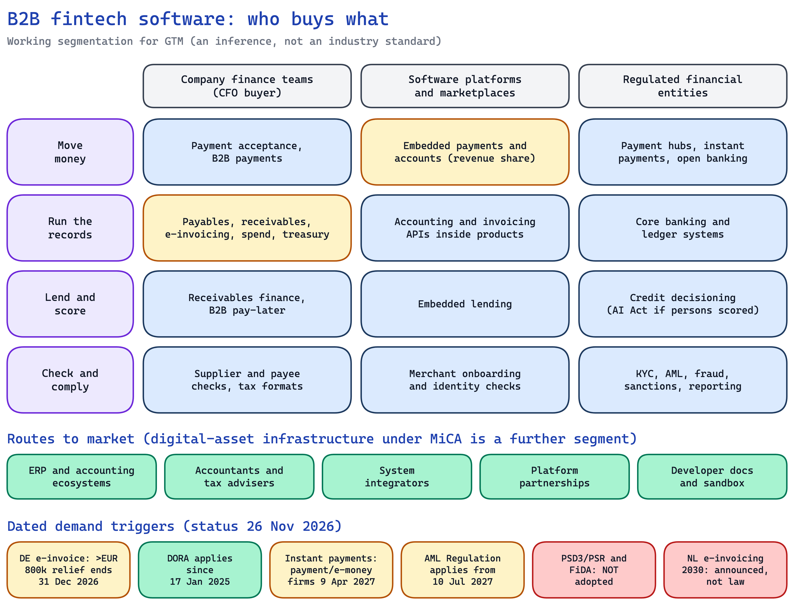
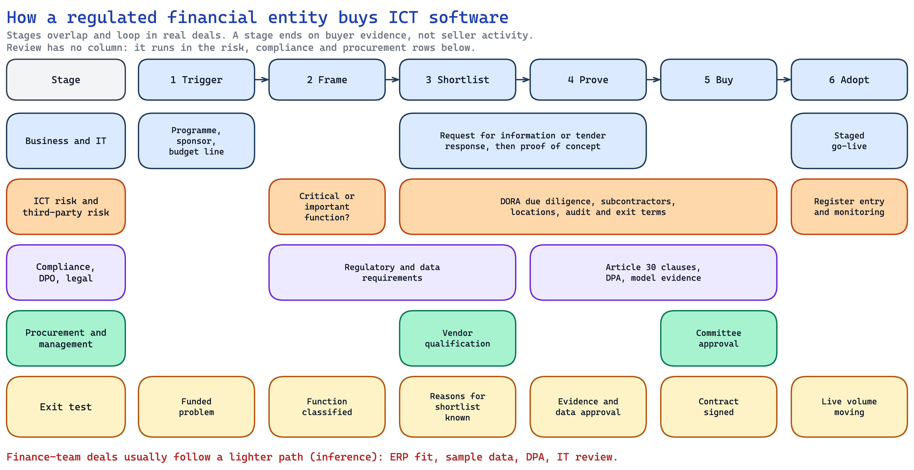
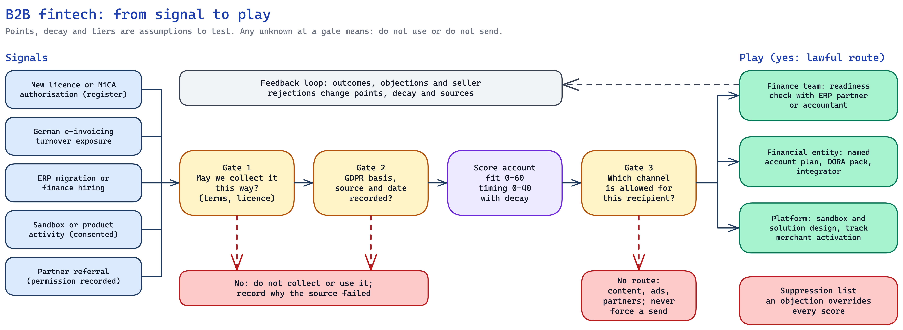

# Selling B2B fintech software in EMEA: a GTM guide (Netherlands and Germany focus)

**Status date: 26 November 2026. All sources accessed 26 November 2026.**

For learners and job candidates. It teaches how to reason about this market. It is not legal, tax, compliance or investment advice.

## How to read this guide

- A number in brackets, such as [7], points to the source list at the end.
- **[Estimate]** = a number calculated here. **[Assumption]** = a value chosen here with no source; change it. **[Inference]** = a conclusion drawn here that the cited source does not state.
- Playbooks (ICP, tiers, plays, copy, plan, metrics) are proposals built with common GTM methods. They are not tested results and not a description of any company's internal practice.

## 1. Ten things to know first

1. "Fintech" market figures mix consumer revenue, financial services and software. Never use one without its definition (section 7).
2. Germany: businesses have had to be able to **receive** e-invoices since 1 January 2025. The transition for **issuing** them ends on 31 December 2026 for issuers with prior-year turnover above EUR 800,000, and on 31 December 2027 at or below it [1]. That is five weeks after this guide's date for the larger group.
3. The Netherlands: on 11 September 2026 the cabinet **announced** mandatory domestic B2B e-invoicing from 1 July 2030 and domestic digital reporting from 1 July 2031. It is **not yet law** [2][3].
4. DORA has applied since 17 January 2025. Selling ICT services to a covered financial entity brings required contract terms [4].
5. Instant euro transfers and payee verification are already mandatory for euro-area banks; euro-area payment and e-money institutions have until 9 April 2027 for sending and receiving instant transfers [5].
6. PSD3 and the Payment Services Regulation (PSR) are **not adopted**. The Council adopted its first-reading position on 29 October 2026; Parliament's second reading was pending [6][7].
7. FiDA (open finance) is **not adopted** [8].
8. The MiCA transitional period for crypto-asset service providers ended on 1 July 2026 [9][10].
9. The new EU anti-money-laundering Regulation applies mainly from 10 July 2027 [11].
10. In Germany, advertising e-mail needs prior express consent, also in B2B [38]. The Netherlands also starts from consent, with narrow exceptions [35].

## 2. Market definition and segments

**Definition used here:** software, including software delivered as a service or through APIs, that a **business buys** to run or embed a financial process: moving money, recording and reconciling it, lending it, checking who it goes to, or reporting on it. Excluded: consumer finance apps, balance-sheet revenue such as interest income, and general ERP. A licensed provider that bundles software with a regulated service (for example payment acceptance) is included, but its revenue is not all "software". This is a working definition for GTM, not an industry standard.

| Segment | Typical buyer | Typical economic unit | What starts a project | Main friction |
|---|---|---|---|---|
| A. Payment acceptance and processing | E-commerce, retail, platforms | Share of volume or per transaction | New market, cost or conversion problem | Migration risk |
| B. Embedded finance infrastructure | Software platforms and marketplaces | Revenue share | Wish to add payments, accounts or lending | Responsibility split, onboarding rules |
| C. Office of the CFO: payables, receivables, e-invoicing, spend, treasury | CFO, finance operations, tax | Subscription, sometimes plus card or volume revenue | E-invoicing duty, ERP change, month-end pain | ERP integration, change management |
| D. Core systems for financial institutions: core banking, payment hubs, open banking | Bank or insurer CIO and business line | Multi-year licence plus implementation | End of life, new product, mandate | Very long cycle, migration |
| E. Financial-crime and compliance technology: identity checks, AML monitoring, fraud, sanctions, reporting | Compliance, money-laundering officer, fraud operations | Per check or subscription | Rule change, audit finding, fraud losses | Model validation, data protection |
| F. Credit and risk decisioning | Lenders, B2B pay-later providers | Usage plus platform fee | New lending product, loss rate | AI Act where natural persons are scored, explainability |
| G. Digital-asset infrastructure | Crypto-asset firms, banks | Mixed | MiCA authorisation | Licensing status of the buyer and the vendor |

Not treated in depth: insurance and wealth technology.



**The first GTM fork:** are you selling to a **regulated financial entity** (long, evidence-heavy, DORA terms) or to an **ordinary company's finance team** (faster, integration-heavy)? One ICP, one playbook and one funnel for both will mislead you. [Inference]

## 3. Regulation that changes demand

### 3.1 Timeline

| Rule | Status on 26 November 2026 | Key dates | Segments |
|---|---|---|---|
| DORA, Reg. (EU) 2022/2554 | In force and applying | Applies since 17 January 2025 [4] | Any vendor to financial entities |
| Instant Payments Reg. (EU) 2024/886 | Applying in steps | See 3.3 [5] | A, D, E |
| MiCA, Reg. (EU) 2023/1114 | Applying | Stablecoin titles 30 June 2024; rest 30 December 2024; transition ended 1 July 2026 [9] | G |
| AML Regulation (EU) 2024/1624 | In force, not yet applying | 10 July 2027; 10 July 2029 for certain football-sector obliged entities [11] | E |
| AI Act, as amended by Reg. (EU) 2026/1744 | In force, staged; some duties **delayed** | Annex III high-risk from 2 December 2027 [13][14] | E, F |
| eIDAS amendment, Reg. (EU) 2024/1183 | In force, staged | Wallets by end 2026; relying-party acceptance later (3.7) [15][16] | E, onboarding |
| PSD3 and PSR | **Proposal, not adopted** | See 3.4 [6][7] | A, B, D, E |
| FiDA, 2023/0205(COD) | **Proposal, not adopted** | See 3.5 [8] | D |
| German e-invoicing | In force with transition | 2025, 2027, 2028 [1] | C |
| Dutch domestic e-invoicing | **Announced, not law** | 2030, 2031 [2] | C |
| EU VAT in the Digital Age (ViDA) | Adopted, staged | Cross-border digital reporting 1 July 2030; alignment of national real-time systems by 1 January 2035 [17] | C |

If your own product is software placed on the market, also check the Cyber Resilience Act: manufacturers' vulnerability and incident reporting has applied since 11 September 2026, main duties from 11 December 2027 [18].

### 3.2 DORA: the rule your financial buyers bring into every contract

From the official text [4]:

- **Before contracting** (Article 28(4)), the financial entity assesses, among other things, whether the service supports a critical or important function and whether conditions for contracting are met.
- It keeps a **register of information** on all ICT service contracts (Article 28(3)). For 2026, BaFin's guidance set formal submission for 9-30 March 2026, with corrections to 24 April [19]. Other authorities set their own dates.
- **All ICT contracts** (Article 30(2)) need: service and subcontracting description, locations of service and data processing, data protection provisions, data return on insolvency or exit, service levels, incident assistance, cooperation with authorities, termination rights, and training participation.
- **Critical or important functions** (Article 30(3)) add: precise performance targets, notice duties, tested contingency plans and security measures, participation in threat-led penetration testing, audit and access rights (alternative assurance can be agreed where other clients' rights are affected), and exit strategy with a transition period.
- The financial entity stays fully responsible for its compliance (Article 28(1)).

The first list of **critical** ICT third-party providers under direct EU oversight was published on 18 November 2025 [20].

**NIS2 relationship:** NIS2 says DORA is the sector-specific act for financial entities, and DORA's ICT risk, incident, testing and third-party rules apply instead of the corresponding NIS2 ones [21]. Your company may still be in NIS2 scope in its own right, depending on its type and size and on national law.

### 3.3 Instant payments and payee verification

Dates from Regulation (EU) 2024/886 [5]:

| Obligation | Euro-area PSPs (general) | Non-euro-area PSPs |
|---|---|---|
| Receive instant euro transfers | 9 January 2025 | 9 January 2027 |
| Send instant euro transfers | 9 October 2025 | 9 July 2027 (with a limited derogation to 9 June 2028) |
| Charges no higher than for other credit transfers | 9 January 2025 | 9 January 2027 |
| Verification of payee | 9 October 2025 | 9 July 2027 |

For **payment and e-money institutions**, the send-and-receive date is 9 April 2027 in the euro area. Outside it, receiving is due 9 April 2027 and sending 9 July 2027 [5]. This row is about the instant-transfer service in Article 5a; check each other article for the institution type. Non-consumers can opt out of payee verification when they submit payments in bulk, and a PSP that fails the verification duty can have to refund the payer [5].

[Inference] A date that has passed is no longer a "get ready" message. The live problems are operations: name-match exceptions, bulk-file handling, real-time fraud and sanctions controls.

### 3.4 PSD3 and PSR: not law

- Proposed 28 June 2023. A committee approved the negotiated text on 5 May 2026 [6].
- The Council adopted its **first-reading position** on the PSR on **29 October 2026** [7]. Parliament's record showed "awaiting second reading", with an **indicative** plenary date of 14 December 2026 [6]. This guide checked the PSR file; verify the companion PSD3 directive separately.
- The PSR text in the Council position includes a check of payee name against the account identifier for credit transfers, and provider liability rules for impersonation fraud [7].
- In that text, the Regulation would generally apply **21 months** after entry into force, with some articles after 27 months [7].

**[Estimate]** If it entered into force in the first half of 2027, general application would fall roughly between late 2028 and early 2029. The input date is unknown. Do not put an application date in sales material.

### 3.5 FiDA

Parliament's procedure record showed "awaiting Parliament's position in first reading"; the last listed event was the December 2024 decision to open negotiations, and no withdrawal was recorded [8]. The record does not show how negotiations stand now. Treat FiDA as **uncertain in content and timing**. Do not sell against it.

### 3.6 MiCA, AML and the AI Act

- **MiCA.** Providers that operated legally before 30 December 2024 could continue only until 1 July 2026 at the latest [9]. ESMA's statement of 23 June 2026 expects unauthorised providers to stop onboarding EU clients and wind down in order [10]. [Inference] For vendors, check a prospect's authorisation in the ESMA register [22] before spending sales time, and for your own customer checks.
- **AML.** The AML Regulation applies from 10 July 2027 [11]. The new authority, AMLA, plans to select 40 entities in 2027 and start direct supervision in 2028 [12]. [Inference] Gap assessment and data-quality work is likely to be budgeted before the application date; verify with buyers.
- **AI Act.** Annex III lists AI used to evaluate the creditworthiness of natural persons or set their credit score as high-risk, with an exception for systems used to detect financial fraud [13]. The 2026 amendment moved the Annex III high-risk duties to **2 December 2027** [14][23]. Other duties apply earlier: prohibitions and AI literacy since February 2025, general-purpose AI model duties since August 2025, transparency since August 2026 [23]. Business credit scoring of companies is not the same as scoring natural persons; sole traders and guarantors need legal review. [Inference]

### 3.7 Digital identity wallet

Member States must offer wallets by the end of 2026 [16]. Private relying parties that must use strong user authentication (including in banking and financial services), except micro and small enterprises, must accept them when a user asks, no later than **36 months after the relevant implementing acts enter into force** [15]. **[Estimate]** One of those acts, Implementing Regulation (EU) 2024/2979, was published on 4 December 2024 and enters into force twenty days later [57]. Counting from 24 December 2024 gives about 24 December 2027. Check the other acts referred to in Articles 5a(23) and 5c(6) before relying on the day. Actual national roll-out may differ from the legal date.

### 3.8 E-invoicing: the clearest dated trigger for CFO software

**Germany** (domestic B2B) [1]:

| Period | Rule |
|---|---|
| Since 1 January 2025 | Domestic businesses must be able to receive e-invoices; an e-mail inbox is enough |
| 2025-2026 | Issuers may still use paper, or another electronic format with the recipient's consent |
| 2027 | That relief continues only for issuers with prior-year turnover up to EUR 800,000; certain EDI procedures may also run to the end of 2027 |
| From 1 January 2028 | The transition periods have ended |

A compliant e-invoice is structured data following EN 16931, for example XRechnung or ZUGFeRD 2.0.1 or later (not its MINIMUM or BASIC-WL profiles); a plain PDF is not enough [1]. Check the ministry's current FAQ for exceptions and detail.

**Netherlands:** the cabinet's announcement [2] covers domestic B2B e-invoicing from 1 July 2030 and domestic reporting from 1 July 2031, with a consultation planned for autumn 2026 and a bill before summer 2027. Businesses in the small business scheme (turnover up to EUR 20,000) would stay exempt [2]. The Commission's country page reports the same decision [3].

**EU:** ViDA introduces digital reporting based on e-invoicing for cross-border B2B from 1 July 2030 [17].

**The honest play:** in Germany in late 2026, many companies above the threshold may already have solved this through their ERP or tax adviser. [Inference] Ask "can you issue and process structured invoices end to end on 2 January?" and help even if the answer does not involve your product.

## 4. How buyers buy

### 4.1 Evidence, with its limits

- Forrester (January 2026, global, all categories): a typical decision involves 13 internal stakeholders and nine external influencers; procurement is a decision maker in 53% of cycles; over 60% of buyers use a trial. No sample size in the release [24].
- 6sense (vendor research, nearly 4,000 global buyers): average cycle 10.1 months in 2025; the winner was on the day-one shortlist 95% of the time [25].

Neither isolates fintech, the Netherlands or Germany. A bank core replacement and a 60-person firm buying invoice capture are not the same market. Build your own baseline by segment.

### 4.2 Two buying committees

**Regulated financial entity** [Inference, with DORA duties from [4]]:

| Role | Cares about | Evidence |
|---|---|---|
| Business owner | Product outcome, time to value | Use-case proof |
| CIO and architecture | Integration, resilience | Architecture, API documentation, capacity |
| CISO and ICT risk | DORA risk management | Security pack, test reports |
| Third-party risk and procurement | Register, concentration, exit | Register data, subcontractor chain, exit plan |
| Compliance, AML officer | Regulatory fit | Control mapping, model documentation |
| Data protection officer | Personal data, transfers | DPA, data map, locations |
| Legal | Article 30 clauses | Pre-filled annex |
| Internal audit, supervisor in the background | Auditability | Audit rights, evidence trail |
| Management body | ICT risk accountability [4] | Short risk summary |

**Company finance team (mid-market):** CFO (cash, control, cost), finance operations (exceptions, month-end), tax adviser or accountant (compliance, export formats), IT (ERP, single sign-on), DPO, procurement, and in Germany or the Netherlands possibly the works council. A works council has rights over technical equipment intended to monitor employees (Germany) [26] and over arrangements on employee data or on observing behaviour and performance (Netherlands) [27]. [Inference] Spend, expense and workflow tools that log individual employee activity may be affected.

### 4.3 Journey



The diagram follows the financial-institution path. Review has no column of its own there: it runs in the risk, compliance and procurement rows.

| Stage | Finance-team deal: exit test | Financial-institution deal: exit test |
|---|---|---|
| Trigger | Named problem and owner | Programme with sponsor and budget line |
| Frame | Invoice or payment volumes, ERP, countries | Function classified as critical/important or not [4] |
| Shortlist | ERP fit confirmed | Request for information or tender response |
| Prove | Real sample data processed to agreed criteria | Proof of concept with data and security approval |
| Review | DPA, IT, works council if needed | DORA terms, risk assessment, audit and exit |
| Buy | Signature | Committee approval, contract, register entry |
| Adopt | Share of volume live | Migration milestones, resilience testing |

### 4.4 Security and procurement pack

| Item | Why |
|---|---|
| DORA Article 30(2) annex and a separate 30(3) annex | Required contract content [4] |
| Subcontractor chain and data locations | Article 30(2) [4] |
| Exit and transition plan; data return format | Articles 28 and 30 [4] |
| Register fields about your service, including a legal entity identifier if you have one | Helps the buyer file its register [Inference]; LEI data is public under CC0 [32] |
| ISO/IEC 27001 or SOC 2; C5 attestation where asked | Common evidence [Inference]; C5:2026 is BSI's cloud criteria catalogue, applying to engagements dated on or periods starting from 1 June 2027, earlier use permitted [28] |
| DPA, records on personal data | GDPR [41] |
| Licence and register status (your own and your partners') | Check public registers [29][30][22] |
| Model documentation for scoring or monitoring | Validation; AI Act where it applies [13] |
| Support, incident notification times, status history | Operational resilience [Inference] |

**Public sector buyers:** EU thresholds for 2026-2027 (excluding VAT) under the general directive are EUR 140,000 for central government supplies and services and EUR 216,000 for sub-central authorities; the utilities threshold is EUR 432,000 [31].

## 5. Who sells how: publicly documented motions

These are company **types**, each with one public example. The pages show what a company says it does. They do not prove that it works, or show internal practice.

| Type | Public example and what the page says | Lesson to test [Inference] |
|---|---|---|
| Payments platform expanding inside existing accounts | Adyen's H1 2025 shareholder letter headlines continued expansion with existing customers, and says its full-stack, licensed approach lets platforms embed financial services through one integration [47] | In usage-priced products, expansion is a main pipeline; track it as one |
| Embedded payments for platforms | Mollie documents Mollie Connect: platforms and marketplaces offer payments and money services to their merchants; Mollie handles licensing, identity checks and risk; the platform earns from payment volume [48] | One platform sale can be many end merchants. The ICP is the platform, and activation of its merchants is the metric |
| Spend management with accountant partners | Pleo's partner page invites accounting and consultancy firms to refer clients, with discounts and rewards that grow with referrals, and lists cashback and revenue share [49] | Advisers who see the books are a trust channel. Disclose incentives |
| Core banking platform with implementation partners | Mambu lists cloud, system integrator, reseller, consultancy and product partners; integrators design, implement and connect it [50] | In long enterprise deals, the integrator can shape the shortlist: run joint account planning |

## 6. ICP and tiering

Worked example: **payables automation and e-invoice processing for companies in Germany and the Netherlands.** All weights are **[Assumption]**.

**Hard filters:** country and language supported; supported ERP or accounting system (or a standard interface); inbound or outbound invoice volume above your break-even; no objection or suppression.

**Fit score (0-60)**

| Criterion | Points | Lawful way to learn it |
|---|---|---|
| 50-999 employees | 15 | Registers, annual report, company site |
| Supported ERP | 15 | Discovery, partner, own job adverts that name the system |
| Multi-entity or multi-country | 10 | Group data (LEI relationships where reported) [32], company site |
| Invoice-heavy business model | 10 | Sector plus discovery |
| Reachable through an ERP partner or tax adviser | 10 | Partner mapping under a data agreement |

**Timing score (0-40):** from section 8, each signal capped at 15, with decay.

**Tiers**

| Tier | Rule | Motion | Capacity [Assumption] |
|---|---|---|---|
| 1 | Fit at least 45, timing at least 20 | Account plan with partner | 30-50 per seller |
| 2 | Fit at least 45, timing under 20 | Content, webinars, ads, partner nurture | Programmatic with human follow-up on consented response |
| 3 | Fit 30-44 | Self-serve, accountant or ERP channel | Low touch |
| Out | Fails a filter or objected | Suppress | None |

**For sales to financial institutions use a different model:** a named account list built from registers [29][30]; score on licence type, business-model fit, known programmes, existing integrator relationships and your reference strength. With few accounts, human judgement with written reasons beats a numeric model. [Inference]

## 7. Market size: published figures disagree

| Source | Geography, year | Figure | What is counted |
|---|---|---|---|
| McKinsey (April 2026), as reported by Tribune India [43] | World, 2025 revenue | About USD 650bn, about 4% of financial services; infrastructure and software providers to institutions about 13% of fintech revenue | Fintech revenue, broad |
| BCG (1 June 2026) [44] | World, 2025 revenue | "Surpassed half a trillion dollars", up 22% | Page gives no definition |
| Mordor Intelligence [45] | Europe, 2025 | USD 85.52bn; retail end users 67.82%; payments 52.67% | Revenue of technology-enabled financial services, including fees, commissions, subscriptions, net interest income |
| MarketsandMarkets [46] | Europe, 2025 | About USD 127.78bn for "fintech as a service" | Modular cloud and API solutions; the same page also shows a conflicting size snapshot |
| HTF Market Insights [42] | Europe, 2025 | USD 4.8bn banking system software | Software for banks, including core, digital banking, payments, risk |

What to learn from this:

- A "fintech as a service" figure that is **larger** than another publisher's figure for **all** European fintech cannot describe the same universe [45][46].
- The Mordor total is mostly retail and includes interest income, so it is **not** a B2B software market [45].
- The banking software figure is more than an order of magnitude smaller than either, because it counts something narrower [42].
- **[Estimate]** 13% of USD 650bn is about USD 85bn worldwide for infrastructure and software sellers to institutions [43]. It is a rough proxy that comes through a press report, has no European split, and does not cover software sold to ordinary companies' finance teams.
- The McKinsey and BCG totals differ in wording and probably in scope [43][44]. [Inference]
- The report-shop figures are public summary pages; their methods were not reviewed.

**Conclusion:** no source opened for this guide gives a defensible size for "B2B fintech software in the Netherlands and Germany". Size your own segment bottom-up (section 14).

## 8. Buying signals and where to get them lawfully

Check three things separately: may you **access** the data this way, may you **process** it (GDPR), and may you **contact** someone (section 10).

| Signal | Source and access note | Points and decay [Assumption] | Segments and play |
|---|---|---|---|
| New or changed payment or e-money authorisation | EBA register, free search and full download [29]; DNB registers with XML and CSV downloads, updated each business day [30] | 15, 180 days | B, D, E: readiness content for new licensees |
| MiCA authorisation | ESMA interim register CSV files [22] | 15, 180 days | G, E: operations and monitoring |
| German e-invoicing exposure | Turnover band relative to EUR 800,000 [1], from published accounts or discovery | Fit and timing, until early 2028 | C: end-to-end readiness check |
| ERP migration | The company's own careers page or announcements; licensed job data | 15, 120 days | C: integration plan |
| Hiring: AML officer, ICT third-party risk, treasury, payables lead | Same | 8-12, 90 days | D, E, C |
| New market, new entity, merger | Company announcements; registers for verification [33][34] | 10, 180 days | A, C |
| Public tender | TED [51]; TenderNed announcements dataset (CC0; live API separate) [52]; German notices (registry lists CC0) [53] | 15, tender dates | Respond through the procedure |
| Platform adds or announces payments or finance features | Platform's own site and documentation | 10, 120 days | B |
| Published annual report mentions a finance systems or payments programme | Company filings | 8, 365 days | C, D |
| First-party: sandbox sign-up, API calls, pricing visits, webinar | Your own systems, within your consent and notice setup | 10-15, 30 days | Product-led follow-up |
| Partner referral | Partner, with a documented permission basis | 15, 60 days | Joint introduction |

**Not signals to use:** leaked data, scraped social profiles, guessed personal addresses, or non-public supervisory information. A register entry tells you a firm's status. It does not give consent to market to it.



## 9. Data sources and terms

| Source | Use | Terms point |
|---|---|---|
| Eurostat `sbs_sc_ovw` [54] | Enterprise counts by size | Reuse with attribution; state changes; the aggregate used here includes section K and excludes O and S94 |
| EBA payment and e-money register [29] | Licensed-firm universe | Free search and download; based on national data, **no legal effect**; accuracy rests with national authorities. The categories shown cover payment, e-money and related providers, not banks; use banking registers for banks |
| DNB registers [30] | Dutch licensed firms | Download offered; the register page states no reuse terms, so check DNB's general terms |
| ESMA MiCA interim register [22] | Crypto-asset providers | Page says published weekly; check the file date |
| GLEIF LEI [32] | Entity identity, matching | CC0; access service only |
| TED [51], TenderNed [52], German notices [53] | Public demand | Reuse terms differ; personal data inside notices stays protected |
| KVK [33] | Verification, due diligence | KVK says the register is not meant as a direct-marketing source; personal data is excluded from open reuse |
| German register portal [34] | Verification | 60 retrievals per hour; read the portal's current rules before automating |
| LinkedIn [55] | Manual research, permitted features | No scraping, bots or automated messaging |
| Commercial B2B data vendors | Enrichment | Check source, date, legal basis, objection handling. A data licence is not marketing consent |

For each contact field keep: source, collection date, legal basis, notice date, consent evidence, objection status. No provenance, no use.

## 10. Outreach law in the Netherlands and Germany (plain words; **not legal advice**)

Check **channel law** and **GDPR** separately. Sector rules for financial promotions may also apply to what you say about regulated products; they are not covered here.

### 10.1 Netherlands (Telecommunications Act, Article 11.7 [35])

- **Electronic messages (e-mail and similar), automated calling, fax:** prior consent that the sender can prove, including to legal persons.
- **Business exception:** no consent needed to a legal person or professional where you use electronic contact details they **designated and published to receive** unsolicited commercial communication, in line with the stated purposes. There is also an item for recipients outside the EEA under their local rules. [Inference] A normal published address does not by itself show such designation.
- **Customers:** details obtained in a sale may be used for your own similar products with an easy, free objection at collection and in every message.
- Every message needs the real identity of the party it is sent for and a valid way to object.
- **Calls:** the statute's consent rule for other means covers **natural persons**. Since 1 July 2026, calling consumers and small businesses such as sole traders and general partnerships requires prior express consent, including customers [37][39]. [Inference] Calls to legal persons such as a BV are not caught by that consent rule, but GDPR and objections still apply. Confirm with counsel; check legal form first.
- ACM supervises; consent must be provable for up to five years after sending; helpers such as list suppliers can be covered [36].
- KVK's non-mailing indicator blocks advertising post and door-to-door sales; legal persons have less protection than sole traders and partnerships [33][39].
- **Post:** Inference, not verified: this guide treats post as outside article 11.7. The statute's wording 'other means' does not name post either way. Confirm with ACM guidance or counsel before mailing sole traders or partnerships.

### 10.2 Germany (UWG section 7 [38])

- **E-mail advertising needs prior express consent.** No general B2B exception.
- **Existing customers** (section 7(3)), all four: address received with a sale; your own similar offers; no objection; clear free-objection notice at collection and each use.
- **Calls to businesses:** at least **presumed consent**. The data protection authorities say a general topical fit is not enough; there needs to be a concrete reason from the called party's own interests, such as earlier business contact [40]. Consumers need prior express consent [38].
- Do not hide the sender; give a valid stop address [38].
- Competitors and qualifying associations, among others, can bring removal and injunction claims [56].
- The authorities say that if the UWG bars a channel, there is no GDPR legitimate interest for it, and that scraping website legal notices (Impressum) for advertising is regularly not permitted [40].
- Advertising by any route to someone who evidently does not want it is unlawful [38].

### 10.3 GDPR essentials

- Direct marketing may be a legitimate interest after balancing [41]; it does not override channel law.
- Data from third parties: give Article 14 information within a reasonable period, at the latest within one month or at first communication, whichever comes first [41][40].
- Objection to direct marketing, including related profiling, ends that processing (Article 21) [41].
- Prefer company-level scoring to profiling named individuals. [Inference]

### 10.4 Social messages

LinkedIn's terms bar automated messaging and contact adding [55]. [Inference] Treat promotional direct messages as possibly covered by electronic-advertising rules until counsel says otherwise.

### 10.5 Pre-send gate

Country and legal form known? Channel permission identified, with evidence? Suppression and objection checked? GDPR basis and notice in place? Sender and stop route clear? **Any unknown means do not send.**

## 11. Channels and messaging

### 11.1 Channels

| Channel | Segments | Note |
|---|---|---|
| ERP and accounting-software ecosystems | C | Integration plus listing plus partner enablement |
| Tax advisers and accountants | C | Check professional rules on referral fees; disclose |
| System integrators and consultancies | D, E | Long enablement; joint account plans |
| Platform partnerships (one sale, many users) | A, B | Measure end-user activation |
| Developer documentation and sandbox | A, B, E | A trial surface that creates first-party signals |
| Events, trade associations, small roundtables | All | Record exactly what permission was given |
| Search, templates, readiness checkers | C, E | Ask marketing consent separately |
| Phone and letter | All | Only within section 10. That post is outside Dutch article 11.7 is an unverified inference (section 10.1): check before mailing sole traders or partnerships |
| Tenders and frameworks | C, D | Follow the procedure |

### 11.2 Angles by persona

| Persona | Angle | Avoid |
|---|---|---|
| CFO | Cash visibility, control, cost per invoice measured on **their** sample | Unmeasured ROI percentages |
| Finance operations | Fewer exceptions at month-end | "Fully automated" |
| Tax lead | Format coverage and archive evidence | Giving tax advice |
| Bank CIO | Migration path and exit | "Rip and replace" |
| Third-party risk | "Here is our DORA pack" | "DORA certified" claims |
| Money-laundering officer | Alert quality, explainability, evidence | Promising to remove all false positives |
| Platform product lead | Time to launch, who carries which duty | Hiding onboarding drop-off |

### 11.3 Sample copy

Placeholders only. Drafts to test; each must pass the gate in 10.5.

**A. E-mail to a contact who opted in (Germany, finance operations)**

> Subject: E-invoicing: a one-page end-to-end check before January
>
> Hello {first_name}, you asked us at {event} for e-invoicing material. If your prior-year turnover is above EUR 800,000, the general issuing relief ends on 31 December 2026 (your tax adviser can confirm how this applies to you). This checklist follows one invoice from creation to archive. It works with any software.
> {name}, {company}, {postal address}. Stop these e-mails: {link}.

**B. Phone opener, Germany (only with a documented concrete reason)**

> "Guten Tag, {name} from {company}. You asked our partner {partner} about the ERP change, and they said you wanted us to call about invoice intake. Is now a good time? If you would rather we did not call, I will record that."

**C. Letter, Netherlands, finance director**

> Subject: 2030 e-invoicing: what is announced and what is not yet law
>
> On 11 September 2026 the cabinet announced domestic B2B e-invoicing from July 2030. A bill is still to come. Our two-page note separates what is decided from what is open, and suggests what is worth doing during your next ERP project. Request it at {short URL}. To stop further post, tell us at {address or e-mail}.

**D. Partner note to an accounting firm that has agreed to hear from you**

> "Your clients will ask you before they ask a vendor. Here is a neutral readiness checklist you can use under your own name, and, separately, our referral terms in plain language so you can disclose them."

**E. Response to a bank's inbound request**

> "Before the demo, here are our DORA Article 30 annexes, subcontractor chain, data locations and exit plan, so your risk team can start in parallel. Which function would this support, and how would you classify it?"

## 12. First 30, 60 and 90 days

| Days | Build | Learn | Exit evidence |
|---|---|---|---|
| 1-30 | Separate pipelines for finance-team and financial-institution sales; CRM fields for legal basis, consent, objection, legal form; suppression gate; register-matching with identity keys; baseline report | 8-10 interviews; loss review; legal review of channel rules and of regulatory claims | Approved contact policy; agreed funnel definitions |
| 31-60 | ICP and scoring with reason codes; one partner play and one readiness-content play; security and DORA pack with named owners; claim library with source and review date | Which signals sellers accept; integration gaps | Each play has hypothesis, audience, baseline, stop rule |
| 61-90 | Comparison group or holdout for one play; signal precision review; partner activation view; expansion view for existing accounts | Where deals stall; objections and complaints | Written keep/change/stop decision with uncertainty |

Ninety days will not prove revenue in long-cycle segments [25]. After January 2027, rewrite the German e-invoicing play around operations and the 2027 group.

## 13. Metrics tree

```text
Net revenue growth
= new recurring + usage revenue + expansion - contraction - churn
|
+-- New  = qualified opportunities x win rate x first-year value
|    +-- Opportunities = target accounts x lawful reach x engagement x qualification
|    +-- Win rate: proof pass rate, security/DORA review pass rate, days in review
|    +-- Value (subscription): entities x modules x price - discount
|    +-- Value (usage): live volume x take rate
|         live volume = contracted volume x share migrated x months live
|
+-- Activation: time to first live transaction or invoice; share of volume live;
|    for platforms: merchants activated / eligible merchants
+-- Expansion: new countries, entities, products, volume share
+-- Retention: gross and net revenue retention, split by segment
+-- Partner: sourced and influenced pipeline, active partners, activation per partner
+-- Efficiency: CAC payback on gross profit (not gross payment revenue)

Guardrails: sends with missing legal basis (target 0), suppression failures (target 0),
objections and complaints per 1,000 contacts, regulatory claims past review date,
partner incentives not disclosed
```

For usage-priced products, "closed-won" is not revenue. Forecast from activation and ramp.

## 14. Worked bottom-up TAM: payables and e-invoice software, Netherlands and Germany

**A teaching example, not a market estimate.** The enterprise counts are sourced; everything else is assumed.

**Counts:** Eurostat 2024, enterprises in NACE Rev. 2 sections B-S excluding O and S94, by persons employed [54]. This aggregate includes financial and insurance activities (K), education and health. It leaves out public administration (O), membership organisations (S94) and agriculture (A). The TAM therefore counts financial firms as company finance teams, that is, as possible buyers of payables and e-invoice software for their own finance function **[Assumption]**; it is not a count of regulated-entity ICT buyers. Section K is a small part of the two larger bands in Germany (876 firms with 50-249 persons and 721 with 250 or more in 2024 [54]); it was not checked here for the other cells. To exclude it, subtract the K counts for each country and band and re-run the code.

| Band | Germany | Netherlands | Total | Fit share f **[Assumption]** | ACV EUR **[Assumption]** | TAM EUR m **[Estimate]** |
|---|---|---|---|---|---|---|
| 20-49 | 148,708 | 20,328 | 169,036 | 0.35 | 3,000 | 177.5 |
| 50-249 | 65,181 | 10,982 | 76,163 | 0.60 | 12,000 | 548.4 |
| 250+ | 14,862 | 2,800 | 17,662 | 0.45 | 45,000 | 357.7 |
| **Total** | | | 262,861 | | | **1,083.5** |

More **[Assumption]** values: contestable share c = 0.50 (the rest are locked in, solved or unreachable); share of contestable accounts won in three years w = 0.03.

```text
TAM = sum over bands of  N_band x f_band x ACV_band
SAM = TAM x c
SOM accounts = sum of N_band x f_band x c x w
SOM ARR      = sum of N_band x f_band x c x w x ACV_band
```

```python
bands = {  # name: (sourced count DE+NL, fit share [assumption], ACV EUR [assumption])
    "20-49": (169_036, 0.35, 3_000),
    "50-249": (76_163, 0.60, 12_000),
    "250+": (17_662, 0.45, 45_000),
}
c, w = 0.50, 0.03  # assumptions

tam = sum(n * f * a for n, f, a in bands.values())
som_acc = sum(n * f * c * w for n, f, _ in bands.values())
print(f"TAM {tam/1e6:,.1f}m  SAM {tam*c/1e6:,.1f}m  "
      f"SOM {som_acc:,.0f} accounts, {tam*c*w/1e6:,.2f}m ARR")
```

**Results [Estimate]:** TAM EUR 1,083.5m a year (Germany 926.4, Netherlands 157.1); SAM EUR 541.8m; SOM about 1,692 accounts (887 / 685 / 119 by band) and EUR 16.3m ARR.

**Sensitivity [Estimate]:** moving every fit share **and** every ACV 30% down or up together gives about EUR 531m to EUR 1,831m.

**What the example teaches:**

- In the accounts won, the 20-49 band is about half the count but only about EUR 2.7m of the EUR 16.3m. 50-249 gives about EUR 8.2m. Count and value point to different motions.
- Large enterprises often have group structures, so enterprise counts are not buying centres.
- Subscription-only. If you earn from payments or cards, model volume x take rate separately and do not add it twice.
- Capacity check: about 1,692 implementations in three years needs a stated onboarding capacity.
- Replace assumptions in this order: ACV (your price list), f (ERP coverage data), c (discovery calls), w (funnel history).

**If you sell to licensed financial firms instead:** count firms from the registers [29][30][22] by licence type, remove group duplicates using legal entity identifiers [32], and size account by account.

## 15. Risks

| Risk | Effect | Mitigation |
|---|---|---|
| A rule is delayed or changed (PSR, FiDA, AI Act) | Roadmap or campaign becomes wrong | Status label, owner and review date on every claim |
| Deadline marketing after the date | Credibility loss | Switch to operational problems |
| ERP or bank bundles the feature | Price pressure | Pick a measurable gap; integrate |
| DORA review underestimated | Slipped quarter | Pack ready before pipeline |
| Concentration on one sponsor bank or processor | Delivery risk | Disclose dependencies; contingency |
| Unlicensed activity through product design | Regulatory exposure | Legal review of the money and data flows |
| Unlawful outreach data | Complaints, injunctions | Gate and provenance |
| Usage revenue ramps slowly | Forecast miss | Forecast from activation |
| TAM built on assumed ACV | Wrong hiring plan | Sensitivity and capacity checks |

## 16. What to verify before using this guide

- [ ] PSR **and** PSD3 status after the indicative December 2026 plenary [6]; Official Journal publication and application dates.
- [ ] FiDA status from current Parliament, Council and Commission pages.
- [ ] The German e-invoicing FAQ and latest ministry letters, including exceptions [1].
- [ ] The Dutch consultation draft and bill [2].
- [ ] The wallet acceptance date in the Official Journal.
- [ ] Which DORA obligations apply to your buyer type, and the buyer's own classification.
- [ ] Instant-payment dates for your buyer's institution type, article by article [5].
- [ ] Channel law with counsel; any financial-promotion rules for your product.
- [ ] Data-source licences and terms.
- [ ] Market figures at the original publisher, especially McKinsey via [43].
- [ ] Vendor pages in section 5.
- [ ] Every assumption in section 14.

## Sources

All accessed 26 November 2026. EU laws were retrieved as official text from the EU Publications Office; Dutch law from the official consolidated-law repository.

1. German Federal Ministry of Finance, e-invoice FAQ. https://www.bundesfinanzministerium.de/Content/DE/FAQ/e-rechnung.html
2. Rijksoverheid, cabinet chooses e-invoicing and reporting (11 September 2026). https://www.rijksoverheid.nl/actueel/nieuws/2026/09/11/kabinet-kiest-voor-invoering-e-facturatie-en-rapportage-voor-bedrijven
3. European Commission, eInvoicing in the Netherlands. https://ec.europa.eu/digital-building-blocks/sites/spaces/DIGITAL/pages/467108895/eInvoicing+in+The+Netherlands
4. Regulation (EU) 2022/2554 (DORA). https://eur-lex.europa.eu/eli/reg/2022/2554/oj
5. Regulation (EU) 2024/886 (instant payments). https://eur-lex.europa.eu/eli/reg/2024/886/oj
6. European Parliament Legislative Observatory, 2023/0210(COD). https://oeil.europarl.europa.eu/oeil/en/procedure-file?reference=2023/0210(COD)
7. Council first-reading position on the PSR, document 8543/1/26 REV 1 (adopted 29 October 2026). https://data.consilium.europa.eu/doc/document/ST-8543-2026-REV-1/en/pdf
8. Legislative Observatory, 2023/0205(COD) (FiDA). https://oeil.europarl.europa.eu/oeil/en/procedure-file?reference=2023/0205(COD)
9. Regulation (EU) 2023/1114 (MiCA), Articles 143 and 149. https://eur-lex.europa.eu/eli/reg/2023/1114/oj
10. ESMA public statement, end of MiCA transitional period (23 June 2026). https://www.esma.europa.eu/sites/default/files/2026-06/ESMA75-113276571-1710_Public_Statement_MiCA_transitional_period_ends.pdf
11. Regulation (EU) 2024/1624 (AML), Article 90. https://eur-lex.europa.eu/eli/reg/2024/1624/oj
12. AMLA, about page. https://www.amla.europa.eu/about-amla_en
13. Regulation (EU) 2024/1689 (AI Act), Annex III. https://eur-lex.europa.eu/eli/reg/2024/1689/oj
14. Regulation (EU) 2026/1744 (Digital Omnibus on AI). https://eur-lex.europa.eu/eli/reg/2026/1744/oj
15. Regulation (EU) 2024/1183 (European digital identity), Article 5f. https://eur-lex.europa.eu/eli/reg/2024/1183/oj
16. European Commission, EUDI Regulation page. https://digital-strategy.ec.europa.eu/en/policies/eudi-regulation
17. European Commission, VAT in the Digital Age. https://taxation-customs.ec.europa.eu/taxation/vat/vat-digital-age-vida_en
18. European Commission, Cyber Resilience Act summary. https://digital-strategy.ec.europa.eu/en/policies/cra-summary
19. BaFin, notes on submitting the DORA register of information (4 March 2026). https://www.bafin.de/SharedDocs/Downloads/DE/Anlage/Hinweise_fuer_die_Einreichung_des_Informationsregisters.pdf?__blob=publicationFile&v=1
20. EBA, designation of critical ICT third-party providers (18 November 2025). https://www.eba.europa.eu/publications-and-media/press-releases/european-supervisory-authorities-designate-critical-ict-third-party-providers-under-digital%5C
21. Directive (EU) 2022/2555 (NIS2), Article 4 and the recital naming DORA as a sector-specific act. https://eur-lex.europa.eu/eli/dir/2022/2555/oj
22. ESMA, MiCA page with interim register. https://www.esma.europa.eu/esmas-activities/digital-finance-and-innovation/markets-crypto-assets-regulation-mica
23. European Commission, "Navigating the AI Act". https://digital-strategy.ec.europa.eu/en/faqs/navigating-ai-act
24. Forrester, "The State Of Business Buying, 2026" release. https://www.forrester.com/press-newsroom/forrester-2026-the-state-of-business-buying/
25. 6sense, B2B Buyer Experience Report 2025 (vendor research). https://6sense.com/science-of-b2b/buyer-experience-report-2025
26. BetrVG section 87. https://www.gesetze-im-internet.de/betrvg/__87.html
27. Wet op de ondernemingsraden, Article 27. https://wetten.overheid.nl/BWBR0002747
28. BSI, C5:2026 catalogue. https://www.bsi.bund.de/SharedDocs/Downloads/EN/BSI/CloudComputing/ComplianceControlsCatalogue/2026/C5_2026.pdf
29. EBA, payment institutions register. https://www.eba.europa.eu/risk-and-data-analysis/data/registers/payment-institutions-register
30. DNB, register of payment service providers. https://www.dnb.nl/en/public-register/register-of-payment-service-providers/
31. European Commission, procurement thresholds. https://single-market-economy.ec.europa.eu/single-market/public-procurement/legal-rules-and-implementation/thresholds_en
32. GLEIF, LEI data terms of use. https://www.gleif.org/en/meta/lei-data-terms-of-use
33. KVK, permitted and non-permitted use of register data. https://www.kvk.nl/kvk-data/waar-mag-je-gegevens-uit-het-handelsregister-wel-niet-voor-gebruiken/
34. IHK Köln, register data and retrieval limit (secondary). https://www.ihk.de/koeln/hauptnavigation/recht-steuern/gefahr-missbrauch-registerdaten-5644100
35. Telecommunicatiewet, Article 11.7 (consolidated version dated 15 August 2026). https://wetten.overheid.nl/BWBR0009950
36. ACM, avoiding spam in advertising. https://www.acm.nl/nl/verkoop-aan-consumenten/reclame-en-verleiden/spam-voorkomen-uw-reclame
37. ACM, stricter telemarketing rules from 1 July. https://www.acm.nl/nl/publicaties/vanaf-1-juli-strengere-regels-voor-telemarketing-alleen-nog-maar-als-klant-toestemming-heeft-gegeven
38. UWG section 7. https://www.gesetze-im-internet.de/uwg_2004/__7.html
39. KVK, limiting unwanted commercial solicitation. https://www.kvk.nl/en/about-the-business-register/how-to-limit-unwanted-commercial-solicitation/
40. Datenschutzkonferenz, guidance on direct advertising (February 2022). https://www.datenschutzkonferenz-online.de/media/oh/OH-Werbung_Februar%202022_final.pdf
41. Regulation (EU) 2016/679 (GDPR). https://eur-lex.europa.eu/eli/reg/2016/679/oj
42. HTF Market Insights, Europe banking system software (summary page). https://www.htfmarketinsights.com/report/4417491-banking-system-software-europe
43. Tribune India (ANI), report on McKinsey's 2026 fintech study (28 April 2026; secondary). https://www.tribuneindia.com/news/business/global-fintech-sector-set-to-triple-to-usd-2-trillion-by-2030-amid-ai-push-mckinsey/
44. BCG, "From recovery to resurgence in global fintech" (1 June 2026). https://www.bcg.com/publications/2026/from-recovery-to-resurgence-in-global-fintech
45. Mordor Intelligence, Europe fintech market (summary page). https://www.mordorintelligence.com/industry-reports/europe-fintech-market
46. MarketsandMarkets, Europe fintech as a service (summary page). https://www.marketsandmarkets.com/Market-Reports/geography/fintech-as-a-service-market/Europe
47. Adyen, H1 2025 shareholder letter. https://investors.adyen.com/financials/h1-2025
48. Mollie, Connect overview. https://docs.mollie.com/docs/connect-overview
49. Pleo, partnerships. https://www.pleo.io/en/partnerships
50. Mambu, partners. https://mambu.com/en/partners
51. TED legal notice. https://ted.europa.eu/en/legal-notice
52. data.overheid.nl, TenderNed announcements dataset. https://data.overheid.nl/dataset/aankondigingen-van-overheidsopdrachten---tenderned
53. Open Contracting data registry, Germany procurement notices. https://data.open-contracting.org/en/publication/136
54. Eurostat, dataset `sbs_sc_ovw` (indicator ENT_NR, 2024, data updated 30 September 2026), https://ec.europa.eu/eurostat/databrowser/view/SBS_SC_OVW/ ; reuse policy https://ec.europa.eu/eurostat/help/copyright-notice
55. LinkedIn User Agreement. https://www.linkedin.com/legal/user-agreement
56. UWG section 8. https://www.gesetze-im-internet.de/uwg_2004/__8.html
57. Commission Implementing Regulation (EU) 2024/2979. https://eur-lex.europa.eu/eli/reg_impl/2024/2979/oj
