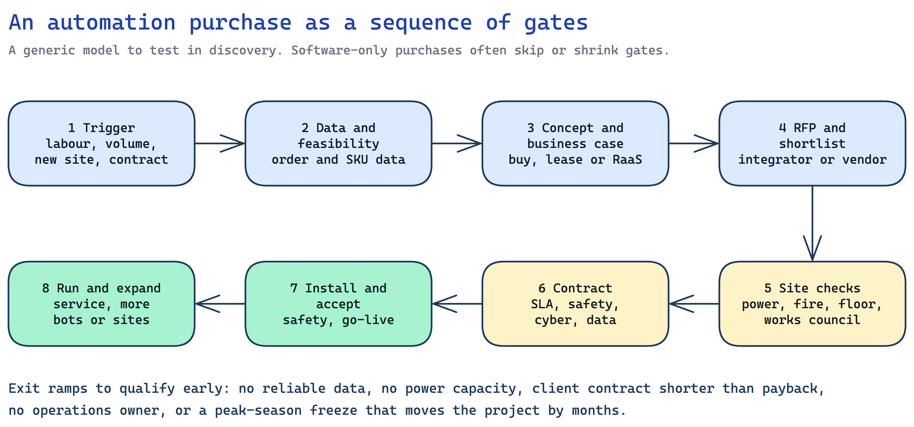
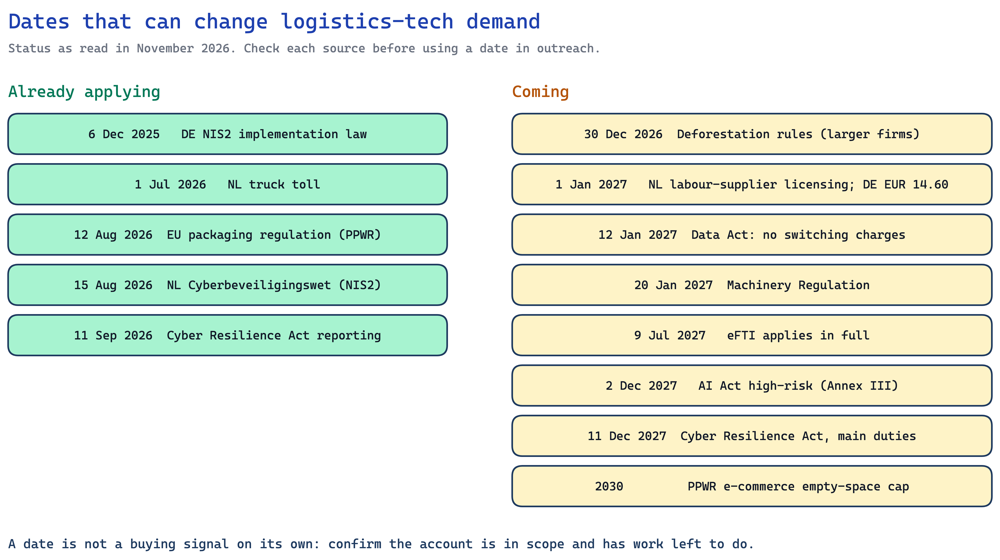
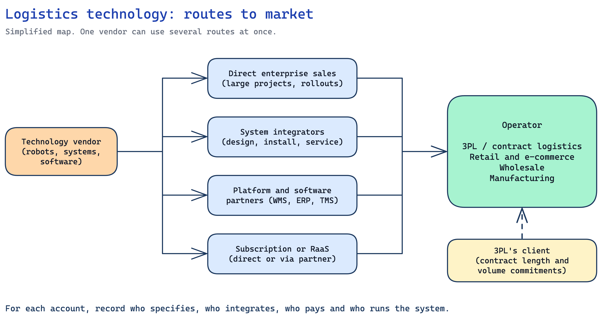

# Industry guide: logistics and warehouse technology, software and automation (EMEA, with the Netherlands and Germany in focus)

**For:** people learning GTM engineering, and candidates preparing for roles at logistics-technology, warehouse-automation and supply-chain software companies.
**Status:** facts checked on 26 November 2026. Rules and market figures change. Re-check before you use them.
**Not legal advice.** The sections on law are a learner's plain-language summary. Ask a qualified lawyer before you run a campaign or make a compliance claim.

## How to read this guide

- A number in brackets points to the [source list](#sources). Every source was opened for this guide.
- **Inference** means a conclusion drawn from the cited facts. No source states it.
- **Assumption** means a number or rule chosen so that an example can run. Replace it with your own evidence.
- Playbooks, committee maps, tiers, plans, sample copy and metric trees are **proposed designs**. They do not describe how any company works inside.

## 1. Market definition and segments

**Working definition:** technology sold to organisations that store and move goods. It covers physical automation, the software that runs it, and software that plans or documents transport.

| Segment (proposed) | Examples | What is sold | Typical buying pattern (inference) |
|---|---|---|---|
| Fixed automation | Conveyors, sorters, storage and retrieval systems | Engineered project plus service | Long, capital-heavy, site-specific |
| Mobile robots | AMRs and driverless vehicles | Purchase, lease or subscription | Can start with a smaller fleet and expand |
| Warehouse software | WMS, execution, control, labour tools | Licence or subscription plus integration | Tied to ERP and automation plans |
| Transport software | Transport management, visibility, freight documents | Subscription or per transaction | Network effects and partner connections matter |
| Trade and compliance software | Customs, product-traceability, freight data | Subscription or per transaction | Driven by dated rules and data quality |
| Equipment and trucks | Forklifts, racking, scanners | Purchase, lease, rental, service | Dealer and service networks |

Buyer groups: third-party logistics (3PL) providers, retailers and e-commerce firms, wholesalers, manufacturers, parcel and postal operators, ports and terminals, and freight forwarders and carriers. Each has a different reason to buy. Do not run one message across all of them.

## 2. Market size: what the numbers say and why they disagree

### Warehouse automation

| Estimate (global) | Source | Scope stated |
|---|---|---|
| About EUR 21 billion in 2025, about EUR 42 billion in 2030; Europe about 28% of 2025; DACH the largest European market | L.E.K. Consulting with Harris Williams, reported 23 November 2026 [1] | AI-supported robotics, computer vision, matrix warehouses, driverless transport; the article gives no formal definition |
| USD 23.92 billion in 2025, USD 27.46 billion in 2026, USD 47 billion in 2030 | The Business Research Company, listed on Research and Markets [2] | Includes conveyors and sortation, storage and retrieval, mobile robots, **WMS** and identification technology |
| USD 34.17 billion in 2026; USD 76.22 billion forecast for 2032. The same page notes other firms' 2025 estimates from USD 16.8 billion to USD 31.71 billion | Mordor Intelligence [3] | Equipment, control software, implementation and operating services; **excludes** stand-alone WMS, buildings and warehousing services |

These differ in currency, years, forecast method and, above all, **scope**: one includes WMS and another excludes stand-alone WMS. Do not average them. Do not convert currencies without stating the rate and date. For orientation only, 28% of EUR 21 billion is about EUR 5.9 billion for Europe in 2025 (my arithmetic on [1]).

### Neighbouring measures (not the same market)

| Measure | Value | Source |
|---|---|---|
| Production by **German** manufacturers of materials-handling and intralogistics equipment | EUR 27.7 billion in 2024; estimated EUR 25.8 billion in 2025 (down 7%); forecast flat at EUR 25.8 billion in 2026 | VDMA, February 2026 [4] |
| EU-27 production, same field | Estimated EUR 65.7 billion in 2024, with some national gaps filled by approximation | VDMA [4] |
| German exports, same field | EUR 18.6 billion in 2025; exports to the Netherlands EUR 989.7 million, down 9.1% | VDMA [4] |
| Professional service robots for transport and logistics, **units**, worldwide | About 117,500 sold in 2025, up 21%, 47% of professional service robot units; robot-as-a-service is growing, though outright sales remain the main model | International Federation of Robotics, 30 September 2026 [5] |
| Supply chain management software **with agentic AI features** | From under USD 2 billion in 2025 to a forecast USD 53 billion in 2030 | Gartner forecast, as reported by MHL News [6]. A forecast for a feature-defined slice, not for logistics software as a whole |

**Reading the cycle (inference):** German production fell in 2025 and was forecast flat for 2026 [4], while forecasts for automation show growth [1][2][3]. Both can be true because they measure different things. VDMA also points to weak industrial demand and investment hesitation, with a possible recovery from 2027 [4]. Do not open a sales conversation with "the market is booming".

### One vendor's results as a temperature check

KION reported that order intake in its Supply Chain Solutions segment, which was renamed Intelligent Automation Solutions from 2026, rose 39.5% to EUR 3.599 billion in 2025. Segment revenue rose 4.4% to EUR 3.071 billion, with both project and service business growing [7]. This is one company. Orders and revenue move at different speeds in project businesses.

## 3. How buyers buy

### General B2B survey evidence

6sense surveyed 945 buyers in Belgium, France, Germany, the Netherlands and Sweden who had been directly involved in a purchase of at least USD 25,000. For 2025 it reports an 11-person buying group in both the Netherlands and Germany, 5.1 (Netherlands) and 5.3 (Germany) vendors evaluated on average, and cycles of 13 months (Netherlands) and 11 months (Germany) [8]. This is **not** logistics-specific, per-country sample sizes are not shown, and the publisher sells buying-signal software. Capital automation projects may be quite different. Measure your own cycle.

The 2026 MHI and Deloitte industry report, as summarised in MHI's magazine, says about 56% of organisations expected to increase supply-chain innovation spending. Of these, 52% planned to spend over USD 1 million. Barriers included unclear use cases, automation cost, difficulty building the business case, talent shortages and budget limits [9]. The summary read here states no region or sample size, so do not present it as Dutch or German data.

### Buying committee (proposed model)

| Role | Cares about | Typical blocker | Evidence to prepare |
|---|---|---|---|
| Warehouse or site operations lead | Throughput, accuracy, peak, staff | "It will not survive peak" | Reference process, ramp plan, fallback to manual |
| Supply chain or logistics director | Network plan, service levels, cost | "The network may change" | Scenarios, redeployment options |
| Industrial engineering | Design fit | "Your assumptions do not match our orders" | Analysis on their order and item data |
| IT and operational technology | Integration, uptime, security | "Another interface to maintain" | Interface list, architecture, patching, access |
| Finance | Cash, payback, accounting | "Payback exceeds our horizon" | Sensitivity model, buy/lease/subscribe comparison |
| Procurement | Comparable bids, risk | "Not comparable" | Clear scope, exclusions, service levels |
| Health and safety | People near machines | "Not assessed" | Risk assessment, conformity documents |
| Works council | Monitoring, workload, jobs | "This tracks individuals" | Data fields, reports, role access, settings |
| Facility owner or developer | Floor, fire, power, lease | "The building cannot take it" | Site survey requirements |
| 3PL's commercial lead and the 3PL's client | Contract fit | "Contract ends before payback" | Term-matched options |
| Integrator or consultant | Feasibility, own accountability | "We specify another technology" | Partner enablement, interfaces |

### The 3PL contract problem

A CBRE note on 3PL warehouse contracts says contracts should assign who pays for labour, equipment, real estate, systems, transport and start-up. Contract length shapes the split. Racking, handling equipment and automation are often passed through to the client. For short deals under about two to three years that keep being renewed, the client may be better off buying equipment than paying passed-through lease costs. For systems, buying may make sense for contracts beyond about three to four years [10]. The note refers to US accounting standards, so check local contract and accounting treatment.

**Inference:** when you sell to a 3PL, ask the remaining term of the client contract that would fund the project, who owns the equipment at exit, and whether it can move to another client or site.

### Cycle and gates



This is a generic model. Ask each buyer for their own gate dates, their peak-season change freeze, their budget calendar and any client-contract deadline.

### Works councils

Where a works council exists:

- **Germany:** unless law or a collective agreement already settles the matter, it has co-determination on introducing and using technical equipment designed to monitor employee behaviour or performance. A conciliation committee decides if there is no agreement [11].
- **Netherlands:** consent is required for adopting, changing or withdrawing rules on facilities aimed at or **suitable for** observing or checking presence, behaviour or performance, article 27(1)(l). Rules on working conditions, 27(1)(d), and on processing staff data, 27(1)(k), are also listed [12].

**Inference:** scanners, wearables, vision systems, pick-rate dashboards and robot-human task assignment can all raise this. Other works council rights on operational change may apply too; this guide did not research them.

### Public and utility buyers

Ports, postal operators, municipalities and other public bodies may have to tender. For 2026 and 2027 the EU thresholds for supplies and most services are EUR 140,000 for central government, EUR 216,000 for sub-central authorities and EUR 432,000 under the utilities directive; the works threshold is EUR 5,404,000 [13]. Whether a specific buyer is covered depends on its legal status and activity.

## 4. Regulation and policy that change demand

Status as read on 26 November 2026. "GTM meaning" is **inference**.



| Rule | Date and status | GTM meaning |
|---|---|---|
| **Machinery Regulation** (EU) 2023/1230 | Applies in full from **20 January 2027**, replacing Directive 2006/42/EC; aims to cover technology such as autonomous mobile machinery better [14]. The originally published text printed 14 January 2027 [15]; EU-OSHA gives 20 January [14]. Confirm the correction in the consolidated text. The text has specific requirements for autonomous mobile machinery, including a supervisory function where relevant [15] | Robot buyers and integrators will ask for conformity plans, especially for equipment supplied around the change |
| **AI Act**, as amended by Regulation (EU) 2026/1744 | High-risk duties apply from **2 December 2027** for Annex III uses and **2 August 2028** for AI covered through Annex I product law. The amendment also moves the Machinery Regulation to a sector-based route within Annex I and calls for AI requirements to be added through delegated acts applying by 2 August 2028 [16] | Annex III includes AI used to make decisions on work terms, to allocate tasks based on behaviour or traits, or to monitor and evaluate workers' performance [17]. Check labour-management and task-allocation features. Machine-safety AI follows the machinery route; get specialist advice |
| **Cyber Resilience Act** | Vulnerability and incident reporting since **11 September 2026**; main duties from **11 December 2027** [18]. Covers hardware and software with digital elements, including remote processing that the product needs and the manufacturer is responsible for [19] | Robots, controllers, scanners and gateways may be in scope; ask about support period and vulnerability handling |
| **NIS2** | Netherlands: Cyberbeveiligingswet in force **15 August 2026**; its 18 sectors include transport [20]. Germany: implementation law in force **6 December 2025**; BSI cited about 29,500 supervised entities [21]. The directive requires measures including supply-chain security for direct suppliers [22] | Covered operators assess technology suppliers. Whether a given warehouse operator is covered depends on sector and size |
| **Data Act** | Applies from **12 September 2025**. The access-by-design duty applies to connected products and related services placed on the market after **12 September 2026**. Cloud switching charges are banned from **12 January 2027** [23] | Contracts for robot and equipment data need review: who can access and share operating data |
| **eFTI** (electronic freight transport information) | Applies in full on **9 July 2027**: authorities must accept information operators share through certified platforms. The Commission planned remaining technical and certification rules by December 2026 [24]. Check whether they were adopted. Coverage is regulatory freight information in road, rail, inland waterway and air | A reason to review freight-document systems. It obliges authorities to accept; do not tell operators they must switch to eFTI |
| **Packaging and Packaging Waste Regulation** (EU) 2025/40 | General application from **12 August 2026**. By **1 January 2030**, or three years after the relevant implementing acts if later, those filling grouped, transport or e-commerce packaging must keep empty space at no more than **50%**, with exemptions. The calculation method is due by 12 February 2028 [25] | Cartonisation, dimensioning, packing automation and packaging data |
| **Deforestation Regulation** (EUDR) | Applies from **30 December 2026** for large and medium operators and traders; **30 June 2027** for micro and small enterprises [26], but only for products not already covered by the earlier EU Timber Regulation [27]. Newly added products: 30 December 2027 [26] | Affects specific commodities and supply chains, not all logistics. Check product scope and the company's role |
| **Netherlands truck toll** | Since **1 July 2026**, for N2 and N3 trucks over 3,500 kg, Dutch and foreign [28] | Transport cost, routing and billing data |
| **German minimum wage** | EUR 13.90 per hour since 1 January 2026; EUR 14.60 from **1 January 2027** [29] | One input to a labour business case. Use the site's real wage bill |
| **Dutch labour-supplier licensing** (Wtta) | In force **1 January 2027**; labour inspectorate enforcement from **1 January 2028**. Hirers may not use unauthorised suppliers and can be fined [30] | Warehouses that rely on agency labour may review labour supply. This does not by itself justify automation |
| **Dutch grid congestion** | Since **1 July 2026** requests for new or larger connections in congested areas go on one waiting list, with priority for projects of public importance. From 1 January 2027 remaining capacity goes to the non-priority queue and some areas may then have none [31] | **Qualify power early.** Automation and vehicle charging may need capacity the site does not have |

### Labour tightness

Eurostat job vacancy rates for transport and storage (NACE H), not seasonally adjusted, all firm sizes, in the latest three quarters the queried table returned [32]:

| 2025 | Netherlands | Germany | EU-27 |
|---|---|---|---|
| Q2 | 3.8% | 2.5% | 2.0% |
| Q3 | 3.6% | 3.0% | 2.0% |
| Q4 | 3.3% | 2.9% | 1.9% |

This sector is wider than warehousing. The Dutch rate was higher than the EU rate but fell over these quarters. Check for newer data and use site-level evidence.

## 5. Publicly documented GTM motions



### 5.1 AutoStore: sales through system integrators

AutoStore's release on 2025 results says all sales are distributed, designed, installed and serviced by qualified system integrators. It reports about 1,900 systems, operations in 65 countries and 150 new customers added in 2025 [33].

**GTM-engineering implications (inference):** in a partner-led model the key objects are partner, opportunity registration, end customer and site. Useful work includes partner capacity and specialisation data, account-ownership rules, lead routing with service-level clocks, and installed-base signals for expansion. Attribution must separate vendor-sourced from partner-sourced.

### 5.2 Locus Robotics: robots as a service

Locus's page describes an all-inclusive subscription priced per robot per year, billed annually in advance, with a small one-time setup fee for each new site. It includes software, design and project support, maintenance and 24/7 support, and lets customers add robots for peaks and growth. The page gives no rates, minimum term or details of peak billing [34].

**Implications:** the sale does not end at go-live. Track live robots per site, utilisation, peak additions and renewal. **Inference:** subscription pricing moves money from capital to operating budgets, but accounting treatment and total cost still need finance review.

### 5.3 WiseTech Global (CargoWise): large rollouts and a new commercial model

WiseTech's fiscal 2026 report (year to 30 June 2026) says CargoWise revenue grew 11% to USD 756.9 million. It names growth drivers including rollouts at large global freight forwarders, more use by existing customers, price increases and a new commercial model, CargoWise Value Packs, launched in December 2025 and in place with more than 95% of CargoWise customers. It counts 61 large-forwarder rollouts secured, and says more than 75% of expected volume from those contracted and in progress was not yet live at year end [35].

**Implications:** for enterprise software, "closed won" can come long before usage. Keep separate stages for contracted, deploying and live volume.

### 5.4 KION (Dematic): projects plus service

KION's 2025 release shows project and service business both growing in its automation segment [7]. **Inference:** an installed base creates service, modernisation and extension opportunities, so installed-system age and capacity are valuable first-party signals for a vendor with an installed base.

### 5.5 Choosing a route

| If your product | Lead route to test (inference) | Data you must capture |
|---|---|---|
| Needs engineering per site | Integrator or direct project team | Site, project stage, specifier, integrator |
| Deploys in standard units | Direct or partner subscription | Site, units live, utilisation |
| Plugs into WMS or ERP | Software partner and marketplace | Installed system and version (with permission) |
| Connects many trading parties | Network-led landing from one participant | Connections, active partners, transaction volume |

## 6. ICP and tiering

**Example product used in this guide:** a hypothetical warehouse orchestration subscription, sold per site, that coordinates manual pickers and mobile robots on top of an existing WMS.

| Dimension (assumption) | Fit | Disqualifier |
|---|---|---|
| Operation | Piece or case picking with several zones | Pallet-in, pallet-out only |
| Volume and shifts | At least two shifts or sharp peaks | Low, flat volume |
| Systems | A WMS with usable interfaces | No system of record |
| Contract horizon | At least three years of expected use (own site or client contract) | Exit planned within 18 months |
| Site | Workable floor and wireless; power path known | No power or building route |
| Owner | Operations sponsor and IT counterpart | No operations owner |

**Account and site are different records.** Model: legal entity → group → site → system → project. For 3PLs add the client contract.

**Score (assumption, 0 to 100):** operation fit 35, feasibility 25, timing signal 25, access (partner path or existing relationship) 15.

| Tier | Rule (assumption) | Treatment |
|---|---|---|
| 1 | Score 70 or more and a verified site | Site-level plan, integrator mapping, committee map |
| 2 | 50 to 69 | Education, events, wait for a trigger |
| 3 | Below 50 | Content only |
| Excluded | Disqualifier, objection, suppression, conflicting partner registration | No direct marketing contact |

Validate the score by time: freeze it at a past date, then see which sites later started a project. Compare with a simple rule such as "all 3PL sites above a floor-area threshold".

## 7. Buying signals and where to get them legally

A signal justifies **research**. It does not give permission to **contact**.

| Signal | Why it may matter | Lawful source | Check before using |
|---|---|---|---|
| New or expanding distribution centre | Design window | Company announcements; official planning and permit publications | Terms of each source; many projects are designed before news appears |
| Large warehouse lease or build | Site change | Company or developer announcements | Occupier may not be the operator |
| Public tender or award | Budget, scope, dates | TED [36]; TenderNed [37] | Personal data in notices still falls under data protection law |
| 3PL wins a new client contract | New process and funding horizon | The 3PL's or client's announcement | Do not assume term or scope |
| Hiring: automation engineer, WMS lead, many pickers | Programme or labour pressure | Employer careers pages; licensed job-data feeds | Read terms; do not collect applicants' data |
| Warehouse locations and footprints | Site universe | OpenStreetMap [38] | ODbL attribution and share-alike; coverage is uneven; for bulk use take extracts, not the editing API [39] |
| Sector vacancies | Context for labour pressure | Eurostat [32] | Aggregate only; never a company-level signal |
| Grid constraint at a location | A **risk**, sometimes a trigger for efficiency projects | Grid operators' published tools and notices [31] | Local and changing |
| Rule date with confirmed scope | Deadline work | Official texts in section 4 | Confirm role and product scope |
| Your installed base: age, capacity, service tickets | Expansion or modernisation | Your own systems | Contract and data-access terms, including the Data Act [23] |

For each signal store source, observation date, site, confidence and expiry. **Assumption:** review site-project signals every 90 days; automation cycles are longer than typical software cycles, so do not expire them as fast as web behaviour.

## 8. Data sources and their terms

| Source | Use | Terms read (summary) |
|---|---|---|
| Eurostat [32][40] | Enterprise counts, vacancies | Statistical data may be reused commercially with attribution; some non-Eurostat data and data on some non-European countries are non-commercial only [41] |
| CBS | Dutch statistics | CC BY 4.0 unless stated otherwise [42] |
| Destatis and GENESIS-Online | German statistics | GENESIS under "dl-de/by-2-0" with attribution [43][44] |
| KVK | Verify Dutch companies | Not meant, as a rule, as a direct-marketing source; targeted acquisition tools are listed as outside its purposes; open datasets CC BY 4.0; non-mailing indicator applies to post and door-to-door [45] |
| Handelsregister | Verify German companies | Individual retrievals for information [46]; portal rules as reproduced by a third party limit use to 60 retrievals per hour [47]. No bulk scraping |
| TED | Tenders | Notices generally reusable, including commercially; personal data rules still apply [36] |
| TenderNed | Dutch tenders | Dataset listed as CC0; XML API needs credentials [37] |
| OpenStreetMap | Sites | ODbL [38]; usage policy for services [39] |
| LinkedIn | Manual research | Agreement bans scraping, bots and unauthorised automation including automated messaging [48] |
| Commercial intent, firmographic and site databases | Enrichment | Not reviewed here. Check origin, licence, EU suppression handling and permitted use |

## 9. Outreach law: Netherlands and Germany (not legal advice)

You need to pass two tests: the **channel rule** and **data protection law**.

### GDPR in brief

- Direct marketing may be a legitimate interest [49], but not automatically. EU board guidance (version 2.0, 10 November 2026) requires a legitimate interest, necessity and a balancing test. It says legitimate interest cannot be used for unlawful marketing, national law may require consent even when marketing to professionals, and intrusive profiling or tracking would be very unlikely to pass [50].
- When data comes from elsewhere, give the required information within a reasonable period, at most one month, and no later than the first communication if you use it to contact the person; the law has exceptions and further timing rules [49].
- After an objection to direct marketing, stop processing the data for that purpose [49].

### Netherlands (Telecommunications Act, article 11.7) [51]

- Unsolicited commercial e-mail and other electronic messages, automated calls and fax need **provable prior consent**.
- A legal entity or a person acting in business may be messaged without prior consent at contact details it has **designated and published for receiving such messages**, used for the stated purpose. Do not treat every published address as one. Recipients outside the European Economic Area fall under a separate exception.
- Own customers: details obtained in a sale may be used for your own similar products or services if an easy, free objection was offered at collection and in every message.
- Live calls to **natural persons**, which the regulator says include sole traders and partnerships, need prior consent. Since 1 July 2026 this also covers existing and former customers, with limited exceptions [52][53].
- The text's consent rule for these other means is limited to natural persons. **Inference:** a live call to a legal entity is outside it. The sources read do not settle calls to a named employee's line. Get advice.
- Show the true sender and a working address or number for stop requests in every electronic message.
- **Addressed post:** Inference, not verified: this guide treats post as outside article 11.7. The statute's wording 'other means' does not name post either way. Confirm with ACM guidance or counsel before mailing sole traders or partnerships.
- A government portal states fines of up to EUR 900,000 per violation of the spam ban [54].

### Germany (UWG section 7) [55]

- E-mail, fax and automated calls need **prior express consent**, including B2B.
- The existing-customer e-mail exception needs all of: address obtained from the customer in a sale; your own similar goods or services; no objection; clear notice of the free right to object at collection and in each use.
- Phone: consumers need express consent; businesses need at least **presumed consent**. The German data protection conference says topical relevance alone is not enough: there must be a concrete reason from the called business's own interests, such as an earlier business contact [56].
- Advertising that the recipient recognisably does not want is also unlawful. Do not hide the sender; give a valid opt-out address.

### Applied to logistics prospecting (inference)

- A site's general phone number or info@ address is not permission.
- A trade-fair badge scan is not consent unless the wording and record show it.
- A promotional direct message is an electronic message; EU guidance lists messengers among channels needing consent, subject to exceptions and national rules [50].
- A partner passing you a contact does not automatically pass you consent. Record who obtained it, for whom and for what.

## 10. Channels, messaging angles and sample copy

| Channel | Role | Notes |
|---|---|---|
| Integrators and consultants | Specification and delivery | Registration rules, enablement, data-sharing agreement |
| Trade fairs and site visits | See equipment and meet committee members | Collect clear, separate consent |
| WMS, ERP and TMS partners | Trigger and trust | Co-selling data terms |
| Technical content | Help engineers and finance | Sizing guide, safety checklist, payback model with editable inputs |
| Reference visits | Reduce perceived risk | Only with the reference customer's permission |
| Search and paid media | Capture demand | Tracking consent |
| Addressed post | Reach operations leads | GDPR, objections, KVK indicator [45]. That post is outside Dutch article 11.7 is an unverified inference (section 9): check before mailing sole traders or partnerships |
| Phone and e-mail | Follow-up | Only under section 9 |

| Angle | For | Proof needed |
|---|---|---|
| Peak without a fixed fleet | Operations, finance | Your real contract terms and a measured deployment |
| Fits the contract you have | 3PL | Term-matched options and exit rules |
| Feasibility before the pitch | Engineering | Analysis on their data, with limits stated |
| Power and building first | Facilities | Load and site requirements |
| Staff data made visible | HR, works council, privacy | Field list, role access, settings |
| Dated readiness | Compliance, IT | Official source, confirmed scope, your specific contribution |

**Never use** a payback period, productivity percentage or safety claim that you cannot show with a defined baseline.

### Sample copy

All copy concerns a fictional product, "Product". Send only through a permitted channel. Check Dutch and German with a native speaker.

**A. Letter to an operations director (English)**
> Subject: Three questions before any robot discussion
> Dear [name],
> Your company announced [specific public fact, date]. Before discussing technology, three questions usually decide feasibility: how long the operation is committed to the site, what power is available, and what order data exists. We have put them on one page, enclosed. If it helps, the same page works with any supplier.
> How we obtained your details and your rights: [privacy notice]. To stop receiving marketing from us: [method].

**B. German letter to a 3PL**
> Betreff: Automatisierung passend zur Vertragslaufzeit
> Guten Tag [Name],
> bei Kontraktlogistik zählt, ob sich eine Lösung innerhalb der Kundenvertragslaufzeit rechnet und was danach mit der Technik passiert. Beigefügt ist eine Rechenvorlage mit offenen Annahmen, die Sie selbst ändern können.
> Herkunft Ihrer Daten und Ihre Rechte: [Datenschutzhinweis]. Sie können der Werbung jederzeit widersprechen: [Weg].

**C. Dutch e-mail to someone who opted in at a trade fair**
> Onderwerp: De checklist die u op [beurs] aanvroeg
> Beste [naam],
> u vroeg ons om informatie na [beurs]. Hierbij de checklist voor stroom, vloer, gegevens en veiligheid. Wilt u de rekenvorm met uw eigen cijfers invullen? Dan sturen wij die toe.
> Geen berichten meer? [afmeldlink]. Afzender: [bedrijfsnaam, adres].

**D. Partner enablement note**
> For your next design review: attached are our interface list, the data we need to size a pilot, and the cases where Product is the wrong choice. Register an opportunity at [link]; we reply within [your real service level].

**E. Call opener to a German business with a concrete, recorded reason**
> "When we met at [event] you asked how Product handles your peak and asked me to call in November. Do you have five minutes?"

## 11. 30-60-90 day plan (for a new GTM engineer; proposed)

| Window | Work | Done when |
|---|---|---|
| Days 1 to 30 | Learn the operation: visit a site if you can. Map account, site, system, project and partner objects. Define stages with entry evidence. Audit consent, suppression and partner-data terms. Review recent won, lost and stalled projects | Data dictionary, stage rules, list of data gaps and risks |
| Days 31 to 60 | Build a site universe for one country and one segment from permitted sources. Match to legal entities with a confidence score and a manual review queue. Add two signals with expiry. Build partner registration and routing | A reviewed sample with measured match precision; documented error cases |
| Days 61 to 90 | Hand tier-1 sites to owners with reasons. Compare with the simple baseline list. Add exit-gate fields (power, data, contract horizon, works council). Build a stage-age report | A keep, change or stop decision using accepted-rate and disqualification reasons, with counts |

Do not promise pipeline or revenue impact within 90 days when cycles may run a year or more. Report data quality, acceptance and speed.

## 12. Metrics tree (proposed)

```
North star: live, retained contract value (report booked and live separately)
├── Market coverage
│   ├── Sites in the universe, % with verified operator
│   ├── Tier-1 sites with an owner, a route (direct or partner) and a committee map
│   └── Match precision on a reviewed sample
├── Demand
│   ├── Signal acceptance rate by source; false-positive reasons
│   ├── Meetings with an operations stakeholder
│   └── Partner registrations and acceptance time
├── Project funnel (median age and conversion per gate)
│   ├── Data received → feasibility done → business case agreed
│   ├── Shortlist → site checks passed → contract
│   └── Loss and stall reasons: power, data, term, budget, safety, competitor, no decision
├── Delivery and value
│   ├── Contract to go-live time
│   ├── Contracted vs live sites, robots or transaction volume
│   └── Measured result against the agreed baseline
├── Expansion and retention: added units and sites, service attach, renewal, churn
└── Guardrails: safety incidents, uptime against SLA, objections and complaints,
    blocked unlawful sends (target for slipped sends: zero), partner conflicts
```

With few, large deals, ratios swing widely. Show counts, use stage history, and resist ranking channels on a handful of wins.

## 13. Worked bottom-up TAM: warehouse orchestration subscription, Netherlands and Germany

**A teaching example, not a market estimate.** Only the enterprise counts are data.

**Formula**

```
TAM = sum over (country, segment) of  N x q x s x P
SAM = TAM x r
```

| Symbol | Meaning | Status |
|---|---|---|
| N | Enterprises, 2024 | **Data** [40] |
| q | Share that run a qualifying warehouse themselves | **Assumption** |
| s | Qualifying sites per qualifying enterprise | **Assumption** |
| P | Annual subscription per site: EUR 30,000 (low 15,000, high 50,000) | **Assumption**, not a market price |
| r | Share serviceable today (integrations, language, support, partners): 45% (30-60%) | **Assumption** |

NACE codes: H52 warehousing **and transport support**, G46 wholesale, G47 retail, C manufacturing.

| Segment (persons employed) | N Germany [40] | N Netherlands [40] | q (assumption) | s (assumption) | Base sites |
|---|---|---|---|---|---|
| H52, 50-249 | 1,337 | 256 | 40% | 1.5 | 956 |
| H52, 250+ | 316 | 79 | 50% | 4.0 | 790 |
| G46, 50-249 | 4,466 | 1,454 | 35% | 1.2 | 2,486 |
| G46, 250+ | 915 | 197 | 55% | 3.0 | 1,835 |
| G47, 50-249 | 5,347 | 631 | 10% | 1.2 | 717 |
| G47, 250+ | 666 | 171 | 35% | 2.0 | 586 |
| C, 250+ | 4,415 | 424 | 40% | 2.0 | 3,871 |

In the low and high cases every q is multiplied by 0.6 and 1.4; s stays fixed.

| Scenario | Sites DE | Sites NL | Total sites | TAM | SAM |
|---|---|---|---|---|---|
| Low | 5,676 | 1,069 | 6,745 | EUR 101m | EUR 30m |
| Base | 9,460 | 1,782 | 11,241 | EUR 337m | EUR 152m |
| High | 13,243 | 2,495 | 15,738 | EUR 787m | EUR 472m |

(The base TAM happens to equal the base TAM in the [B2B SaaS guide](b2b-saas-gtm.md). The two models share no price or share inputs; it is a coincidence.)

**Weak points, in order**

1. **q and s are guesses.** Test them: draw a random sample from each segment, verify sites by hand, and report an interval.
2. **H52 includes transport support activities** such as terminal and port services, not only warehouses.
3. **Enterprises are not groups or sites.** One group can appear as several enterprises; one foreign operator's sites may be counted under local units differently than you expect.
4. **Coverage gaps:** firms below 50 staff, parcel and postal operators outside these codes, and public operators are left out.
5. **A TAM is not comparable with section 2.** This counts one software subscription in two countries; those reports count equipment and more.

**Capacity check (assumption):** 3 sales teams, 5 new customers per team per year, 1.5 live sites per customer, 95% of sites kept each year, everything live in the year sold. After three years: about 64 sites and EUR 1.93m annual recurring revenue at EUR 30,000. Real deployment delay would lower this. Compare it with the 11,241-site base count: capacity, delivery and partners limit growth long before TAM does.

**Change it yourself:**

```python
# enterprises: Eurostat sbs_sc_ovw 2024. (DE count, NL count)
N = {"H52 50-249":(1337,256), "H52 250+":(316,79), "G46 50-249":(4466,1454), "G46 250+":(915,197),
     "G47 50-249":(5347,631), "G47 250+":(666,171), "C 250+":(4415,424)}
# ASSUMPTIONS: share running a qualifying warehouse, and qualifying sites per such firm
q     = {"H52 50-249":0.40,"H52 250+":0.50,"G46 50-249":0.35,"G46 250+":0.55,
         "G47 50-249":0.10,"G47 250+":0.35,"C 250+":0.40}
sites = {"H52 50-249":1.5,"H52 250+":4.0,"G46 50-249":1.2,"G46 250+":3.0,
         "G47 50-249":1.2,"G47 250+":2.0,"C 250+":2.0}
# ASSUMPTIONS (low, base, high)
q_mult = (0.6,1.0,1.4); price = (15_000,30_000,50_000); reach = (0.30,0.45,0.60)
for i, name in enumerate(["low", "base", "high"]):
    per = {"DE": 0, "NL": 0}
    for seg, (de, nl) in N.items():
        for c, n in (("DE", de), ("NL", nl)):
            per[c] += n * min(q[seg] * q_mult[i], 1) * sites[seg]
    total = sum(per.values()); tam = total * price[i]
    print(f"{name}: DE={per['DE']:,.0f} NL={per['NL']:,.0f} total={total:,.0f} "
          f"TAM=EUR {tam/1e6:,.0f}m SAM=EUR {tam*reach[i]/1e6:,.0f}m")

teams, wins, sites_per_win, years, keep = 3, 5, 1.5, 3, 0.95   # ASSUMPTIONS
live = 0
for _ in range(years):
    live = live * keep + teams * wins * sites_per_win
print(f"live sites after {years} years={live:,.0f}, ARR=EUR {live*30_000/1e6:,.2f}m")
```

## 14. Risks

| Risk | Early sign | Response |
|---|---|---|
| Capital spending slows | Stages age; "next year" | Smaller scope, subscription option, requalify |
| No power or building route | Late site survey | Make it a first-meeting question [31] |
| 3PL contract ends before payback | Vague term answers | Term-matched or redeployable options [10] |
| Poor order or item data | Feasibility keeps slipping | Data-readiness gate; paid assessment |
| Peak freeze | Go-live near the busy season | Plan backwards from the freeze date |
| Works council or privacy objection | Late involvement | Early data map and configuration options [11][12] |
| Partner conflict | Two teams on one account | Registration rules and a single owner of record |
| Compliance claim overreach | "You must buy this by [date]" in copy | Legal review; state scope and what your product does not do |
| Contracted is mistaken for live | Revenue forecast misses | Separate contracted, deploying and live [35] |
| Vendor ROI claims used as fact | No baseline | Agree baseline and measurement before the pilot |

## 15. Verify before using

- [ ] Corrected Machinery Regulation date and what it means for your equipment [14][15]
- [ ] AI Act route and classification for each AI feature [16][17]
- [ ] Cyber Resilience Act scope and support-period duties [19]
- [ ] NIS2 scope for each target [20][21][22]
- [ ] Whether eFTI implementing specifications were adopted [24]
- [ ] EUDR product scope, company role and any later change [26][27]
- [ ] PPWR implementing acts, exemptions and role definitions [25]
- [ ] Dutch grid status at the actual location [31]
- [ ] Current Wtta transition dates with the Dutch authorities [30]
- [ ] Dutch article 11.7 and German section 7 against your exact channel and recipient; later case law [51][55][56]
- [ ] Market figures in the original reports; the L.E.K. figures come from press coverage [1] and the Gartner figure too [6]
- [ ] Current company filings and pages for section 5
- [ ] Your own q, s, P and capacity values

## 16. Using this as a job candidate

Be ready to explain: why account and site must be separate records; how a 3PL's contract length changes the offer; why "contracted" is not "live"; how you would measure whether a site signal is any good; what you would check before sending one e-mail to a German operator; and why two market reports differ. A strong exercise: sample 30 firms from one TAM row using permitted sources, estimate q with an interval, and show what you could not verify.

## Sources

All accessed 26 November 2026.

1. Logistik Heute, report of the L.E.K. Consulting and Harris Williams study: https://logistik-heute.de/en/news/forecast-market-warehouse-automation-grow-42-billion-euros-2030-294266.html
2. Research and Markets, listing for The Business Research Company's warehouse automation report: https://www.researchandmarkets.com/reports/5767469/warehouse-automation-market-report
3. Mordor Intelligence, warehouse automation market: https://www.mordorintelligence.com/industry-reports/warehouse-automation-market
4. VDMA, materials handling and intralogistics market development, February 2026 (German): https://www.vdma.eu/documents/d/group-34568/marktentwicklung_intralogistik_2025-2026
5. International Federation of Robotics, professional service robots release: https://ifr.org/ifr-press-releases/news/global-sales-of-professional-service-robots-surge-24-percent
6. MHL News, report of a Gartner forecast: https://www.mhlnews.com/technology-automation/news/55369439/agentic-ai-supply-chain-software-to-hit-53-billion-by-2030
7. KION Group, 2025 results press release: https://www.kiongroup.com/KION-Website-Main/Investor-Relations/Reports-Presentations/2025-Reports-Presentations/FY-2025/2302_KION_Group_AG_Press_Release_FY_2025.pdf
8. 6sense, European buyer research: https://6sense.com/marketing-in-europe
9. MHI Solutions magazine, 2026 annual industry report article: https://www.mhisolutionsmag.com/index.php/2026/06/26/new-mhi-and-deloitte-report-finds-ai-is-biggest-disruptor-of-supply-chains-over-the-next-decade/
10. CBRE, 3PL contract viewpoint: https://www.cbre.com/insights/viewpoints/deconstruct-the-3pl-contract-to-create-value
11. Germany, BetrVG section 87: https://www.gesetze-im-internet.de/betrvg/__87.html
12. Netherlands, Wet op de ondernemingsraden article 27, official XML (latest version listed in the official manifest): https://repository.officiele-overheidspublicaties.nl/bwb/BWBR0002747/2023-02-18_0/xml/BWBR0002747_2023-02-18_0.xml
13. European Commission, procurement thresholds: https://single-market-economy.ec.europa.eu/single-market/public-procurement/legal-rules-and-implementation/thresholds_en
14. EU-OSHA, Machinery Regulation summary: https://osha.europa.eu/en/legislation/directive/regulation-20231230eu-machinery
15. Regulation (EU) 2023/1230, originally published text: https://publications.europa.eu/resource/celex/32023R1230
16. Regulation (EU) 2026/1744 (Digital Omnibus on AI): https://publications.europa.eu/resource/celex/32026R1744
17. Regulation (EU) 2024/1689 (AI Act), Annex III: https://publications.europa.eu/resource/celex/32024R1689
18. European Commission, Cyber Resilience Act: https://digital-strategy.ec.europa.eu/en/policies/cyber-resilience-act
19. Regulation (EU) 2024/2847 (Cyber Resilience Act): https://publications.europa.eu/resource/celex/32024R2847
20. Government of the Netherlands, Cyberbeveiligingswet in force: https://www.rijksoverheid.nl/actueel/nieuws/2026/08/15/cyberbeveiligingswet-en-wet-weerbaarheid-kritieke-entiteiten-vanaf-vandaag-van-kracht
21. BSI, NIS-2 implementation law press release: https://www.bsi.bund.de/DE/Service-Navi/Presse/Pressemitteilungen/Presse2025/251205_NIS-2-Umsetzungsgesetz_in_Kraft.html
22. Directive (EU) 2022/2555 (NIS2), article 21: https://publications.europa.eu/resource/celex/32022L2555
23. Regulation (EU) 2023/2854 (Data Act): https://publications.europa.eu/resource/celex/32023R2854
24. European Commission, eFTI Regulation: https://transport.ec.europa.eu/transport-themes/logistics-and-multimodal-transport/efti-regulation_en
25. Regulation (EU) 2025/40 (packaging and packaging waste): https://publications.europa.eu/resource/celex/32025R0040
26. European Commission, deforestation regulation page: https://environment.ec.europa.eu/topics/forests/deforestation/regulation-deforestation-free-products_en
27. EY Tax News, EUDR postponement: https://taxnews.ey.com/news/2026-0237-eu-deforestation-regulation-application-postponed-to-30-december-2026
28. Government of the Netherlands, truck toll: https://www.rijksoverheid.nl/themas/verkeer-en-vervoer/goederenvervoer/vrachtwagenheffing
29. German Federal Government, minimum wage: https://www.bundesregierung.de/breg-de/aktuelles/mindestlohn-steigt-2391010
30. Business.gov.nl, authorisation of personnel suppliers: https://business.gov.nl/amendments/certificate-for-temporary-employment-agencies/
31. Netbeheer Nederland, new grid allocation rules: https://www.netbeheernederland.nl/artikelen/nieuws/vanaf-1-juli-2026-nieuwe-regels-voor-de-verdeling-van-ruimte-op-het-stroomnet
32. Eurostat API, job vacancy statistics (`jvs_q_nace2`): https://ec.europa.eu/eurostat/api/dissemination/statistics/1.0/data/jvs_q_nace2?geo=NL&geo=DE&geo=EU27_2020&nace_r2=H&lastTimePeriod=3
33. AutoStore, Q4 2025 results release: https://www.autostoresystem.com/investors/press-releases/autostore-q4-2025-financial-results-4317e
34. Locus Robotics, Robots-as-a-Service: https://locusrobotics.com/why-locus/robots-as-a-service
35. WiseTech Global, fiscal 2026 Appendix 4E and financial report: https://announcements.asx.com.au/asxpdf/20260826/pdf/0737910sgpzj3r.pdf
36. TED, legal notice: https://ted.europa.eu/en/legal-notice
37. data.overheid.nl, TenderNed notices dataset: https://data.overheid.nl/dataset/aankondigingen-van-overheidsopdrachten---tenderned
38. OpenStreetMap, copyright and licence: https://www.openstreetmap.org/copyright
39. OpenStreetMap Foundation, API usage policy: https://operations.osmfoundation.org/policies/api/
40. Eurostat API, structural business statistics (`sbs_sc_ovw`, ENT_NR, 2024; change `nace_r2` for each sector): https://ec.europa.eu/eurostat/api/dissemination/statistics/1.0/data/sbs_sc_ovw?geo=NL&geo=DE&nace_r2=H52&time=2024&indic_sbs=ENT_NR
41. Eurostat, copyright and reuse: https://ec.europa.eu/eurostat/help/copyright-notice
42. CBS, copyright: https://www.cbs.nl/en-gb/about-us/website/copyright
43. Destatis, legal notice: https://www.destatis.de/EN/Service/Legal-Notice/_node.html
44. GovData, Data licence Germany attribution 2.0: https://www.govdata.de/dl-de/by-2-0
45. KVK, permitted and non-permitted uses of Business Register data: https://www.kvk.nl/kvk-data/waar-mag-je-gegevens-uit-het-handelsregister-wel-niet-voor-gebruiken/
46. Germany, HGB section 9: https://www.gesetze-im-internet.de/hgb/__9.html
47. bundesAPI/handelsregister project (third party): https://github.com/bundesAPI/handelsregister
48. LinkedIn User Agreement: https://www.linkedin.com/legal/user-agreement
49. Regulation (EU) 2016/679 (GDPR), recital 47, articles 14 and 21: https://publications.europa.eu/resource/celex/32016R0679
50. EDPB Guidelines 1/2024 on legitimate interest, version 2.0, 10 November 2026: https://www.edpb.europa.eu/system/files/2026-11/edpb_guidelines_202401_legitimateinterest_v2_en.pdf
51. Netherlands, Telecommunicatiewet article 11.7, official consolidated XML (version of 15 August 2026): https://repository.officiele-overheidspublicaties.nl/bwb/BWBR0009950/2026-08-15_0/xml/BWBR0009950_2026-08-15_0.xml
52. ACM, stricter telemarketing rules from 1 July: https://www.acm.nl/en/publications/stricter-telemarketing-rules-effect-starting-july-1-only-allowed-if-customers-have-given-consent
53. ACM, sales by telemarketing: https://www.acm.nl/nl/verkoop-aan-consumenten/reclame-en-verleiden/verkoop-telemarketing
54. Business.gov.nl, rules on advertising: https://business.gov.nl/regulations/advertising/
55. Germany, UWG section 7: https://www.gesetze-im-internet.de/uwg_2004/__7.html
56. Datenschutzkonferenz, guidance on direct marketing (February 2022): https://datenschutzkonferenz-online.de/media/oh/OH-Werbung_Februar%202022_final.pdf
