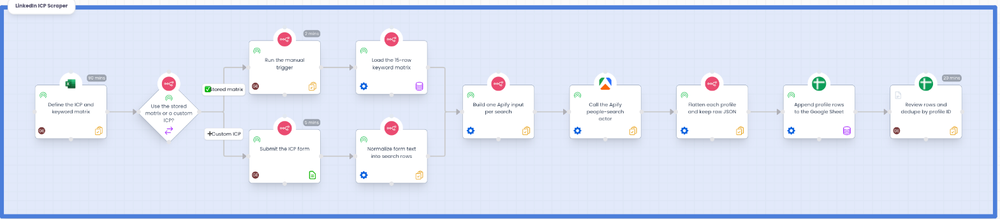
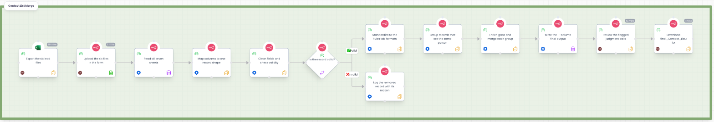

# Workflow maps

One-page process maps of the two n8n workflows, built in [Puzzle](https://puzzleapp.io). They show **who does what, in what order, with which tool**. The n8n canvas shows how the automation is wired; these maps show the process around it: the human steps, the automated steps, the forks and the owners.

## Project 01: LinkedIn ICP Scraper

| | |
|---|---|
| Steps | 11 (3 Person, 7 Automation, 1 Draft) |
| Fork | *Use the stored matrix or a custom ICP?* with two labeled outcomes that converge on **Build one Apify input per search** |
| Draft step | **Review rows and dedupe by profile ID** is manual today because re-runs append duplicate rows; the planned fix is append-or-update keyed on `profile_id` |
| Tools | n8n, Apify, Google Sheets, Microsoft Excel |

Details: [Project 01 README](../../projects/01-linkedin-icp-scraper/README.md).

## Project 02: Contact List Merge

| | |
|---|---|
| Steps | 13 (4 Person, 9 Automation) |
| Fork | *Is the record valid?* **Valid** continues; **Invalid** goes to a log step that ends that branch |
| Human steps | export the six files, upload them, review the flagged judgment calls, download the result |
| Tools | n8n, Apollo, ZoomInfo, Microsoft Excel |

Details: [Project 02 README](../../projects/02-contact-list-merge/README.md) and its [algorithms](../../projects/02-contact-list-merge/docs/algorithms.md).

## How the maps were made

Built through the Puzzle MCP using the open-source [puzzle-skills](https://github.com/puzzle-app/puzzle-skills) (`build-puzzle-process`, `read-the-map`). The method the skill enforces is worth copying for any process map:

- **Every step is typed, owned and costed**: a type, an executor (Person, Automation or AI Agent), a status, tools, and a Purpose / Inputs / Procedure / Output note.
- **Forks have labeled outcomes and every branch lands somewhere**: a continuing outcome, a rejoin or a terminator. Nothing dangles.
- **Connectors are set explicitly** (`right → left` for a left-to-right map) instead of trusting the nearest-side default, and the result is checked on screen for crossings.
- **Each build is logged** as a changelog entry with the decisions and what was verified.

## Assumptions to replace

- The **GTM Engineer** role carries an illustrative hourly rate (75 USD). It is a placeholder, not a real figure; set your own before reading any cost rollup.
- **Durations and frequencies** on Person steps are estimates and are marked as such in each step's note.
