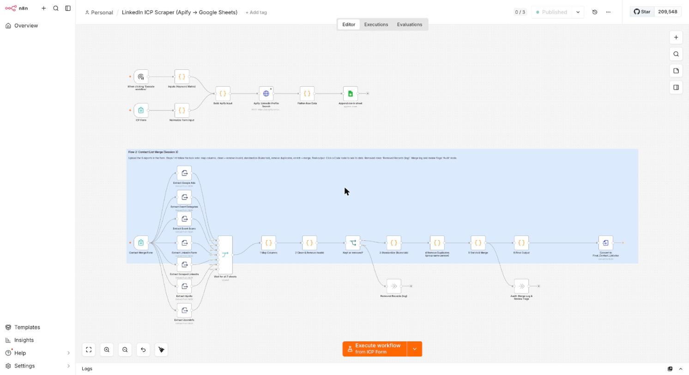
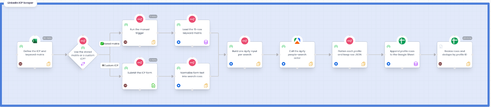
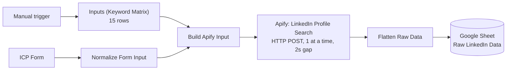

# Project 01: LinkedIn ICP Scraper

An n8n workflow that takes an **Ideal Customer Profile (ICP)** as input, turns it into a prioritized search matrix, calls a scraping API for each search, and appends the raw results to a Google Sheet.

| | |
|---|---|
| Input | ICP form (titles, locations, industries, headcount, max profiles) **or** the stored keyword matrix |
| Output | One row per scraped profile in a Google Sheet tab, including the complete raw record |
| Stack | n8n 2.32.6 · Apify (`automly/linkedin-people-search-scraper`) · Google Sheets API (OAuth2) |
| Last full run | 15 searches → **255 profiles**, about **$0.40**, a few minutes |
| Scenario | A commercial HVAC services provider selling to facilities decision makers at institutions with large, ageing HVAC estates in Colorado |



### Process map



*Who does what and where the fork is. Details in [`docs/workflows/`](../../docs/workflows/README.md).*

## 1. ICP definition

The ICP is data, in [`data/icp-design.csv`](data/icp-design.csv). Priorities run P1 (highest) to P3.

**Target audience (job titles)**

| Priority | Titles |
|---|---|
| P1 | Director of Facilities · Facilities Manager · Director of Maintenance & Operations |
| P2 | Director of Capital Projects / Construction · Property Manager · Energy Manager / Sustainability Director · VP / COO Operations |
| P3 | Chief Engineer / Building Engineer · Asset Manager · Chief Business / Financial Officer (K-12) |

**Target industries:** P1 K-12 education, higher education, hospitals & health care. P2 commercial real estate, government administration, facilities services. P3 hospitality, manufacturing, real estate, owner-side construction.

**Target regions:** P1 Denver, Aurora, Boulder. P2 Colorado Springs, Fort Collins, Greeley. P3 Pueblo, Grand Junction, Cheyenne WY, statewide.

**Company size:** 51-200, 201-500, 501-1000, 1001-5000, 5001-10000 selected; 11-50 and 10001+ excluded.

**Qualifiers and exclusions:** manager level and up; owns multi-building portfolios (100k+ sq ft); publicly funded organizations with ageing HVAC; recently changed jobs (last 90 days, P2); active on LinkedIn (last 30 days, P2). Exclude HVAC competitors and contractors, staffing/recruiters, interns/students/assistants, and IT/Marketing/HR roles.

## 2. Keyword setting matrix

[`data/keyword-matrix.csv`](data/keyword-matrix.csv) has 15 search keywords with a priority and five company-headcount filters each. The industry and location filters are **global**: in the source spreadsheet those two columns are merged cells spanning every row, so they apply to all keywords ([`data/global-filters.csv`](data/global-filters.csv)).

Design consequence: one matrix row becomes one scrape. Priority is carried through to the output so downstream consumers can sort P1 leads first.

## 3. Choosing the scraper

See [ADR-0006](../../docs/adr/0006-scraper-actor-selection.md). In short, three actors were tried in order, and the one that remained usable on the Free plan was selected, at the price of losing headcount and industry facets. The history is itself the lesson: **verify rate and plan limits before building around a vendor**.

```
harvestapi (facets, worked)  ->  "free user run limit reached"
neuralverge (facets)         ->  docs cap Free plans at 3 runs/month
automly (no facets)          ->  no cap, selected
```

Because headcount/industry cannot be applied server-side, the ICP is enforced through **job title + location** only, and out-of-ICP companies can appear in results.

## 4. Workflow design



Two entry points converge on the same contract (an item per search): the manual trigger uses the stored matrix, the form builds the same shape from free text.

### Node specifications

| Node | Type | Contract |
|---|---|---|
| Inputs (Keyword Matrix) | Code | Emits one item per matrix row: `{keyword, priority, headcount[], industries[], locations[], maxItems}` |
| Normalize Form Input | Code | Splits form text on `, ; \n`, trims, defaults `maxItems` to 25 and `priority` to P1; emits the same shape |
| Build Apify Input | Code | Maps a row to the actor input `{jobTitles:[keyword], locations, maxResults, maxResultsPerSearch}`; carries `keyword` and `priority` alongside as metadata |
| Apify: LinkedIn Profile Search | HTTP Request | `POST https://api.apify.com/v2/acts/automly~linkedin-people-search-scraper/run-sync-get-dataset-items`; header auth via credential; **batch size 1, interval 2000 ms** (be polite to the API and keep cost predictable); timeout 300 s; continue on error so one failed search does not abort the run |
| Flatten Raw Data | Code | Splits the name, derives title and company from the headline, joins the originating keyword/priority back by `pairedItem`, and keeps the **entire original record** in `raw_json` |
| Append row in sheet | Google Sheets | Append with auto-mapping by header name |

Headline parsing, as implemented:

```js
const m = headline.match(/^(.*?)\s+(?:at|@)\s+(.*)$/i);
current_title   = m ? m[1] : headline;
current_company = p.company || (m ? m[2] : '');
```

### Output schema (sheet row 1)

`scraped_at, keyword, priority, first_name, last_name, headline, current_title, current_company, location, linkedin_url, profile_id, school, connections, raw_json`

**Why keep `raw_json`.** Parsing headlines is lossy and the actor's output can change. Storing the raw record means the flattened columns can be re-derived later without paying to scrape again (schema-on-read for the raw layer, schema-on-write for the convenience columns).

## 5. Setup

1. Start n8n: from the repo root, `make up`.
2. Import `workflow/linkedin-icp-scraper.workflow.json` (see [n8n operations](../../docs/n8n-operations.md#import--export--publish-cycle)).
3. Create two credentials in n8n and select them on the nodes that show a red marker:
   - **Apify API**: type *Header Auth*, name `Authorization`, value `Bearer <your Apify token>`.
   - **Google Sheets account**: type *Google Sheets OAuth2*, using your own Google Cloud OAuth client. Enable the **Google Sheets API** in that Cloud project.
4. In **Append row in sheet**, replace the placeholder spreadsheet id (`YOUR_GOOGLE_SHEET_ID`) with your sheet and make sure the tab `Raw LinkedIn Data` exists **with the header row above in row 1** (the node needs existing headers).
5. Run from the manual trigger (stored matrix) or open the ICP form.

Credentials, the sheet id and the OAuth client file are deliberately not in this repo; see [SECURITY.md](../../SECURITY.md).

## 6. Problems hit and how they were solved

| # | Problem | Root cause | Fix |
|---|---|---|---|
| 1 | Apify returned 0 results | Location `"Denver Metropolitan Area, Colorado"` matches nothing; `"Denver, Colorado"` works. Headcount must be letter codes (A to I), not `"51-200"` | Isolated one filter at a time; used plain "City, State" strings |
| 2 | "free user run limit reached" | Free-plan cap on the first actor | Switched actors ([ADR-0006](../../docs/adr/0006-scraper-actor-selection.md)) |
| 3 | Editor shows "Lost connection to the server" behind nginx | Proxy passed `Host: localhost` without the port, so n8n rejected the websocket origin | `proxy_set_header Host $http_host;` |
| 4 | "No columns found in Google Sheets" | The sheet had no header row, and the tab was named `Sheet1` | Added headers in row 1, renamed the tab |
| 5 | Google: "Sheets API has not been used in project ..." | API not enabled in the Cloud project that owns the OAuth client | Enabled the API |
| 6 | Pasting headers produced one cell | Tabs were typed as spaces | Used real Tab keypresses |
| 7 | Duplicate rows on every re-run | Sheets *append* is not idempotent | Known limitation; see below |

## 7. Limitations and next steps

- **No idempotency.** Each run appends. Design: switch the Sheets node to *append or update* with `profile_id` as the matching column, so a re-run refreshes rows instead of duplicating them.
- **No server-side headcount or industry filter** (actor limitation). Add a company lookup/enrichment step and filter the sheet downstream.
- **No scheduling.** Add a Schedule trigger and a run-log tab (timestamp, search count, profile count, cost).
- **No enrichment.** The natural next stage is e-mail and phone enrichment, then the merge/clean pipeline in [Project 02](../02-contact-list-merge/README.md).
- **Cost guard.** `maxItems` caps cost per search (about $0.0015 per profile). Add a global ceiling before widening the matrix.
- **Compliance.** Scraping LinkedIn data is subject to LinkedIn's terms and to privacy law (GDPR/CCPA). Keep the raw layer access-controlled, document a lawful basis, and honor deletion requests.
