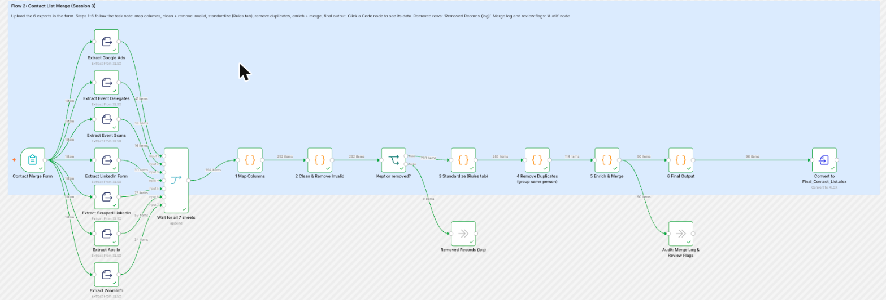
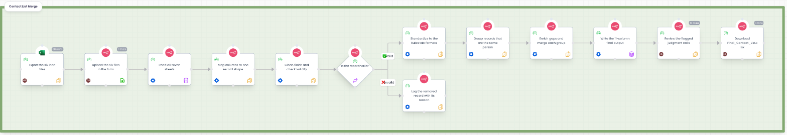
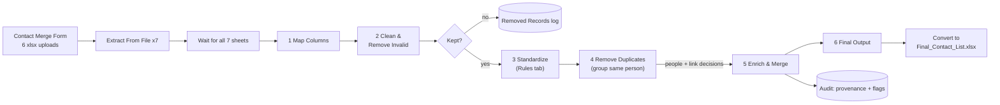
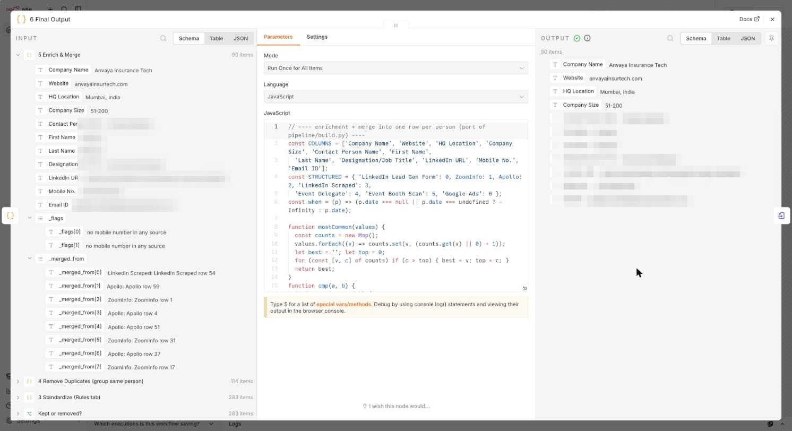
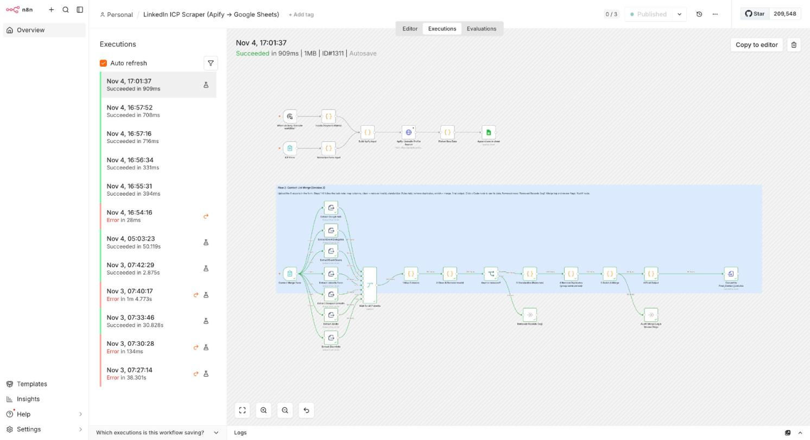

# Project 02: Contact List Merge

Six messy lead exports in, one clean, de-duplicated contact list out. Implemented as a six-step n8n workflow, with an independent Python reference build and a test suite that proves the two agree.

| | |
|---|---|
| Sources | Google Ads lead form, event (delegate list + booth scans), LinkedIn Lead Gen form, scraped LinkedIn (Sales Navigator), Apollo, ZoomInfo |
| Output | 11 columns, one row per real person (`Final Output` sheet), plus an audit trail |
| Result on the bundled synthetic sample | 37 rows read → 5 invalid removed → 32 kept → **12 people** |
| Built and verified on | an instructor dataset of 292 rows → 9 removed → 283 kept → **90 people** (193 duplicates merged). **That dataset is not included.** |
| Quality gates | 102 tests, 98% coverage, n8n output **identical** to the reference (0 differing rows), end-to-end test in a clean container |
| Stack | n8n 2.32.6 (Extract From File, Code, IF, Merge, Convert To File), JavaScript, Python 3 + openpyxl |



> A visual walkthrough with screenshots is in [`docs/guide/`](docs/guide/) (`make guide`, then open `docs/guide/index.html`).

## The task

Combine the sources into one list using the template's 11 columns, after cleaning, standardizing (Rules tab), enriching missing fields from other sources and removing duplicates.

The Rules tab defines both the format of each field (E.164 phones, spelled-out titles, root domains, size buckets) and six merge rules. The two that shape the design: the **latest dated source wins** for employer and title, and **ZoomInfo, then Apollo, then everything else** wins for company facts. Full mapping of rules to code and tests: [rules-traceability.md](docs/rules-traceability.md).

## Architecture



*The human and automated steps, and the validity fork, as a process map. The diagram below shows the n8n node wiring.*



| Step | Node | Responsibility |
|---|---|---|
| 1 | Map Columns | One common record shape for all sources; parse four date formats; keep raw values |
| 2 | Clean & Remove Invalid | Clean names and links; remove test leads, spam, job seekers, hidden LinkedIn Members; log each with a reason |
| 3 | Standardize | Canonical company, title, validated e-mail, E.164 mobile, city and country |
| 4 | Remove Duplicates | Group records into people with guarded union-find; log every merge |
| 5 | Enrich & Merge | Latest-dated employer and title; ZoomInfo then Apollo company facts; best e-mail and mobile; blank when unknown |
| 6 | Final Output | Exactly the 11 template columns, in order |

The reasoning behind each step, including the algorithms and their failure modes, is in [docs/algorithms.md](docs/algorithms.md). Catalogue of every data defect found: [docs/data-quality-catalogue.md](docs/data-quality-catalogue.md).



*Every merged row carries `_merged_from` (source rows) and `_flags` (review notes) to the audit node, so nothing is merged without a trace. Person fields are pixelated in this screenshot.*

## Key engineering decisions

| Decision | Why | Record |
|---|---|---|
| Python reference first, JS port, parity check | Fast rule iteration; two independent implementations agreeing row for row (90 of 90 on the instructor dataset, 12 of 12 on the bundled sample) | [ADR-0001](../../docs/adr/0001-python-reference-then-javascript-port.md) |
| Form upload instead of reading from disk | The n8n container cannot see the host; works on any clone | [ADR-0002](../../docs/adr/0002-input-via-form-upload.md) |
| Union-find with a LinkedIn-identity guard | Different people sharing a name, company or mailbox must not merge | [ADR-0003](../../docs/adr/0003-guarded-union-find-for-identity-resolution.md) |
| Phone columns judged by cross-source evidence | Board lines (0 of 28 matched) and direct lines (0 of 7) excluded; a mislabeled mobile column (10 of 11) rescued | [ADR-0004](../../docs/adr/0004-mobile-only-phone-policy-with-corroboration.md) |
| Workflow JSON is generated from `n8n/src/` | Reviewable source, reproducible artifact, CI-verified | [ADR-0005](../../docs/adr/0005-generated-workflow-json-and-sanitized-exports.md) |
| Blank beats a guess; judgment calls become flags | Output is always traceable to a source | [ADR-0007](../../docs/adr/0007-blank-over-guess-and-review-flags.md) |

## Worth a human look

These are judgment calls, listed deliberately rather than hidden. (The specific people and counts below come from the instructor-dataset run; the bundled sample exercises the same categories.)

- **One assumed job change** (R.T.): same name and city across two employers with no e-mail or LinkedIn link. Logged as `job-change (verify)`. If wrong, that person is two rows.
- **One excluded phone** (S.L.): the only candidate is an Apollo "Work Direct" number no other source corroborates, so the mobile is blank.
- **Synonyms:** `Purchase Manager` is read as `Procurement Manager`; `Co-Founder & CTO` as `Chief Technology Officer`.
- **Personal e-mail only** for three contacts; **two repaired e-mails** (`.con`); some Apollo e-mails are vendor-guessed ("Extrapolated").
- **Blanks left as the Rules require:** 30 mobiles, 8 LinkedIn URLs, 3 e-mails.

## Run it

### A. Python reference build (no Docker)

```bash
cd projects/02-contact-list-merge
pip install -r requirements.txt
python3 -m pipeline.run          # writes output/Final_Contact_List.xlsx and output/Cleaning_Audit.xlsx
python3 -m pytest                # 102 tests
GTM_DATA_DIR=/path/to/your/exports python3 -m pipeline.run   # your own files, same names and layout
```

`Cleaning_Audit.xlsx` contains: Column Mapping (every source column mapped to an output field), Removed Records, Merge Log (source rows per person), Link Decisions, Review Flags.

### B. In n8n

```bash
make up                          # from the repo root; n8n on http://localhost:5678
# import the workflow (see docs/n8n-operations.md), or let `make e2e` do it
```

1. Open `http://localhost:5678/form/contact-merge-form-0001`.
2. Upload the six files from `sample-data/` (or your own exports with the same layout). The form field order matches the file numbers; the two event sheets live in one workbook.
3. In n8n, open the workflow's **Executions**, select the latest run, open **Convert to Final_Contact_List.xlsx** and download the file. Removed rows and the audit data are on the **Removed Records (log)** and **Audit** nodes.



### C. Verify everything

```bash
make check       # lint + 102 tests + rebuild workflow + JS/Python parity + secret scan
make e2e         # real n8n container: import, submit the form, compare with the golden file
```

## Project layout

```
projects/02-contact-list-merge/
├── pipeline/                  Python reference build: loaders, normalize, cluster, build, run
│   └── tests/                 unit, integration, golden-file and output-format tests
├── n8n/
│   ├── src/                   JS source of truth: shared helpers + one file per workflow step
│   ├── build_workflow.py      assembles Code nodes and the workflow JSON from src/
│   ├── harness.mjs            runs the generated node code in plain Node (n8n API emulation)
│   └── dump_sheets.py         emits what the Extract nodes would emit, for the harness
├── workflow/                  generated n8n workflow (committed, CI-verified)
├── sample-data/               small SYNTHETIC sample + README on how the data looks in Excel
├── expected-output/           golden Final_Contact_List.xlsx and Cleaning_Audit.xlsx
├── scripts/                   parity_check.py, e2e.py, read_run.js
├── scripts/make_sample_data.py  regenerates the synthetic sample
└── docs/                      algorithms, data-quality catalogue, rules traceability, visual guide
```

## Problems we hit

*(Counts refer to the run on the instructor dataset.)*

| Problem | Cause | Fix |
|---|---|---|
| Event delegates loaded 0 rows in n8n (the final count was still 90, but 9 rows lost phones and e-mails) | In Extract From File a string range such as `A5` is read as the single cell A5 | Numeric range `4` skips the four title rows. Only a row-by-row comparison with the golden file caught it |
| A stray private-use character after names that had 🚀 | n8n's bundled xlsx reader decodes 4-byte emoji into `U+F680` | The cleaner also strips `U+E000-U+F8FF` |
| Form completion page redirected to a dead host | The Form ending node uses `WEBHOOK_URL`, which pointed at an expired tunnel | Dropped that node; the file is downloaded from the execution |
| n8n could not read the host folder | Container mounts only its own volume | Upload form ([ADR-0002](../../docs/adr/0002-input-via-form-upload.md)) |
| Seven event delegates had no company | Rejecting "no company" up front would delete real people | The check now runs after merging |
| Sanitized workflow would not import on a clean instance | The CLI needs a workflow `id` | Sanitizer keeps `id`; found by the clean-container e2e run |

## Data

`sample-data/` is a small **synthetic** sample generated by `scripts/make_sample_data.py`: every person, company and e-mail is invented. The instructor dataset used during development is not redistributed; [`sample-data/README.md`](sample-data/README.md) shows how each export looks in Excel (sheets, columns, example rows, quirks). Do not run real personal data through a shared n8n instance without access controls (see [SECURITY.md](../../SECURITY.md)).
