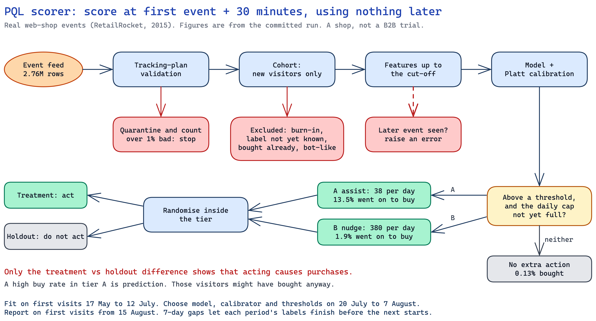
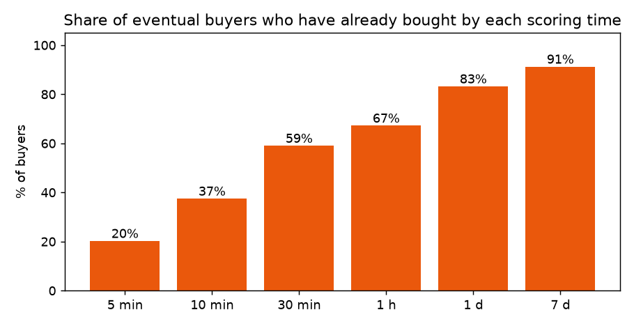
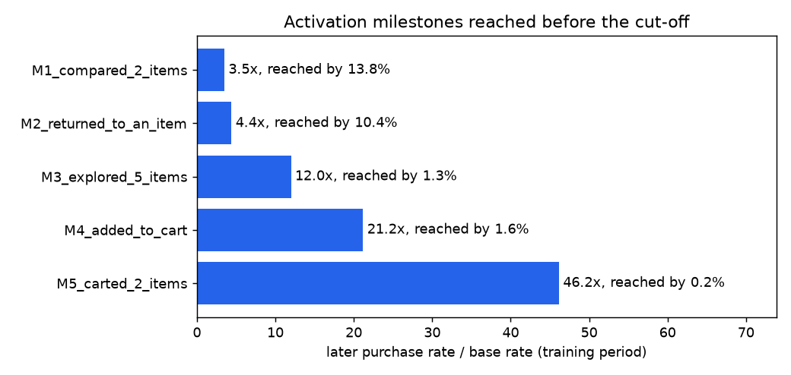
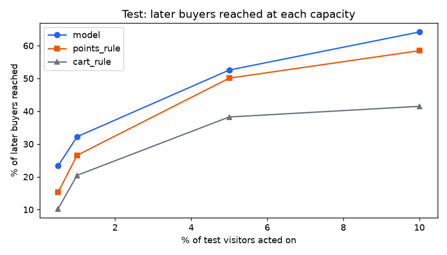
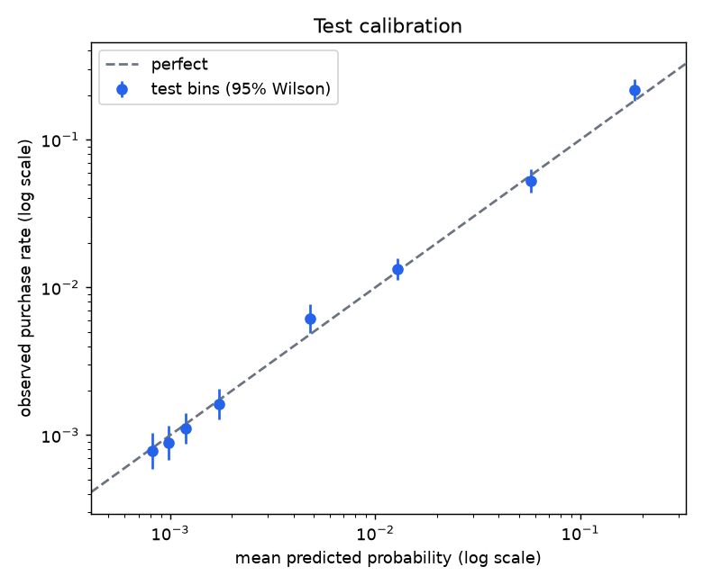

# Project 07: product-qualified lead scoring from behaviour events

**Business question:** from early product behaviour, who is likely to buy, early enough to act, and how should they be routed?

**What the data is, plainly:** real, anonymised behaviour from one web shop in 2015 ([RetailRocket](https://www.kaggle.com/datasets/retailrocket/ecommerce-dataset), CC BY-NC-SA 4.0, non-commercial). It is **not** a B2B free trial. I found no openly licensed B2B product-usage data with a conversion outcome (my search was not exhaustive). A visitor stands in for a trial user, "add to cart" for an activation event, and "transaction" for conversion to paid. The method carries over; the numbers do not. [DATA.md](DATA.md) has the licences, checksums and biases.



*Editable source: [`docs/pql-scorer.excalidraw`](docs/pql-scorer.excalidraw). Operating process: [`docs/process.md`](docs/process.md). Full run output: [`reports/report.md`](reports/report.md).*

## Why this project

**Business need.** In a self-serve product, many more people sign up than a team can help. Someone has to decide who gets a person, who
gets an automated nudge and who is left alone, early enough to matter. The intended users are a sales-assist or customer-success lead and
a lifecycle marketer.

**The workflow in four lines**

1. **Goes in:** each new visitor's product events from the first 30 minutes.
2. **Reasoned:** how likely this visitor is to buy within 7 days, and whether there is room today in each action tier.
3. **Happens:** the visitor gets a tier and a dry-run task or none, with a random holdout designed to test the action. Nothing is sent.
4. **Seen:** in a real setup, in the sales-assist task queue and the lifecycle audience. Here, only in the report.

**What you could buy instead.** Product analytics, CRM and product-led sales tools offer behaviour-based lead scores and routing. I did not
test or compare any. A hand-set points rule, which this project also tests, costs far less to run.

**Signal that it works.** In a randomised holdout inside a tier, visitors who get the action buy more often than those held out, with an
interval that excludes zero, and the gain pays for the action. A higher buy rate in tier A alone does not show this.

**Real users today: none.** This is a learning project on one old web-shop dataset. No action has been taken on any score.

## Who uses the answer

| Role | Decision |
|---|---|
| Sales-assist or customer-success lead | Which few people get a human today |
| Lifecycle or growth marketer | Who gets an automated nudge, and who is held out to measure it |
| RevOps or GTM engineer | Event contract, scoring job, capacity thresholds, no duplicate tasks |
| Product analyst | Which activation milestones and funnel steps matter |

## Run it

```bash
cd projects/07-pql-scorer
pip install -r requirements.txt
python fetch_data.py        # about 35 MB; needs your own configured `kaggle` tool; verifies SHA-256
python -m pql               # writes reports/ (about 80 seconds on the author's laptop)
python -m pytest --cov=pql  # offline, hand-made fixtures, no downloaded data needed
```

## The prediction, defined

| Question | Answer |
|---|---|
| Unit | A new visitor: first seen after a 14-day burn-in |
| Prediction time | First event **+ 30 minutes** |
| Allowed information | Events at or before that time. `build_features` raises an error on anything later |
| Label | A transaction after the cut-off, within 7 days of it |
| Excluded | Already bought (5,716 visitors: nothing left to predict), more than 100 events (1), burn-in, label window not finished |
| Split | By first-seen date: train 17 May to 12 July, validation 20 July to 7 August, test 15 August to 11 September. 7-day gaps mean each period's labels are known before the next starts |
| Chosen on validation only | Model family, calibrator, tier thresholds |
| Fixed in advance in `config.py` | 30-minute cut-off, milestones, points rule, capacities |

## Architecture

| Module | Job |
|---|---|
| [`tracking_plan.json`](pql/tracking_plan.json), [`tracking_plan.py`](pql/tracking_plan.py) | Event contract; quarantine and count bad rows; stop above 1% |
| [`cohort.py`](pql/cohort.py) | Eligibility, label, time split with embargo |
| [`features.py`](pql/features.py) | 12 features from events up to the cut-off |
| [`milestones.py`](pql/milestones.py) | Activation milestones and ordered funnel |
| [`models.py`](pql/models.py), [`evaluate.py`](pql/evaluate.py) | Rules, logistic regression, boosting, Platt calibration; tie-safe capacity metrics and bootstrap |
| [`routing.py`](pql/routing.py) | Capacity thresholds, hard daily caps in time order, dry-run tasks with idempotency keys |
| [`experiment.py`](pql/experiment.py) | Sample size, simulation check, sample-ratio check, break-even lift |
| [`leakage.py`](pql/leakage.py) | The two leak tests |
| [`pipeline.py`](pql/pipeline.py), [`analysis.py`](pql/analysis.py), [`report.py`](pql/report.py), [`plots.py`](pql/plots.py) | Orchestration and aggregate outputs |

## Results

All numbers come from `python -m pql`. Two consecutive runs on one machine gave the same report.

### 1. Many buyers are gone before you can score them



Among visitors first seen after the burn-in who ever buy, 20.2% have bought within 5 minutes, 59.0% within 30 minutes and 83.2% within a day. "Wait until we have a week of behaviour" would score almost nobody who still needs help. In a B2B trial this curve will look different. Plot it first, before choosing any model.

Earlier cut-offs leave more to act on (validation only; the populations differ, so AP is not comparable across rows):

| Cut-off | Later buyers (all periods) | Base rate | ROC AUC | Lift in top 1% |
|---|---|---|---|---|
| 5 min | 6,911 | 0.586% | 0.791 | 35.7x |
| 30 min | 3,152 | 0.265% | 0.812 | 29.1x |
| 24 h | 844 | 0.071% | 0.781 | 20.8x |

The 30-minute choice was fixed before this table existed and I kept it. The table suggests testing 5 minutes next. That needs fresh test data, not a second look at this test period.

### 2. Two leaks, tested

**Looking past the cut-off.** Same logistic model, same visitors, validation period:

| Features | Average precision | ROC AUC |
|---|---|---|
| Events up to the cut-off | 0.0674 | 0.812 |
| Views and carts from the whole label window (wrong on purpose) | 0.3522 | 0.987 |

No leaked feature mentions a purchase. A `GROUP BY visitor` without a time filter is enough to produce a model that looks superb and cannot work live.

**UCI Online Shoppers `PageValues`** (12,330 sessions, CC BY 4.0). Google's [Page Value definition](https://support.google.com/analytics/answer/2695658) is the average value for a page visited **before** a goal page or a completed transaction. So the column is computed from outcomes. Train February to September, test October to December:

| Columns | Average precision | ROC AUC |
|---|---|---|
| All, with `PageValues` | 0.666 | 0.835 |
| `PageValues` alone | 0.559 | 0.813 |
| Without it | 0.338 | 0.692 |
| Context only (plausibly known at session start) | 0.260 | 0.592 |

`PageValues` is above zero in 80.6% of buying sessions and 11.4% of the others (purchase rate 56.3% against 3.9%). On its own it beats all the other columns together. What this does **not** prove: the file does not say which date range Google Analytics used to compute the values, so I cannot show how much of a session's own transaction is inside its own number. It is unusable either way until you can compute it from data older than the prediction time. Removing it is also not enough: every other UCI behaviour column is an end-of-session total and there are no timestamps, which is why UCI is only the leak exhibit here.

### 3. Activation milestones and funnel (training period)



| Milestone reached in 30 min | Reach | Later buy rate | Lift | Share of later buyers |
|---|---|---|---|---|
| Viewed 2+ items | 13.84% | 0.96% | 3.5x | 48.4% |
| Returned to an item | 10.44% | 1.20% | 4.4x | 46.0% |
| Viewed 5+ items | 1.33% | 3.27% | 12.0x | 15.9% |
| Added to cart | 1.65% | 5.78% | 21.2x | 34.9% |
| Carted 2+ items | 0.21% | 12.60% | 46.2x | 9.9% |

These are associations. Pushing someone to add to cart will not give them the buy rate of people who chose to.

Funnel for **all** new visitors in the training period, first 7 days: 588,799 viewed, 12,983 then added to cart (2.20%), 3,816 of those then bought (29.39%). Another 656 buyers have no recorded view-then-cart path, so the tracking is incomplete or there is another route to purchase.

### 4. Model against rules (held-out test: 251,323 visitors, 664 later buyers, 0.264%)

| Scorer | Average precision (95% interval) | ROC AUC | Precision in top 1% | Recall in top 1% |
|---|---|---|---|---|
| **Gradient boosting (chosen)** | **0.0841** [0.0656, 0.1080] | 0.812 | 8.52% | 32.2% |
| Logistic regression (not chosen) | 0.0582 [0.0480, 0.0745] | 0.811 | 7.52% | 28.5% |
| Hand-set points rule | 0.0408 [0.0331, 0.0514] | 0.797 | 7.02% | 26.6% |
| "Added to cart" rule | 0.0212 [0.0173, 0.0261] | 0.672 | 5.41% | 20.5% |

Against the points rule, paired 95% intervals are [0.0304, 0.0609] for the gain in average precision and [0.0075, 0.0211] for precision in the top 1%. Equal rule scores are counted as picked at random, so row order cannot help a rule.



Read this honestly:

- ROC AUC barely separates the model from the points rule (0.812 against 0.797). With 0.26% positives it hides what matters at the top.
- The model's edge is largest at the very top: at 0.5% capacity it reaches 23.3% of later buyers against 15.2%. At 5% it is 52.6% against 50.1% (no interval was computed at 0.5% or 5%).
- An average precision of 0.084 is about 32 times the base rate and still low in absolute terms. Most people the model likes do not buy.

### 5. Calibration



| | Brier | Log loss | Mean predicted | Observed |
|---|---|---|---|---|
| Constant (training rate) | 0.002635 | 0.01832 | 0.273% | 0.264% |
| Model, raw | 0.002512 | 0.01476 | 0.271% | 0.264% |
| Model, Platt on validation | 0.002512 | 0.01476 | 0.260% | 0.264% |

Platt scaling changed nothing that matters (slope 0.979), and the raw mean was already slightly closer. In the top bin the model predicts 18.4% and 21.7% bought (interval 18.3% to 25.5%). One middle bin is under-predicted: 0.480% predicted, 0.613% observed, interval 0.490% to 0.765%. Brier score hardly moves because positives are so rare; use log loss and the bin table.

### 6. Routing under capacity

The capacities are **assumptions**: 50 per day for a human assist (tier A), 500 per day for an automated nudge (tier B). Thresholds (6.72% and 0.68%) were set on validation. Decisions are made in time order with a hard daily cap.

| Test period | Visitors | Per day | Buy rate (95%) | Share of later buyers |
|---|---|---|---|---|
| Model A | 1,067 | 38 | 13.50% (11.58 to 15.68) | 21.7% |
| Model B | 10,636 | 380 | 1.88% (1.64 to 2.16) | 30.1% |
| Model: no action | 239,620 | 8,558 | 0.13% | 48.2% |
| Points rule A | 1,140 | 41 | 8.25% (6.79 to 9.99) | 14.2% |
| Points rule B | 11,786 | 421 | 2.05% (1.81 to 2.33) | 36.4% |
| Points rule: no action | 238,397 | 8,514 | 0.14% | 49.4% |

- **The model wins in tier A.** Across A and B together it is close to a wash: 51.8% of later buyers against 50.6%, with fewer visitors contacted (11,703 against 12,926). If you only have an automated channel, the points rule may be enough. If a human's time is scarce, the model earns its place. These two policies were not matched exactly on volume: the rule's scores are lumpy.
- **Neither tier filled on average.** Eligible traffic fell from about 11,200 a day in validation to about 9,000 in test (the last test day is partial). Fixed score thresholds drift in volume, so monitor it. Even so, 194 visitors met a threshold when that tier was already full on their day.

Playbook (the actions are illustrations; nothing is connected or sent):

| Tier | Action | Owner | Do not |
|---|---|---|---|
| A | Offer help (chat or a person) soon after scoring | Sales assist | Lead with a discount before the test shows it pays |
| B | Triggered message or retargeting audience, only where consent allows | Lifecycle | Count its buyers as "generated" |
| No action | Normal lifecycle | Marketing | Treat as worthless: it holds 48.2% of later buyers |

For an anonymous visitor there is no CRM contact to update. In a B2B product the same decision would go to the CRM, keyed by `TaskLedger`'s idempotency key so a replay creates no second task. That ledger is held in memory; a real one needs a database unique key.

### 7. Where the model loses

| Behaviour in the first 30 min | Visitors | Share of later buyers | Their buyers above the B threshold |
|---|---|---|---|
| One event only | 81.1% | 30.0% | 1.5% |
| 2+ events, no cart | 17.4% | 34.8% | 47.6% |
| Added to cart | 1.8% | 36.1% | 98.8% |

Thirty per cent of later buyers leave one event in the first half hour. There is almost nothing to learn from it, and no choice of algorithm fixes that. Better signals (source, campaign, account, price viewed) would be needed. In the last column, "above the B threshold" is before daily caps.

Week by week in the test period, average precision ran from 0.078 to 0.100 and predicted rates stayed near observed ones. The largest gap was the week of 17 August (0.263% predicted, 0.300% observed). The first week listed is only two days. That is about four weeks of one season (five calendar weeks, two of them partial), not evidence about drift over a year.

## Prediction is not causation: the A/B test

A 13.50% buy rate in tier A says those visitors are likely to buy. **It does not say that contacting them makes one more of them buy.** Many would buy anyway. Calling tier A purchases "pipeline from PQL routing" would be wrong.

| Design item | Choice |
|---|---|
| Hypothesis | The tier's action raises the 7-day purchase rate among visitors routed to that tier |
| Unit and moment | Visitor id, randomised by a stable hash when the tier is assigned, **after** scoring, so both arms are chosen the same way |
| Arms | Action against holdout (no action) |
| Analysis | Intention to treat: everyone assigned counts, including those the message never reached |
| Primary metric | Purchase after the cut-off and within 7 days of it |
| Guardrails | Margin per visitor (discounts), unsubscribes and complaints, refunds, page performance |
| Validity check | `sample_ratio_p_value`: stop and investigate on a very small p |
| Stopping | Fixed sample size, then wait 7 days. No stopping early because it looks good |
| Contamination | One person on two devices can land in both arms; this shrinks the measured effect |

Two-sided, alpha 0.05, power 0.80. Baselines and volumes are the observed test-period ones. The lifts are **planning assumptions**.

| Tier (baseline, per day) | Relative lift | Per arm, 50/50 | Days to readout | Days to readout with a 10% holdout |
|---|---|---|---|---|
| A (13.50%, 38) | 20% | 2,723 | 150 | 413 |
| A | 50% | 483 | 33 | 81 |
| B (1.88%, 380) | 20% | 22,482 | 126 | 345 |
| A and B pooled (2.94%, 418) | 10% | 54,343 | 268 | 740 |
| A and B pooled | 20% | 14,211 | 76 | 201 |

A simulation of 20,000 experiments at the pooled 20% design gave power 0.797 against the 0.800 target. Pooling answers "does acting on high scores help on average", not which action works.

Money, with **assumed** figures that are not in the data (margin 20.00 per order; cost 1.50 per assist and 0.05 per nudge, no discount): break-even needs a 56% relative lift in tier A and 13% in tier B. Under these assumptions tier A has to be far more effective than a nudge to pay for itself. Change the assumptions in [`analysis.py`](pql/analysis.py) and the conclusion can change.

Two further questions need other designs. **Is model routing better than rule routing?** Randomise eligible visitors between the two policies; the arms mostly treat the same people, so the effect is diluted and needs a much larger sample. **Whom does the action move?** That is uplift modelling, and it needs randomised data first. The highest-propensity visitors need not be the most persuadable.

## What did not work, or was rejected

- **Funnel on the scored cohort.** My first version used eligible visitors, which excludes everyone who bought within 30 minutes. It showed 13.79% from cart to purchase; all new visitors show 29.39%. I changed it after the first full run, which had also printed test results. No feature, model, threshold or split changed after that run.
- **UCI as the main dataset.** No event times, so no cut-off is possible.
- **The "added to cart" rule** as the whole score. It is the weakest scorer by average precision.
- **Logistic regression** as the final model. Boosting beat it on validation (0.0850 against 0.0674, paired 95% interval for the gain [0.0031, 0.0316]), the stated bar for accepting the more complex model.
- **Platt calibration** was in the plan and turned out to be nearly a no-op.
- **Other datasets.** The REES46 shop event files on Kaggle give the licence only as `copyright-authors`, which I treated as unclear. The OTTO dataset is CC BY 4.0, but its training file is about 11 GB (over the 1 GB project limit); the 716 MB test file covers one week, too short for a burn-in, a 7-day label and a time split.

## Limits

- One shop, 2015, 4.5 months, anonymous visitors. No accounts, users in companies, pricing, plan, source or campaign. This does not validate anything about B2B product-led sales.
- "New visitor" means a new id after a 14-day burn-in. Cleared cookies and second devices make some returning people look new.
- Ids and items are hashed and event meanings come from the publisher. I cannot check the tracking.
- The only bot rule is volume before the cut-off; it removed one visitor. Slower automation would pass.
- Bootstrap intervals resample visitors. They leave out week-to-week and season-to-season variation and the uncertainty from fitting the model.
- One time split. A rolling-origin backtest would be stronger.
- The tracking-plan check finds structural errors only. It cannot see an event that silently stopped firing; add volume monitoring.
- No cause is estimated anywhere. No experiment was run.
- Licence: the [Retailrocket dataset](https://www.kaggle.com/datasets/retailrocket/ecommerce-dataset) is [CC BY-NC-SA 4.0](https://creativecommons.org/licenses/by-nc-sa/4.0/) (non-commercial, share-alike). The files in `reports/`, and the result figures quoted from them in this README, the diagram and `docs/`, are modified (aggregated and charted) material shared under that licence. They are **not** covered by the repository's MIT licence; see [`reports/LICENSE.md`](reports/LICENSE.md) and [`NOTICE.md`](../../NOTICE.md). The UCI parts remain CC BY 4.0. Do not use this model commercially.

## What you should be able to explain in an interview

1. **What is a PQL, and how is this different from an MQL?** A PQL is qualified by what someone did in the product; an MQL usually by marketing engagement. Neither label proves buying intent until checked against outcomes.
2. **What is the point in time of your prediction, and why does it matter?** First event plus 30 minutes. Features may use nothing later. Here, allowing later views and carts raised ROC AUC from 0.812 to 0.987, which could never be reproduced live.
3. **Why remove people who bought before the cut-off?** At scoring time you already know the answer. Keeping them mixes detection with prediction. It also changes funnel numbers, so I compute the funnel on everyone.
4. **How would you spot a leaky vendor metric such as `PageValues`?** Ask how and when it is calculated. Check how strong it is alone and how it differs by outcome. Rebuild it from data older than the prediction, or drop it.
5. **Why average precision and capacity metrics, not accuracy or ROC AUC?** With 0.26% positives, "nobody buys" is 99.7% accurate. ROC AUC was 0.812 against 0.797 while precision at the top differed clearly. The team only acts on the top.
6. **What does calibrated mean, and when does it matter?** Among visitors scored near 18%, about that share should buy. It matters when thresholds or expected value depend on the probability; ranking alone does not need it.
7. **Why capacity-based thresholds instead of "score above 30"?** A team can handle a fixed number per day. But a fixed score threshold still drifts in volume: tier A averaged 38 a day against a cap of 50.
8. **Tier A converts at 13.5% and the rest at far less. Did routing work?** Unknown. That difference exists before any action. Only a randomised holdout inside the tier measures the effect.
9. **Why does a smaller baseline or a small holdout make tests slower?** Detecting the same relative lift on a rarer event needs more people. A 90/10 split starves the control arm, so the total sample grows.
10. **When would you ship the rule instead of the model?** When the extra gain does not justify retraining, monitoring and explanation. Here the two are close across A and B together; the model's case rests on tier A.

## Exercises for learners

1. Move the cut-off to 5 minutes. Choose everything on validation, then say why this test period is no longer untouched.
2. Remove `idle_minutes_at_cutoff` and `active_minutes`. How much validation average precision do you lose, and what would break these two in a live stream with late-arriving events?
3. Add a rolling-origin backtest with at least three folds, each with an embargo.
4. Add item popularity from events **before** each visitor's first event. Write the test that fails if a later event leaks in.
5. Replace the fixed threshold with a rolling threshold from the previous 7 days. Compare daily volumes without looking ahead.
6. Compute the sample size for model routing against points-rule routing, counting only the visitors the two policies treat differently.
7. Write a tracking plan for a B2B trial (`signed_up`, `invited_teammate`, `connected_integration`), with account-level ids. Which features become account-level, and how does the split change?
8. Add a volume monitor that raises an alert when a day's `addtocart` rate falls far below its recent range.
