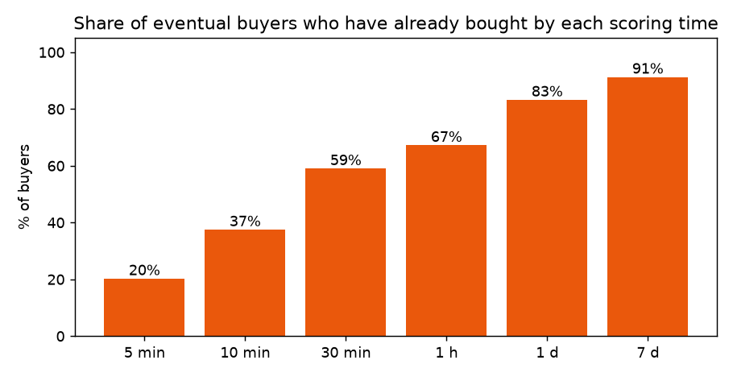
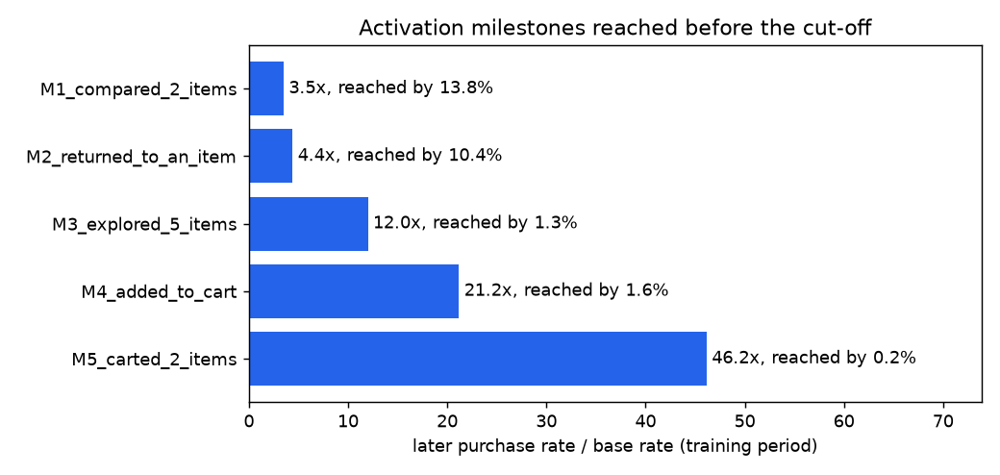
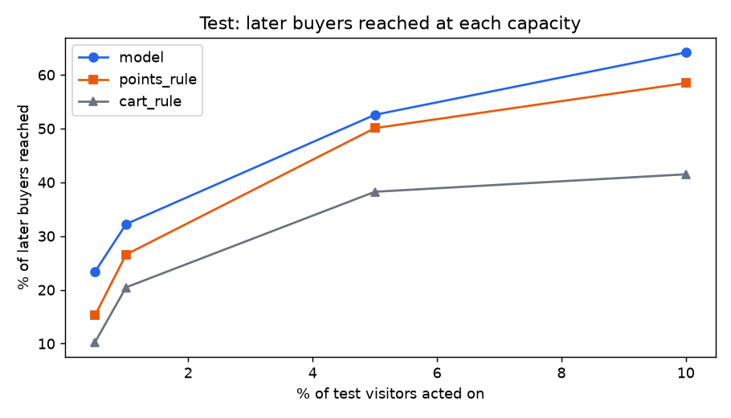
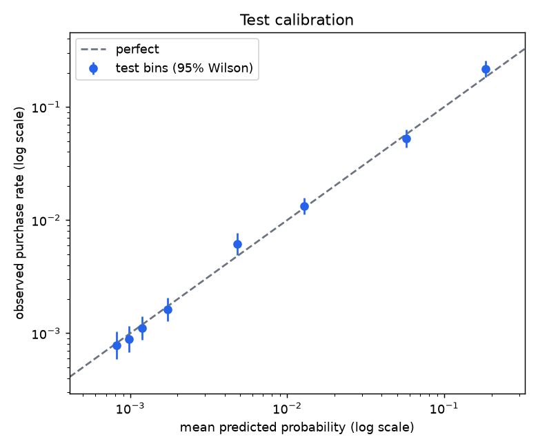
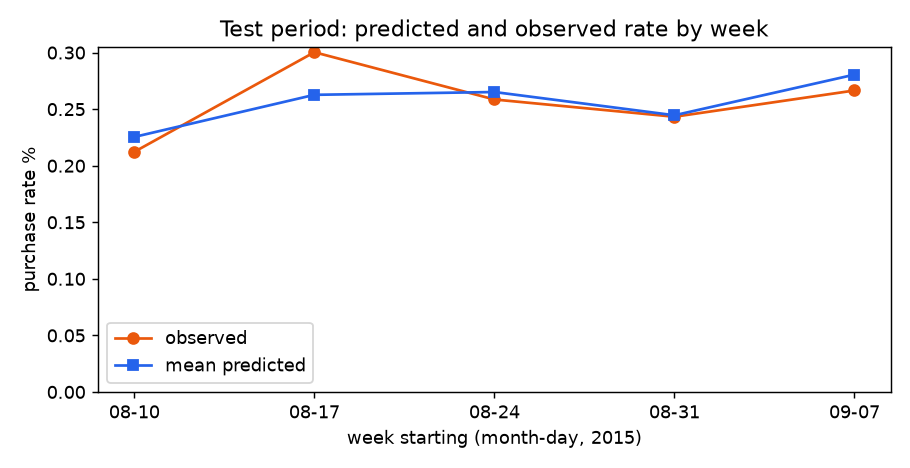

# PQL scorer: run report

Generated by `python -m pql`. Source: RetailRocket events (real, anonymised web-shop behaviour, 2015, by Retailrocket, https://www.kaggle.com/datasets/retailrocket/ecommerce-dataset; CC BY-NC-SA 4.0, https://creativecommons.org/licenses/by-nc-sa/4.0/; aggregated and charted, so modified. This report and its charts are shared under the same terms and are not covered by the repository's MIT licence) and UCI Online Shoppers (CC BY 4.0). It is a shop, not a B2B product trial.

## 1. Tracking-plan validation

Rows in: 2,756,101. Rows kept: 2,755,641. Violations: exact_duplicate: 460.

## 2. Cohort and splits

| count | visitors |
|---|---|
| visitors total | 1,407,580 |
| excluded burn in | 147,098 |
| excluded label window incomplete | 59,643 |
| excluded bought before cutoff | 5,716 |
| excluded automation like | 1 |
| excluded automation like later buyers | 0 |
| eligible | 1,195,122 |
| eligible later buyers | 3,152 |

| split | visitors | later buyers | rate |
|---|---|---|---|
| train | 586,821 | 1,602 | 0.273% |
| validation | 212,942 | 564 | 0.265% |
| test | 251,323 | 664 | 0.264% |

## 3. How early is early enough?

Minutes after a visitor's first event, and the share of eventual buyers who had already bought by then.

| minutes | buyers already bought |
|---|---|
| 5 | 20.2% |
| 10 | 37.5% |
| 30 | 59.0% |
| 60 | 67.2% |
| 1,440 | 83.2% |
| 10,080 | 91.2% |

## 4. Cut-off sensitivity (logistic regression, validation period only)

Each row is a different population, so average precision is not directly comparable between rows.

| cut-off min | bought before | later buyers | base rate | AP | ROC AUC | lift top 1% | recall top 1% |
|---|---|---|---|---|---|---|---|
| 5 | 1,957 | 6,911 | 0.586% | 0.1234 | 0.791 | 35.7x | 35.7% |
| 30 | 5,716 | 3,152 | 0.265% | 0.0674 | 0.812 | 29.1x | 29.1% |
| 1,440 | 8,004 | 844 | 0.071% | 0.0122 | 0.781 | 20.8x | 20.8% |

## 5. Activation milestones (training period)

| milestone | reach | buy rate if reached | if not | lift | share of later buyers |
|---|---|---|---|---|---|
| M1_compared_2_items | 13.84% | 0.96% | 0.16% | 3.5x | 48.4% |
| M2_returned_to_an_item | 10.44% | 1.20% | 0.16% | 4.4x | 46.0% |
| M3_explored_5_items | 1.33% | 3.27% | 0.23% | 12.0x | 15.9% |
| M4_added_to_cart | 1.65% | 5.78% | 0.18% | 21.2x | 34.9% |
| M5_carted_2_items | 0.21% | 12.60% | 0.25% | 46.2x | 9.9% |

## 6. Funnel (ALL new visitors in the training period, including fast buyers; first 7 days)

| step | visitors | from previous step | median minutes from previous |
|---|---|---|---|
| viewed | 588,799 | 99.79% | 0.0 |
| added_to_cart | 12,983 | 2.20% | 2.8 |
| purchased | 3,816 | 29.39% | 5.4 |
| purchased_without_that_path | 656 | - | - |

The last row counts buyers with no recorded view-then-cart path: a tracking gap or a route the events do not show.

## 7. Leak test 1: looking past the cut-off (validation)

| features | AP | ROC AUC |
|---|---|---|
| features up to the cut-off | 0.0674 | 0.812 |
| features from the whole label window (LEAK) | 0.3522 | 0.987 |

The second row is wrong on purpose. No feature in it mentions a purchase.

## 8. Leak test 2: UCI Online Shoppers `PageValues`

12,330 sessions, purchase rate 15.5%. Train Feb-Sep (7,056), test Oct-Dec (5,274, purchase rate 20.7%).

`PageValues` is above zero for 80.6% of buying sessions and 11.4% of the others. Purchase rate when above zero: 56.3%; when zero: 3.9%.

| columns used | AP | ROC AUC |
|---|---|---|
| all columns, PageValues included | 0.666 | 0.835 |
| PageValues alone | 0.559 | 0.813 |
| without PageValues (still end-of-session totals) | 0.338 | 0.692 |
| context only (plausibly known at session start) | 0.260 | 0.592 |

## 9. Model choice (validation only)

| scorer | AP | ROC AUC | precision top 1% |
|---|---|---|---|
| logistic | 0.0674 | 0.812 | 7.70% |
| boosting | 0.0850 | 0.814 | 8.17% |
| cart_rule | 0.0212 | 0.666 | 5.60% |
| points_rule | 0.0434 | 0.790 | 7.26% |

Boosting minus logistic, AP, paired 95% interval: [0.0031, 0.0316]. Chosen: **boosting** (boosting is chosen only if that interval is above zero).

## 10. Held-out test period

| scorer | AP | AP 95% | ROC AUC | AP minus points rule 95% | precision@1% minus points rule 95% |
|---|---|---|---|---|---|
| model | 0.0841 | [0.0656, 0.1080] | 0.812 | [0.0304, 0.0609] | [0.0075, 0.0211] |
| cart_rule | 0.0212 | [0.0173, 0.0261] | 0.672 | [-0.0278, -0.0141] | [-0.0216, -0.0107] |
| points_rule | 0.0408 | [0.0331, 0.0514] | 0.797 | [0.0000, 0.0000] | [0.0000, 0.0000] |
| logistic_not_chosen | 0.0582 | [0.0480, 0.0745] | 0.811 | [0.0108, 0.0258] | [-0.0010, 0.0108] |

### At fixed capacity

| acted on | scorer | visitors | precision | recall | lift |
|---|---|---|---|---|---|
| 0.5% | model | 1,257 | 12.33% | 23.3% | 46.7x |
| 0.5% | cart_rule | 1,257 | 5.41% | 10.2% | 20.5x |
| 0.5% | points_rule | 1,257 | 8.05% | 15.2% | 30.5x |
| 0.5% | logistic_not_chosen | 1,257 | 12.09% | 22.9% | 45.8x |
| 1.0% | model | 2,513 | 8.52% | 32.2% | 32.2x |
| 1.0% | cart_rule | 2,513 | 5.41% | 20.5% | 20.5x |
| 1.0% | points_rule | 2,513 | 7.02% | 26.6% | 26.6x |
| 1.0% | logistic_not_chosen | 2,513 | 7.52% | 28.5% | 28.5x |
| 5.0% | model | 12,566 | 2.78% | 52.6% | 10.5x |
| 5.0% | cart_rule | 12,566 | 2.02% | 38.2% | 7.6x |
| 5.0% | points_rule | 12,566 | 2.65% | 50.1% | 10.0x |
| 5.0% | logistic_not_chosen | 12,566 | 2.73% | 51.7% | 10.3x |
| 10.0% | model | 25,132 | 1.70% | 64.2% | 6.4x |
| 10.0% | cart_rule | 25,132 | 1.10% | 41.5% | 4.1x |
| 10.0% | points_rule | 25,132 | 1.54% | 58.5% | 5.8x |
| 10.0% | logistic_not_chosen | 25,132 | 1.68% | 63.7% | 6.4x |

### Probability quality

| probability | Brier | log loss | mean predicted | observed |
|---|---|---|---|---|
| constant_train_rate | 0.002635 | 0.01832 | 0.273% | 0.264% |
| model_before_calibration | 0.002512 | 0.01476 | 0.271% | 0.264% |
| model_calibrated_on_validation | 0.002512 | 0.01476 | 0.260% | 0.264% |

Platt calibrator fitted on validation: slope 0.979, intercept -0.147.

| visitors | mean predicted | observed | 95% interval |
|---|---|---|---|
| 62,442 | 0.082% | 0.078% | 0.059% to 0.104% |
| 61,826 | 0.098% | 0.089% | 0.068% to 0.116% |
| 60,379 | 0.119% | 0.111% | 0.087% to 0.141% |
| 41,538 | 0.173% | 0.161% | 0.127% to 0.205% |
| 12,571 | 0.480% | 0.613% | 0.490% to 0.765% |
| 10,053 | 1.279% | 1.333% | 1.127% to 1.576% |
| 2,011 | 5.758% | 5.271% | 4.377% to 6.336% |
| 503 | 18.394% | 21.670% | 18.291% to 25.478% |

### What the model leans on (validation, permutation: drop in AP)

| feature | AP drop |
|---|---|
| cart_adds | 0.0611 |
| active_minutes | 0.0423 |
| idle_minutes_at_cutoff | 0.0225 |
| first_hour_utc | 0.0078 |
| views | 0.0072 |
| cart_items | 0.0045 |

## 11. Routing under daily capacity (test period)

Thresholds on the calibrated probability, set on validation (11,207 eligible visitors per day): A at 6.72% or higher, B at 0.68% or higher.

### Policy: model

| tier | visitors | per day | later buyers | buy rate | 95% interval | share of buyers |
|---|---|---|---|---|---|---|
| A_assist | 1,067 | 38 | 144 | 13.50% | 11.58% to 15.68% | 21.7% |
| B_nudge | 10,636 | 380 | 200 | 1.88% | 1.64% to 2.16% | 30.1% |
| C_none | 239,620 | 8558 | 320 | 0.13% | 0.12% to 0.15% | 48.2% |

Visitors who met a tier threshold when that tier was already full: 194.

### Policy: points_rule

| tier | visitors | per day | later buyers | buy rate | 95% interval | share of buyers |
|---|---|---|---|---|---|---|
| A_assist | 1,140 | 41 | 94 | 8.25% | 6.79% to 9.99% | 14.2% |
| B_nudge | 11,786 | 421 | 242 | 2.05% | 1.81% to 2.33% | 36.4% |
| C_none | 238,397 | 8514 | 328 | 0.14% | 0.12% to 0.15% | 49.4% |

Visitors who met a tier threshold when that tier was already full: 86.

## 12. Where the model loses

| segment | share of visitors | later buyers | share of buyers | buy rate | their buyers above B threshold |
|---|---|---|---|---|---|
| one event only before cut-off | 81.1% | 199 | 30.0% | 0.098% | 1.5% |
| 2+ events, no cart | 17.4% | 231 | 34.8% | 0.528% | 47.6% |
| added to cart | 1.8% | 240 | 36.1% | 5.407% | 98.8% |

### By week

| week | visitors | buyers | observed | predicted | AP |
|---|---|---|---|---|---|
| 2015-08-10 | 15,076 | 32 | 0.212% | 0.225% | 0.0790 |
| 2015-08-17 | 64,927 | 195 | 0.300% | 0.263% | 0.0931 |
| 2015-08-24 | 64,977 | 168 | 0.259% | 0.265% | 0.0777 |
| 2015-08-31 | 62,068 | 151 | 0.243% | 0.245% | 0.0953 |
| 2015-09-07 | 44,275 | 118 | 0.267% | 0.281% | 0.0996 |

## 13. A/B test design: does the routed action cause purchases?

**Everything above is prediction. None of it shows that any action changes behaviour.** Two-sided test, alpha 0.05, power 0.80, purchase within 7 days of the cut-off. Baseline and volume are the observed test-period values per tier. The lifts are hypothetical effect sizes to plan for, not results.

### A_assist: baseline 13.50%, 38 visitors per day

| relative lift | treated / holdout | treated rate | n treated | n holdout | enrol days | days to readout |
|---|---|---|---|---|---|---|
| 10% | 50% / 50% | 14.85% | 10,482 | 10,482 | 551 | 558 |
| 20% | 50% / 50% | 16.19% | 2,723 | 2,723 | 143 | 150 |
| 30% | 50% / 50% | 17.54% | 1,255 | 1,255 | 66 | 73 |
| 50% | 50% / 50% | 20.24% | 483 | 483 | 26 | 33 |
| 10% | 90% / 10% | 14.85% | 53,056 | 5,895 | 1,547 | 1,554 |
| 20% | 90% / 10% | 16.19% | 13,924 | 1,547 | 406 | 413 |
| 30% | 90% / 10% | 17.54% | 6,472 | 719 | 189 | 196 |
| 50% | 90% / 10% | 20.24% | 2,521 | 280 | 74 | 81 |

ASSUMED money (not in the data): cost 1.50 per action and margin 20.00 per order give a break-even relative lift of 56%.

### B_nudge: baseline 1.88%, 380 visitors per day

| relative lift | treated / holdout | treated rate | n treated | n holdout | enrol days | days to readout |
|---|---|---|---|---|---|---|
| 10% | 50% / 50% | 2.07% | 85,923 | 85,923 | 453 | 460 |
| 20% | 50% / 50% | 2.26% | 22,482 | 22,482 | 119 | 126 |
| 30% | 50% / 50% | 2.44% | 10,436 | 10,436 | 55 | 62 |
| 50% | 50% / 50% | 2.82% | 4,075 | 4,075 | 22 | 29 |
| 10% | 90% / 10% | 2.07% | 435,889 | 48,432 | 1,276 | 1,283 |
| 20% | 90% / 10% | 2.26% | 115,480 | 12,831 | 338 | 345 |
| 30% | 90% / 10% | 2.44% | 54,181 | 6,020 | 159 | 166 |
| 50% | 90% / 10% | 2.82% | 21,538 | 2,393 | 64 | 71 |

ASSUMED money (not in the data): cost 0.05 per action and margin 20.00 per order give a break-even relative lift of 13%.

### A_and_B_pooled: baseline 2.94%, 418 visitors per day

| relative lift | treated / holdout | treated rate | n treated | n holdout | enrol days | days to readout |
|---|---|---|---|---|---|---|
| 10% | 50% / 50% | 3.23% | 54,343 | 54,343 | 261 | 268 |
| 20% | 50% / 50% | 3.53% | 14,211 | 14,211 | 69 | 76 |
| 30% | 50% / 50% | 3.82% | 6,593 | 6,593 | 32 | 39 |
| 50% | 50% / 50% | 4.41% | 2,571 | 2,571 | 13 | 20 |
| 10% | 90% / 10% | 3.23% | 275,635 | 30,626 | 733 | 740 |
| 20% | 90% / 10% | 3.53% | 72,964 | 8,107 | 194 | 201 |
| 30% | 90% / 10% | 3.82% | 34,210 | 3,801 | 91 | 98 |
| 50% | 90% / 10% | 4.41% | 13,573 | 1,508 | 37 | 44 |

Formula check by simulation (A_and_B_pooled, 20% lift, 50/50, 20,000 runs): power 0.797 against a target of 0.800.
