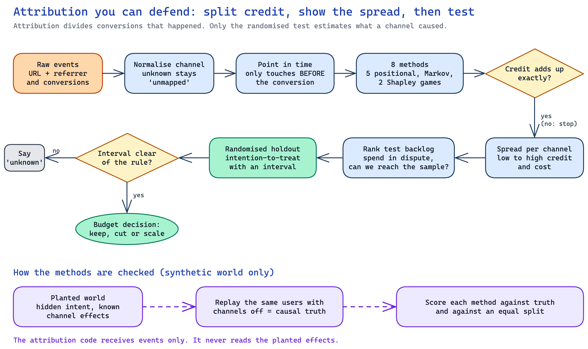
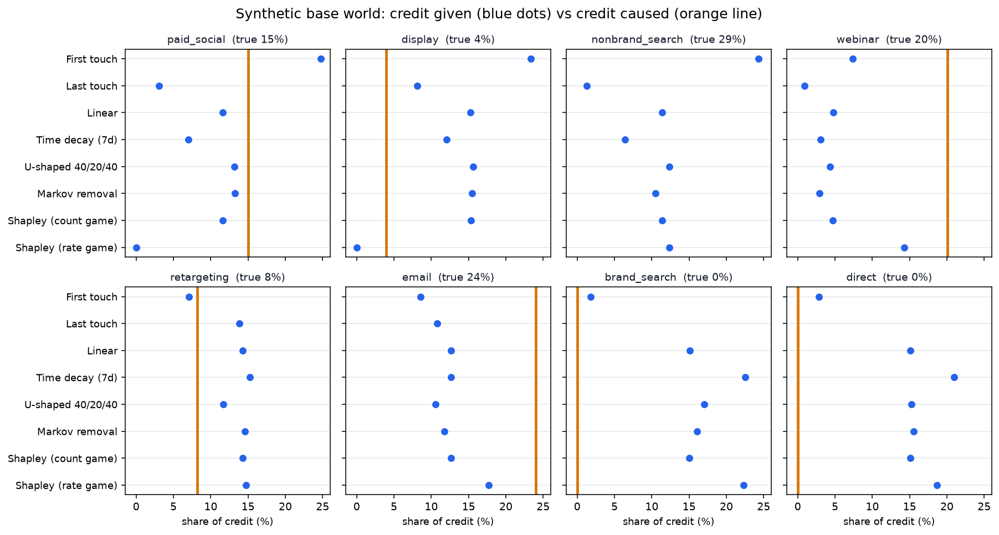
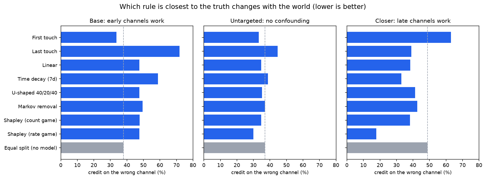
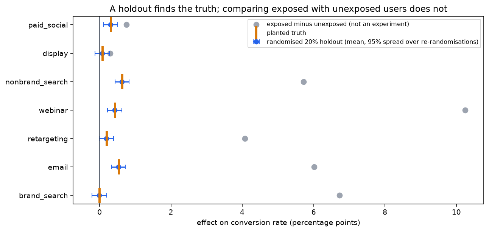

# Project 09: Multi-touch attribution you can defend

**Business question:** how much does each channel's credit change when the attribution method changes, and what can and cannot be concluded for budget decisions?

**Short answer.** In the test world, a lot: between the two most different of seven methods (rate-game Shapley left out), 66% of all credit changes channel. No method recovers what the channels caused, which method comes closest changes when the world changes, and every method hands out all the credit even when no channel does anything. Use attribution to describe journeys and to choose what to test. Use a randomised holdout to decide whether a channel causes sales.



*Editable source: [`docs/attribution.excalidraw`](docs/attribution.excalidraw).*

## Why this project

**Business need.** A marketing team has to decide where the budget goes, and the channel report changes when someone changes the
attribution rule. The intended users are the budget owner and the RevOps person who has to explain the numbers.

**The workflow in four lines**

1. **Goes in:** marketing touches with links and referrers, conversions, and a written conversion definition and lookback window.
2. **Reasoned:** how much each channel's credit depends on the method, and which channel is most worth testing first.
3. **Happens:** a report with the range of credit per channel and a randomised holdout plan. No budget is changed automatically.
4. **Seen:** the budget owner and RevOps read the report; the analyst uses the holdout design.

**What you could buy instead.** Web analytics tools and ad platforms include attribution reports, and dedicated attribution and
measurement vendors exist, including ones that run lift tests. I did not test or compare any. If you only need one reporting rule, the
report in your current tool may be enough.

**Signal that it works.** A team picks a channel from the spread table, runs the pre-registered holdout, and makes a keep, cut or retest
decision that cites the holdout interval instead of an attribution share.

**Real users today: none.** The results come from an invented test world, and no real holdout has been run.

## Who uses the answer

| Person | What they take from it |
|---|---|
| Marketing leader or budget owner | Which channel numbers depend on the method, and what must be tested before moving money |
| RevOps | One conversion definition, one lookback rule, and reports that show a range |
| Marketing operations | The campaign naming rules the channel normaliser depends on |
| GTM or analytics engineer | The pipeline, the SQL, the invariants and the [holdout design](docs/holdout-test-design.md) |

## The data (read this first)

| Dataset | Real? | Used for |
|---|---|---|
| Planted world, 200,000 users, 8 channels | **Synthetic**. Every effect and all spend are invented | Checking the methods against a known answer |
| Criteo attribution dataset (optional, you download it) | **Real**, one display vendor. **CC BY-NC-SA 4.0, local only** | Optional local audit, results not published |

I found no public journey dataset that is real, openly licensed and has several marketing channels. [`DATA.md`](DATA.md) lists what was rejected and why. **Every published result in this project is synthetic. Nothing here describes how any real marketing channel performs.**

## Run it

```bash
cd projects/09-attribution-engine
pip install -r requirements.txt

python -m attribution --quick          # small run into output/, no download; numbers differ
python -m attribution --skip-criteo    # full synthetic run into reports/

# optional, non-commercial licence: local audit of a real file
python fetch_data.py --accept-noncommercial-licence   # 653 MB, SHA-256 checked
python -m attribution                  # synthetic report in reports/, Criteo audit in output/

python -m pytest --cov=attribution     # offline, hand-made fixtures
```

Without the Criteo file, the optional step is skipped. When it runs, its report and chart go to the git-ignored `output/` folder, never to
`reports/`. Do not commit or republish them without meeting the CC BY-NC-SA 4.0 terms.

## Architecture

| Module | Job |
|---|---|
| `channels.py` | URL tags, click ids and referrer into one channel. Unknown stays `unmapped`; paid search without a brand marker stays `paid_search_unclassified` |
| `journeys.py` | Point in time: a touch counts only if it is **strictly before** the conversion and inside the lookback. Exact duplicates are dropped |
| `allocate.py` | One conversion is 1,000,000 integer units, split by largest remainder, so totals are exact |
| `heuristics.py`, `markov.py`, `shapley.py` | The methods |
| `methods.py` | Runs all eight and stops if any total is off by one unit |
| `uncertainty.py` | Bootstrap intervals |
| `sql/`, `sqllayer.py` | The same time rules, positional methods and Markov transition counts in SQLite |
| `world*.py`, `truth.py`, `evaluate.py` | The synthetic world and the only code that sees the planted truth |
| `holdout.py`, `holdout_plan.py` | Assignment, sample size, analysis, and a replay on the planted world |
| `decisions.py` | Spread, cost range and test backlog, using **assumed** spend |
| `criteo*.py`, `report_criteo.py` | Optional local loader: audit, click paths, method comparison |

**Point in time.** This is a look back, not a prediction, so there is no train and test split and no probability to calibrate. The rule that matters is that nothing at or after the conversion may earn credit. The score against truth is the out-of-model check.

## The methods

| Method | Rule | Uses non-buyers? |
|---|---|---|
| First touch, last touch | All credit to one end | No |
| Linear | Equal per touch (a channel seen three times gets three shares) | No |
| Time decay | A touch loses half its weight every 7 days | No |
| U-shaped (position based) | 40% first, 40% last, 20% across the middle; two touches 50/50. **Not W-shaped**, which also anchors a lead-creation touch (usually 30/30/30/10) | No |
| Markov removal | First-order chain; credit in proportion to how much conversion probability falls when a channel is removed | Yes |
| Shapley, count game | A coalition is worth the conversions of journeys using only its channels. This **equals** an equal split over each journey's distinct channels | No |
| Shapley, rate game | A coalition is worth the **conversion rate** of those journeys | Yes |

"Shapley attribution" is not one method. Both versions are exact, and they disagree. Markov rescales removal effects to add to 100%, which is a convention. The rate game can go negative; negative values are set to zero and the report names the channels.

## Results: synthetic world

All numbers come from [`reports/report.md`](reports/report.md), seed 7.

**The base world.** A hidden intent score drives both who sees a channel and who buys. Paid social, non-brand search and webinars also raise later interest, which causes more site visits, brand searches and direct visits. Brand search and direct have **zero** effect on buying.

- 8,273 conversions. Switching every switchable channel off would lose 3,430 (41.5%). The other 4,843 happen anyway.
- 7,923 have a tracked touch, and every method credits all 7,923. So each channel table adds up to more than twice what the channels caused.
- Brand search plus direct, true effect zero, get 4.6% of credit under first touch, 30.2% under linear, 31.5% under Markov, 43.5% under time decay and 62.0% under last touch.
- Non-brand search gets 102 conversions under last touch and 1,925 under first touch.
- Webinar truly accounts for 20% of the marketing effect. Last touch gives it 0.9% and Markov 2.9%.
- Rate-game Shapley gives paid social zero. Its true share is 15%.



**Share error** is the part of all credit sitting on the wrong channel (0% is perfect). "Equal split" gives each channel one eighth and uses no data.

| Method | Base | No confounding or cascade | Late channels do the work | 40 random worlds: median | beats equal split |
|---|---|---|---|---|---|
| First touch | **33.7%** | 33.2% | **63.1%** (worst) | 27.5% | 85% |
| Last touch | 71.9% | 44.6% | 38.9% | 55.5% | 2.5% |
| Linear | 47.6% | 34.6% | 38.3% | 30.2% | 90% |
| Time decay | 58.8% | 38.8% | 32.9% | 40.2% | 27.5% |
| U-shaped | 47.5% | 35.2% | 41.3% | 32.4% | 82.5% |
| Markov | 49.5% | 37.1% | 42.5% | 34.8% | 65% |
| Shapley, count | 47.7% | 34.7% | 38.2% | 30.2% | 90% |
| Shapley, rate | 47.5% | **30.0%** | **17.8%** | 35.4% | 62.5% |
| Equal split (no model) | 37.9% | 37.1% | 48.9% | 36.2% | |

What to take from it, including where the sophisticated methods lose:

- In the base world, **seven of eight methods are no closer than the equal split**. Only first touch beats it, by about 4 points.
- **That is not a reason to use first touch.** It wins because the base world puts real effects early. When late channels do the work, it is the worst. In the 40 random worlds it has the lowest median error, but those worlds all keep prospecting early and intent capture late, and even there it names the biggest channel only 37.5% of the time.
- **Markov is not more causal than linear here.** It does worse than linear in all three fixed worlds and by median in the random ones. It learns which channels sit on paths to purchase, which hidden intent also decides.
- Removing confounding and cascade helps most methods, but the best error is still 30.0%. Attribution also splits conversions that would have happened anyway.
- Across ten fresh sets of users, each error other than rate-game Shapley's stays within a range under 2 points wide; rate-game Shapley ranges from 42.7% to 49.0%. The bootstrap intervals are narrow too. **A precise wrong answer stays wrong.**



**Null world.** All effects set to zero: every method still hands out all 4,493 tracked conversions. Attribution cannot say "nothing worked".

**Holdout replay.** A 20% randomised holdout, re-randomised 500 times, averages close to the planted effect for every channel, and its 95% intervals contain the truth 95.0% to 96.4% of the time. For brand search (true effect zero) it flags an effect 5.0% of the time, as it should. Comparing exposed with unexposed users shows a **6.7 point** gap for that same channel. The price is sample size: about 45,000 users for non-brand search at 80% power, 188,000 for paid social, 475,000 for retargeting and 2.8 million for display. This confirms the arithmetic, not how hard a real test is.



**Two pipeline mistakes, measured.**

- Keeping events from after the purchase moves e-mail's last-touch share from 10.8% to 30.8% and direct's from 27.9% to 40.0%. The world plants these on purpose.
- Treating "no `utm_source`" as direct would mislabel 9.3% of events. The normaliser matches the planted channel on every event, but one author wrote both, so that is a regression check and not an accuracy score.

SQL and Python differ by at most 0.001 of a conversion.

## What you can conclude, and what you cannot

| You may say | You may not say |
|---|---|
| "Under rule X, channel A appears in this share of credited journeys" | "Channel A caused these conversions" |
| "A's credit ranges from low to high across methods, so its value is unresolved" | "The data-driven model is the accurate one" |
| "The methods agree on A" | "...so A works" (they share the same blind spots) |
| "This is the channel we should test first" | "Cut A, its last-touch cost per conversion is high" |
| "The holdout puts A's effect in this interval, for this audience, spend level and period" | "A will have the same effect at twice the budget" |

**The action:** run section 6 of the report on your own journeys with real spend. It lists each channel's lowest and highest credit and cost per attributed conversion, ordered by "spend in dispute" = spend x (1 - lowest / highest). Take the top channel for which you can reach the sample size and run the [holdout](docs/holdout-test-design.md). That column is a ranking aid, not money at risk. In the synthetic table all spend figures are assumptions. Its last column, cost per truly incremental conversion, exists only because the truth is planted: brand search has none to price, yet last touch makes it look cheap.

The operating steps, owners and failure handling are in [`docs/process.md`](docs/process.md).

## What I tried that did not work

- **A ready-made Kaggle journey file** (Apache-2.0). Every channel converted at 48% to 50% and most users had both outcomes. There was no signal to attribute, so it was dropped.
- **Expecting Markov or Shapley to recover the planted effects.** In the base world they did not beat an equal split. The planted effects were not changed to rescue them.
- **One world only.** First touch came out best, which would have been a misleading headline. I added the mirror-image "late channels" world, the untargeted world and the random sweep **after** seeing that result. The mirror world reverses first touch from best to worst. These extra worlds were designed to stress the conclusion, so treat them as demonstrations, not as a representative sample.
- **Rate-game Shapley as "the" Shapley.** It is the best method in two fixed worlds and zeroes a channel with a real effect in the base world. Both games are now shown.

## Limits

- The verification world was designed by the same person who built the pipeline. Effects are never negative, nobody uses two devices, offline touches do not exist, and there is no spend-response curve, so nothing here says how to reallocate a budget.
- "Truth" is defined as an on/off effect. A different question (10% more spend) has a different answer.
- Consumer-style journeys. B2B needs account-level identity, buying groups, long sales cycles and opportunity stages. None of that is modelled, and there is no CRM, GA4 or ad-platform connector.
- Markov is first order only. Other orders, half-lives and conversion definitions would give yet other answers.
- The bootstrap treats journeys as independent. In real data one user can have several.
- The holdout code covers user-level two-arm tests with a Wald interval: no region tests, sequential looks, variance reduction or multiple-testing correction.
- The SQL covers time rules, positional methods and transition counts, not the Markov solve or Shapley.
- Exact Shapley is limited to 14 channels here, so inputs with more must be grouped first.

## What you should be able to explain in an interview

1. **Why does credit always add to 100%, and why is that a problem?** Each rule divides observed conversions among the touches. Conversions that would have happened anyway are divided too. In the base world 4,843 of 8,273 would have; in the null world all of them would, and credit is still fully handed out.
2. **Why does last touch favour brand search?** People who already intend to buy search for the brand shortly before buying. The touch is a result of intent. In the planted world its effect is zero and last touch gives it 34% of credit.
3. **Is a data-driven model causal?** No. Markov and Shapley are fitted on observed paths, where hidden intent decides both exposure and purchase. Neither has a source of random variation.
4. **How do Markov removal effect and Shapley differ?** Markov asks how conversion probability falls if a state is cut from an order-based chain, then rescales. Shapley averages a channel's marginal contribution over all orders in which a coalition could be built, ignores sequence here, and depends on the value function you choose.
5. **When is Shapley the same as linear?** In the count game it is an equal split over each journey's distinct channels. It differs from per-touch linear only when a channel repeats in a journey.
6. **U-shaped or W-shaped?** U-shaped is 40/20/40 on first and last. W-shaped has a third anchor, usually lead creation, commonly 30/30/30 with 10 spread over the rest.
7. **What is intention-to-treat and why not compare exposed users?** Compare everyone assigned, reached or not, so the arms differ only by chance. "Reached" is chosen by targeting and behaviour: the naive gap for a zero-effect channel was 6.7 points.
8. **Why can a holdout be impractical?** The sample needed grows roughly with one over the effect squared. In the planted world, display would need 2.8 million users. Say it cannot be measured rather than run an underpowered test.
9. **What is the leakage risk in attribution?** Post-conversion events (onboarding mail, logins as direct visits) and outcome-dependent path construction: if the way a path is built depends on whether it converted, the path leaks its own label.
10. **Leadership wants one number. What do you give?** The range per channel, which decisions are the same across it, and a dated test plan for the ones that are not. If they need one operating rule for reporting, pick it, name it and keep it stable, and do not call it causal.

## Exercises

1. Change `HALF_LIFE_DAYS` to 1 and to 30. Which channels move, and which earlier method does each end resemble?
2. Add a second-order Markov chain. Does its share error improve in all three worlds? How many states have few observations?
3. Give display a negative effect in `world.py`. What does each method show?
4. Add a third Shapley value function (for example rate times coalition volume). Defend or reject it using the three worlds.
5. Make 20% of users switch device halfway through, splitting their journey. How do the errors change, and how does it affect the holdout?
6. Write a W-shaped rule with a lead-creation event added to the world, with tests for journeys that have fewer than three anchors.
7. Compute the brand-search holdout size needed to rule out an effect above 0.2 points. This is an equivalence question: why does `required_total` not answer it as written?
8. Add a region-level test to the world and show why the user-level interval is too narrow for it.
