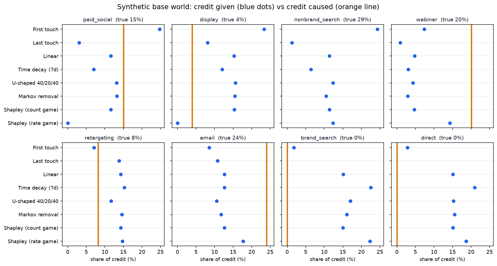
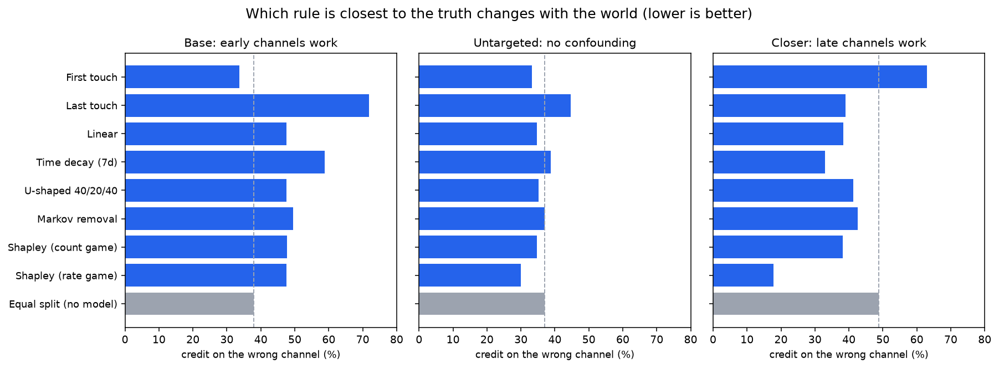
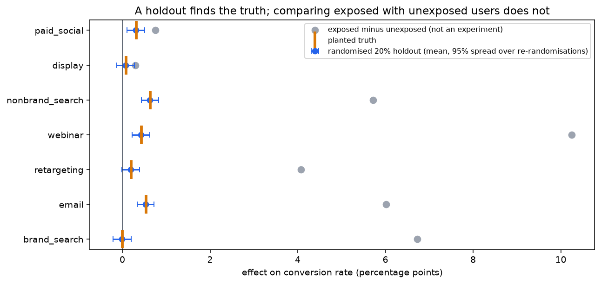

# Attribution report: synthetic world with planted incrementality

> **Everything in this file is synthetic.** Users, channels, effects and spend are invented. It shows how the methods behave when the truth is known. It says nothing about any real channel.

Settings: 200,000 users, seed 7, 200 bootstrap replicates. Rebuild with `python -m attribution`.

## 1. Headline

- 7,923 tracked conversions are credited by every method, to the exact integer unit. Only 3,430 of all 8,273 conversions would be lost with all switchable channels off (41.5%). The other 4,843 happen anyway.
- 350 conversions had no touch. No method can credit them.
- Between the two most different core methods, 66.4% of all credit changes channel.
- In the base world, 7 of 8 methods are no closer to the truth than an equal split.
- Methods with a negative raw rate-game value, set to zero: display, paid_social.

## 2. Credit by method against planted truth

In conversions. `leave_one_out` is what is lost if only that channel is switched off (what a holdout measures). `causal_shapley` splits the whole marketing effect fairly across channels, so it adds up to that total. Direct is not switchable and has no planted effect.

| measure | paid_social | display | nonbrand_search | webinar | retargeting | email | brand_search | direct |
|---|---|---|---|---|---|---|---|---|
| leave_one_out | 635 | 166 | 1,272 | 868 | 401 | 1,083 | 0 | 0 |
| causal_shapley | 516 | 134 | 987 | 689 | 280 | 824 | 0 | 0 |
| first_touch | 1,962 | 1,849 | 1,925 | 586 | 561 | 677 | 141 | 222 |
| last_touch | 245 | 641 | 102 | 70 | 1,097 | 854 | 2,700 | 2,214 |
| linear | 920 | 1,207 | 900 | 376 | 1,131 | 999 | 1,194 | 1,195 |
| time_decay | 556 | 957 | 509 | 244 | 1,210 | 1,002 | 1,784 | 1,662 |
| u_shaped | 1,045 | 1,238 | 976 | 341 | 924 | 837 | 1,350 | 1,211 |
| markov | 1,049 | 1,223 | 829 | 232 | 1,155 | 933 | 1,270 | 1,231 |
| shapley_count | 916 | 1,215 | 899 | 373 | 1,132 | 1,001 | 1,188 | 1,198 |
| shapley_rate | 0 | 0 | 979 | 1,130 | 1,168 | 1,402 | 1,767 | 1,477 |

### Share of credit with 95% bootstrap intervals (%)

| method | brand_search | direct | display | email | nonbrand_search | paid_social | retargeting | webinar |
|---|---|---|---|---|---|---|---|---|
| First touch | 1.8 (1.4-2.1) | 2.8 (2.4-3.1) | 23.3 (22.5-24.3) | 8.5 (8.0-9.2) | 24.3 (23.3-25.4) | 24.8 (23.8-25.7) | 7.1 (6.5-7.6) | 7.4 (6.9-7.9) |
| Last touch | 34.1 (32.8-35.1) | 27.9 (27.0-28.9) | 8.1 (7.6-8.7) | 10.8 (10.2-11.4) | 1.3 (1.1-1.5) | 3.1 (2.7-3.5) | 13.8 (13.1-14.7) | 0.9 (0.7-1.1) |
| Linear | 15.1 (14.7-15.4) | 15.1 (14.7-15.4) | 15.2 (14.7-15.8) | 12.6 (12.3-12.9) | 11.4 (11.1-11.7) | 11.6 (11.2-12.1) | 14.3 (13.9-14.6) | 4.8 (4.5-5.0) |
| Time decay (7d) | 22.5 (22.0-23.0) | 21.0 (20.5-21.4) | 12.1 (11.6-12.6) | 12.7 (12.3-13.0) | 6.4 (6.2-6.7) | 7.0 (6.7-7.4) | 15.3 (14.9-15.7) | 3.1 (2.9-3.3) |
| U-shaped 40/20/40 | 17.0 (16.5-17.5) | 15.3 (14.8-15.7) | 15.6 (15.1-16.2) | 10.6 (10.3-11.0) | 12.3 (12.0-12.8) | 13.2 (12.7-13.7) | 11.7 (11.3-12.1) | 4.3 (4.0-4.6) |
| Markov removal | 16.0 (15.8-16.3) | 15.5 (15.3-15.8) | 15.4 (15.3-15.6) | 11.8 (11.6-11.9) | 10.5 (10.4-10.6) | 13.2 (13.1-13.4) | 14.6 (14.4-14.8) | 2.9 (2.9-3.0) |
| Shapley (count game) | 15.0 (14.6-15.3) | 15.1 (14.7-15.5) | 15.3 (14.8-15.8) | 12.6 (12.3-12.9) | 11.3 (11.1-11.7) | 11.6 (11.2-12.0) | 14.3 (14.0-14.6) | 4.7 (4.5-4.9) |
| Shapley (rate game) | 22.3 (19.7-24.8) | 18.6 (16.0-21.2) | 0.0 (0.0-0.0) | 17.7 (15.2-20.5) | 12.4 (10.1-14.8) | 0.0 (0.0-0.0) | 14.7 (11.9-17.4) | 14.3 (10.8-17.9) |

The intervals cover sampling noise only. They are narrow next to the gaps between methods, and a narrow interval around a wrong rule is still wrong. Journeys are resampled as independent units.

## 3. Which method is closest to the truth? It depends on the world

**Share error** is the part of all credit that would have to move to match the causal split (0% is perfect). `equal_split` (1/8 each) and `touch_volume` use no attribution logic; a method that cannot beat them adds nothing.

| method | Base: early channels work | Untargeted: no confounding | Closer: late channels work | Base, 10 fresh seeds: mean (min to max) |
|---|---|---|---|---|
| first_touch | 33.7% | 33.2% | 63.1% | 32.9% (32.3% to 33.5%) |
| last_touch | 71.9% | 44.6% | 38.9% | 72.6% (71.6% to 73.4%) |
| linear | 47.6% | 34.6% | 38.3% | 48.0% (47.5% to 48.6%) |
| time_decay | 58.8% | 38.8% | 32.9% | 59.3% (58.7% to 60.1%) |
| u_shaped | 47.5% | 35.2% | 41.3% | 48.0% (47.5% to 48.5%) |
| markov | 49.5% | 37.1% | 42.5% | 50.3% (49.7% to 51.0%) |
| shapley_count | 47.7% | 34.7% | 38.2% | 48.0% (47.4% to 48.5%) |
| shapley_rate | 47.5% | 30.0% | 17.8% | 45.7% (42.7% to 49.0%) |
| equal_split | 37.9% | 37.1% | 48.9% | 38.7% (38.3% to 39.5%) |
| touch_volume | 49.3% | 38.6% | 50.7% | 49.3% (48.8% to 50.0%) |

### 40 random worlds

Lifts, targeting strength and cross-channel effects are redrawn for each world (60,000 users each; brand search may have a small real effect).

| method | median_error | worst_error | beats_equal_split | lowest_error_worlds | names_right_top_channel |
|---|---|---|---|---|---|
| first_touch | 27.5% | 50.8% | 85.0% | 20 | 37.5% |
| last_touch | 55.5% | 68.8% | 2.5% | 0 | 0.0% |
| linear | 30.2% | 44.7% | 90.0% | 7 | 42.5% |
| time_decay | 40.2% | 55.1% | 27.5% | 0 | 15.0% |
| u_shaped | 32.4% | 45.7% | 82.5% | 1 | 32.5% |
| markov | 34.8% | 50.2% | 65.0% | 1 | 22.5% |
| shapley_count | 30.2% | 44.7% | 90.0% | 3 | 42.5% |
| shapley_rate | 35.4% | 49.0% | 62.5% | 5 | 35.0% |
| equal_split | 36.2% | 46.9% | 0.0% | 0 | 7.5% |
| touch_volume | 33.4% | 48.3% | 67.5% | 3 | 30.0% |

These are shares of the worlds this generator can produce, not of real businesses. In every one of them prospecting channels come first and intent capture comes last.

## 4. The null world: no channel does anything

Every lift is zero. Switching all marketing off changes conversions by 0. Every method still hands out all 4,493 tracked conversions:

| channel | first_touch | last_touch | linear | time_decay | u_shaped | markov | shapley_count | shapley_rate |
|---|---|---|---|---|---|---|---|---|
| brand_search | 124 | 1,232 | 613 | 870 | 658 | 622 | 614 | 1,235 |
| direct | 188 | 1,101 | 644 | 854 | 645 | 633 | 638 | 1,018 |
| display | 1,233 | 581 | 875 | 737 | 897 | 784 | 880 | 0 |
| email | 354 | 467 | 492 | 508 | 436 | 528 | 493 | 646 |
| nonbrand_search | 906 | 90 | 462 | 280 | 485 | 498 | 463 | 532 |
| paid_social | 1,119 | 288 | 638 | 454 | 681 | 629 | 642 | 0 |
| retargeting | 375 | 685 | 632 | 691 | 564 | 666 | 630 | 704 |
| webinar | 194 | 49 | 138 | 100 | 127 | 133 | 134 | 358 |

No attribution method can output 'nothing worked'. That is a property of the arithmetic, not of this data.

## 5. Holdout test, replayed on the planted world

20% of 200,000 users are held out from one channel, re-randomised 500 times. Effects are intention-to-treat differences in conversion rate. `detected` is the share of runs whose 95% interval excludes zero (power; for a true zero it is the false-positive rate). `users_needed` is the two-arm total for 80% power at the true effect, which in real life you must guess.

| channel | true_effect_pp | holdout_mean_pp | holdout_sd_pp | interval_coverage | detected | naive_exposed_gap_pp | users_needed_80pct_power |
|---|---|---|---|---|---|---|---|
| paid_social | 0.317 | 0.310 | 0.102 | 95.4% | 83.0% | 0.75 | 187,546 |
| display | 0.083 | 0.074 | 0.105 | 95.4% | 8.0% | 0.30 | 2,803,048 |
| nonbrand_search | 0.636 | 0.630 | 0.098 | 96.2% | 100.0% | 5.72 | 45,366 |
| webinar | 0.434 | 0.425 | 0.101 | 95.8% | 98.2% | 10.25 | 99,299 |
| retargeting | 0.200 | 0.191 | 0.102 | 95.4% | 40.8% | 4.07 | 475,322 |
| email | 0.541 | 0.534 | 0.097 | 96.4% | 99.8% | 6.02 | 63,147 |
| brand_search | 0.000 | -0.010 | 0.106 | 95.0% | 5.0% | 6.73 | n/a |

This replay only shows that the design and arithmetic are right. A simulation has no cross-device leakage, no spillover and perfect delivery, so a real test will be noisier than this.

## 6. Budget view

**Spend is an assumption invented for this example.** The first columns are what a real team could compute. The last one exists only because the world is synthetic.

`spend_in_dispute` = spend x (1 - lowest credit / highest credit) across the five positional rules, Markov and count-game Shapley. 'Methods agree' means the highest credit is at most 1.25 times the lowest. It is a ranking aid for what to test, not money at risk.

| channel | assumed_spend_eur | credit_low | credit_high | cpa_low_eur | cpa_high_eur | best_efficiency_rank | worst_efficiency_rank | spend_in_dispute_eur | verdict | true_cost_per_incremental_eur |
|---|---|---|---|---|---|---|---|---|---|---|
| nonbrand_search | 80,000 | 102 | 1,925 | 42 | 784 | 4 | 7 | 75,761 | depends on the method: test first | 63 |
| paid_social | 60,000 | 245 | 1,962 | 31 | 245 | 3 | 6 | 52,508 | depends on the method: test first | 94 |
| brand_search | 35,000 | 141 | 2,700 | 13 | 248 | 2 | 7 | 33,172 | depends on the method: test first | n/a |
| display | 40,000 | 641 | 1,849 | 22 | 62 | 2 | 4 | 26,133 | depends on the method: test first | 241 |
| webinar | 25,000 | 70 | 586 | 43 | 357 | 5 | 7 | 22,014 | depends on the method: test first | 29 |
| retargeting | 30,000 | 561 | 1,210 | 25 | 53 | 2 | 6 | 16,095 | depends on the method: test first | 75 |
| email | 8,000 | 677 | 1,002 | 8 | 12 | 1 | 1 | 2,597 | depends on the method: test first | 7 |

## 7. Pipeline checks

### Point in time (last-touch share)

4,885 events at or after the journey end are removed. Keeping them changes last touch like this:

| channel | point_in_time | post_purchase_events_kept |
|---|---|---|
| brand_search | 34.1% | 16.3% |
| direct | 27.9% | 40.0% |
| display | 8.1% | 3.8% |
| email | 10.8% | 30.8% |
| nonbrand_search | 1.3% | 0.7% |
| paid_social | 3.1% | 1.4% |
| retargeting | 13.8% | 6.6% |
| webinar | 0.9% | 0.3% |

### Channel normalisation

- 554,970 raw events carry 13 distinct `utm_source / utm_medium` strings; normalising gives 8 channels.
- 100.0% match the planted channel. The same author wrote the URL variants and the rules, so this is a regression check, not an accuracy estimate.
- A 'no `utm_source` means direct' shortcut would mislabel 9.3% of events.

### SQL against Python

Largest difference between the SQL layer and the Python methods, in conversions: 0.001 (rounding from integer allocation).
