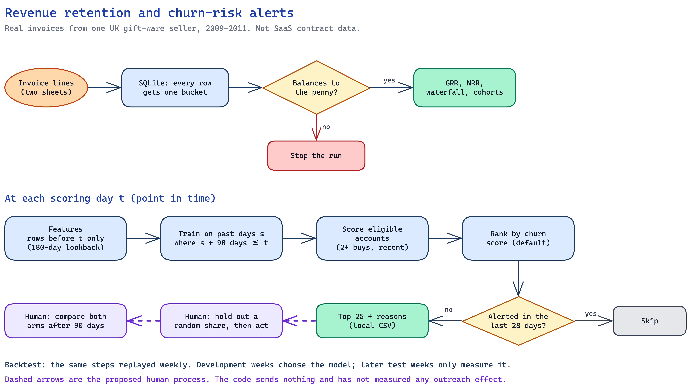
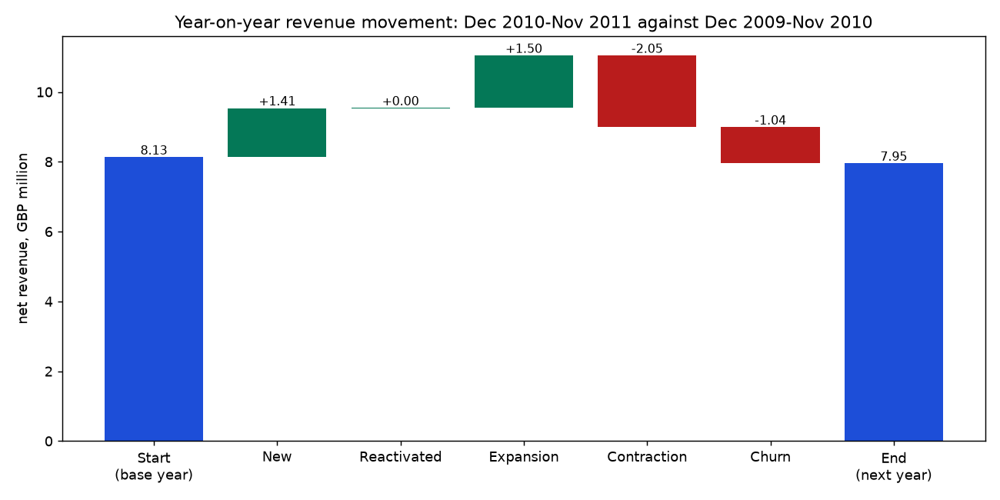
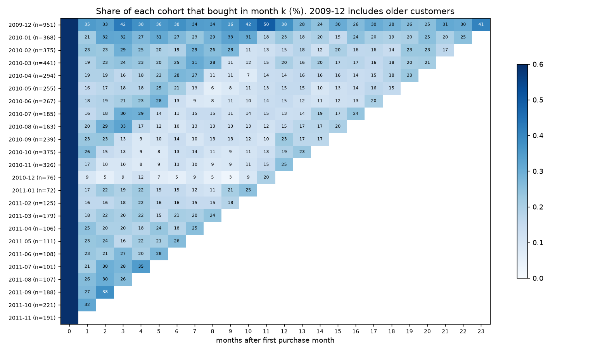
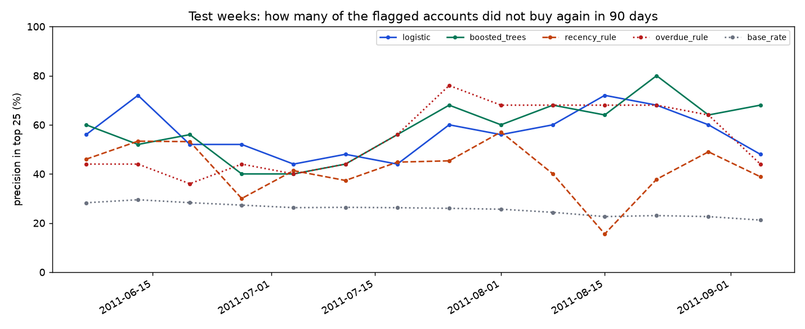
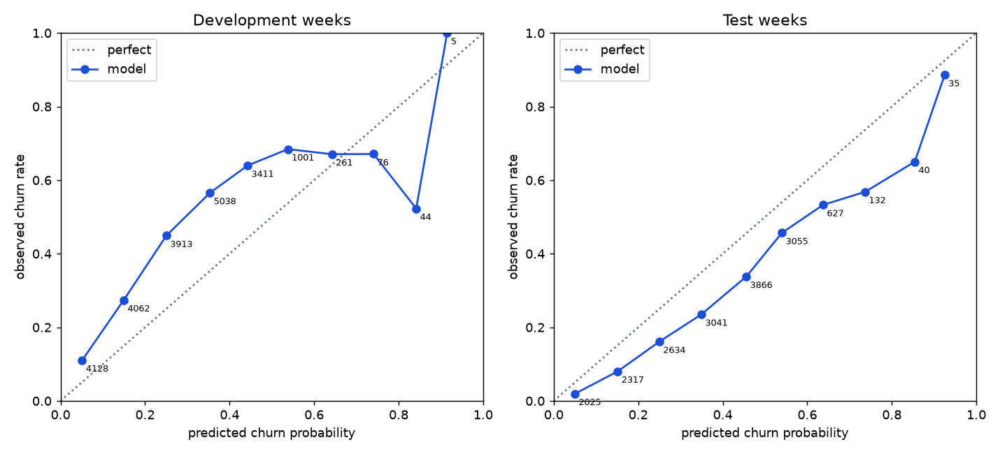

# Project 11: Revenue retention and churn-risk alerts

**Business question:** what is net and gross revenue retention by cohort, which accounts are at risk before they leave, and what should
customer success do this week?

> **This is not SaaS contract data.** It is real invoices (2009-2011) from one UK online gift-ware seller with many wholesale customers
> ([UCI Online Retail II](https://doi.org/10.24432/C5CG6D), Chen 2012, CC BY 4.0). There are no subscriptions, renewals, MRR, seats or
> product usage. GRR and NRR here are repeat-purchase analogues. "Churn" is a definition we chose. Do not quote these numbers as
> SaaS benchmarks.



*Editable source: [`docs/churn_alert.excalidraw`](docs/churn_alert.excalidraw). Operating process: [`docs/process.md`](docs/process.md).
Data notes: [`DATA.md`](DATA.md). Full output: [`reports/report.md`](reports/report.md).*

## Why this project

**Business need.** A team that sells repeat orders loses revenue quietly: accounts stop buying or buy less, and no cancellation tells
anyone. The intended user is a customer success manager with room for a fixed number of check-ins a week, with RevOps owning the
retention numbers.

**The workflow in four lines**

1. **Goes in:** invoice lines with customer, date, quantity and price.
2. **Reasoned:** which eligible accounts are most likely to make no purchase in the next 90 days, plus the observable behaviour to mention.
3. **Happens:** a ranked list of 25 accounts is written to a local file; a person decides what to do. Nothing is sent.
4. **Seen:** the customer success manager reads the queue file; RevOps reads the retention report.

**What you could buy instead.** Customer success and CRM products offer account health scores and churn alerts, and subscription analytics
tools report GRR and NRR. I did not test or compare any. A simple "silent for longer than usual" rule in a spreadsheet is also a real
alternative: this test could not separate it from the model on precision at 25.

**Signal that it works.** In a randomised holdout, flagged accounts that get the follow-up make no purchase for 90 days less often than
flagged accounts that do not, with an interval that excludes zero. Before that, in shadow use, the share of listed accounts that do stop
buying should stay above the share among all eligible accounts.

**Real users today: none.** No customer success team has used this list, and no outreach effect has been measured.

## Who uses the answer

| Role | Question they bring | What they get |
|---|---|---|
| RevOps | Is the installed base growing or leaking, and does the number tie out? | GRR, NRR, waterfall and cohorts with exact reconciliation |
| Head of customer success | Can we trust a risk list at our capacity? | A backtest against simple rules, with intervals and weak spots |
| Customer success manager | Whom do I contact this week, and why? | A ranked local list with observable reasons and a suggested first step |
| Finance | Can this go in a forecast? | No: the score is not calibrated across seasons (see below) |

## Architecture

| Piece | Job |
|---|---|
| `churnalert/data.py` | Load and validate the workbook; money as integer pence |
| `churnalert/sql/01-04` | SQLite: row buckets, customers and cohorts, per-customer movements, waterfall views |
| `churnalert/sql/05_checks.sql`, `sqldb.py` | Reconciliation checks; one penny of difference stops the run |
| `retention.py` | GRR, NRR, customer bootstrap, sensitivity, the month-on-month trap |
| `features.py` | Point-in-time features and the 90-day label |
| `models.py`, `backtest.py` | Three baselines, logistic regression, boosted trees; rolling-origin backtest |
| `metrics.py`, `uncertainty.py` | Precision at capacity, calibration, paired bootstrap, segments |
| `queue.py` | This week's list (ranked by risk; `policy="value"` is optional), reasons, 28-day cooldown; writes local files only |
| `experiment.py` | Holdout sample size |
| `analysis.py`, `report.py`, `charts.py` | Orchestration and aggregate-only outputs |

## Run it

```bash
cd projects/11-churn-alert-system
pip install -r requirements.txt
python fetch_data.py          # about 46 MB from UCI, SHA-256 verified, into data/raw/ (git-ignored)
python -m churnalert          # about a minute on a laptop: reports/ (aggregates) and output/ (local only)
python -m pytest --cov=churnalert   # offline, hand-made and invented fixtures, no download needed
```

`output/` holds the SQLite database, `alert_queue_<date>.csv` and `alert_history.csv`. They contain account-level rows: keep them local.
To explore the SQL, open `output/retention.sqlite` and read `churnalert/sql/` in number order. Nothing is sent anywhere.

## Retention definitions

Compare the **same months one year apart**, because the trade is highly seasonal. Revenue is net merchandise value per customer per
window, floored at zero.

- **Base:** customers with revenue in the base window.
- **Churn:** all base revenue of a customer with none in the comparison window.
- **Contraction / expansion:** the fall or rise for customers present in both.
- **GRR** = (start - churn - contraction) / start. **NRR** = (start - churn - contraction + expansion) / start.
- **New and reactivated** revenue appear in the waterfall and never in GRR or NRR.
- `start + new + reactivation + expansion - contraction - churn = end`, exactly.

There are two different "churns" here. The retention waterfall uses *no revenue in the comparison window*. The risk model uses
*no purchase day in the next 90 days*. Always say which one you mean.

## Results: retention

Dec 2010 to Nov 2011 against Dec 2009 to Nov 2010 (identified customers only):

| Start | New | Reactivation | Expansion | Contraction | Churn | End |
|---|---|---|---|---|---|---|
| £8,128,735 | £1,407,371 | £1,707 | £1,502,716 | £2,052,421 | £1,036,405 | £7,951,702 |

(Displayed values are rounded to pounds; the checks run on pence.)

- **GRR 62.0%** (95% customer bootstrap 58.7% to 65.8%). **NRR 80.5%** (75.3% to 86.9%). **Logo retention 63.8%** (2,694 of 4,224).
- **Contraction (£2.05m) is about twice churn (£1.04m).** Watching only for lost logos would miss most of the lost revenue.
- **By cohort, annual:** NRR 74.6% for "2009-12 or older", 71.1% Jan-Mar 2010, 85.7% Apr-Jun, 131.4% Jul-Sep, 128.1% Oct-Nov.
  The figures above 100% are **mostly an artefact**: those cohorts have only part of a year in the base and a full year after it.
- **Concentration:** without the 50 largest base customers (30% of base revenue), GRR falls to 56.7% and NRR to 76.4%.
- **Cleaning choices:** dropping within-sheet duplicate rows or counting manual adjustments moves GRR and NRR by under 0.2 points.
- **Reconciliation:** 44 of 44 checks balance exactly. All 1,067,371 source rows sit in exactly one bucket. 235,287 rows with no customer id
  (net £2,566,093) cannot be in any retention figure.





## The churn-risk model

- **Point in time:** 00:00 on a Monday. Features use earlier rows only, from a fixed 180-day lookback.
- **Who is scored:** at least 2 purchase days in the last 180, and one in the last 90.
- **Label:** no purchase day in the next 90 days. 85.5% of 11,961 repeat gaps observed before Dec 2010 were 90 days or less.
  This is right-censored evidence (long gaps are under-counted), so 90 days is a judgement.
- **Embargo:** a past snapshot is used for training only once its 90-day label has closed.
- **Development** weeks (6 Dec 2010 to 7 Mar 2011) choose the model by log loss. Their last label closes before the first test week.
  **Test** weeks: 6 Jun to 5 Sep 2011 (14 weeks, 1,725 accounts). Hyperparameters were fixed in code and not searched.
  After the first test run, comparisons against the overdue rule were added to the report and display changes made. No model,
  feature, definition or queue rule was changed.
- **Capacity:** 25 accounts a week. This is an assumption; change `CAPACITY` in `config.py`.

### Test results

| Model | AUC | Brier | Precision in top 25 (rank by risk) | Precision, rank by risk x value | Churner revenue captured, risk x value |
|---|---|---|---|---|---|
| **Logistic (chosen)** | 0.739 | 0.174 | 56.6% | 17.4% | 8.2% |
| Boosted trees | 0.738 | 0.174 | 58.6% | 14.6% | 7.7% |
| Recency rule | 0.581 | 0.194 | 42.1% | 2.9% | 3.8% |
| Overdue rule (silence / usual gap) | 0.489 | 0.194 | 54.6% | 2.3% | 3.4% |
| Same score for all (ranked by value: revenue only) | 0.533 | 0.197 | 25.6% | 2.6% | 3.7% |

The last column is the share of the trailing 180-day revenue of that week's churners found in the top 25, averaged over weeks.
All eligible accounts churned at 25.6%. (The constant model's AUC is not 0.5 because its constant changes from week to week.)

Paired customer bootstrap, model minus rule:

| Comparison | AUC | Precision in top 25 |
|---|---|---|
| vs recency rule | +0.158 (0.135 to 0.178) | +0.145 (0.046 to 0.268) |
| vs overdue rule | +0.250 (0.221 to 0.280) | +0.020 (**-0.047 to +0.150**) |

**The value-ranked column has low precision.** The logistic model ranked by risk x value had 17.4% precision. This is lower than the
25.6% you would expect from picking eligible accounts at random. The ranking trades hit rate for revenue.

**Say this plainly:** if all you need is the 25 riskiest accounts, this test cannot show that the model beats "how many of its usual
reorder gaps has this account been silent?". The model's clearer gains are in ordering the whole list, and in revenue captured when risk
is combined with value. For that second gain, the baseline that matters is ranking by revenue alone: risk x value captured 8.2% of
churners' trailing revenue against 3.7%, a paired difference of **+4.5 points (95% +2.3 to +7.9)**. Against random picking, ranking by
risk gains +31.0 points of precision (+21.2 to +41.6).



The intervals cover customer sampling only. Weekly 90-day windows overlap, so the test period holds little more than one independent
outcome window, in one year, running into one peak season.

### Where it loses

- **Calibration moves with the season.** On development weeks it predicted 26.9% churn and 42.4% happened (post-Christmas). On test weeks
  it predicted 34.6% and 25.5% happened (run-up to the peak). Expected calibration error: 0.157 and 0.091. Use the score to rank, not
  to forecast.
- **Thin histories:** AUC 0.600 for accounts with only 2 purchase days, which is also the highest-churn group (40.3%).
- **Silent 31 to 90 days:** AUC 0.672, against 0.784 for those who bought in the last 30.
- **Boosted trees** scored slightly higher precision on test (58.6%). The choice stays logistic because it was made on development data.
- **Revenue:** ranked by risk alone (the default), the model flags mostly small accounts. In the top 25 it holds 1.7% of churners' trailing
  revenue, which is **less than the 3.7% from ranking by revenue alone**. In the cooldown replay over 14 weeks, churners it flagged held
  £60,061 of trailing revenue, against £112,083 for the recency rule. Ranking by risk x value reaches £144,438 but only 23.1% of its
  alerts churn (26.4% of unique accounts). These replay figures are single numbers with no interval, and none of them is money saved.



## What should customer success do this week?

The queue is dated **10 December 2011**, the day after the data ends. Its outcome does not exist, so **it has not been evaluated**.
1,807 of 3,471 recent buyers are eligible, holding 85.9% of their last 180 days' revenue.

**Recommendation: rank by churn score (the default).** On test weeks its precision at 25 was 56.6%, against 25.6% for random picking.
Ranking by score x trailing revenue is available (`build_queue(..., policy="value")`), but its precision was 17.4%. This is lower than the
25.6% you would expect from picking eligible accounts at random. The ranking trades hit rate for revenue: it captured 8.2% of churners'
trailing revenue, against 3.7% for revenue alone (+4.5 points, 95% +2.3 to +7.9) and 1.7% for the default (no interval computed between
those two). A team whose goal is revenue coverage can choose it, knowing most of its alerts will be accounts that would have bought anyway.
The default has a clear weakness too: its accounts are small. The 25 listed below held about £12,600 of net revenue in 180 days together.

| Primary reason | Accounts | First step |
|---|---|---|
| OVERDUE | 11 | Call: did the usual reorder move, stall or go elsewhere? |
| RETURNS_UP | 7 | Fix the service issue before any sales ask |
| THIN_HISTORY | 6 | Early-life follow-up and a reorder reminder |
| SPEND_DOWN | 1 | Check which lines stopped, and why |

Reasons are observable behaviour, **not causes**, and not an explanation of the logistic score. The playbook actions are proposals that
have not been tested.

Beyond the 25:
1. **Randomise a holdout before the first call.** At a 25.6% base rate you need about 256 accounts per arm to detect a 10-point fall and
   1,113 per arm for 5 points (80% power, 5% two-sided). In 14 test weeks the default queue reached 292 different accounts, to be split
   between both arms (the value-ranked queue reached 178). Flagged accounts churn more often, so size again from the control arm you expect.
2. **Give one-time and lapsed buyers a separate motion.** They are outside this queue.
3. **Report contraction next to churn.** It is the larger leak.

## What did not work

- **Month-on-month "GRR", the SaaS habit.** It averages 37.8%, with 61.8% of buyers "churning" every month. It measures ordering rhythm,
  not loss. See the right-hand panel of [`reports/retention.png`](reports/retention.png).
- **The recency rule** is weak here (AUC 0.581), partly because the scored population is already limited to accounts silent 90 days or less.
- **The overdue ratio as a full ranking** (AUC 0.489) is no better than chance, although its top 25 is strong. One metric would have hidden
  either fact.
- **Value-weighted ranking as the default.** Its precision fell below random picking. It is now an option, not the recommendation. The
  default was changed after an independent review of the test results; it changes only the queue order, not a model, feature or definition.
- **Trees** did not beat logistic regression on development data (log loss).
- **A real subscription dataset** with a clear licence was not found in a Kaggle search; see `DATA.md`.

## Limits

- One seller, two years, 2009-2011. Nothing here transfers to another business without a new backtest.
- No contracts, usage, support, CRM owner or contact history; no reason for leaving.
- Non-contractual "churn" can be a seasonal buyer who returns after 90 days.
- No season feature: with about one example of each season it could not be learned or tested.
- The 90-day horizon and the 180-day lookback were not stress-tested against other values.
- No buy-till-you-die model (BG/NBD, Pareto/NBD), a standard comparator for this kind of data.
- The precision-at-25 intervals are approximate: in a customer bootstrap, copies of one customer can take several of the 25 weekly slots.
- GRR and NRR intervals reflect which customers are in the base, not year-to-year variation.
- The annual view has no real reactivation line, and its later cohorts have partial base years.
- Predicting risk is not the same as predicting who responds to outreach.
- The cooldown trusts a local history file. Delete it and accounts can be alerted again. It is not safe for concurrent runs.

## What you should be able to explain in an interview

**1. Why can NRR be above 100% while GRR cannot?**
GRR counts only losses (churn and contraction), so its ceiling is 100%. NRR adds expansion from the same starting customers. New logos
are in neither.

**2. Why compare the same months a year apart instead of month on month?**
These buyers order irregularly and the trade is seasonal. Month on month, a customer who orders quarterly "churns" and "reactivates" all
year. Here that gives about 38% "GRR" against 62% year on year. The two measure different things.

**3. How do you define churn without a contract?**
Pick a silence window from how often customers normally reorder, using only data before the evaluation. State it, report that it is a
definition, and remember some "churned" accounts come back. Here: 90 days, which covered 85.5% of observed repeat gaps.

**4. What is point-in-time correctness, and how did you test it?**
A score for day t may use only what was known at t. A test adds large orders and returns on and after t and requires identical features.
Training rows have a second condition: their outcome window must have closed by the day of training.

**5. Why not a random train/test split?**
It would put the same account in adjacent weeks on both sides and let the model learn from the future, including the season it is scored
on. A rolling origin copies how the model would really be run.

**6. AUC went from 0.58 to 0.74. Should CS adopt the model?**
Not on AUC alone. At capacity 25, the model beats the recency rule, but the interval against the overdue rule includes zero. I would say
the simple rule is a reasonable start, run both in shadow, and decide on precision and value at capacity.

**7. The model is mis-calibrated. What would you do?**
Churn rates move with the season and there is too little history to learn that. Use ranks, show the observed rate next to the score, and
revisit recalibration with at least another full year. Recalibrating on the test weeks would be tuning on the test set.

**8. How do you know the reconciliation is not circular?**
Start and end are recomputed directly from invoice lines plus the zero-floor adjustment, without using the movement table, and compared in
integer pence. A test changes one penny and expects the run to fail. It shows internal consistency, not that the source data or the
business definitions are right.

**9. Why not rank by score x revenue, and what do you give up?**
Its test precision was 17.4%, below the 25.6% from random picking, so a team would find most alerts wrong. Ranking by risk gave 56.6%. The
price is revenue coverage: 1.7% of churners' trailing revenue against 8.2% for risk x value, and less than the 3.7% from revenue alone.
Neither product is expected loss: the score is uncalibrated and trailing revenue is not future revenue.

**10. How would you prove the alerts save revenue?**
Randomly hold out flagged accounts before contact, count each account once, fix the 90-day outcome in advance, and compare arms with an
interval. With a small base the honest answer may be "not detectable".

## Exercises

1. Set the horizon to 60 and 120 days. Move the plan dates so every label is observed and development still closes before test. Which
   conclusions survive? Do not pick the horizon that scores best on test.
2. Add a fair cohort comparison: each cohort's revenue in months 13-15 against months 1-3. What season problem remains?
3. Write one extra SQL check that would fail if the overlap rule were removed. (Hint: the current checks would still balance.)
4. Add BG/NBD as another model. Choose on development weeks only.
5. Split GRR and NRR for United Kingdom and other customers, with intervals. Is the difference more than noise?
6. Replace the single queue with a two-lane queue (some slots by risk, some by value). Decide the split on development weeks.
7. Redesign the schema for a real SaaS business: which tables replace the invoice lines, and which definitions change at renewal?

## Source and licence

Chen, D. (2012). Online Retail II [Dataset]. UCI Machine Learning Repository. https://doi.org/10.24432/C5CG6D. Licensed under CC BY 4.0.
Licence deed: https://creativecommons.org/licenses/by/4.0/.
The data was cleaned and aggregated here (see `DATA.md`). No raw or account-level rows are committed.
