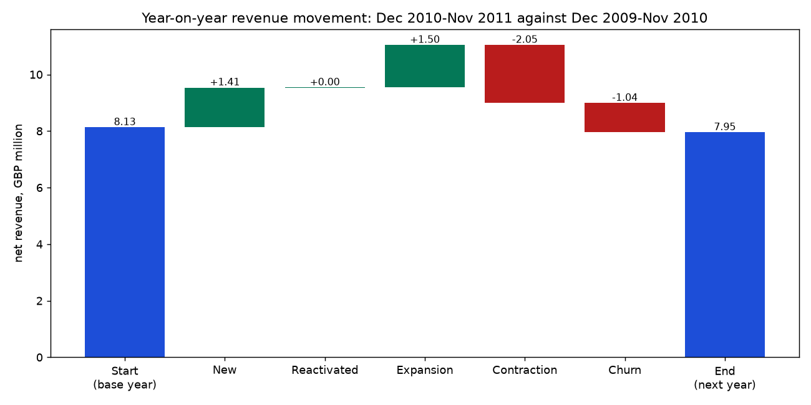
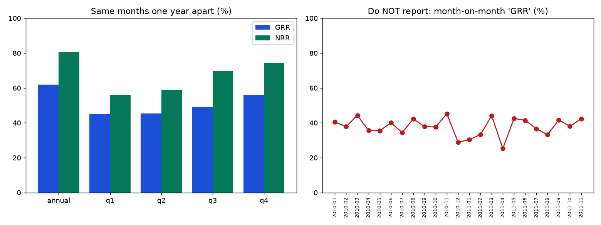
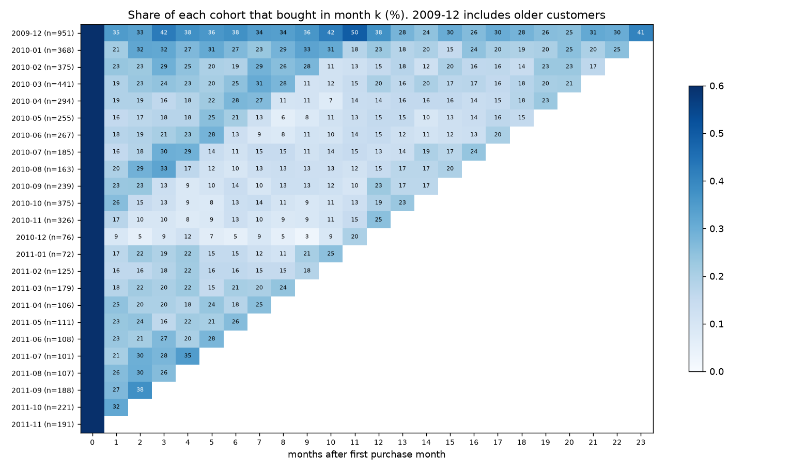
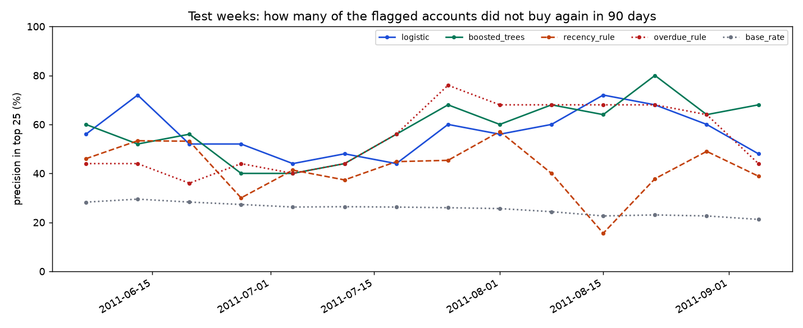
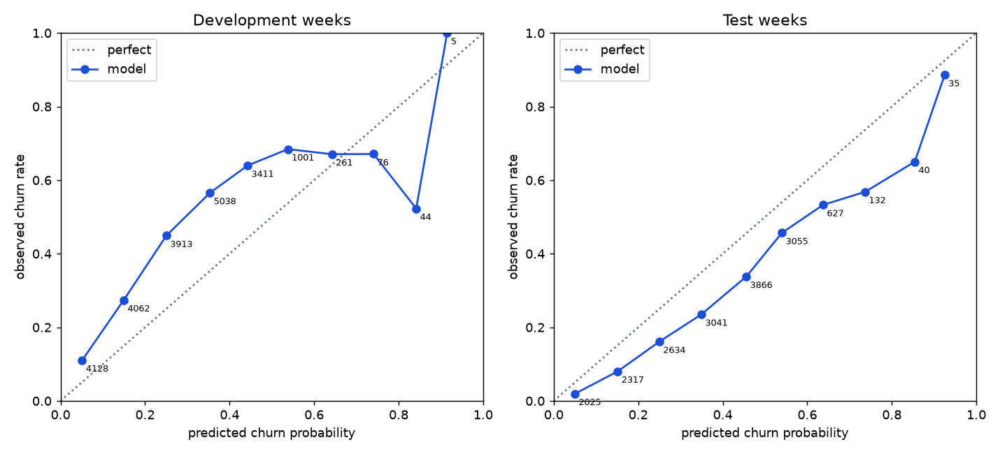

# Revenue retention and churn-risk report

**Not SaaS contract data.** These are real invoices of one UK gift-ware seller with many wholesale customers, 2009-2011 (UCI Online Retail II, CC BY 4.0). There are no subscriptions, renewals, MRR or cancellations of a contract. GRR and NRR here are repeat-purchase analogues, and churn is a definition we chose.

Source: Chen, D. (2012). Online Retail II. UCI Machine Learning Repository, https://doi.org/10.24432/C5CG6D (CC BY 4.0). Aggregated and cleaned here as described in DATA.md.

## 1. Revenue retention

**Annual GRR 62.0%** (95% customer bootstrap 58.7% to 65.8%) and **NRR 80.5%** (75.3% to 86.9%). Logo retention 63.8% (2,694 of 4,224 base customers).

New customers added £1,407,371, which is why total revenue moved from £8,128,735 to £7,951,702 while NRR stayed below 100%.

Definitions (per comparison; revenue = net merchandise value per customer per window, floored at zero):

- base customer: revenue above zero in the base window.
- churn: base customer with zero in the comparison window (all base revenue lost).
- contraction / expansion: the fall or rise of a base customer still buying.
- GRR = (start - churn - contraction) / start. NRR = (start - churn - contraction + expansion) / start.
- new: nothing in the base window and first sale after it ended. Reactivation: nothing in the base window, first sale before it ended. Neither enters GRR or NRR.
- The annual reactivation line is close to zero by construction: the file has no history before the base year.

| comparison | start | new | reactivation | expansion | contraction | churn | end |
|---|---|---|---|---|---|---|---|
| annual | £8,128,735 | £1,407,371 | £1,707 | £1,502,716 | £2,052,421 | £1,036,405 | £7,951,702 |
| q1 | £1,682,803 | £516,383 | £5,181 | £180,567 | £422,432 | £499,514 | £1,462,987 |
| q2 | £1,796,132 | £536,088 | £60,158 | £242,327 | £394,930 | £587,494 | £1,652,280 |
| q3 | £1,757,776 | £471,787 | £138,790 | £365,654 | £377,734 | £517,251 | £1,839,022 |
| q4 | £2,912,710 | £683,869 | £152,070 | £540,720 | £573,052 | £709,695 | £3,006,622 |

| cmp | base_customers | base_revenue | logo_retention | GRR | NRR |
|---|---|---|---|---|---|
| annual | 4224 | £8,128,735 | 63.8% | 62.0% | 80.5% |
| q1 | 1682 | £1,682,803 | 45.5% | 45.2% | 55.9% |
| q2 | 2041 | £1,796,132 | 47.9% | 45.3% | 58.8% |
| q3 | 1945 | £1,757,776 | 47.5% | 49.1% | 69.9% |
| q4 | 2868 | £2,912,710 | 54.4% | 56.0% | 74.5% |

The right-hand chart is the trap: month-on-month 'GRR' averages 37.8% and 61.8% of buyers 'churn' every month, because wholesale buyers do not order monthly.

### By acquisition cohort (annual)

| cohort | base_customers | base_revenue | logo_retention | GRR | NRR |
|---|---|---|---|---|---|
| 2009-12 or older | 949 | £4,542,797 | 75.7% | 67.7% | 74.6% |
| 2010 Jan-Mar | 1184 | £1,966,121 | 65.9% | 53.2% | 71.1% |
| 2010 Apr-Jun | 812 | £791,206 | 58.6% | 55.3% | 85.7% |
| 2010 Jul-Sep | 581 | £465,646 | 56.8% | 60.5% | 131.4% |
| 2010 Oct-Nov | 698 | £362,964 | 55.9% | 54.9% | 128.1% |

**Read with care.** A cohort acquired during the base year has only part of a year in its base and a full year in the comparison, which pushes its NRR up. Later cohorts above 100% are mostly this, not proof they grow faster. The 2009-12 cohort also contains customers of unknown age, because the file starts that month. Quarterly comparisons by cohort (same months a year apart):

| cmp | cohort | base_customers | base_revenue | logo_retention | GRR | NRR |
|---|---|---|---|---|---|---|
| q1 | 2009-12 or older | 944 | £1,323,135 | 53.1% | 49.5% | 57.8% |
| q1 | 2010 Jan-Mar | 738 | £359,669 | 35.8% | 29.6% | 49.0% |
| q2 | 2009-12 or older | 640 | £947,378 | 65.2% | 56.0% | 68.5% |
| q2 | 2010 Jan-Mar | 855 | £600,476 | 45.3% | 36.0% | 52.1% |
| q2 | 2010 Apr-Jun | 546 | £248,278 | 31.7% | 27.1% | 37.8% |
| q3 | 2009-12 or older | 564 | £923,930 | 63.8% | 60.2% | 80.3% |
| q3 | 2010 Jan-Mar | 569 | £428,103 | 52.9% | 43.2% | 62.8% |
| q3 | 2010 Apr-Jun | 467 | £270,601 | 36.2% | 32.3% | 57.6% |
| q3 | 2010 Jul-Sep | 345 | £135,142 | 27.2% | 25.1% | 45.9% |
| q4 | 2009-12 or older | 663 | £1,365,157 | 73.3% | 67.5% | 83.3% |
| q4 | 2010 Jan-Mar | 674 | £580,110 | 58.6% | 49.1% | 69.1% |
| q4 | 2010 Apr-Jun | 419 | £273,431 | 51.8% | 49.4% | 64.9% |
| q4 | 2010 Jul-Sep | 414 | £330,838 | 46.4% | 46.4% | 77.7% |
| q4 | 2010 Oct-Nov | 698 | £363,174 | 38.5% | 37.2% | 54.4% |

A quarterly cohort is still part-way through its first order cycle if it was acquired inside the base quarter.

### How much do cleaning choices matter?

| variant | start_gbp | grr | nrr |
|---|---|---|---|
| main definition | £8,128,735 | 62.0% | 80.5% |
| also drop exact duplicate rows within a sheet | £8,096,619 | 62.1% | 80.6% |
| count manual adjustments (code M) as revenue | £8,094,213 | 62.2% | 80.6% |
| without the 10 largest base customers (16% of base) | £6,792,307 | 59.0% | 80.8% |
| without the 50 largest base customers (30% of base) | £5,700,606 | 56.7% | 76.4% |

### Reconciliation (SQL, integer pence, no tolerance)

Where every source row went:

| bucket | rows | value_gbp |
|---|---|---|
| analysed | 805828 | £16,411,917 |
| no_customer_id | 235287 | £2,566,093 |
| overlap_duplicate | 22523 | £377,488 |
| non_merchandise_code | 3673 | -£68,248 |
| zero_value | 60 | £0 |

**44 of 44 checks balance exactly.** The run stops with an error if one fails. Check families: file rows and value equal the buckets; customer-month equals lines; each waterfall rolls forward; start and end are recomputed from lines plus the zero-floor adjustment; cohorts add to totals; one movement type per customer; cohort triangle month 0 equals cohort size.

## 2. Churn-risk model

- **Scored:** at 00:00 on a Monday, accounts with at least 2 purchase days in the previous 180 days and a purchase in the last 90 days. Features use only earlier rows, all from a fixed 180-day lookback.
- **Churned:** no purchase day in the next 90 days. It is not proof the account is gone. Why 90: of 11,961 gaps between purchase days before 2010-12-01, 85.5% were 90 days or less (long gaps are under-counted in so short a period).
- **Training at each origin:** snapshots every 28 days from 2010-06-01, only those whose 90-day label had closed by the origin.
- **Development:** 14 weekly origins 2010-12-06 to 2011-03-07. **Test:** 14 weekly origins 2011-06-06 to 2011-09-05 (17,772 account-weeks, 1,725 accounts).
- **Model choice rule:** lowest development log loss among the fitted models: **logistic**.

### Development weeks

| model | auc | brier | log_loss | mean_predicted | observed | precision | recall | value_captured | ev_precision | ev_value_captured |
|---|---|---|---|---|---|---|---|---|---|---|
| base_rate | 0.457 | 0.267 | 0.735 | 27.6% | 42.4% | 41.9% | 1.6% | 1.6% | 5.4% | 3.7% |
| recency_rule | 0.612 | 0.257 | 0.712 | 28.8% | 42.4% | 54.7% | 2.1% | 1.8% | 9.7% | 6.1% |
| overdue_rule | 0.522 | 0.265 | 0.732 | 28.1% | 42.4% | 63.1% | 2.5% | 3.2% | 7.1% | 4.6% |
| logistic | 0.732 | 0.232 | 0.656 | 26.9% | 42.4% | 65.1% | 2.6% | 0.9% | 38.0% | 9.8% |
| boosted_trees | 0.724 | 0.235 | 0.664 | 26.9% | 42.4% | 61.1% | 2.4% | 1.3% | 32.9% | 9.6% |

### Test weeks

| model | auc | brier | log_loss | mean_predicted | observed | precision | recall | value_captured | ev_precision | ev_value_captured |
|---|---|---|---|---|---|---|---|---|---|---|
| base_rate | 0.533 | 0.197 | 0.585 | 34.2% | 25.5% | 25.6% | 2.0% | 2.0% | 2.6% | 3.7% |
| recency_rule | 0.581 | 0.194 | 0.576 | 33.9% | 25.5% | 42.1% | 3.2% | 3.0% | 2.9% | 3.8% |
| overdue_rule | 0.489 | 0.194 | 0.578 | 33.6% | 25.5% | 54.6% | 4.3% | 2.9% | 2.3% | 3.4% |
| logistic | 0.739 | 0.174 | 0.517 | 34.6% | 25.5% | 56.6% | 4.4% | 1.7% | 17.4% | 8.2% |
| boosted_trees | 0.738 | 0.174 | 0.517 | 34.4% | 25.5% | 58.6% | 4.6% | 1.7% | 14.6% | 7.7% |

`precision`, `recall` and `value captured` are at 25 accounts a week, averaged over weeks, ranking by risk. `ev_` columns rank by risk x trailing 180-day revenue. For `base_rate` that is the same as ranking by revenue alone, the 'call the biggest accounts' baseline. `value captured` is the share of the trailing revenue of all that week's churners that sits in the top list. Ties are scored as random order.

### Uncertainty (test, whole customers resampled; `difference` is paired, model minus recency rule)

| metric | who | estimate | low | high |
|---|---|---|---|---|
| auc | logistic | 0.739 | 0.719 | 0.759 |
| auc | recency_rule | 0.581 | 0.564 | 0.598 |
| auc | difference | 0.158 | 0.135 | 0.178 |
| brier | logistic | 0.174 | 0.167 | 0.181 |
| brier | recency_rule | 0.194 | 0.188 | 0.200 |
| brier | difference | -0.020 | -0.024 | -0.015 |
| precision | logistic | 0.566 | 0.473 | 0.674 |
| precision | recency_rule | 0.421 | 0.367 | 0.473 |
| precision | difference | 0.145 | 0.046 | 0.268 |
| ev_value_captured | logistic | 0.082 | 0.037 | 0.134 |
| ev_value_captured | recency_rule | 0.038 | 0.000 | 0.085 |
| ev_value_captured | difference | 0.044 | 0.022 | 0.079 |

Against the stronger rule at capacity, `overdue_rule` (days silent / the account's usual gap), model minus rule:

| metric | estimate | low | high |
|---|---|---|---|
| auc | +0.250 | +0.221 | +0.280 |
| brier | -0.021 | -0.025 | -0.015 |
| precision | +0.020 | -0.047 | +0.150 |
| ev_value_captured | +0.049 | +0.021 | +0.079 |

An interval that includes zero means this test cannot separate the two on that metric.

Against `base_rate`, model minus baseline. For `precision` the baseline is random picking. For `ev_value_captured` the model ranks by risk x value and the baseline ranks by revenue alone:

| metric | estimate | low | high |
|---|---|---|---|
| precision | +0.310 | +0.212 | +0.416 |
| ev_value_captured | +0.045 | +0.023 | +0.079 |

These intervals cover which customers were sampled, **not** which season. All test outcomes fall between June and early December 2011, and weekly windows overlap: there is little more than one independent 90-day period.

### Calibration

Expected calibration error: development weeks 0.157, test weeks 0.091. The base churn rate moves with the season, and with under two years of data no model here can learn that. Treat the score as a ranking, not as a probability to put in a forecast.

### Where the model helps and where it does not (test)

| segment | rows | churn_rate | mean_predicted | auc_model | auc_baseline |
|---|---|---|---|---|---|
| bought in last 30 days | 9879 | 21.3% | 28.7% | 0.784 | 0.520 |
| silent 31-90 days | 7893 | 30.7% | 42.0% | 0.672 | 0.563 |
| 2 purchase days in 180 | 7073 | 40.3% | 51.2% | 0.600 | 0.479 |
| 3-5 purchase days | 7740 | 19.9% | 29.6% | 0.673 | 0.534 |
| 6+ purchase days | 2959 | 4.6% | 7.8% | 0.782 | 0.677 |
| top 20% trailing revenue | 3555 | 8.3% | 13.6% | 0.828 | 0.645 |
| other 80% | 14217 | 29.8% | 39.8% | 0.692 | 0.542 |

### The queue as operated: an alerted account rests for 28 days (test weeks)

| model | policy | alerts | unique_accounts | alert_precision | unique_precision | churned_value_flagged_gbp |
|---|---|---|---|---|---|---|
| logistic | risk | 350 | 292 | 53.4% | 52.1% | £60,061 |
| logistic | risk x value | 350 | 178 | 23.1% | 26.4% | £144,438 |
| recency_rule | risk | 350 | 350 | 39.1% | 39.1% | £112,083 |
| recency_rule | risk x value | 350 | 130 | 6.0% | 6.9% | £54,623 |
| overdue_rule | risk | 350 | 256 | 34.0% | 28.9% | £60,340 |
| overdue_rule | risk x value | 350 | 132 | 4.3% | 5.3% | £49,067 |

Ranking by risk alone the model flags mostly small accounts, so a simple rule can touch more churned revenue. `churned value flagged` is the trailing 180-day revenue of flagged accounts that then churned, each counted once. It is **not** money saved: nothing shows that outreach would have kept any of them.

## 3. What customer success should do this week

Queue as of 2011-12-10 (model trained on 23,180 closed account-snapshots). 1,807 of 3,471 buyers in the last 180 days are eligible; they hold 85.9% of that period's net revenue. One-time and already-lapsed buyers are outside this queue and need a separate onboarding or win-back motion.

The ranked list (25 accounts, capacity 25 is an **assumption**) is ranked by **risk** and written to a local, git-ignored CSV. **Nothing is sent.** By primary reason:

| primary_reason | accounts | mean_score | net_180d_gbp | value_at_risk_gbp | suggested_action |
|---|---|---|---|---|---|
| OVERDUE | 11 | 0.80 | £10,620 | £8,622 | Call this week: ask whether the usual reorder moved, stalled, or went to another supplier. |
| RETURNS_UP | 7 | 0.74 | £658 | £474 | Open a service review first: resolve returns or credits before any sales ask. |
| THIN_HISTORY | 6 | 0.73 | £1,156 | £843 | Early-life follow-up: confirm the second order landed well and set a reorder reminder. |
| SPEND_DOWN | 1 | 0.72 | £145 | £104 | Check basket mix: which lines stopped, and was it stock, price or demand? |

`value_at_risk` is churn score x trailing 180-day net revenue: a priority number, not a forecast loss.

**Default: rank by churn score.** On test weeks its precision at capacity was 56.6%, against 25.6% for all eligible accounts. The alternative, ranking by risk x value (`policy="value"`), had 17.4% precision. **This is lower than the 25.6% you would expect from picking eligible accounts at random.** The ranking trades hit rate for revenue.

What each order buys: the share of churners' trailing revenue in the top list was 1.7% ranked by risk, 8.2% ranked by risk x value and 3.7% ranked by revenue alone. Risk x value minus revenue alone is +4.5 points (95% +2.3 to +7.9). So the default gives up revenue coverage, including against revenue alone, to get a list in which more of the alerts are real. No interval was computed between the two model-based orders.

This queue is dated 10 December, after the seasonal peak, and its 90-day window (December to March) is the post-peak lull. There is no outcome for it in the data, so it has not been evaluated.

### Prove that outreach works

The model predicts who stops buying, not who can be persuaded. Randomly hold out part of the flagged accounts. At a 25.6% control churn rate (80% power, 5% two-sided) you need about 1,113 accounts per arm for a 5-point fall or 256 accounts per arm for a 10-point fall. Count each account once. Replaying 14 test weeks, the default queue reached 292 different accounts, to be split between both arms, so even a 10-point effect would take longer than that to test, and the season would change during the experiment. Flagged accounts churn more often than the average, so size again from the control arm you expect.
