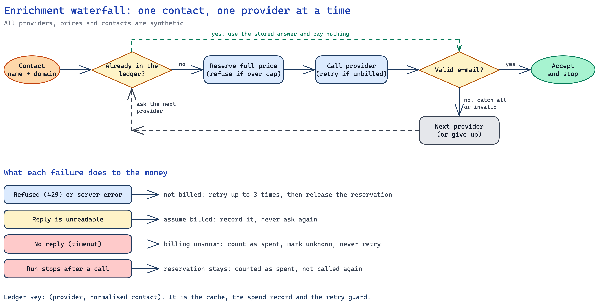

# Project 16: Enrichment Waterfall Engine

One data provider rarely covers a whole list. This asks providers one at a time, stops at the first acceptable e-mail, and keeps an exact record of what was spent. The hard part is the money: not paying twice, not going over budget, and being honest when you cannot know whether you were billed.

**Everything here is synthetic.** Four invented providers, invented prices, 1,000 invented contacts. It is not a comparison of real vendors, it is not connected to any, and it says nothing about e-mail deliverability.



*Editable source: [`docs/waterfall.excalidraw`](docs/waterfall.excalidraw).*

## Run it

```bash
cd projects/16-enrichment-waterfall
python3 -m waterfall            # writes output/report.md (no keys, no network)
python3 -m pytest --cov=waterfall
```

## The rules

| Rule | How it is checked |
|---|---|
| At most one billable call per provider and contact | A ledger with a unique key; a second run makes no billable call and costs nothing |
| The spend cap is never exceeded | The full price is reserved **before** the call; tested at several caps and with money already reserved |
| A stopped run never pays again | A test kills the run after a billed call, reopens the ledger and runs again; the reservation stays visible as unresolved |
| Refused calls (429) and server errors are not billed | Retried up to 3 times, then released so a later run can try again. That a 500 is unbilled is an assumption about these fictional providers; check it for a real one |
| A timeout or unreadable reply is counted as spent | It is marked, and never retried blindly |
| Only a `valid` result is accepted | `catch_all` and `invalid` move on to the next provider |
| Spend and calls are right | A separate, simpler [oracle](waterfall/oracle.py) predicts them for all 24 provider orders; the engine must match exactly. The same author wrote both, so this shows they agree, not that the billing model matches any real provider |

## What the synthetic run shows (seed 7)

- 900 of 1,000 contacts are findable by someone; 820 get an accepted address. Timeouts, bad replies, refusals and rejected statuses account for the rest.
- A provider's "verified" is not truth: for the cheapest order, 43 of 820 accepted addresses are wrong (94.8% precision).
- Cost per **correct** address ranges from $0.0388 upward depending on order. Cheapest-price-first happens to come out best **in this invented world**; that is not a general rule, and the report shows every order so it can be checked.
- Asking every provider about every contact would cost $64.51; the cheapest order spent $30.14. That is the only baseline behind any "saving".

## Limits

- Calls run one at a time. No claim is made about concurrent use.
- No real provider adapter exists. A real one needs its billing rules confirmed (what is billed on errors, timeouts and repeats), plus a lawful basis for processing the contacts.
- Retries have no back-off delay, because the fake providers need none.
- The contact key is name plus domain; spelling variants of one person count as two contacts.
