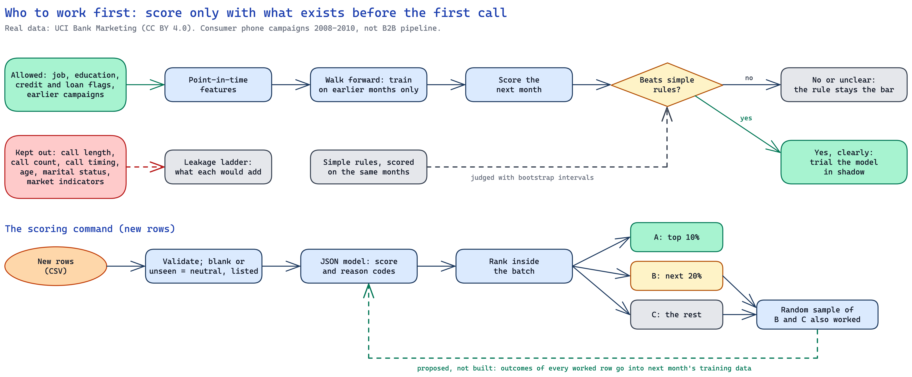
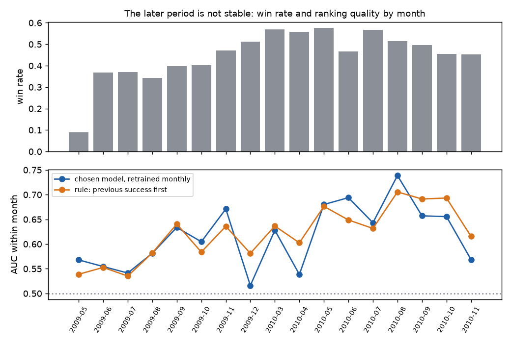

# Project 17: Account and opportunity scoring with an honest backtest

**Question:** you have more accounts than your reps can work. Which should they work first, and does a score beat simple rules on **later** data?

**Answer on this data: not reliably.** A model chosen in advance orders the whole list a little better than hand-written rules on one measure (within-month AUC 0.573 against 0.557). At the capacity cuts a team actually uses (top 10% and top 30%) there is no clear difference. The small overall edge also disappears when whole months are resampled or when each month counts equally.

**What the data is:** [UCI Bank Marketing](https://archive.ics.uci.edu/dataset/222/bank+marketing) (Moro, Rita and Cortez, CC BY 4.0). It is **real**: phone campaigns from a Portuguese bank, 2008 to 2010. It is **consumer telemarketing, not B2B pipeline**. It was chosen because it is real, openly licensed, in date order and has outcomes. Candidates are compared in [DATA.md](DATA.md).



*Editable source: [`docs/signal-fit-scoring.excalidraw`](docs/signal-fit-scoring.excalidraw), written by [`docs/make_diagram.py`](docs/make_diagram.py).*

## Why this project

**Business need.** A sales team has more accounts than it can work, and someone has to decide the order. A score is only worth its upkeep
if it orders later work better than a rule anyone can explain. The intended users are a sales or SDR manager and the RevOps person who
would maintain the score.

**The workflow in four lines**

1. **Goes in:** rows to be worked, with fit fields and the results of earlier contact, as known before the first call.
2. **Reasoned:** each row's rank, and whether the score beats simple rules on later data.
3. **Happens:** rows get a tier and up to three reason codes in a file, with a small random exploration sample. Nobody is contacted.
4. **Seen:** the rep sees tier and reasons in the scored file; RevOps reads the backtest report.

**What you could buy instead.** CRM and marketing-automation products offer built-in lead and opportunity scoring, and there are dedicated
scoring vendors. I did not test or compare any. On this data, a hand-written rule is a close and much cheaper alternative.

**Signal that it works.** On fresh later data, the score finds more wins than the current rule at the team's real capacity cut, with an
interval that stays above zero when whole months are resampled. Showing that working the list causes more sales needs a random holdout.

**Real users today: none.** It has been tested only on old consumer telemarketing data.

## Who uses the answer

| Role | Decision it supports |
|---|---|
| Sales or SDR manager | What order reps work the list in |
| RevOps | Whether a model is worth its upkeep compared with a rule |
| GTM engineer | Which fields may be used, how to route, what to monitor |
| Privacy or compliance owner | Which fields are kept out, and why |

## How this maps to GTM, and where the mapping breaks

| In this data | GTM equivalent | Fits? |
|---|---|---|
| A person on the call list | An account or lead awaiting outreach | Loosely |
| `job`, `education` | Fit: industry, size band | Weak: personal, not firmographic |
| `default`, `housing`, `loan` | Qualification flags | Loosely |
| `poutcome`, `previous` | Earlier relationship: past win, past loss, untouched | Good |
| `pdays` | Recency of the last touch | Good idea, but dated on few rows |
| `y` | Opportunity won | One-step sale only |

**It cannot answer** anything about open-pipeline stages, deal age, deal value, buying committees or timestamped intent. For "which open opportunities first?", you need your CRM's stage history. This project gives you the test to run on it, not the answer.

## Run it

```bash
cd projects/17-signal-fit-scoring
pip install -r requirements.txt
python fetch_data.py                 # UCI file, about 1 MB download, hash checked
python fetch_data.py --candidates    # optional: also the fictitious Maven set (needs a configured kaggle command)
python -m fitscore                   # writes reports/ (about 6 minutes on the author's laptop)
python -m fitscore --bootstrap 100   # faster, rougher intervals; overwrites reports/
python -m fitscore score --input examples/new_rows.csv --output output/scored.csv
python -m pytest --cov=.             # offline, no downloaded data
```

The scoring command works without any download, because [`reports/model.json`](reports/model.json) is committed. [`examples/new_rows.csv`](examples/new_rows.csv) is **invented**.

## Architecture

| Module | Job |
|---|---|
| `data.py` | Load, check, rebuild the month from row order |
| `features.py` | Allowed fields only; recency decay; blank or unseen means neutral |
| `models.py`, `baselines.py` | Candidates and calibrator; five simple rules |
| `backtest.py` | Choose on validation months; walk forward month by month |
| `metrics.py`, `bootstrap.py`, `evaluate.py` | Within-month AUC, tie-safe lift and tiers, intervals, calibration |
| `ablation.py`, `segments.py`, `verdict.py` | Remove signals, add back excluded fields, segment playbook, short answer |
| `artifact.py`, `score.py`, `reasons.py` | JSON model file, scoring command, reason codes |
| `candidates.py` | Signal check on the fictitious Maven set |
| `pipeline.py`, `report.py`, `plots.py` | Run everything and write `reports/` |

Weights, tier cuts, half-life and exploration share are in [`config/scoring.json`](config/scoring.json). The team process is in [docs/process.md](docs/process.md).

## Method

- **Point in time:** before the first call of a campaign.
- **Left out:** call length and call count (leaks); month, weekday and channel of the last call (not clearly known in advance); age and marital status (policy); five economy-wide indicators (they work as a clock).
- **Splits by time:** May to August 2008 is the first history, October 2008 to April 2009 chooses the model, and **May 2009 to November 2010 is the later test** (10,758 rows).
- **Walk forward:** before each test month, refit on all earlier months. This assumes outcomes are known by the end of each month.
- **Main measure:** ordering inside one month. A rep ranks today's list, not 2008 against 2010.
- **Ties** are averaged, so a rule with three score levels is not helped or hurt by row order.

### What was decided when

The split, the field policy, the rule weights, the candidate models and the "boosted must win by 0.01" rule were fixed before any later-period result was computed. While exploring, the author had seen the win rate of every month, overall field counts, and win rates by earlier-campaign result for months **before** the test period. One points weight (an earlier failure scores slightly above no history) came from sales intuition even though those earlier months did not support it.

Added **after** seeing later results, so treat them as diagnostics: the equal-weight monthly table, the like-for-like shuffled column, the segment table, and the change of the scoring command's default to batch ranking. The first full run stopped because the selection rule picked boosted trees and the export could not explain them. The rule was kept, and the logistic model was added next to it.

## Results

All numbers come from [`reports/report.md`](reports/report.md). `boosted_depth2` won the validation months (0.606 against 0.579 for the best logistic).

| Method | Within-month AUC (95%, rows resampled) | Lift, top 10% | Lift, top 30% | Pooled AUC |
|---|---|---|---|---|
| Chosen model, refitted monthly | 0.573 (0.548 to 0.594) | 1.59 | 1.35 | 0.756 |
| Chosen model, frozen | 0.574 (0.549 to 0.595) | 1.57 | 1.37 | 0.705 |
| Explainable logistic (shipped) | 0.572 (0.548 to 0.594) | 1.58 | 1.34 | 0.755 |
| Hand-written points rules | 0.557 (0.533 to 0.579) | **1.61** | 1.34 | 0.694 |
| Earlier success first | 0.548 (0.536 to 0.559) | 1.57 | 1.34 | 0.631 |
| Most recent contact first | 0.550 (0.538 to 0.561) | 1.56 | 1.35 | 0.640 |
| Best past job segment first | 0.526 (0.503 to 0.548) | 1.05 | 1.04 | **0.720** |
| No ranking | 0.500 | 1.00 | 1.00 | 0.500 |

Lift 1.59 means rows in the top 10% won 1.59 times as often as the whole list.

### Why "the model wins on AUC" is not safe

- Chosen model minus points rules: **+0.016** (rows resampled: 0.003 to 0.029). With whole months resampled it is -0.005 to 0.018.
- **May 2009 has 54% of later rows and 85% of the weight** in the pooled within-month AUC.
- Giving each month equal weight: model 0.616, points rules 0.616, earlier success first 0.621, **most recent first 0.627**. The chosen model is ahead of that last rule in 8 of 17 months. These means have no intervals.



### Tiers

Ranked inside each month: A is the top 10%, B the next 20%, C the rest.

| Tier | Chosen model win rate (95%) | Lift (95%) | Points rules win rate |
|---|---|---|---|
| A | 0.403 (0.380 to 0.428) | 1.59 (1.50 to 1.68) | 0.408 |
| B | 0.314 (0.297 to 0.331) | 1.24 (1.17 to 1.30) | 0.308 |
| C | 0.216 (0.207 to 0.224) | 0.85 (0.83 to 0.87) | 0.217 |

Tiers work. **The model is not why they work:** the rules give almost the same tiers. A is about 2.5 rows per win. C still holds 59% of all wins, so "do not work C" would throw most sales away.

### Which signals carry it

| Variant (chosen model) | Within-month AUC | Lift, top 30% | Top-30% rows kept from the full model |
|---|---|---|---|
| All signals | 0.573 | 1.35 | 100% |
| Without earlier-campaign history | 0.531 | **1.04** | 70% |
| Without job and education | 0.552 | 1.32 | 61% |
| Without credit and loan flags | 0.561 | 1.36 | 92% |
| Only history | 0.518 | 1.30 | 57% |

Nearly all the top-30% lift needs history. Job and education reshuffle many names while changing lift very little. History is also what the simple rules use, which is why they keep up.

### What the excluded fields would have added

| Added alone | Within-month AUC | Pooled AUC |
|---|---|---|
| Nothing | 0.573 | 0.756 |
| **Call duration (leak)** | **0.900** | 0.866 |
| Call count (leak) | 0.586 | 0.759 |
| Contact channel | 0.608 | 0.760 |
| Age and marital status | 0.586 | 0.752 |
| Month and weekday | 0.580 | 0.781 |
| Market-wide indicators | 0.595 | **0.541** |

`duration` is the famous trap. If a tutorial on this file reports about 0.9, check for it.

### Probabilities: do not use them as a forecast

| Probability | Mean predicted (observed 0.254) | Brier | Log loss |
|---|---|---|---|
| Chosen model, monthly, calibrated | 0.256 | 0.171 | 0.526 |
| Chosen model, frozen | 0.304 | 0.178 | 0.556 |
| Shipped logistic, monthly | **0.139** | 0.174 | 0.533 |
| **No model: last month's win rate** | 0.281 | **0.166** | **0.513** |

Lower Brier and log loss are better. **Giving everyone last month's win rate beats every model.** The shipped logistic's average is a little over half the observed rate. In May and June 2009 the calibrator found that earlier scores pointed the wrong way across months, and fell back to no correction. The `probability_estimate` column of the scoring command comes from this family of model: use the rank, not the number.

### Playbook: the segments

Ranked on earlier months, then checked on later ones:

| Segment | Earlier rows, win rate | Later rows, win rate |
|---|---|---|
| Earlier success, dated within 7 days | 91, 40.7% | 1,036, 68.7% |
| Earlier success, older or undated | **11**, 18.2% | 235, 60.9% |
| Earlier attempt failed | 1,320, 6.8% | 2,932, 17.6% |
| No earlier campaign | 29,008, 6.1% | 6,555, 20.8% |

The top two stayed on top. The bottom two **swapped**. These are associations among people who were called, not the effect of calling them.

**What a team could do with this**

1. Work earlier successes first, most recent first. This needs no model.
2. Below them, do not promise a meaningful order. Without history the model has little to go on.
3. Run the model in shadow. Switch only if it beats the rule at your capacity cut, with months resampled, on fresh data.
4. Work a random 10% of B and C as well (`explore_sample`), or the next training set only describes people the score liked.
5. Check tier A's lift monthly. If it nears 1.0, stop using the score.

No money figure is claimed: the data has no deal value or call cost.

## The scoring command

Input: a CSV with `row_id`, `previous` and `pdays`, plus `job`, `education`, `default`, `housing`, `loan`, `poutcome`. Leave unknown values blank. Output, sorted: score, probability estimate, tier, action, exploration flag, up to three reason codes, unknown fields, and whether the row has a dated signal.

On the invented example, the first row gets `UP poutcome=success (+1.27 log-odds)`, `UP pdays=3 (+0.97 log-odds)`, `UP job=retired (+0.80 log-odds)`.

- **It uses the logistic model, not the boosted headline model.** Their later results are close, and the intervals do not separate them.
- The model file is fitted on **all** months. No later data exists, so that exact file has **no measured performance**. The backtest measures the procedure.
- A reason code says how the model used a value, compared with an average training row. It is not a cause.
- A blank or never-seen value adds nothing and is listed. The literal value `unknown`, which exists in the source, is a learned category: it can move the score, and it is also listed.
- `--tier-mode batch` (default) ranks inside your file. Tied rows stay together, so tier sizes can differ from 10/20/70. In a tiny file the shares mean little. `--tier-mode fixed` uses stored thresholds and is not recommended (see below).

### Evidence coverage

Of later rows, 39.1% have any earlier-campaign history and only **13.1% have a dated signal**. No signal has its own calendar date or source system. The original spec asked for a source and date on every signal: this data cannot do that. Reason codes name the source **column** only.

## Other candidate datasets

| Set | Real? | Later-period result | Verdict |
|---|---|---|---|
| Maven CRM Sales Opportunities | **Fictitious** | AUC 0.525 (0.503 to 0.545), top-30% lift 1.02 (0.98 to 1.06) | Barely above random. Fine for dashboards, not for learning scoring |

[DATA.md](DATA.md) lists the other sets that were looked at and not used.

## What did not work

- **One fixed train and test split.** May to August 2008 has no earlier-campaign history at all, so a model fitted only there cannot learn the strongest signal.
- **Assuming logistic regression would be chosen.** Boosted trees won validation, then did about the same on later data.
- **Reusing score thresholds from past months.** Tier A ranged from 11% to 72% of a month, and C (27.3% won) beat B (19.9%). The command now ranks inside the batch.
- **Calibration.** See above: a constant from last month was better.
- **Pooled AUC.** "Best past job first" scores 0.720 pooled but 0.526 inside a month. Pooled AUC mostly rewards knowing which period a row came from.
- **Market-wide indicators.** Walking forward, adding them cuts later pooled AUC from 0.756 to 0.541. A shuffled split of all rows scores the same fields at 0.790 and would not warn you. (That figure covers different rows, so do not subtract the two.)
- **Two expectations that were wrong.** Shuffling did not inflate within-month ranking on the same later rows (0.559 against 0.573). The call-count leak added much less (+0.013) than the duration leak. A field can be invalid even when it helps little.
- **Saving the model with sorted JSON keys.** It reordered the categories against their coefficients, giving wrong scores with no error. A parity test caught it. The file now stores the order as a list.

## Limits

- Consumer data from 2008 to 2010. Do not carry any number here into a B2B plan.
- Only called people appear. The score has never seen anyone the bank skipped.
- Prioritisation is not uplift: someone likely to buy may buy without a call. Measuring that needs a randomised holdout.
- Row bootstrap treats rows as independent. They share months and may repeat people, so those intervals are probably too narrow. The month bootstrap has only 17 months, one dominant, so it is rough too.
- Many comparisons are shown and none is corrected for multiple testing.
- When profile fields were recorded is unknown. They could contain later updates.
- Leaving out age and marital status does **not** show the score is fair. `job` (retired, student) is a close proxy for age, and no fairness test was run. Do not use this to target real people.
- Recency decay uses a 7-day half-life set by judgement. Dated values cover too few rows to fit it, and it was not tuned.
- No CRM connection, scheduler or monitoring service exists here.

## What you should be able to explain in an interview

1. **What is the prediction's point in time, and why does it matter?**
   Before the first call. A field is allowed only if it exists then. `duration` fails clearly: it is created by the call.
2. **`campaign` looks harmless. Why is it a leak?**
   It is the final number of calls in the campaign. Calling tends to stop once there is an answer, so the total depends on the outcome.
3. **Why split by time instead of at random?**
   You will always score the future. A random split lets the model learn each period's win rate from rows around the ones it scores.
4. **Why is pooled AUC 0.756 but within-month AUC 0.573?**
   Win rates moved a lot between months. Pooled AUC credits ranking a high-rate month above a low-rate one. A rep never makes that choice.
5. **The model's AUC beats the rules. Do you ship it?**
   Not yet. The gap is small, disappears at the top 10% and 30%, depends heavily on one month, and its month-resampled interval includes zero. A rule is cheaper to run and explain.
6. **Why can a model rank well and still give bad probabilities?**
   Ranking depends only on order. Probabilities also need the right level, and the level kept moving. A trailing rate follows it better, though it cannot rank within a month.
7. **How do you handle missing signals?**
   Blank is not zero. "Never contacted" and "history not supplied" are different inputs. Missing and unseen values are neutral and shown to the rep.
8. **Tier A converts 1.59 times the average. Did the score cause that?**
   No. It sorts people by likelihood among those called. Causal gain needs a random holdout.
9. **Why work some C rows at random?**
   If only high scorers get worked, you only learn their outcomes, and the next model confirms the last one.
10. **Fixed thresholds or rank cuts?**
    Rank cuts keep the workload steady but "A" means something different each batch. Fixed thresholds keep the meaning only if scores are stable, and here they were not.

## Exercises

1. Add `duration` to `feature_spec`, run, and watch which test fails. Explain the failure to a sales manager.
2. Change `points_rules` in the config. Decide your weights **before** you run, then note how often you were tempted to change them afterwards.
3. Replace the 30% cut with your team's real weekly capacity and rerun the comparison.
4. Add a paired interval for the equal-weight monthly average.
5. Try a calibrator that uses only the last three months. Does it beat the trailing rate? You have now looked at the test months: how would you validate the answer honestly?
6. Design the random holdout that would measure whether calling changes the outcome. How many rows would you need?
7. Export your own CRM history with stage-entry dates and write the point-in-time rule for each field before modelling.
