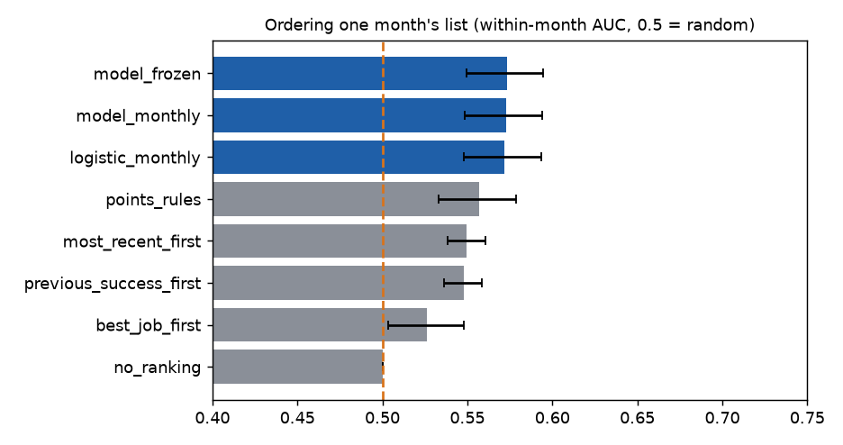
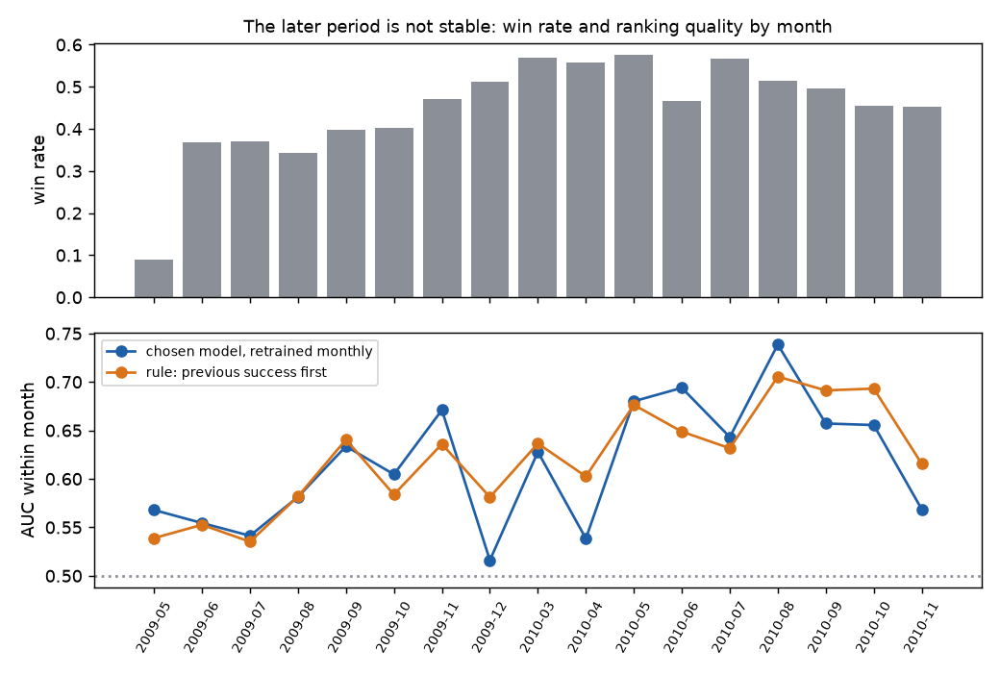
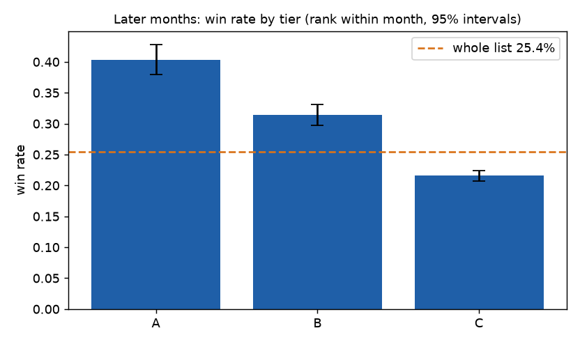
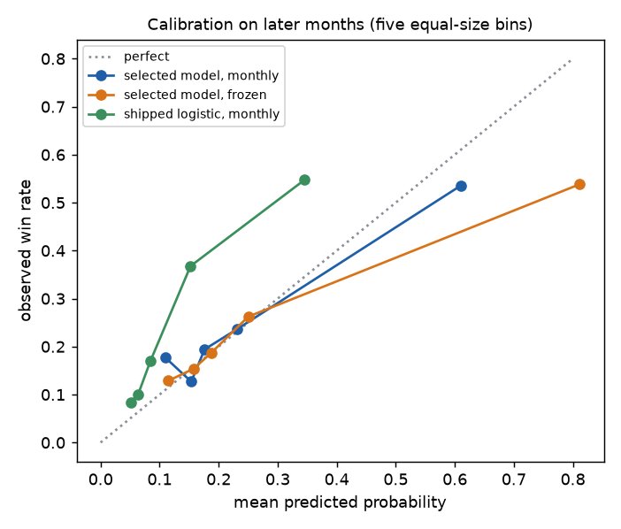

# Fit and history scoring: backtest report

**Data: UCI Bank Marketing (Moro, Rita and Cortez), CC BY 4.0. Real phone-campaign records from a Portuguese bank, 2008-2010. It is consumer telemarketing, not B2B pipeline.** The candidate-dataset checks at the end are labelled separately.

## Question and point in time

Which rows on a call list should be worked first? Each score is made **before the first call of the campaign**, using the person's job, education, credit and loan flags, and results of earlier campaigns. Call length, call count, call timing, age, marital status and market-wide indicators are excluded.

## Short answer

Chosen model against each simple rule on later months. A difference counts only if its 95% interval excludes zero. 2009-05 alone holds 54% of the later rows.

| rule | question | difference | rows resampled | whole months resampled |
|---|---|---|---|---|
| points_rules | ordering the whole list (within-month AUC) | 0.016 | model ahead | no clear difference |
| points_rules | lift in the top 10% | -0.021 | no clear difference | no clear difference |
| points_rules | lift in the top 30% | 0.009 | no clear difference | no clear difference |
| previous_success_first | ordering the whole list (within-month AUC) | 0.025 | model ahead | no clear difference |
| previous_success_first | lift in the top 10% | 0.017 | no clear difference | no clear difference |
| previous_success_first | lift in the top 30% | 0.014 | no clear difference | no clear difference |
| most_recent_first | ordering the whole list (within-month AUC) | 0.023 | model ahead | no clear difference |
| most_recent_first | lift in the top 10% | 0.021 | no clear difference | no clear difference |
| most_recent_first | lift in the top 30% | 0.004 | no clear difference | no clear difference |

The pooled within-month AUC is weighted by (won, lost) pairs, so one month carries 85% of it. Giving every month the same weight instead:

| method | mean_of_monthly_auc | months_chosen_model_ahead | months |
|---|---|---|---|
| model_monthly | 0.616 | n/a | 17 |
| logistic_monthly | 0.611 | 13 | 17 |
| points_rules | 0.616 | 9 | 17 |
| previous_success_first | 0.621 | 9 | 17 |
| most_recent_first | 0.627 | 8 | 17 |

## Splits (by time; month rebuilt from row order)

| split | rows | first_month | last_month | win_rate | had_previous_campaign |
|---|---|---|---|---|---|
| first training history | 23997 | 2008-05 | 2008-08 | 0.046 | 0.000 |
| validation (model choice) | 6433 | 2008-10 | 2009-04 | 0.125 | 0.221 |
| later test | 10758 | 2009-05 | 2010-11 | 0.254 | 0.391 |

## Model choice (validation months only)

| model | validation_within_month_auc | chosen |
|---|---|---|
| logistic_C0.03 | 0.579 | no |
| logistic_C0.3 | 0.564 | no |
| logistic_C3 | 0.557 | no |
| boosted_depth2 | 0.606 | yes |
| boosted_depth3 | 0.585 | no |

Rule set in advance: boosted trees are chosen only if they beat the best logistic model by 0.01. Chosen: **boosted_depth2**. Boosted trees give no simple reason codes, so the file the scoring command loads is the best logistic model, **logistic_C0.03**, shown below as `logistic_monthly`.

## Does the score beat simple rules on later data? (2009-05 onwards, 10758 rows, win rate 0.254)

`model_monthly` is the chosen model refitted before each month on all earlier months (the primary result). `model_frozen` is fitted once before the later period. `logistic_monthly` is the explainable model, refitted monthly. Lift is measured inside each month, then pooled.

| method | within-month AUC (95%) | lift, top 10% (95%) | lift, top 30% (95%) | pooled AUC |
|---|---|---|---|---|
| model_monthly | 0.573 (0.548 to 0.594) | 1.59 (1.50 to 1.68) | 1.35 (1.30 to 1.40) | 0.756 |
| model_frozen | 0.574 (0.549 to 0.595) | 1.57 (1.47 to 1.66) | 1.37 (1.32 to 1.41) | 0.705 |
| logistic_monthly | 0.572 (0.548 to 0.594) | 1.58 (1.49 to 1.67) | 1.34 (1.30 to 1.39) | 0.755 |
| points_rules | 0.557 (0.533 to 0.579) | 1.61 (1.51 to 1.69) | 1.34 (1.30 to 1.39) | 0.694 |
| previous_success_first | 0.548 (0.536 to 0.559) | 1.57 (1.50 to 1.63) | 1.34 (1.30 to 1.37) | 0.631 |
| most_recent_first | 0.550 (0.538 to 0.561) | 1.56 (1.47 to 1.64) | 1.35 (1.31 to 1.38) | 0.640 |
| best_job_first | 0.526 (0.503 to 0.548) | 1.05 (0.97 to 1.13) | 1.04 (1.00 to 1.08) | 0.720 |
| no_ranking | 0.500 (0.500 to 0.500) | 1.00 (1.00 to 1.00) | 1.00 (1.00 to 1.00) | 0.500 |

### Paired differences: chosen model minus each other method (rows resampled within month)

| compared_with | measure | difference | low | high | interval excludes 0 |
|---|---|---|---|---|---|
| model_frozen | within_month_auc | -0.001 | -0.001 | 0.000 | no |
| model_frozen | lift_top10 | 0.018 | -0.037 | 0.086 | no |
| model_frozen | lift_top30 | -0.012 | -0.028 | 0.007 | no |
| logistic_monthly | within_month_auc | 0.001 | -0.004 | 0.007 | no |
| logistic_monthly | lift_top10 | 0.002 | -0.055 | 0.071 | no |
| logistic_monthly | lift_top30 | 0.009 | -0.009 | 0.033 | no |
| points_rules | within_month_auc | 0.016 | 0.003 | 0.029 | yes |
| points_rules | lift_top10 | -0.021 | -0.074 | 0.053 | no |
| points_rules | lift_top30 | 0.009 | -0.017 | 0.038 | no |
| previous_success_first | within_month_auc | 0.025 | 0.002 | 0.045 | yes |
| previous_success_first | lift_top10 | 0.017 | -0.041 | 0.094 | no |
| previous_success_first | lift_top30 | 0.014 | -0.015 | 0.054 | no |
| most_recent_first | within_month_auc | 0.023 | 0.001 | 0.043 | yes |
| most_recent_first | lift_top10 | 0.021 | -0.042 | 0.102 | no |
| most_recent_first | lift_top30 | 0.004 | -0.026 | 0.041 | no |
| best_job_first | within_month_auc | 0.047 | 0.026 | 0.068 | yes |
| best_job_first | lift_top10 | 0.538 | 0.437 | 0.649 | yes |
| best_job_first | lift_top30 | 0.313 | 0.259 | 0.369 | yes |
| no_ranking | within_month_auc | 0.073 | 0.048 | 0.094 | yes |
| no_ranking | lift_top10 | 0.585 | 0.499 | 0.683 | yes |
| no_ranking | lift_top30 | 0.353 | 0.304 | 0.401 | yes |

### Same differences when whole months are resampled (wider)

| compared_with | measure | difference | low | high | interval excludes 0 |
|---|---|---|---|---|---|
| model_frozen | within_month_auc | -0.001 | -0.009 | 0.000 | no |
| model_frozen | lift_top10 | 0.018 | -0.052 | 0.092 | no |
| model_frozen | lift_top30 | -0.012 | -0.034 | 0.005 | no |
| logistic_monthly | within_month_auc | 0.001 | -0.003 | 0.006 | no |
| logistic_monthly | lift_top10 | 0.002 | -0.045 | 0.056 | no |
| logistic_monthly | lift_top30 | 0.009 | -0.018 | 0.031 | no |
| points_rules | within_month_auc | 0.016 | -0.005 | 0.018 | no |
| points_rules | lift_top10 | -0.021 | -0.093 | 0.039 | no |
| points_rules | lift_top30 | 0.009 | -0.037 | 0.047 | no |
| previous_success_first | within_month_auc | 0.025 | -0.004 | 0.028 | no |
| previous_success_first | lift_top10 | 0.017 | -0.067 | 0.083 | no |
| previous_success_first | lift_top30 | 0.014 | -0.042 | 0.061 | no |
| most_recent_first | within_month_auc | 0.023 | -0.009 | 0.027 | no |
| most_recent_first | lift_top10 | 0.021 | -0.037 | 0.074 | no |
| most_recent_first | lift_top30 | 0.004 | -0.051 | 0.053 | no |
| best_job_first | within_month_auc | 0.047 | 0.042 | 0.110 | yes |
| best_job_first | lift_top10 | 0.538 | 0.425 | 0.646 | yes |
| best_job_first | lift_top30 | 0.313 | 0.270 | 0.376 | yes |
| no_ranking | within_month_auc | 0.073 | 0.069 | 0.134 | yes |
| no_ranking | lift_top10 | 0.585 | 0.459 | 0.686 | yes |
| no_ranking | lift_top30 | 0.353 | 0.303 | 0.415 | yes |

### Shipped logistic minus each other method (rows resampled within month)

| compared_with | measure | difference | low | high | interval excludes 0 |
|---|---|---|---|---|---|
| model_monthly | within_month_auc | -0.001 | -0.007 | 0.004 | no |
| model_monthly | lift_top10 | -0.002 | -0.071 | 0.055 | no |
| model_monthly | lift_top30 | -0.009 | -0.033 | 0.009 | no |
| model_frozen | within_month_auc | -0.002 | -0.007 | 0.004 | no |
| model_frozen | lift_top10 | 0.016 | -0.052 | 0.087 | no |
| model_frozen | lift_top30 | -0.021 | -0.047 | 0.003 | no |
| points_rules | within_month_auc | 0.015 | 0.003 | 0.026 | yes |
| points_rules | lift_top10 | -0.023 | -0.080 | 0.045 | no |
| points_rules | lift_top30 | -0.000 | -0.025 | 0.024 | no |
| previous_success_first | within_month_auc | 0.024 | 0.002 | 0.044 | yes |
| previous_success_first | lift_top10 | 0.015 | -0.047 | 0.079 | no |
| previous_success_first | lift_top30 | 0.005 | -0.024 | 0.040 | no |
| most_recent_first | within_month_auc | 0.022 | 0.000 | 0.042 | yes |
| most_recent_first | lift_top10 | 0.019 | -0.043 | 0.088 | no |
| most_recent_first | lift_top30 | -0.005 | -0.035 | 0.027 | no |
| best_job_first | within_month_auc | 0.046 | 0.025 | 0.068 | yes |
| best_job_first | lift_top10 | 0.536 | 0.427 | 0.643 | yes |
| best_job_first | lift_top30 | 0.304 | 0.251 | 0.355 | yes |
| no_ranking | within_month_auc | 0.072 | 0.048 | 0.094 | yes |
| no_ranking | lift_top10 | 0.583 | 0.487 | 0.669 | yes |
| no_ranking | lift_top30 | 0.344 | 0.296 | 0.386 | yes |

### Shipped logistic, whole months resampled

| compared_with | measure | difference | low | high | interval excludes 0 |
|---|---|---|---|---|---|
| model_monthly | within_month_auc | -0.001 | -0.006 | 0.003 | no |
| model_monthly | lift_top10 | -0.002 | -0.056 | 0.045 | no |
| model_monthly | lift_top30 | -0.009 | -0.031 | 0.018 | no |
| model_frozen | within_month_auc | -0.002 | -0.015 | 0.003 | no |
| model_frozen | lift_top10 | 0.016 | -0.030 | 0.059 | no |
| model_frozen | lift_top30 | -0.021 | -0.046 | 0.004 | no |
| points_rules | within_month_auc | 0.015 | -0.011 | 0.017 | no |
| points_rules | lift_top10 | -0.023 | -0.086 | 0.028 | no |
| points_rules | lift_top30 | -0.000 | -0.030 | 0.026 | no |
| previous_success_first | within_month_auc | 0.024 | -0.007 | 0.027 | no |
| previous_success_first | lift_top10 | 0.015 | -0.048 | 0.070 | no |
| previous_success_first | lift_top30 | 0.005 | -0.038 | 0.042 | no |
| most_recent_first | within_month_auc | 0.022 | -0.013 | 0.025 | no |
| most_recent_first | lift_top10 | 0.019 | -0.042 | 0.061 | no |
| most_recent_first | lift_top30 | -0.005 | -0.045 | 0.033 | no |
| best_job_first | within_month_auc | 0.046 | 0.040 | 0.107 | yes |
| best_job_first | lift_top10 | 0.536 | 0.441 | 0.612 | yes |
| best_job_first | lift_top30 | 0.304 | 0.247 | 0.384 | yes |
| no_ranking | within_month_auc | 0.072 | 0.068 | 0.129 | yes |
| no_ranking | lift_top10 | 0.583 | 0.488 | 0.663 | yes |
| no_ranking | lift_top30 | 0.344 | 0.288 | 0.418 | yes |

## Month by month

| month | rows | win_rate | auc_model_monthly | auc_points_rules | auc_previous_success_first | lift_top30_model | small_month |
|---|---|---|---|---|---|---|---|
| 2009-05 | 5794 | 0.090 | 0.568 | 0.549 | 0.539 | 1.305 | no |
| 2009-06 | 715 | 0.369 | 0.554 | 0.551 | 0.553 | 1.179 | no |
| 2009-07 | 178 | 0.371 | 0.541 | 0.530 | 0.535 | 1.172 | no |
| 2009-08 | 770 | 0.343 | 0.581 | 0.583 | 0.582 | 1.356 | no |
| 2009-09 | 267 | 0.397 | 0.634 | 0.625 | 0.640 | 1.487 | no |
| 2009-10 | 447 | 0.403 | 0.605 | 0.620 | 0.584 | 1.352 | no |
| 2009-11 | 357 | 0.471 | 0.671 | 0.667 | 0.636 | 1.510 | no |
| 2009-12 | 172 | 0.512 | 0.516 | 0.492 | 0.581 | 1.174 | no |
| 2010-03 | 264 | 0.568 | 0.628 | 0.629 | 0.636 | 1.369 | no |
| 2010-04 | 174 | 0.557 | 0.538 | 0.561 | 0.602 | 1.203 | no |
| 2010-05 | 212 | 0.575 | 0.680 | 0.674 | 0.676 | 1.383 | no |
| 2010-06 | 229 | 0.467 | 0.694 | 0.688 | 0.649 | 1.433 | no |
| 2010-07 | 311 | 0.566 | 0.643 | 0.644 | 0.632 | 1.350 | no |
| 2010-08 | 233 | 0.515 | 0.739 | 0.731 | 0.705 | 1.636 | no |
| 2010-09 | 303 | 0.495 | 0.657 | 0.671 | 0.691 | 1.489 | no |
| 2010-10 | 204 | 0.456 | 0.656 | 0.671 | 0.693 | 1.366 | no |
| 2010-11 | 128 | 0.453 | 0.569 | 0.585 | 0.616 | 1.402 | no |

## Tiers (rank inside each month: A top 10%, B next 20%, C the rest)

| tier | rows | win rate (95%) | lift (95%) | share of all wins | rows per win |
|---|---|---|---|---|---|
| A | 1076 | 0.403 (0.380 to 0.428) | 1.59 (1.50 to 1.68) | 0.159 | 2.5 |
| B | 2152 | 0.314 (0.297 to 0.331) | 1.24 (1.17 to 1.30) | 0.247 | 3.2 |
| C | 7531 | 0.216 (0.207 to 0.224) | 0.85 (0.83 to 0.87) | 0.594 | 4.6 |

Same tiers from the shipped logistic model:

| tier | rows | win rate (95%) | lift (95%) | share of all wins | rows per win |
|---|---|---|---|---|---|
| A | 1076 | 0.402 (0.377 to 0.426) | 1.58 (1.49 to 1.67) | 0.158 | 2.5 |
| B | 2152 | 0.311 (0.294 to 0.327) | 1.22 (1.16 to 1.28) | 0.245 | 3.2 |
| C | 7531 | 0.217 (0.208 to 0.225) | 0.85 (0.83 to 0.87) | 0.597 | 4.6 |

Same tiers from the hand-written points rules:

| tier | rows | win rate (95%) | lift (95%) | share of all wins | rows per win |
|---|---|---|---|---|---|
| A | 1076 | 0.408 (0.383 to 0.430) | 1.61 (1.51 to 1.69) | 0.161 | 2.5 |
| B | 2152 | 0.308 (0.292 to 0.323) | 1.21 (1.16 to 1.26) | 0.243 | 3.2 |
| C | 7531 | 0.217 (0.209 to 0.225) | 0.85 (0.83 to 0.87) | 0.597 | 4.6 |

### Reusing score thresholds from the previous three months instead

| tier | rows | win_rate | smallest_monthly_share | largest_monthly_share |
|---|---|---|---|---|
| A | 3503 | 0.291 | 0.107 | 0.716 |
| B | 3599 | 0.199 | 0.058 | 0.445 |
| C | 3656 | 0.273 | 0.039 | 0.724 |

## Calibration on later months

`trailing_rate` gives every row the previous month's win rate: a no-model baseline.

| probability | mean_predicted | observed_rate | brier | log_loss |
|---|---|---|---|---|
| monthly | 0.256 | 0.254 | 0.171 | 0.526 |
| monthly_uncalibrated | 0.142 | 0.254 | 0.173 | 0.548 |
| frozen | 0.304 | 0.254 | 0.178 | 0.556 |
| logistic_monthly | 0.139 | 0.254 | 0.174 | 0.533 |
| trailing_rate | 0.281 | 0.254 | 0.166 | 0.513 |

Reliability of the chosen model's monthly calibrated probability:

| rows | mean_predicted | observed_rate |
|---|---|---|
| 2152 | 0.110 | 0.177 |
| 2152 | 0.154 | 0.127 |
| 2152 | 0.176 | 0.194 |
| 2151 | 0.231 | 0.236 |
| 2151 | 0.611 | 0.536 |

## Which signals matter (chosen model, monthly walk-forward)

`top30_kept_from_full` is the share of the full model's top-30% rows that stay in the top 30%.

| variant | within_month_auc | lift_top30 | pooled_auc | top30_kept_from_full | rank_correlation_with_full |
|---|---|---|---|---|---|
| all signals | 0.573 | 1.353 | 0.756 | 1.000 | 1.000 |
| without profile | 0.552 | 1.324 | 0.754 | 0.614 | 0.849 |
| without finance | 0.561 | 1.359 | 0.751 | 0.917 | 0.943 |
| without history | 0.531 | 1.039 | 0.720 | 0.702 | 0.911 |
| only profile | 0.522 | 1.048 | 0.717 | 0.672 | 0.859 |
| only finance | 0.514 | 1.004 | 0.731 | 0.358 | 0.764 |
| only history | 0.518 | 1.296 | 0.757 | 0.572 | 0.772 |

## What the excluded fields would have added

Each field is added alone. The first three result columns are the monthly walk-forward. The last two come from a shuffled 5-fold split, which lets the model learn from the future: first scored on the same later rows, then on all rows.

| feature_set | within_month_auc | lift_top30 | pooled_auc | shuffled_within_month_auc_same_rows | shuffled_pooled_auc_all_rows |
|---|---|---|---|---|---|
| allowed fields only | 0.573 | 1.353 | 0.756 | 0.559 | 0.694 |
| add age + marital (policy) | 0.586 | 1.344 | 0.752 | 0.575 | 0.706 |
| add contact channel | 0.608 | 1.374 | 0.760 | 0.588 | 0.722 |
| add month + weekday of last call | 0.580 | 1.359 | 0.781 | 0.551 | 0.736 |
| add market-wide indicators | 0.595 | 1.382 | 0.541 | 0.614 | 0.790 |
| add campaign call count (LEAK) | 0.586 | 1.372 | 0.759 | 0.577 | 0.702 |
| add call duration (LEAK) | 0.900 | 1.865 | 0.866 | 0.892 | 0.889 |

## Segment playbook (aggregates)

Segments are ranked by their win rate in the months before the later period, then checked on the later months.

| segment | past_rows | past_win_rate | later_rows | later_win_rate |
|---|---|---|---|---|
| earlier success, dated within 7 days | 91 | 0.407 | 1036 | 0.687 |
| earlier success, older or undated | 11 | 0.182 | 235 | 0.609 |
| earlier attempt failed | 1320 | 0.068 | 2932 | 0.176 |
| no earlier campaign | 29008 | 0.061 | 6555 | 0.208 |

## Evidence behind a score

- Every reason code names a source column and its value.
- Rows in the later period with any earlier-campaign history: 39.1%.
- Rows with a dated signal (days since earlier contact): 13.1%. The file gives no calendar date for any single signal, so time decay applies only to these rows.
- Rows with at least one literal 'unknown' value: 16.4%.

## Other candidate datasets (checked, not used for the main result)

### Maven Analytics CRM Sales Opportunities (FICTITIOUS company)

8800 pipeline rows, 2089 still open. Logistic model on rep, team, product and account fields; trained on 2679 deals closed before the cutoff, tested on 3062 engaged later (win rate 0.602).
Later-period AUC **0.525** (95% 0.503 to 0.545); top-30% lift 1.02 (0.98 to 1.06). Only closed deals are tested, so slow deals are under-represented.
