# Project 19: Clay Playbook, Account Enrichment and ICP Scoring

A small Clay workflow, built once in a real workspace: pull 25 companies, score them with free formulas, and pay for a hiring signal only on the rows that pass. It is the "buy" counterpart to [project 16](../16-enrichment-waterfall/), which builds the spend controls of a waterfall in code.

**What kind of evidence this is.** One run on 26 November 2026, on one list of 25 companies. The data is live, third-party company data served through Clay, not synthetic and not a benchmark. No company names or row values are published here, only counts. Screenshots are cropped; the row area of both table screenshots is covered with a solid fill, and so is the date range in the usage screenshot. Prices, screen labels and billing behaviour can change.

**The pass rule is unvalidated.** Which companies pass to the paid step is decided in practice by a keyword rule on the company description. Nobody has checked its labels against any other source, so its error rate is unknown. Read every count below the gate with that in mind.

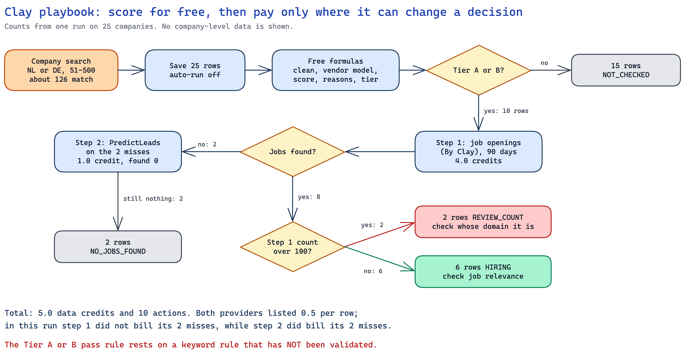

*Editable source: [`docs/clay-playbook.excalidraw`](docs/clay-playbook.excalidraw), written by [`docs/make_diagram.py`](docs/make_diagram.py). Operating process: [`docs/process.md`](docs/process.md).*

## Why this project

**Business need.** Paid enrichment is billed per lookup, and a company list from a database search is only a rough match for the target market. A team wants to know which accounts to look at first without paying to enrich all of them. The intended users are a sales development lead who picks the accounts and a RevOps person who watches the spend.

**The workflow in four lines**

1. **Goes in:** company search filters and the firmographic fields the search returns.
2. **Reasoned:** a fit score from free formulas, a pass rule, and whether a job count looks believable.
3. **Happens:** only passing rows get a paid job lookup, a second provider runs on misses, and each row gets one status. Nothing is sent.
4. **Seen:** in the Clay table, where the user reads the tier, the reason codes and the hiring status.

**What you could buy instead.** This build is already the bought option. Other enrichment platforms, sales intelligence databases and CRM add-ons cover similar steps, and you can also write the waterfall yourself, as [project 16](../16-enrichment-waterfall/) does with invented providers. I did not test or compare other products.

**Signal that it works.** On a sample checked by a person, the passing rows are good-fit accounts more often than the blocked rows, and the flagged hiring signals are real and relevant. After that, the credits spent per confirmed usable account stay within the agreed cap, and passing accounts lead to more meetings than a comparable group chosen without the score. None of this has been measured.

**Real users today: none.** It was built and run once.

## Business question

> Of the cybersecurity software companies headquartered in the Netherlands or Germany with 51-500 employees, which should be looked at first, and do they show a reason to look **now**?

Who uses the answer: sales development and account executives (which accounts first), revenue operations (what each signal costs and how far to trust it). The workflow stops at accounts. It finds no people, e-mail addresses or phone numbers and sends nothing.

## Results

| Measure | Result |
|---|---|
| Companies matching the search filters | about 126, as shown by Clay |
| Companies saved | 25 (the first 25 in Clay's order, **not** a random sample) |
| Passed the fit gate (tier A or B), decided by an **unvalidated** keyword rule | 10 (A: 9, B: 1); tier C: 15; disqualified: 0 |
| Paid step 1 found open jobs | 8 of 10 |
| Paid step 2 found jobs for the other 2 | 0 of 2 |
| Of the 8 hits, flagged for a human to check | 2 (implausibly large counts) |
| Hiring signal usable without that check | 6 of 10 gated accounts |
| Data credits spent | **5.0** |
| Actions spent | 10 |

The two balance rows come from workspace-wide totals read before and after (the totals themselves are not published): they fell by 5.0 data credits and 10 actions. The table's own usage history also showed 5 data credits and 10 actions.

## Build it, in order

You need a Clay account with data credits. Labels below are the ones seen on the build date.

### 0. Read the balance

Settings > Usage. Write down data credits and actions. This is your only independent check on the cost at the end.

### 1. Company search

Find leads > Companies. Match **all** of:

| Filter | Value |
|---|---|
| Industry | is `Computer and Network Security` |
| HQ location (at least 1) | Country is `Netherlands` or `Germany` |
| Company size | is `51-200 employees` or `201-500 employees` |

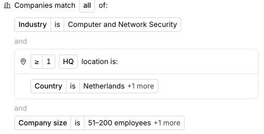

The industry tag is **not** the same as "cybersecurity software". From reading the results on screen, it also seemed to include service businesses and other non-product organisations. I did not count or verify them. Step 4 tries to handle that, with an unvalidated rule.

### 2. Save 25 rows, with nothing else ticked

Continue, choose **Custom** and `25`, then **Save to table**. On the build date the preselected option was *Save to Audiences*. Leave every box under *Enrich to add more data?* unticked. I ticked none; the dialog showed no run-condition setting, so add paid columns later, where you can gate them.

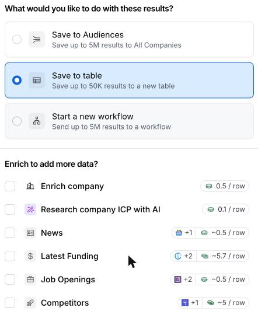

Rename the workbook to `GTM Series: Account Enrichment and ICP Scoring`. I left the table with the name Clay generated from the search.

### 3. Turn auto-run off before adding anything

The new table had **Auto-run on**. Switch it to Manual. Clay's confirmation dialog warns that scheduled columns would still run; this table had none (the schedule counter showed 0).

### 4. Free formula columns

Add column > Formula, open the **Formula** box (below the AI prompt box) and type the formula. Typed `{{Column Name}}` references were recognised. Add them in this order, then rename each.

**Domain Clean**: one join key and enrichment input.

```javascript
String({{Domain}} || "").trim().toLowerCase().replace(/^https?:\/\//, "").replace(/^www\./, "").split("/")[0]
```

On this pull the source domains already looked clean: I saw no value change. The column matters more for CSV or CRM imports.

**Vendor Model**: product company, services company, both, or cannot tell, from description keywords.

```javascript
((p, s) => p && s ? "mixed" : p ? "product" : s ? "services" : "unclear")(/software|platform|plattform|saas|product|produkt/i.test(String({{Description}})), /consult|beratung|advis|advies|dienstleist|services|managed|reseller|distribut|systemhaus|training/i.test(String({{Description}})))
```

Result: product 10, services 6, mixed 1, unclear 8. **This is an unvalidated keyword rule, not a verified classification.** I did not hand-label the rows, so its error rate is unknown. A product company whose description mentions only services words would be misread (one that mentions both comes out `mixed`), and the German and Dutch word lists are partial.

**Fit Score**: 0 to 100.

| Component | Points |
|---|---|
| HQ in the Netherlands or Germany | 20 |
| Size 51-200 / 201-500 | 30 / 20 |
| Vendor Model product / mixed / unclear / services | 40 / 25 / 10 / 0 |
| Type is Privately Held | 10 |

```javascript
(["Netherlands","Germany"].includes({{Country}}) ? 20 : 0) + (String({{Size}}) === "51-200" ? 30 : String({{Size}}) === "201-500" ? 20 : 0) + ({{Vendor Model}} === "product" ? 40 : {{Vendor Model}} === "mixed" ? 25 : {{Vendor Model}} === "unclear" ? 10 : 0) + ({{Type}} === "Privately Held" ? 10 : 0)
```

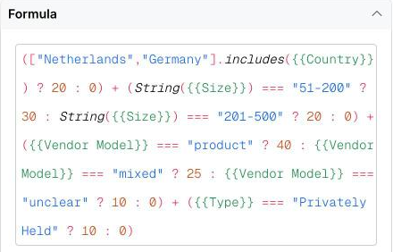

The weights are judgement calls. They were not fitted to or tested against any sales outcome.

**Reason Codes**: lets a rep see why a row scored as it did.

```javascript
[["Netherlands","Germany"].includes({{Country}}) ? "GEO_OK" : "GEO_MISS", "SIZE_" + String({{Size}}), "MODEL_" + String({{Vendor Model}}).toUpperCase(), {{Type}} === "Privately Held" ? "OWN_PRIVATE" : "OWN_OTHER", {{Domain Clean}} ? "DOMAIN_OK" : "DOMAIN_MISSING"].join(" | ")
```

**Tier**: hard rules first, then thresholds.

```javascript
!{{Domain Clean}} || !String({{Reason Codes}}).includes("GEO_OK") ? "DQ" : Number({{Fit Score}}) >= 90 ? "A" : Number({{Fit Score}}) >= 75 ? "B" : "C"
```

I set the thresholds after seeing the score preview, so that a row with an `unclear` model could not pass. **On this list the gate came down to the keyword rule: the 10 rows that passed are exactly the 10 marked `product`.** Among the `product` rows, size and ownership only moved rows between A and B. They could still matter for a `mixed` row: some size and ownership combinations reach 75 or more, and on this list the one `mixed` row did not. Treat them as a design choice, not a finding. Because the search already filtered on geography, all 25 rows got the same 20 geography points and none was disqualified: that rule only protects against rows added some other way.

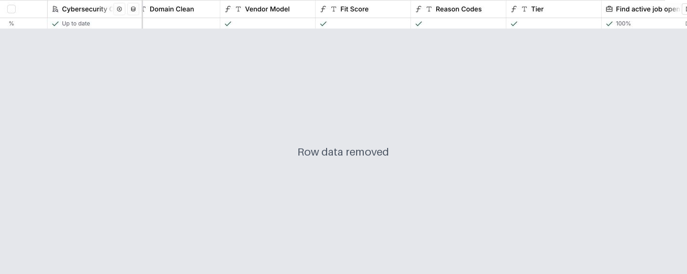

### 5. Choose the timing signal

Add column > Add enrichment, search `job openings`. Prices differed widely between entries that sound alike.

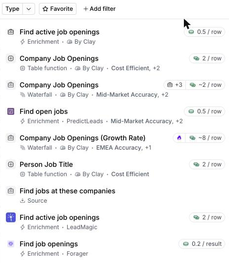

I picked two single-provider entries listed at 0.5 per row and chained them by hand, so the condition between them is visible. I did not test the prebuilt waterfalls (listed at about 2 and about 8 per row), so I cannot say whether they find more.

### 6. Paid step 1: Find active job openings (By Clay)

| Setting | Value |
|---|---|
| Company Identifier | `Domain Clean` |
| Maximum Days since Posted | `90` |
| Limit | `10` |
| Other inputs | defaults |
| Column Auto-run | **off** (it was on by default) |
| Output column added | Job Count (Clay named it `Jobcount`) |

Run condition (the fit gate):

```javascript
{{Tier}} === "A" || {{Tier}} === "B"
```

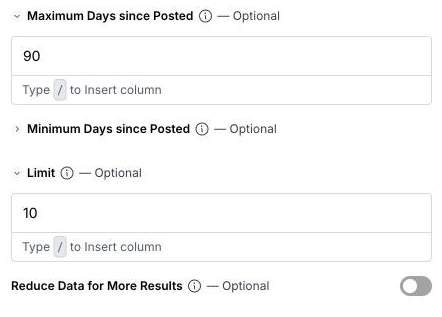

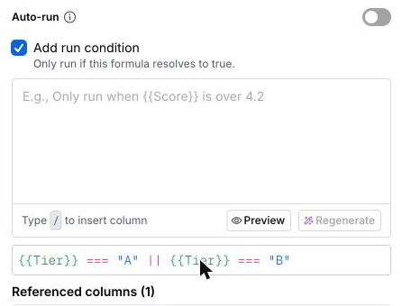

Before continuing, check that **Referenced columns** appears under the condition. Save without running.

**Test two single cells first.** Click one tier C cell: it showed `Run condition not met`. Then one tier A cell: it returned jobs. Only then open the column's run button.

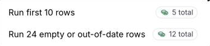

The menu estimated **12 credits** for the 24 remaining rows, which equals 24 x 0.5: it did not subtract the rows the condition would block. Use it as a ceiling, not a forecast. The bulk run was billed 3.5.

### 7. Paid step 2: Find open jobs (PredictLeads), only on step 1 misses

| Setting | Value |
|---|---|
| Account | Clay-managed Predict Leads account (no key or new connection) |
| Domain | `Domain Clean` |
| Days Since Posted | `90` |
| Maximum number of jobs | `10` (default) |
| Other inputs | defaults |
| Column Auto-run | **off** (on by default again, although the table was Manual) |
| Output column added | Total Count of Active Jobs (shown as `Total Job Count`) |

```javascript
({{Tier}} === "A" || {{Tier}} === "B") && !{{Jobcount}}
```

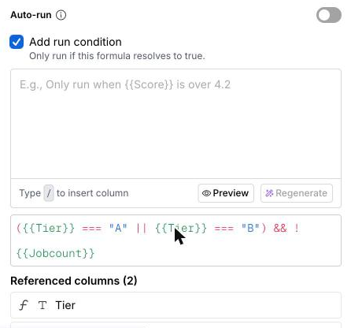

Test one miss and one hit first: the miss should run, the hit should show `Run condition not met`.

**Run step 1 to completion before step 2.** `!{{Jobcount}}` means "the count is empty or zero". It cannot tell "step 1 found nothing" from "step 1 has not run" or "step 1 failed", so out of order it would buy step 2 for rows that step 1 might have answered.

### 8. Merge and flag: Hiring Signal (free)

```javascript
!["A","B"].includes({{Tier}}) ? "NOT_CHECKED" : Number({{Jobcount}} || 0) > 100 ? "REVIEW_COUNT" : Number({{Jobcount}} || 0) > 0 ? "HIRING_PROVIDER_1" : Number({{Total Job Count}} || 0) > 0 ? "HIRING_PROVIDER_2" : "NO_JOBS_FOUND"
```

`NOT_CHECKED` is deliberately different from `NO_JOBS_FOUND`: 15 companies were never looked up, which says nothing about whether they are hiring. The limit of 100 was chosen after seeing the counts, and it checks only step 1's count. Also, a gated row whose paid columns have not run, or have failed, would read `NO_JOBS_FOUND`; check the paid cells before trusting that label.

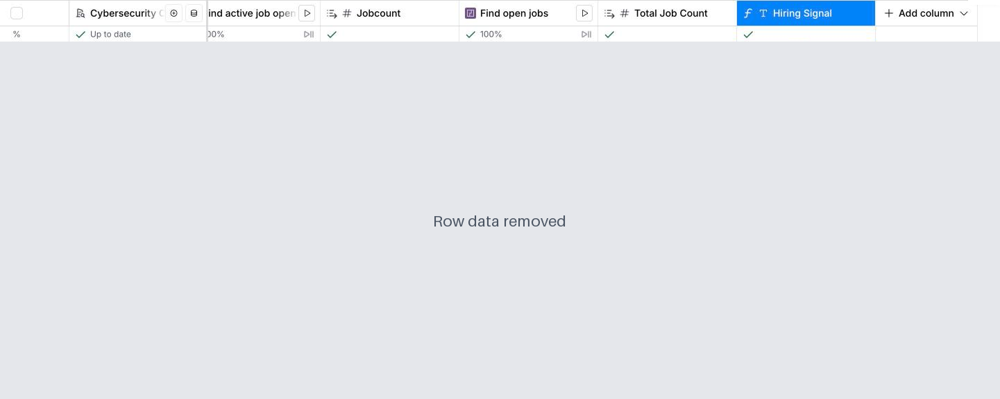

### 9. Reconcile the spend

In the table: History > Usage history > **Column**. Then compare with the Settings > Usage balance from step 0.

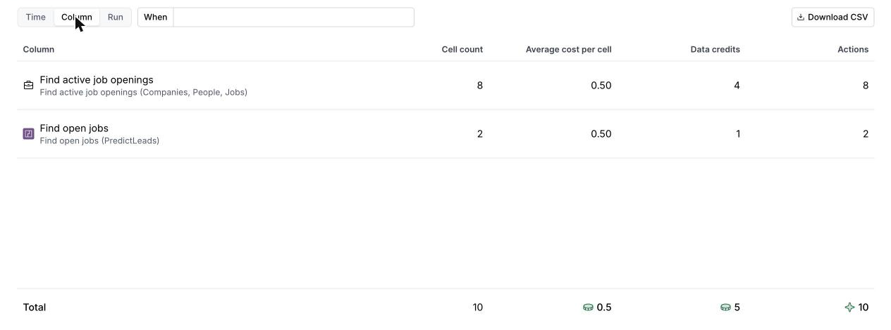

## Column reference

The final table had 23 columns, 21 of them visible.

| Column | Kind | Purpose |
|---|---|---|
| Search source column | source | The full record behind each row. In the column picker's preview it also held fields not shown as columns, such as a revenue range and a location count |
| Created At, Updated At | system, hidden | Row timestamps |
| Name, Domain, Description, Industry, Size, Type, City, State or Province, Country, LinkedIn URL | source fields (10) | Firmographics. LinkedIn URL is the company page; it was not enriched |
| Domain Clean | formula | Normalised enrichment input |
| Vendor Model | formula | Product versus services keyword rule |
| Fit Score | formula | Weighted fit, 0-100 |
| Reason Codes | formula | Explanation of the inputs to the score |
| Tier | formula | DQ, A, B or C; drives the gate |
| Find active job openings | paid, conditional | Step 1 |
| Jobcount | output of step 1 | Job count reported by step 1 |
| Find open jobs | paid, conditional | Step 2, misses only |
| Total Job Count | output of step 2 | Job count reported by step 2 (empty on every row here) |
| Hiring Signal | formula | One status per row, including what needs review |

## Measured cost

| Step | Rows the condition let through | Rows with jobs | Cells billed | Data credits | Actions |
|---|---|---|---|---|---|
| Search and save 25 rows | no condition | not applicable | none seen | none seen | none seen |
| Formula columns (6) | all 25 | not applicable | none seen | none seen | none seen |
| Step 1, By Clay | 10 | 8 | **8** | 4.0 | 8 |
| Step 2, PredictLeads | 2 | 0 | **2** | 1.0 | 2 |
| **Total** | | 8 | 10 | **5.0** | 10 |

"None seen" means the whole balance change equals the two paid columns. It is not a statement about Clay's price list.

The most useful thing this run showed: **the two providers billed a miss differently.** Both were listed at 0.5 per row. Step 1's two "No Job Found" rows were not billed. Step 2's two "No Jobs Found" rows were. This is four rows of evidence from one day, so confirm it again before planning a large run.

Rows blocked by a condition did not appear in the usage totals.

- Per gated account: 0.5 credits on average (5.0 / 10).
- Per account where either provider returned jobs: 0.625 (5.0 / 8).
- Per account with an unflagged hit: about 0.83 (5.0 / 6).

At the listed 0.5 per row, running step 1 on all 25 rows should have cost no more than 12.5 credits, against the 4.0 paid. The actual saving is unknown because the 15 blocked rows were never run. Do not scale these figures to a larger list without a new test: the pass rate and hit rate come from 25 non-random rows.

## Coverage achieved

| Field or stage | Filled |
|---|---|
| Name, Domain, Description, Industry, Size, Type, Country, LinkedIn URL | 25 / 25 each |
| City, State or Province | 23 / 25 each |
| Size band | 51-200: 16; 201-500: 9 |
| HQ country | Germany: 13; Netherlands: 12 |
| Fit Score | 100: 6; 90: 3; 80: 1; 70: 3; 65: 1; 60: 7; 50: 3; 40: 1 |
| Hiring Signal | HIRING_PROVIDER_1: 6; REVIEW_COUNT: 2; HIRING_PROVIDER_2: 0; NO_JOBS_FOUND: 2; NOT_CHECKED: 15 |

These were counted by reading the table on screen; I exported nothing. Filled does not mean correct: I checked no field against an independent source.

## Mistakes and surprises

1. **A run condition disappeared.** I typed it, then clicked near the Run settings header to close a pop-up. The section collapsed, and on reopening it *Add run condition* was unticked. I caught it before saving. Fix: press Tab to leave the field, then confirm the condition and its referenced columns are still there.
2. **Auto-run defaults.** The new table had it on, and each new enrichment column did too. Check both places.
3. **The list is probably not the ICP.** The unvalidated keyword rule marked only 11 of 25 as `product` or `mixed`. That is not a measured share of product companies. An industry tag is a starting filter, not a definition.
4. **A returned list is not the count.** With Limit 10, some cells said `Returned 10 Jobs` while the Job Count column showed several hundred. The limit capped the list, not the reported total.
5. **A domain can mislead.** Two counts were several hundred while the other six hits were in single digits. My **unverified inference** is that in those two cases the lookup counted the jobs of a larger organisation that uses the same domain; I did not check any careers page. Both are marked `REVIEW_COUNT`. The 90-day filter and the successful lookup did not prevent this.
6. **The second provider added nothing here.** It cost 1 credit (20% of the spend) and found 0 of 2. Two rows cannot show whether it helps in general. Also, its miss does not prove those companies are not hiring: both providers can share blind spots, and I did not check their sources.
7. **An unsaved formula was lost.** The browser window changed height, a click meant for *Save column* landed elsewhere, and I rebuilt the column. Confirm the new column appears before moving on.

## Build or buy: this table against project 16

| Concern | This Clay table | [Project 16](../16-enrichment-waterfall/) (code, synthetic providers) |
|---|---|---|
| Time to a working version | No code or provider keys for these two providers | You write the engine, ledger and tests, and real adapters do not exist yet |
| Waterfall order | A run condition I wrote on column 2 | Engine logic, with all 24 orders of four fake providers compared |
| Not paying twice | I did not test what a re-run bills | A unique ledger key; tests show a second run makes no billable call |
| Spend cap | I set none. The workbook overview showed a *Workbook credit limit* control, which I did not use or test | The full price is reserved before each call; tested at several caps |
| Cost estimate | Ignored the run condition in this build | You compute it from your own rules |
| Billing on a miss | Differed between the two providers; found by reading usage afterwards | Each failure type has a written, tested rule, and the assumption must be confirmed for a real vendor |
| Timeouts and unclear billing | Not encountered, not tested | Counted as spent and never retried blindly |
| Accepting a result | Any non-empty count counted as a hit until I added a review flag | Only a `valid` status is accepted, and even that is shown to be wrong sometimes |
| Audit | Per-column usage history on screen | A ledger you own and can query |
| Tests and version control | None for this table; this page is the record | Code, tests and history in Git |

A practical rule: use the table to learn which signals are worth paying for. Consider code, or at least a written ledger and reconciliation routine, when re-runs, caps, shared use or proof of spend start to matter. This comparison says nothing about which finds more data: project 16's providers are invented.

## Limits

- 25 rows, one day, one search order, no repeat run. No rate here supports a general claim.
- No ground truth. Neither the vendor labels, the scores nor the job counts were verified.
- No outcome data, so there is no evidence that tier A converts better than tier C.
- A job count is a weak timing signal. I did not look at job titles, so a hiring finance role counts the same as a security engineering role.
- The signal is a snapshot. Nothing is scheduled or refreshed.
- No technology-stack enrichment was tried.
- No sharing, export, CRM sync or outreach was set up, and none was tested.
- Reuse of data from Clay and its providers is subject to their terms. This repository publishes counts and settings only. Before using a list for outreach in the EU, settle your lawful basis and the relevant marketing rules.

## What you should be able to explain in an interview

1. **Why score before you enrich?** Free fields can remove rows that you would not act on whatever the paid answer. Here 15 of 25 never reached a paid column. The risk: a wrong free rule removes good accounts, and you will not see their signal.
2. **How would you test whether the gate loses good accounts?** Draw a random sample of blocked rows, hand-label fit, and if the budget allows, run the signal on that sample. Compare with the passed rows. This run did not do it.
3. **What makes a waterfall's second step conditional, and how can it break?** It runs only where the first output is empty. Empty can also mean not run, errored, or a real zero, so order and cell status matter.
4. **Two providers cost 0.5 per row. Are they equally expensive?** Not necessarily. In this run one did not bill misses and one did. Compare cost per usable result, using measured billing.
5. **The platform estimates 12 credits. What do you tell your budget owner?** In this build it was rows times price and ignored the condition, so it was a ceiling. State the ceiling, run a small test, then reconcile with usage history and the balance.
6. **A 51-500 employee company shows hundreds of open jobs. What now?** Do not route on it. Check which entity owns the domain, try a more specific identifier, or compare with the careers page, and mark the row for review in the meantime.
7. **Why keep `NOT_CHECKED` separate from `NO_JOBS_FOUND`?** Missing because you did not look is not evidence of absence. Merging them would teach reps that tier C companies are not hiring.
8. **How would you validate the fit score?** Fix the rules, then compare tiers with later outcomes (meetings, opportunities) on accounts worked under comparable effort, with a split in time and a simple baseline such as size alone. If reps work only tier A, the comparison is biased.
9. **When would you move from Clay to code?** When you need guaranteed no-double-billing, hard caps, tests, shared ownership or an audit record, or when volume makes maintaining it worthwhile. State which of these you have actually tested in the platform.

## Exercises

1. Hand-label the vendor model for all 25 of your rows from company websites **before** looking at the formula output. Report a confusion table. Change the keywords, then test on a second batch you have not seen.
2. Change the B threshold to 70. Work out, without running anything, how many more rows pass and the maximum extra cost of each step. The score counts above are enough for the first part.
3. Rewrite the step 2 condition and `Hiring Signal` so that "not run" and "errored" are separate from "no result". Test each case on single rows.
4. For rows marked `REVIEW_COUNT`, try the company's LinkedIn page URL as the identifier on one row, if the enrichment accepts it. Write down the price first, and compare.
5. Add job-title keywords relevant to what you sell. Compare "any job" with "relevant job", and decide which one should change an account's priority.
6. In project 16, write a fake provider that bills misses and one that does not, at the same price. Show how the cheapest order changes.
7. Set a credit limit on a test workbook and find out, with a very small value, what happens to a bulk run that would exceed it.
