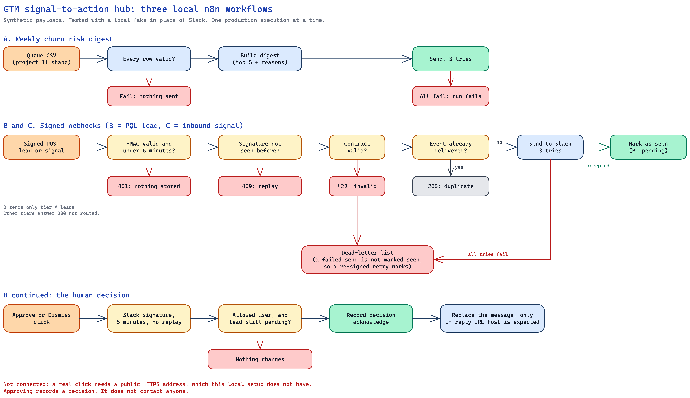

# Project 20: GTM signal-to-action hub

**Business question:** a score or a signal is worth nothing until the right person sees it once, can act on it, and nothing gets lost when
a tool fails. How do you build that last step safely?

Three local [n8n](https://n8n.io) workflows connect the output shapes of earlier projects to Slack.

> **Every payload is synthetic.** No row from any dataset is used. The workflows ran in real n8n 2.32.6 with a **local fake in place of
> Slack**. No message has been posted to Slack, so rendering in Slack and real button clicks are **not verified**.



*Editable source: [`docs/signal-to-action-hub.excalidraw`](docs/signal-to-action-hub.excalidraw). Operating process:
[`docs/process.md`](docs/process.md).*

## Who uses the answer

| Role | What they get |
|---|---|
| Customer success lead | A Monday digest of the churn-risk queue ([project 11](../11-churn-alert-system/) file shape) |
| Sales-assist rep | One alert per top-tier product-qualified lead ([project 07](../07-pql-scorer/) task shape) with Approve and Dismiss |
| RevOps or GTM engineer | A signed inbound webhook that rejects forgeries and replays, drops duplicates and keeps failures |

## The three workflows

| File in `workflows/` | Trigger | What happens when it goes wrong |
|---|---|---|
| `a-churn-digest.json` | Monday 08:00, or by hand | A bad row, wrong columns or no file: the run fails and nothing is posted. Slack down: three tries, then the run fails |
| `b-pql-review.json` | `POST /webhook/gtm-hub-pql` and `/webhook/gtm-hub-slack-actions` | Only tier A is sent. A failed send is dead-lettered. A second click changes nothing |
| `c-signed-signal.json` | `POST /webhook/gtm-hub-signal` | See the status table below |

| HTTP | Outcome | Meaning | What the sender should do |
|---|---|---|---|
| 200 | `delivered`, `pending` | Slack accepted it | Nothing |
| 200 | `duplicate`, `not_routed` | Already handled, or not a tier that needs a person | Nothing |
| 401 | `bad_signature`, `stale_timestamp`, `missing_headers` | Not authenticated. **Nothing is stored** | Fix the key or clock |
| 409 | `replay` | These exact signed bytes were seen | Sign again with a new timestamp if it is a real retry |
| 413 | `too_large` | Over 16 KB | Send less |
| 422 | `invalid_json`, `invalid_schema` | Signed but unusable; dead-lettered (hash and field names only) | Fix the payload |
| 502 | `delivery_failed` | Slack refused three times; the event is kept | Sign again and retry |
| 503 | `not_configured` | No secret set, so everything is refused | Set the secret |

**Signature:** `x-gtm-signature: v1=` + HMAC-SHA256 of `v1:<timestamp>:<raw body>`, with `x-gtm-timestamp` in Unix seconds. Button
clicks use [Slack's own scheme](https://docs.slack.dev/authentication/verifying-requests-from-slack/), which has the same shape with `v0`.

## Code map

| Path | Job |
|---|---|
| `hub/signing.py`, `contracts.py`, `messages.py` | Verification, input contracts, Slack Block Kit payloads |
| `hub/state.py`, `pipeline.py`, `interactions.py` | Replay, dedupe, dead letters, and the reference behaviour of each webhook |
| `hub/js/` | The JavaScript that runs inside n8n |
| `hub/workflows.py` | Builds `workflows/*.json` from `hub/js/`. Edit the scripts, not the JSON |
| `hub/scenarios.py` | 32 webhook steps, run both offline and against n8n |
| `hub/fake_slack.py`, `hub/send.py` | Local stand-in for Slack; signed sample sender |
| `e2e/` | Starts a throwaway n8n, runs everything, removes it |

The logic exists twice, in Python and in JavaScript. That is a real cost. It buys a readable, unit-tested reference, and the end-to-end
run fails if status, outcome or any posted message differs between the two.

## Run it

Offline (no Docker, no network beyond your own machine):

```bash
cd projects/20-gtm-automation-hub
pip install -r requirements.txt
python -m hub                 # rebuilds workflows/, writes reports/
python -m pytest --cov=hub
```

Everything against a real n8n (needs Docker; uses random secrets held in memory; removes its own container and volume):

```bash
python e2e/run_e2e.py         # about 3 minutes; writes reports/e2e.md
```

### Your own local n8n, still with the fake Slack

```bash
cp .env.example .env          # fill N8N_ENCRYPTION_KEY and GTM_HUB_WEBHOOK_SECRET with your editor
                              # for local click tests, SLACK_SIGNING_SECRET can be any random string of 16+ characters
python -m hub.fake_slack --port 8787        # keep this running in its own terminal

docker compose up -d
docker compose exec n8n n8n import:workflow --separate --input=/workflows
docker compose exec n8n n8n publish:workflow --id=gtmHubPql0000001
docker compose exec n8n n8n publish:workflow --id=gtmHubSignal0001
docker compose restart n8n                  # publishing takes effect after a restart

set -a; source .env; set +a                 # gives the sender the same keys
python -m hub.send signal                   # run twice: the second says "duplicate"
python -m hub.send pql
python -m hub.send click --decision approve # leave SLACK_APPROVER_IDS empty, or pass --user

# the digest, by hand
docker compose exec -e N8N_RUNNERS_BROKER_PORT=5699 n8n n8n execute --id=gtmHubChurn00001
```

None of this needs an n8n owner account. The editor at `http://127.0.0.1:5690` will ask you to create one if you want to look inside.
`publish:workflow --id=gtmHubChurn00001` (then restart) turns on the Monday schedule. The sample queue is dated 2026-11-23, so after
eight days the digest adds a stale-queue warning, which is intended.

This was run on macOS with Docker Desktop. On Linux, `host.docker.internal` points at the Docker bridge, so a fake bound to 127.0.0.1 is
not reachable without extra setup (not tested).

**To see dead letters** (they live in the workflow's static data):

```bash
docker compose exec n8n n8n export:workflow --id=gtmHubSignal0001 --output=/tmp/signal.json
docker compose exec n8n cat /tmp/signal.json      # look under staticData.global.hub.deadLetters
```

To repair a `delivery_failed` entry, save its `detail.event` to a file and run `python -m hub.send signal --file that-file.json`.

## Connecting real Slack

### The app and its one permission

[`slack/manifest.json`](slack/manifest.json) creates "GTM Signal Hub (demo)".

| Entry | Why it is there |
|---|---|
| `incoming-webhook` (the only scope) | Gives one URL that can post to **one channel you pick at install**. It cannot read messages, list people or channels, or post elsewhere |
| `bot_user` | Not a permission. The identity that a bot scope belongs to |
| `socket_mode_enabled`, `org_deploy_enabled`, `token_rotation_enabled`: false | None is used |
| No event subscriptions, slash commands, redirect URLs or user scopes | Nothing needs them |

Why not `chat:write`? It needs a bot token and can post in any channel the app is added to. This project posts to one channel. The
button reply uses the short-lived `response_url` that Slack sends with each click, which needs no further scope.

In the app creation dialog, a manifest **with** scopes offers only "Create and Install". To review before installing, create it without
`oauth_config` and `features`, then paste the full manifest on the app's **App Manifest** page and save.

### Install it (you do these steps; never paste a secret into chat, n8n, a ticket or a commit)

1. In Slack, create a channel `gtm-demo-alerts`.
2. At <https://api.slack.com/apps>, open **GTM Signal Hub (demo)** (or create it from the manifest).
3. Open **Install App**, install to your workspace, check that the only permission is the incoming webhook, pick `gtm-demo-alerts`, allow.
4. Open **Incoming Webhooks** and copy the URL. In your editor, add it to `.env` as `GTM_HUB_SLACK_WEBHOOK_URL=...`.
5. `git status` must not list `.env`. Then run `docker compose up -d` to apply it, and send the synthetic samples.
6. To go back to the fake, comment the line out and run `docker compose up -d` again.

Anyone who has the webhook URL can post to that channel. If it leaks, remove it in the app settings and make a new one.

### Buttons in real Slack: not connected

Slack sends a click to a public HTTPS **Request URL**. This n8n listens only on your machine, and the manifest leaves interactivity off.
So the buttons will show in Slack but will not work. The click path is verified only with requests signed locally.

To connect it you would need an HTTPS endpoint that forwards **only** `/webhook/gtm-hub-slack-actions`, interactivity enabled with that
URL, and your app's real signing secret in `.env` (Basic Information, App Credentials). Do not publish the whole n8n port: the editor,
and these relaxed code settings, would go with it. Set `SLACK_APPROVER_IDS` too. Slack expects an answer within 3 seconds; with one
execution at a time, a click waiting behind a retrying send can miss that.

## Results

| Run | Result |
|---|---|
| `python -m hub` | `offline tour: 32 of 32 steps as expected` |
| `python -m pytest --cov=hub` | 106 passed, 99% coverage of `hub/` (`e2e/` needs Docker and is not counted) |
| `python e2e/run_e2e.py` | 48 of 48 checks in n8n 2.32.6: [`reports/e2e.md`](reports/e2e.md) |

The most useful result is a measurement, from one machine:

| 20 parallel requests | n8n default (no limit) | `N8N_CONCURRENCY_PRODUCTION_LIMIT=1` |
|---|---|---|
| Identical signed request: Slack posts (1 is correct) | **20** | 1 |
| Different events: records lost, so re-sending delivered again | **19** | 0 |

The replay and dedupe code was correct one request at a time and useless in parallel. Each execution loaded the same old state, and the
last one to finish overwrote the others. This project therefore runs one production execution at a time.

## What did not work

- **Static data as a replay store with default concurrency.** See the table above. Every sequential test passed while this was broken.
- **Dead-lettering malformed JSON.** n8n parses a body labelled `application/json` before the workflow starts, even with "raw body" on.
  It answers 422 itself, so the gate never sees it, **before any signature check**. Signed JSON bodies keep their exact bytes, so HMAC
  works. The tour sends its broken bodies as `text/plain` to exercise our own branch, and a separate check records n8n's behaviour.
- **A test that signed twice in one second.** "Same event, new signature" produced the same signature and was correctly refused as a
  replay. A real sender that retries within the same second with the same body will see 409 too.
- **Installing on creation.** Slack's dialog bundles create and install for a manifest with scopes (as seen on the day this was built).

## Limits

- **At least once, not exactly once.** If Slack accepts a message but the reply is lost, or n8n dies before saving, it can be sent again.
- **Concurrency 1 is a throughput cap**, and it is an instance setting: someone who removes it silently breaks replay protection. It is
  also one measurement, not a proof. n8n answers before it saves static data. 10 immediate replays were all refused, with no guarantee.
  For real volume use a database with a unique key, as [project 16](../16-enrichment-waterfall/) does for spend.
- **Bounded memory:** 2,000 events for up to 7 days, 100 dead letters. Older entries drop off silently. There is no alert on dead letters.
- **The digest has no "already sent this week" guard.** Running it twice posts twice.
- **Retries wait one second** each, with no back-off, and also retry errors that will never succeed.
- **Relaxed n8n settings:** Code nodes may use `crypto` and read environment variables, including the encryption key. Use this
  instance only for this project, and import only workflows you have read.
- **Secrets at rest:** `.env` and the container environment hold them in plain text. The webhook workflows keep no execution data.
  The digest keeps its executions so failures are visible; a failed HTTP record may include the webhook URL (not checked). Exports and
  container logs were checked only for the items listed in `reports/e2e.md`.
- **Anyone who reaches the port** can use CPU and get n8n's parse errors. It is bound to 127.0.0.1; keep it there.
- **The digest names accounts.** With synthetic ids that is harmless. Real account rows in a channel need a data-handling decision first.
- **Nothing acts on an approval.** It is recorded. No lead is contacted.
- No claim is made that alerts change revenue. That needs the holdout tests described in projects 07 and 11.

## What you should be able to explain in an interview

1. **Why sign the raw bytes?** Parsing and re-serialising JSON can change spacing or key order, so a correct sender would fail.
2. **A signature is valid. Why also check a timestamp?** A captured request stays validly signed forever. The window limits how long it
   can be reused, and the signature store stops reuse inside the window. The store only has to remember that long.
3. **Replay versus duplicate?** A replay is the same signed bytes (security, 409). A duplicate is the same business event, signed again
   (normal retry, 200 so the sender stops).
4. **Why mark an event as seen only after delivery?** Marking first means a failed send is dropped when the sender retries. Marking
   after risks a double send if you crash in between. Here a duplicate alert is cheaper than a lost lead.
5. **Why store nothing for unauthenticated requests?** Otherwise a stranger can fill your dead-letter list and push out real failures.
6. **Why did parallel requests defeat dedupe?** Read, check, write was not atomic. Fix it with a unique constraint or an atomic
   set-if-absent. Serialising executions is the small-volume workaround used here.
7. **Why check `response_url`?** It arrives in the request and you POST to it. The signature protects it, but if the key leaks, an
   unchecked URL lets the attacker make your server call any host. Match `https://hooks.slack.com/` including the final slash.
8. **Why escape `<`, `>` and `&`?** Slack reads `<!channel>` as a mention. A lead's free-text field must not notify a whole channel.
9. **Why keep a Python copy of the logic?** Fast offline tests and a readable specification. The cost is drift, so one scripted tour
   compares both. With a larger system, call one service from n8n and keep the logic in one place.
10. **Why a human button for top-tier leads?** The score ranks; it does not show that contact helps. A person can reject bad matches, and
    their decisions are data. It is still no substitute for a holdout.

## Exercises

1. Replace the signature store with an atomic one (for example SQLite with a unique key behind a small service). Rerun the parallel probe
   with no concurrency limit.
2. Add a "sent this week" guard to the digest, and prove it survives a restart. Note which kinds of n8n run save static data.
3. Add an n8n error workflow that reports a failed digest somewhere other than the channel that failed.
4. Support two signing keys at once so a key can be rotated without rejected requests.
5. Back off between retries, and stop retrying on HTTP 4xx.
6. Break `pounds()` in one language only and confirm the end-to-end run catches it.
