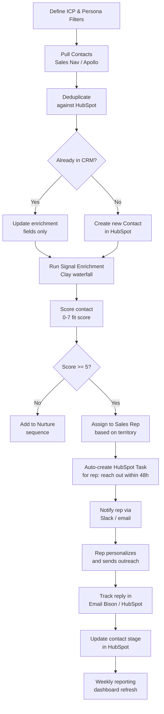

# GTM Workflow Design Execution

**Assignment**: Sep 4th — GTM Workflow Design Execution  
**Course**: GTM Engineering - Cohort 1 (GTME.SCHOOL)  
**Student**: GTM Cohort 1  
**Company Context**: Deccan AI — GenAI data services (training datasets, model evals, annotation)  
**Target Accounts**: AI-first companies like Nvidia building/scaling LLM/agentic products

---

## Objective

Design and document a repeatable workflow that enables a GTM Engineer to systematically identify, enrich, and engage the right personas at high-fit target accounts. The workflow covers:

1. Persona identification at Nvidia-type AI companies
2. Signal-based enrichment
3. HubSpot sync and sales assignment
4. Follow-up and reporting automation

---

## Part 1 — Persona Identification

### Who We're Targeting

Deccan sells GenAI training data, annotation pipelines, and model evaluation services. The buyers are people who *need* high-quality data to build, fine-tune, or validate AI models.

**Primary Personas**

| Persona | Why They Buy | Trigger |
|---|---|---|
| Head of AI/ML (VP, Dir, Lead) | Owns model quality outcomes; accountable for training data gaps | New model launch, benchmark miss |
| LLM Data Acquisition Lead | Directly sources and manages training datasets | Job posting for "data pipeline" roles |
| Head of Engineering (AI/LLM tag) | Manages infra for training runs; needs data at scale | Hiring ML infra engineers |
| AI Program Manager | Coordinates cross-functional model projects; procurement decision-maker | Product launch, partnership announcement |

**Secondary Personas** (loop in later)
- MLOps Lead
- Research Scientist (NLP/CV)
- Director of Data Science

### Keyword Filters for LinkedIn Sales Navigator / Apollo

Search operators to find these personas:

```
title:("Head of AI" OR "VP AI" OR "Director of AI" OR "AI Lead")
title:("LLM" OR "Large Language Model") NOT title:("Sales" OR "Marketing")
title:("Head of Engineering") + keyword:("AI" OR "ML" OR "LLM")
title:("AI Program Manager" OR "ML Program Manager")
keyword:("Gen AI Datasets" OR "Post-training" OR "NLP" OR "Data annotation" 
         OR "Fine-tuning" OR "Model evaluation" OR "Human-in-the-loop" OR "HITL"
         OR "RLHF" OR "Synthetic data")
```

### Account Qualification Criteria

Target accounts must pass at minimum 2 of these:
- Has active job postings for AI/ML engineers (signals active model build)
- Has published a model, paper, or product in the last 6 months
- Headcount growth in AI/ML function >20% YoY
- Company has raised Series B+ or is a public tech company with AI division
- Uses open-source LLM tooling (Hugging Face, vLLM, LangChain) — signals they're building, not just wrapping

### Data Sources & Tools

| Source | Use | Priority |
|---|---|---|
| LinkedIn Sales Navigator | Persona search with title + keyword filters | P0 |
| Apollo.io | Alternative to Sales Nav; cheaper; bulk export | P0 |
| Prospeo | Email enrichment from LinkedIn URL | P0 |
| Clay | Waterfall enrichment; job posting signals; headcount data | P1 |
| Crunchbase | Funding stage, investor base, recent news | P1 |
| Builtwith / G2 / StackShare | Tech stack signals (Hugging Face, Databricks, Snowflake AI) | P2 |

---

## Part 2 — Enrichment

### What We Enrich Per Person

After identifying a persona, we pull the following signals to give sales a reason to reach out and a relevant angle:

**Contact-Level Enrichment**

| Field | Source | Why It Matters |
|---|---|---|
| Verified work email | Prospeo | Required for outreach |
| LinkedIn URL | Apollo / Sales Nav | For manual verification |
| Current title + seniority | Apollo | Confirm persona match |
| Tenure at company | LinkedIn | <6mo = onboarding; >2yr = owner |
| Recent content / posts | Clay Claygent | Talking points |
| Conference talks | Clay Claygent | Personalization hook |

**Account-Level Enrichment**

| Signal | Source | Interpretation |
|---|---|---|
| Active AI/ML job postings | Prospeo / Clay | Building = needs data NOW |
| Product launches (last 90 days) | Crunchbase, news | Good timing for outreach |
| Funding round (last 12 months) | Crunchbase | Budget available |
| AI headcount growth | LinkedIn headcount API / Clay | Scaling = more data needed |
| Tech stack | Builtwith | Databricks / Hugging Face = ICP |

### Enrichment Waterfall (Clay)

```
Step 1: Apollo → get title, company, LinkedIn URL
Step 2: Prospeo → get verified work email from LinkedIn URL
Step 3: Clay Claygent → "What AI products has [company] shipped in last 6 months?"
Step 4: Clay Job Postings → pull active ML/AI roles at the account
Step 5: Clay Headcount → get AI/ML headcount delta (6mo vs 12mo)
Step 6: Score → assign 1–5 fit score based on signals present
```

### Signal Scoring Model

| Signal | Points |
|---|---|
| Active AI job postings (3+) | +2 |
| Product launch in last 90 days | +2 |
| Funding in last 12 months | +1 |
| Persona has published content on data/evals | +1 |
| Tech stack includes Hugging Face / vLLM | +1 |
| Tenure >18 months (owns the problem) | +1 |

**Score 5–7 = High priority (SDR outreach within 48h)**  
**Score 3–4 = Medium (add to sequence)**  
**Score 0–2 = Low (hold for nurture)**

### Structuring Data for Sales

Each record delivered to HubSpot includes:
- One-line "why now" note (auto-generated from signals)
- Top talking point (from enrichment)
- Suggested angle: data quality / scale / evals / annotation

Example output:
> **Why now**: Nvidia posted 8 AI data engineer roles this month and shipped NIM microservices last week.  
> **Angle**: Model evaluation data — they're productionizing fast and need eval pipelines.

---

## Part 3 — Workflow Design

### Full Workflow Map



### HubSpot Field Schema

**New Contact Properties to Create**

| Field Name | Type | Values | Purpose |
|---|---|---|---|
| `gtm_persona_type` | Dropdown | Head of AI, LLM Data Lead, Head of Eng (AI), AI PM | Persona classification |
| `gtm_fit_score` | Number | 0–7 | Signal-based priority score |
| `gtm_why_now` | Text | Auto-populated from enrichment | Sales talking point |
| `gtm_signal_source` | Multi-select | Job posting, Product launch, Funding, Content, Tech stack | What triggered this contact |
| `gtm_enrichment_date` | Date | — | When enrichment was last run |
| `gtm_sales_angle` | Dropdown | Data quality, Scale, Model evals, Annotation, Synthetic data | Recommended pitch angle |
| `gtm_tenure_months` | Number | — | Months at current company |
| `gtm_account_ai_headcount` | Number | — | AI/ML headcount at account |
| `gtm_active_job_postings` | Number | — | Count of active AI job postings |

**Deal Stage Updates**
- `Identified` → `Enriched` → `Assigned` → `Contacted` → `Replied` → `Meeting Booked`

### Deduplication Logic

Before creating a new contact:
1. Check HubSpot by email (exact match)
2. Check by LinkedIn URL (exact match)
3. Check by [first name + last name + company] fuzzy match (Levenshtein distance ≤2)

If duplicate found:
- Update enrichment fields with latest data
- Do NOT create new contact
- Log update in `Notes` with timestamp

### Sales Assignment Rules

| Account Type | Assigned To |
|---|---|
| Enterprise (1000+ employees) | AE pool — round robin |
| Mid-market (100–999) | SDR pool — by territory |
| Startup (<100) | Founder / GTM lead directly |
| Re-engaged (was in CRM >6mo ago) | Original owner, if active |

---

## Part 4 — Follow-Up & Reporting

### Automated Task Creation

When a contact hits `Assigned` stage:
1. HubSpot workflow fires: create Task → `"Reach out to [Name] @ [Company] — [Why Now]"`
2. Task due date: 48 hours from assignment
3. Task description includes: persona type, fit score, why-now note, recommended angle
4. Slack notification to rep: `#sales-queue` channel
5. If task overdue by 24h: escalation email to sales manager

### Follow-Up Sequence (3-touch)

| Touch | Timing | Channel | Content |
|---|---|---|---|
| Touch 1 | Day 0 | Email | Cold open — lead with signal (job posting / launch) |
| Touch 2 | Day 4 | Email | Follow-up — different angle (data quality vs scale) |
| Touch 3 | Day 10 | Email | Soft close — "worth a 15-min call?" |
| Touch 4 | Day 21 | LinkedIn DM | Re-engage if no reply |

If reply at any touch → move to `Replied` stage, notify rep immediately.

### Reporting Dashboard

**Weekly GTM Report (sent every Monday 9am)**

| Metric | Definition | Target |
|---|---|---|
| Personas Identified | New contacts added this week | 50/week |
| Enrichment Rate | % contacts with fit score | >90% |
| High Priority (Score 5+) | % contacts scored 5–7 | >30% |
| Assignment Rate | % high-priority contacts assigned within 48h | >95% |
| Outreach Completion | % assigned contacts contacted | >85% |
| Reply Rate | Replies / emails sent | >8% |
| Meeting Conversion | Meetings / replies | >25% |

**Dashboard Views**
1. **Pipeline Funnel**: Identified → Enriched → Assigned → Contacted → Replied → Meeting
2. **Signal Breakdown**: Which signals are driving the most high-priority contacts
3. **Rep Leaderboard**: Tasks completed, outreach sent, replies received per rep
4. **Account Heatmap**: Which companies have the most high-scoring contacts
5. **Sequence Performance**: Open rate, reply rate, unsubscribe rate per touch

---

## Part 5 — Deliverables Summary

### What This Workflow Produces

1. **Weekly contact list** — 50 net-new high-fit personas, scored and enriched, ready for sales
2. **HubSpot-ready import** — CSV with all custom field values pre-populated
3. **Automated task queue** — Every high-priority contact generates a rep task within minutes of enrichment
4. **Weekly report** — Monday morning metrics digest to GTM lead and founders

### Tech Stack Required

| Layer | Tool | Cost |
|---|---|---|
| Prospecting | LinkedIn Sales Nav or Apollo | $80–150/mo |
| Email enrichment | Prospeo | Credits-based |
| Waterfall enrichment | Clay | $149+/mo |
| CRM | HubSpot (Starter+) | $50+/mo |
| Outreach | Email Bison / Smartlead | $79+/mo |
| Automation | HubSpot Workflows (native) | Included |
| Reporting | HubSpot Dashboards (native) | Included |

### Replication Steps for Any New ICP

1. Update persona filters in Sales Nav / Apollo
2. Update scoring model signals in Clay
3. Update `gtm_sales_angle` dropdown values in HubSpot
4. Update assignment rules if territory changes
5. Adjust sequence copy for new angle

---

## Implementation Notes

**What made this workflow non-obvious:**

- **S4 Staffing accounts**: Job posting signals are the client's requirement, not an internal hire — never reference them in copy to staffing companies
- **Tenure matters**: A persona who joined 3 months ago doesn't own the data pipeline yet — score lower, revisit in 90 days
- **Signal recency decay**: Job postings older than 60 days score 0 for that signal — the trigger window has closed
- **Dedup is critical**: Running the same account through enrichment twice creates duplicate tasks for reps — the dedup check must run before every import

---

*Assignment submitted as part of GTM Engineering Cohort 1 — GTME.SCHOOL*  
*Student: GTM Cohort 1*
